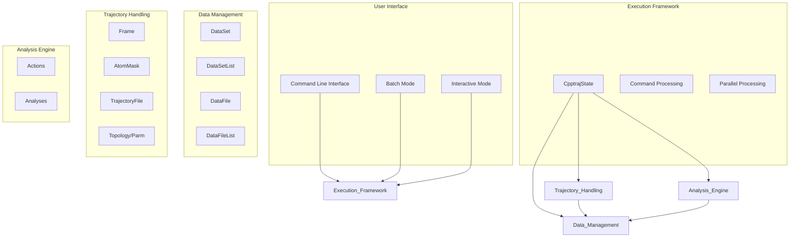
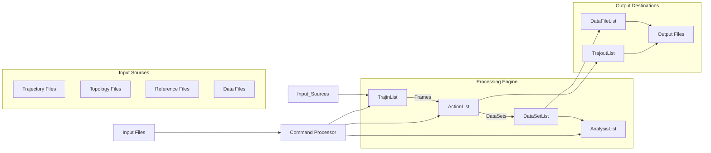
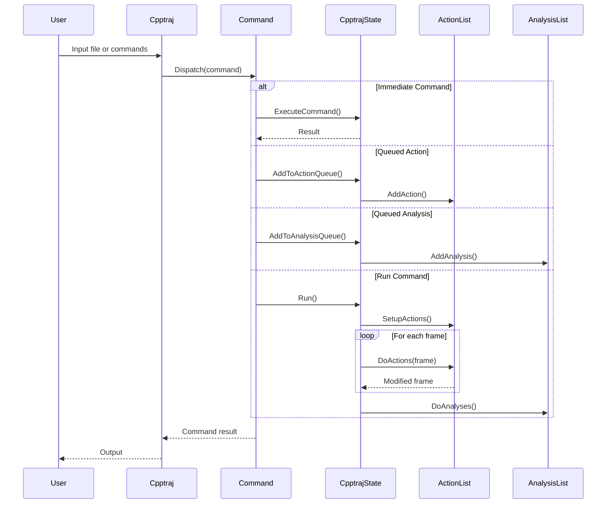
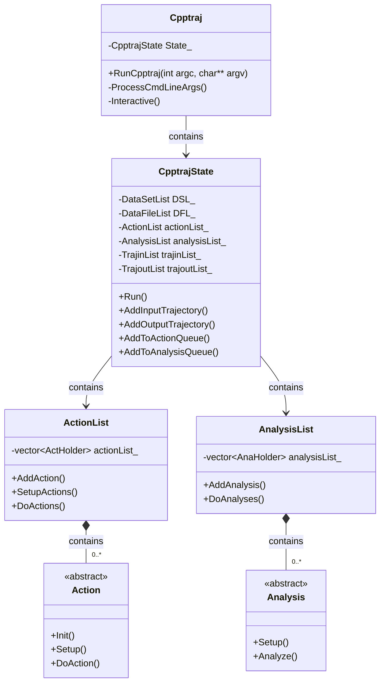
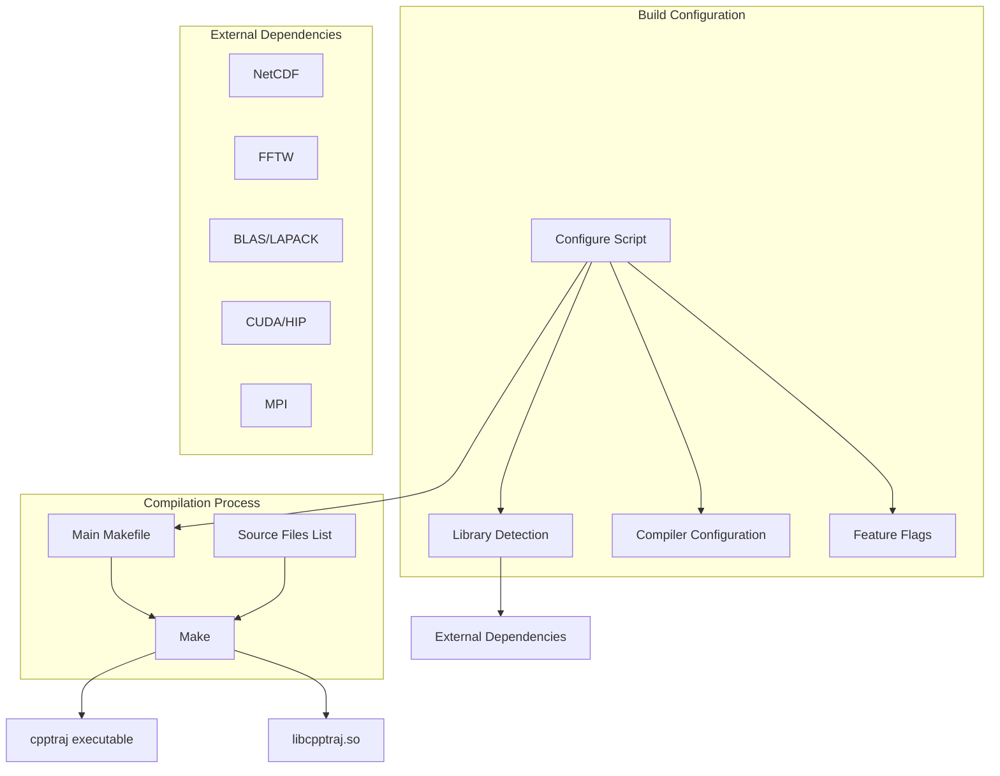

# Overview

Relevant source files

The following files were used as context for generating this wiki page:

- [Jenkinsfile](Jenkinsfile)
- [README.md](README.md)
- [devtools/ci/jenkins/Dockerfile.libcpptraj](devtools/ci/jenkins/Dockerfile.libcpptraj)
- [doc/CpptrajManual.pdf](doc/CpptrajManual.pdf)
- [doc/DocumentChecksums.txt](doc/DocumentChecksums.txt)
- [doc/cpptraj.lyx](doc/cpptraj.lyx)
- [src/Action.h](src/Action.h)
- [src/ActionList.cpp](src/ActionList.cpp)
- [src/ActionList.h](src/ActionList.h)
- [src/Analysis.h](src/Analysis.h)
- [src/AnalysisList.cpp](src/AnalysisList.cpp)
- [src/AnalysisList.h](src/AnalysisList.h)
- [src/Command.cpp](src/Command.cpp)
- [src/Cpptraj.cpp](src/Cpptraj.cpp)
- [src/Cpptraj.h](src/Cpptraj.h)
- [src/CpptrajState.cpp](src/CpptrajState.cpp)
- [src/CpptrajState.h](src/CpptrajState.h)
- [src/Energy/EnergyDecomposer.cpp](src/Energy/EnergyDecomposer.cpp)
- [src/Energy/EnergyDecomposer.h](src/Energy/EnergyDecomposer.h)
- [src/Exec_SequenceAlign.cpp](src/Exec_SequenceAlign.cpp)
- [src/Version.h](src/Version.h)
- [src/cpptrajdepend](src/cpptrajdepend)
- [src/cpptrajfiles](src/cpptrajfiles)
- [src/main.cpp](src/main.cpp)
- [test/Makefile](test/Makefile)
- [test/Test_EneDecomp/RunTest.sh](test/Test_EneDecomp/RunTest.sh)
- [test/Test_EneDecomp/decomp.components.nacl.box.dat.save](test/Test_EneDecomp/decomp.components.nacl.box.dat.save)
- [test/Test_EneDecomp/decomp.components.tz2.dat.save](test/Test_EneDecomp/decomp.components.tz2.dat.save)
- [test/Test_ReadData/RunTest.sh](test/Test_ReadData/RunTest.sh)

CPPTRAJ is a powerful software package designed for processing and analyzing molecular dynamics trajectories. As the successor to PTRAJ, it provides extensive functionality for handling trajectory data from popular MD software packages including Amber, CHARMM, Gromacs, and NAMD. This page provides a high-level overview of CPPTRAJ's architecture, execution flow, and key capabilities.

## Purpose and Scope

CPPTRAJ serves as the main program in Amber for processing coordinate trajectories and data files. It is designed to:

- Read and write trajectory files in various formats
- Process trajectories through customizable actions
- Analyze trajectory data with specialized analysis methods
- Support parallel processing for performance enhancement
- Generate output data in various formats for further analysis or visualization

For information about specific actions and analyses available, see [Key Features](#1.1), and for details about building and installing CPPTRAJ, see [Installation](#2).

Sources: [README.md](), [doc/cpptraj.lyx:98-138]()

## Core Architecture

CPPTRAJ is built around a modular architecture that separates its functionality into distinct subsystems. The main components are organized as shown in the diagram below:

Sources: [src/Cpptraj.h](), [src/CpptrajState.h](), [src/CpptrajState.cpp](), [src/ActionList.h](), [src/AnalysisList.h]()

### Key Components

1. **CpptrajState**: The central state management class that coordinates all operations and holds references to:
   - Input and output trajectories
   - Actions to be performed
   - Analyses to be executed
   - Data sets and data files

2. **Command Processing**: Parses and dispatches commands to appropriate handlers, supporting both immediate execution and queueing actions for later processing.

3. **Action Framework**: Provides a plugin architecture for operations performed on trajectory frames.

4. **Analysis Framework**: Supports post-trajectory processing analyses on collected data.

5. **Data Management System**: Organizes and stores results from actions and analyses.

Sources: [src/CpptrajState.h:11-125](), [src/Command.cpp:216-603]()

## Data Flow Architecture

The following diagram illustrates how data flows through CPPTRAJ during execution:

Sources: [src/ActionList.cpp](), [src/AnalysisList.cpp](), [src/CpptrajState.cpp:452-482]()

## Command Processing and Execution Flow

CPPTRAJ processes commands in a sequence that allows for both immediate execution of some commands and queuing of actions and analyses for later execution:

Sources: [src/Cpptraj.cpp:158-209](), [src/CpptrajState.cpp:452-510](), [src/ActionList.cpp:78-112](), [src/AnalysisList.cpp:42-82]()

## Core Class Relationships

The following diagram shows the key class relationships in CPPTRAJ:

Sources: [src/Cpptraj.h:5-33](), [src/CpptrajState.h:11-125](), [src/ActionList.h:5-40](), [src/AnalysisList.h:4-30](), [src/Action.h:11-65](), [src/Analysis.h:6-38]()

## Running Modes

CPPTRAJ can be run in two primary modes:

### Batch Mode
In batch mode, CPPTRAJ reads commands from an input file (or files) and executes them without user interaction. This is the most common way to use CPPTRAJ for production analysis.

### Interactive Mode
In interactive mode, CPPTRAJ reads commands from the user one at a time, executing them immediately and providing feedback. This mode is useful for testing and exploration.

Additionally, CPPTRAJ supports parallel processing in two major ways:

### OpenMP Parallelization
Many computationally intensive actions and analyses in CPPTRAJ use OpenMP to parallelize calculations across multiple CPU cores within a single node.

### MPI Parallelization
CPPTRAJ can use MPI to distribute work across multiple compute nodes, supporting both:
- Trajectory parallelism (each process handles different frames)
- Ensemble parallelism (each process handles different ensemble members)

Sources: [src/Cpptraj.cpp:158-209](), [src/CpptrajState.cpp:489-510](), [README.md:16-55]()

## Version Information

The current version of CPPTRAJ as shown in the source code is Version 6.29.13.

Sources: [src/Version.h:15]()

## Build System

CPPTRAJ uses a customizable build system with various compilation options:

Sources: [README.md:69-130](), [src/cpptrajfiles:1-626](), [src/Version.h:1-19]()

The CPPTRAJ source code is organized into several main categories:
- Core library functionality
- Command processing and state management
- Actions for trajectory processing
- Analyses for post-trajectory processing
- File I/O interfaces
- Parallel processing utilities

The file structure reflects this organization, with most action implementations in files prefixed with "Action_" and analyses in files prefixed with "Analysis_".

Sources: [src/Command.cpp:1-603](), [src/cpptrajfiles:1-626]()

---