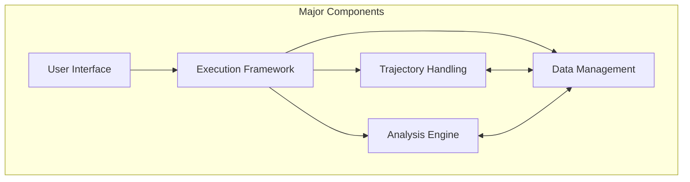
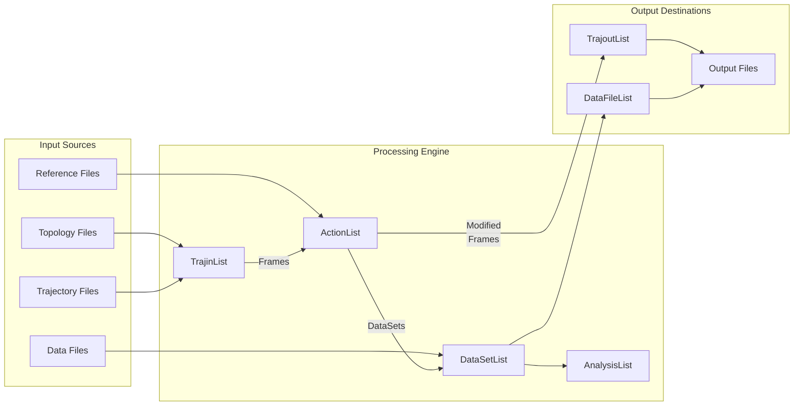
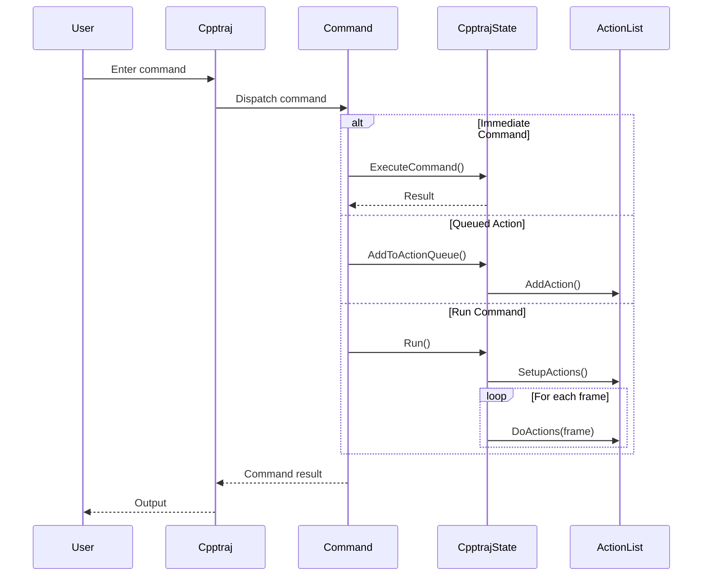
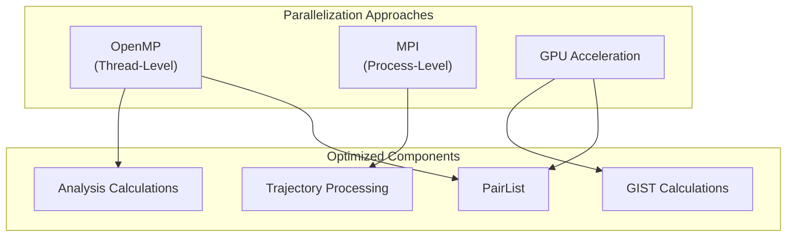
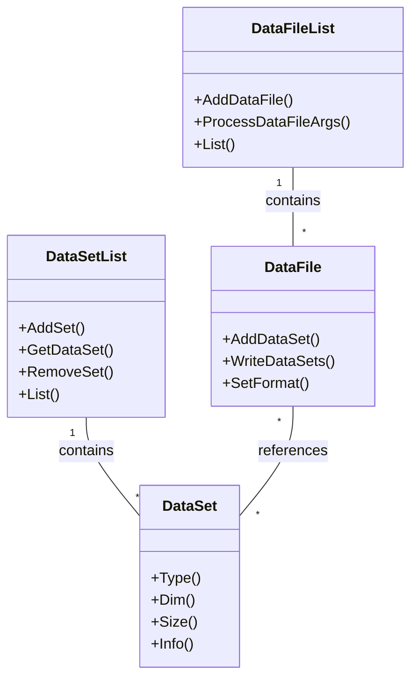

# Key Features

Relevant source files

The following files were used as context for generating this wiki page:

- [doc/CpptrajManual.pdf](doc/CpptrajManual.pdf)
- [doc/DocumentChecksums.txt](doc/DocumentChecksums.txt)
- [doc/cpptraj.lyx](doc/cpptraj.lyx)
- [src/Action_Energy.cpp](src/Action_Energy.cpp)
- [src/Action_Energy.h](src/Action_Energy.h)
- [src/Action_GIST.cpp](src/Action_GIST.cpp)
- [src/Action_GIST.h](src/Action_GIST.h)
- [src/Action_NAstruct.cpp](src/Action_NAstruct.cpp)
- [src/Action_NAstruct.h](src/Action_NAstruct.h)
- [src/Analysis_Clustering.cpp](src/Analysis_Clustering.cpp)
- [src/Analysis_Clustering.h](src/Analysis_Clustering.h)
- [src/AxisType.cpp](src/AxisType.cpp)
- [src/AxisType.h](src/AxisType.h)
- [src/Command.cpp](src/Command.cpp)
- [src/Energy.cpp](src/Energy.cpp)
- [src/Energy.h](src/Energy.h)
- [src/Energy/Ene_Angle.h](src/Energy/Ene_Angle.h)
- [src/Energy/EnergyDecomposer.cpp](src/Energy/EnergyDecomposer.cpp)
- [src/Energy/EnergyDecomposer.h](src/Energy/EnergyDecomposer.h)
- [src/PairList.cpp](src/PairList.cpp)
- [src/PairList.h](src/PairList.h)
- [src/Version.h](src/Version.h)
- [src/cpptrajdepend](src/cpptrajdepend)
- [src/cpptrajfiles](src/cpptrajfiles)
- [test/Makefile](test/Makefile)
- [test/Test_EneDecomp/RunTest.sh](test/Test_EneDecomp/RunTest.sh)
- [test/Test_EneDecomp/decomp.components.nacl.box.dat.save](test/Test_EneDecomp/decomp.components.nacl.box.dat.save)
- [test/Test_EneDecomp/decomp.components.tz2.dat.save](test/Test_EneDecomp/decomp.components.tz2.dat.save)
- [test/Test_GIST/Gist10-Info.dat.save](test/Test_GIST/Gist10-Info.dat.save)
- [test/Test_GIST/Gist3-output.dat.save](test/Test_GIST/Gist3-output.dat.save)
- [test/Test_GIST/Gist4-Info.dat.save](test/Test_GIST/Gist4-Info.dat.save)
- [test/Test_GIST/Gist4-Solute-Etot-pme-dens.dx.save](test/Test_GIST/Gist4-Solute-Etot-pme-dens.dx.save)
- [test/Test_GIST/Gist5-Info.dat.save](test/Test_GIST/Gist5-Info.dat.save)
- [test/Test_GIST/Gist5-Solute-Etot-pme-dens.dx.save](test/Test_GIST/Gist5-Solute-Etot-pme-dens.dx.save)
- [test/Test_GIST/Gist6.out.save](test/Test_GIST/Gist6.out.save)
- [test/Test_GIST/Gist7.out.save](test/Test_GIST/Gist7.out.save)
- [test/Test_GIST/RunTest.sh](test/Test_GIST/RunTest.sh)
- [test/Test_GIST/gist.out.save](test/Test_GIST/gist.out.save)
- [test/Test_GIST_Order/gist-order-norm.dx.save](test/Test_GIST_Order/gist-order-norm.dx.save)
- [test/Test_GIST_Order/gistout.dat.save](test/Test_GIST_Order/gistout.dat.save)
- [test/Test_GIST_Order/test_gist-center.crd](test/Test_GIST_Order/test_gist-center.crd)
- [test/Test_GIST_Order/test_gist.prmtop](test/Test_GIST_Order/test_gist.prmtop)
- [test/Test_GIST_Order/tip4p.dat.save](test/Test_GIST_Order/tip4p.dat.save)
- [test/Test_GIST_Order/tip4pew.cluster.parm7](test/Test_GIST_Order/tip4pew.cluster.parm7)
- [test/Test_GIST_Order/tip4pew.cluster.rst7](test/Test_GIST_Order/tip4pew.cluster.rst7)
- [test/Test_GIST_Order/tip5p.cluster.parm7](test/Test_GIST_Order/tip5p.cluster.parm7)
- [test/Test_GIST_Order/tip5p.cluster.rst7](test/Test_GIST_Order/tip5p.cluster.rst7)
- [test/Test_GIST_Order/tip5p.dat.save](test/Test_GIST_Order/tip5p.dat.save)
- [test/Test_NAstruct/RunTest.sh](test/Test_NAstruct/RunTest.sh)
- [test/Test_NAstruct/SS.mol1.dat.save](test/Test_NAstruct/SS.mol1.dat.save)
- [test/Test_NAstruct/SS.mol1.selected.dat.save](test/Test_NAstruct/SS.mol1.selected.dat.save)
- [test/Test_NAstruct/axes.bases.pdb.save](test/Test_NAstruct/axes.bases.pdb.save)
- [test/Test_NAstruct/axes.bp.mol2.save](test/Test_NAstruct/axes.bp.mol2.save)
- [test/Test_NAstruct/axes.step.crd.save](test/Test_NAstruct/axes.step.crd.save)
- [test/Test_NAstruct/axes.step.parm7.save](test/Test_NAstruct/axes.step.parm7.save)
- [test/Test_ReadData/RunTest.sh](test/Test_ReadData/RunTest.sh)

This document provides an overview of the key features and capabilities of CPPTRAJ, the main program in Amber for processing and analyzing molecular dynamics (MD) trajectories. For information about installing CPPTRAJ, see [Installation](#2).

## General Overview

CPPTRAJ is a comprehensive software package for the analysis of molecular dynamics simulation data. It offers a robust set of tools for processing trajectory files, calculating structural properties, and performing advanced analyses on simulation results.

Sources: [src/cpptrajdepend:1-14](). [doc/cpptraj.lyx:93-137]().

## Trajectory and Topology Support

CPPTRAJ can process trajectories from multiple formats simultaneously and supports different topology files in a single run. This flexibility is particularly valuable when analyzing simulations performed with different force fields or simulation packages.

Key capabilities include:

- Support for numerous trajectory formats including:
  - Amber NetCDF, ASCII, and Restart formats
  - CHARMM DCD and Restart formats
  - Gromacs TRX, XTC, and TNG
  - PDB, Mol2, and other common formats
- Multiple trajectory and topology handling in a single run
- Frame alignment, filtering, and modification operations
- Flexible output options with format determined by file extension

Sources: [src/cpptrajdepend:410-610](). [doc/cpptraj.lyx:138-182]().

## Command Processing

CPPTRAJ employs a flexible command-processing system that supports both interactive and batch modes of operation. Commands can be immediate (executed when entered) or queued (processed during a run).

Sources: [src/Command.cpp:216-478](). [doc/cpptraj.lyx:638-780]().

## Comprehensive Analysis Capabilities

CPPTRAJ offers over 120 different analysis commands (Actions and Analyses) for processing and analyzing molecular dynamics data, including:

| Category | Examples |
|----------|----------|
| Structural Analysis | RMSD, distances, angles, dihedrals, hydrogen bonds |
| Coordinate Transformations | Alignment, centering, imaging, rotations |
| Energetic Analysis | Bond, angle, dihedral, non-bonded energy calculations |
| Statistical Analysis | Histograms, correlation functions, clustering |
| Specialized Analyses | Grid-based analyses (GIST), nucleic acid structure analysis (NAstruct) |

```mermaid
graph TD
    subgraph "Analysis Types"
        Actions["Actions"]
        Analyses["Analyses"]
    end
    
    subgraph "Action Categories"
        Transformations["Coordinate Transformations"]
        PropertyCalc["Property Calculations"]
        StructAnalysis["Structural Analysis"]
        Filtering["Filtering Operations"]
        EnergyCalc["Energy Calculations"]
        NAAnalysis["Nucleic Acid Analysis"]
    end
    
    subgraph "Analysis Categories"
        Clustering["Clustering"]
        Statistics["Statistical Analysis"]
        Correlation["Correlation Analysis"]
        GIST["Grid-Based Analysis"]
    end
    
    Actions --> Transformations
    Actions --> PropertyCalc
    Actions --> StructAnalysis
    Actions --> Filtering
    Actions --> EnergyCalc
    Actions --> NAAnalysis
    
    Analyses --> Clustering
    Analyses --> Statistics
    Analyses --> Correlation
    Analyses --> GIST
    
    Transformations --> |"Examples"| RM["RMS-Fit"]
    Transformations --> |"Examples"| ROT["Rotate"]
    Transformations --> |"Examples"| TR["Translate"]
    
    PropertyCalc --> |"Examples"| DIST["Distance"]
    PropertyCalc --> |"Examples"| ANG["Angle"]
    PropertyCalc --> |"Examples"| DIH["Dihedral"]
    
    StructAnalysis --> |"Examples"| RMSD["RMSD"]
    StructAnalysis --> |"Examples"| SURF["Surface"]
    StructAnalysis --> |"Examples"| RGYRD["Radius of Gyration"]
    
    EnergyCalc --> |"Examples"| ENER["Energy"]
    
    NAAnalysis --> |"Examples"| NAST["NAstruct"]
    
    Clustering --> |"Examples"| HIER["Hierarchical"]
    Clustering --> |"Examples"| KMEANS["K-Means"]
    
    GIST --> |"Examples"| GISTC["GIST"]
```

Sources: [src/Command.cpp:70-469](). [test/Makefile:1-549](). [src/cpptrajfiles:1-627]().

### Specialized Analysis Modules

#### Grid Inhomogenous Solvation Theory (GIST)

GIST is a sophisticated method for analyzing water thermodynamics and structure in molecular systems. It provides detailed insights into:

- Solvent density distributions
- Translational and orientational entropy
- Solvent-solvent and solute-solvent energetics
- Water structure and ordering

GIST calculations can be accelerated using GPU capabilities when available.

Sources: [src/Action_GIST.cpp:1-135](). [src/Action_GIST.h:1-138](). [test/Test_GIST/RunTest.sh:1-12]().

#### Nucleic Acid Structure Analysis (NAstruct)

NAstruct provides comprehensive analysis of nucleic acid structure, including:

- Base pairing and stacking geometries
- Helical parameters
- Sugar pucker conformations
- Backbone torsion angles

The module implements standard conventions for nucleic acid structural analysis from the literature.

Sources: [src/Action_NAstruct.cpp:1-78](). [src/Action_NAstruct.h:1-138](). [src/AxisType.cpp:1-32](). [src/AxisType.h:1-30](). [test/Test_NAstruct/RunTest.sh:1-6]().

#### Clustering

CPPTRAJ provides extensive clustering capabilities for analyzing conformational ensembles:

- Multiple clustering algorithms (hierachical, k-means, DBSCAN)
- Various distance metrics (RMSD, distance-based measures)
- Cluster analysis and visualization tools
- Representative structure selection

Sources: [src/Analysis_Clustering.cpp:1-75](). [src/Analysis_Clustering.h:1-19]().

#### Energy Calculations

CPPTRAJ can perform detailed energy calculations on trajectory frames:

- Bond, angle, and dihedral energies
- Van der Waals and electrostatic interactions
- Various electrostatic methods (simple, Ewald, PME)
- Energy decomposition by residue or atom group

Sources: [src/Action_Energy.cpp:1-75](). [src/Action_Energy.h:1-20](). [src/Energy.cpp:1-57]().

## Performance Features

CPPTRAJ leverages several technologies to enhance performance:

- **OpenMP Parallelization**: Many actions are parallelized using OpenMP for multi-core processors
- **MPI Implementation**: Ensemble-level parallelism for processing multiple trajectories simultaneously
- **GPU Acceleration**: Selected operations (GIST, PairList) can utilize GPU resources
- **Optimized Algorithms**: Efficient spatial decomposition methods for non-bonded calculations (PairList)

Sources: [src/PairList.cpp:1-25](). [src/PairList.h:1-13](). [doc/cpptraj.lyx:156-163]().

## Data Management

CPPTRAJ features a flexible data management system that allows for the storage, manipulation, and visualization of analysis results:

- **DataSet**: Core container for analysis results (various types: scalar, vector, matrix, grid)
- **DataSetList**: Collection of DataSets generated during analysis
- **DataFile**: Controls output formatting for DataSets
- **DataFileList**: Manages multiple output files

Users can manipulate data using mathematical expressions, filter based on properties, and export in various formats.

Sources: [doc/cpptraj.lyx:257-268](). [src/cpptrajdepend:170-246]().

## Additional Features

- **File Compression Support**: Almost any file read or written by CPPTRAJ can be compressed/decompressed on-the-fly
- **Format Flexibility**: Output format can be specified by file extension (e.g., `.agr` for xmgrace format)
- **Multiple Output Trajectories**: Several output trajectories can be written during action processing
- **Reference Structure Handling**: Multiple reference structures can be used for analysis
- **Scripting Capabilities**: Internal looping constructs and variables for complex analysis workflows
- **Mask Selection Syntax**: Powerful atom selection syntax for specifying regions of interest

Sources: [doc/cpptraj.lyx:138-290](). [src/Command.cpp:454-469]().

## Extensibility

CPPTRAJ is designed to be extensible, allowing developers to add new functionality through:

- Custom Actions for trajectory processing
- Custom Analyses for data processing
- Support for new file formats
- Integration with other computational chemistry tools

The codebase follows object-oriented principles with clear inheritance hierarchies for the major components.

Sources: [src/cpptrajfiles:401-627](). [doc/cpptraj.lyx:700-756]().

---