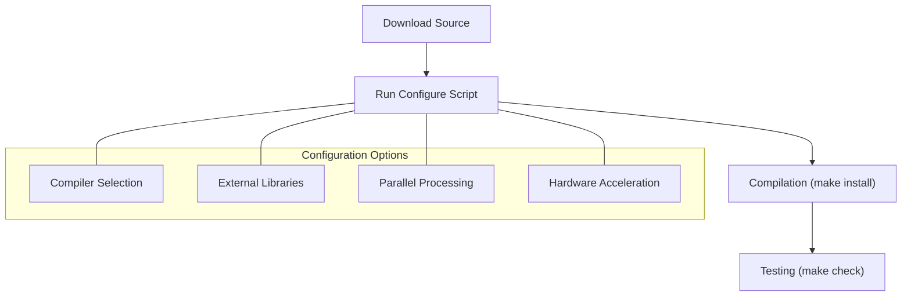
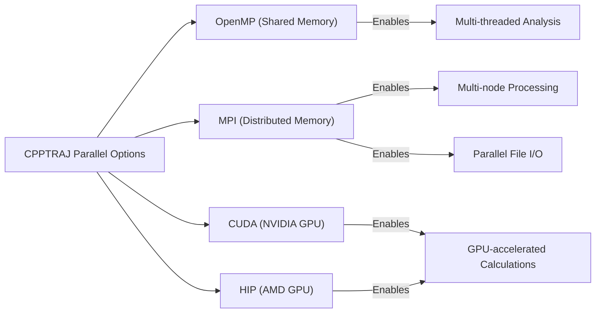
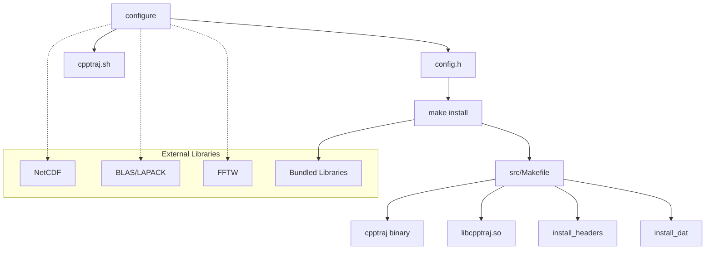

# Installation

<details>
<summary>Relevant source files</summary>

The following files were used as context for generating this wiki page:

- [.github/workflows/merge-gate.yml](.github/workflows/merge-gate.yml)
- [Jenkinsfile](Jenkinsfile)
- [Makefile](Makefile)
- [README.md](README.md)
- [configure](configure)
- [devtools/ci/environment.yml](devtools/ci/environment.yml)
- [devtools/ci/jenkins/Dockerfile.libcpptraj](devtools/ci/jenkins/Dockerfile.libcpptraj)
- [doc/Makefile](doc/Makefile)
- [get_library.sh](get_library.sh)
- [src/Action_AtomMap.cpp](src/Action_AtomMap.cpp)
- [src/Action_AtomMap.h](src/Action_AtomMap.h)
- [src/Exec_SequenceAlign.cpp](src/Exec_SequenceAlign.cpp)
- [src/Makefile](src/Makefile)
- [src/tng/Makefile](src/tng/Makefile)
- [test/Test_AtomMap/ADD.names.mol2](test/Test_AtomMap/ADD.names.mol2)
- [test/Test_AtomMap/remap.ADD.mol2.save](test/Test_AtomMap/remap.ADD.mol2.save)
- [test/Test_AtomMap/template-base-adenine.pdb](test/Test_AtomMap/template-base-adenine.pdb)

</details>


This page explains how to build and install CPPTRAJ from source. CPPTRAJ uses a flexible build system that supports various compilers, external libraries, and hardware acceleration options.

## Overview

CPPTRAJ uses a configure/make build system by default, with optional CMake support. The installation process typically involves these steps:

1. Configure the build with desired options
2. Compile the source code
3. Test the installation (recommended)



Sources: [configure:1-109](), [Makefile:1-46](), [README.md:67-75]()

## Prerequisites

Before installing CPPTRAJ, ensure you have the following:

- C and C++ compilers (GCC, Intel, Clang, PGI, or Cray)
- Fortran compiler (for certain features)
- Build tools: make, ar, etc.

### Required and Optional Libraries

CPPTRAJ makes use of several external libraries for full functionality:

| Library | Required | Purpose |
|---------|----------|---------|
| NetCDF  | Yes      | File I/O for trajectory data |
| BLAS    | Yes      | Linear algebra operations |
| LAPACK  | Yes      | Matrix operations |
| Gzip    | No       | Compressed file support |
| Bzip2   | No       | Compressed file support |
| FFTW    | No       | Fast Fourier transforms (required for PME) |
| Parallel NetCDF | No | Parallel NetCDF trajectory output (only with MPI) |
| CUDA    | No       | NVIDIA GPU acceleration |
| HIP     | No       | AMD GPU acceleration |

CPPTRAJ also bundles these libraries:
- ARPACK (diagonalization of sparse matrices)
- helPME (particle mesh Ewald calculations)
- XDR (reading GROMACS XTC trajectories)
- TNG (reading GROMACS TNG trajectories)

Sources: [README.md:72-93](), [configure:219-246]()

## Basic Installation

The simplest way to install CPPTRAJ with default options:

```bash
./configure gnu
make install
make check
```

This will configure CPPTRAJ with the GNU compiler toolchain, compile it, and run tests to verify the installation.

### Installing With Automatic Library Building

If your system is missing required libraries, CPPTRAJ can download and build them automatically:

```bash
./configure --buildlibs gnu
make install
make check
```

The `--buildlibs` option tells CPPTRAJ to automatically install any missing enabled libraries into `$CPPTRAJHOME`.

Sources: [README.md:95-103](), [configure:7-16](), [get_library.sh:1-246]()

## Configuration Options

CPPTRAJ's `configure` script offers many options to customize the build. You can see a basic list with `./configure --help` or a full list with `./configure --full-help`.

### Compiler Selection

Specify a compiler suite by adding one of these options at the end of your configure command:

```bash
./configure gnu     # GNU compilers (default)
./configure intel   # Intel compilers
./configure clang   # Clang compilers
./configure pgi     # PGI compilers
./configure cray    # Cray compiler wrappers
./configure oneapi  # Intel oneAPI compilers
```

### Installation Location

By default, CPPTRAJ installs in the current directory. To specify a different location:

```bash
./configure --prefix=/path/to/install gnu
```

This will install binaries to `/path/to/install/bin`, libraries to `/path/to/install/lib`, and include files to `/path/to/install/include`.

### Specifying External Libraries

Use these options to specify library locations:

```bash
./configure --with-netcdf=/path/to/netcdf \
            --with-blas=/path/to/blas \
            --with-lapack=/path/to/lapack gnu
```

Alternatively, disable libraries you don't need:

```bash
./configure -nobzlib -nozlib gnu
```

If you have Amber installed and `$AMBERHOME` is set, you can use its libraries:

```bash
./configure -amberlib gnu
```

Sources: [configure:44-109](), [configure:429-476](), [README.md:105-129]()

## Parallel Computing Options

CPPTRAJ supports several forms of parallelization:



### OpenMP Support

Enable shared-memory parallelism with:

```bash
./configure -openmp gnu
```

When running with OpenMP, set the `OMP_NUM_THREADS` environment variable to control the number of threads.

### MPI Support

For distributed computing across multiple nodes:

```bash
./configure -mpi gnu
```

This will use `mpicc` and `mpicxx` for compilation. For Intel MPI, use `-intelmpi` instead.

### GPU Acceleration

For NVIDIA GPU acceleration:

```bash
./configure -cuda gnu
```

Set `CUDA_HOME` to your CUDA installation directory and `SHADER_MODEL` to match your GPU architecture (e.g., "sm_80").

For AMD GPU acceleration:

```bash
./configure -hip gnu
```

You can combine parallel options, for example:

```bash
./configure -openmp -mpi -cuda gnu
```

Sources: [configure:183-189](), [configure:183-189](), [README.md:109-129]()

## Building Shared Libraries

To build CPPTRAJ as a shared library (useful for Python bindings like pytraj):

```bash
./configure -shared gnu
make libcpptraj
```

This will create `libcpptraj.so` (or equivalent) that can be linked against by other programs.

Sources: [src/Makefile:54-67](), [README.md:131-134]()

## Build System Architecture

The CPPTRAJ build system includes several key components:



The configuration process generates `config.h` which contains platform-specific defines and compiler flags. The main makefile then includes this file to set up the compilation environment.

The build system can automatically download and build missing libraries using the `get_library.sh` helper script.

Sources: [configure:111-182](), [src/Makefile:1-44](), [get_library.sh:9-80]()

## Testing Your Installation

After installation, run the test suite to verify everything works correctly:

```bash
make check
```

For more verbose test output:

```bash
make verbosecheck
```

If you built with parallel options, you can test those specifically:

```bash
# With OpenMP
make -e OPT=openmp verbosecheck

# With MPI
make -e DO_PARALLEL='mpiexec -n 2' verbosecheck

# With CUDA
make -e OPT=cuda verbosecheck
```

Sources: [Makefile:23-28](), [.github/workflows/merge-gate.yml:41-125](), [Jenkinsfile:44-190]()

## Common Issues and Troubleshooting

### Missing Libraries

If you encounter errors about missing libraries during configure, you can either:

1. Install the required libraries on your system
2. Use `--buildlibs` to have CPPTRAJ download and build them
3. Disable the libraries with `-no<library>` options

### Compilation Errors

- Check that your compiler versions are compatible
- Look for error messages in the build output
- Try building with debugging information: `./configure -debug gnu`

### MPI Issues

- Ensure MPI compilers (`mpicc`, `mpicxx`) are in your PATH
- For Intel MPI, use `-intelmpi` instead of `-mpi`
- You can have CPPTRAJ download and build MPI with `BUILD_MPI='mpich'`

Sources: [configure:477-508](), [README.md:95-103]()

## Advanced Configuration

For specialized builds, many additional options are available:

- `-debug`: Enable compiler debugging information
- `-noopt`: Disable compiler optimizations
- `-static`: Use static linking
- `-libstatic`: Use static linking only for specified libraries
- `-mkl`: Use Intel MKL for BLAS/LAPACK
- `-openblas`: Use OpenBLAS for BLAS/LAPACK
- `-profile`: Enable profiling

For complete details, run:

```bash
./configure --full-help
```

Sources: [configure:30-109](), [README.md:126-129]()

---