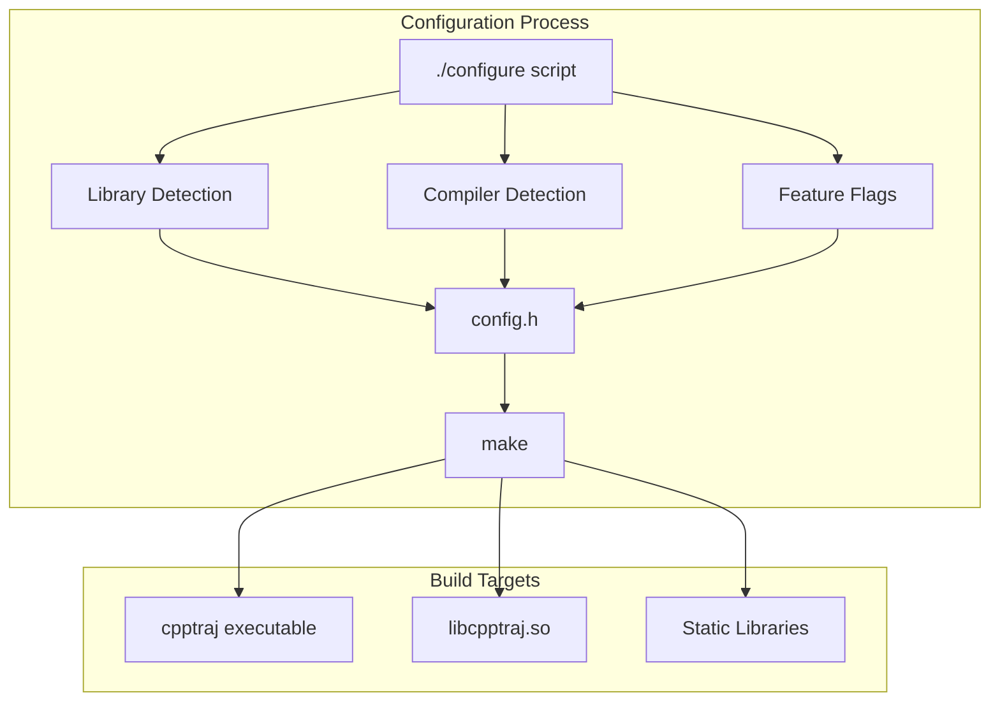
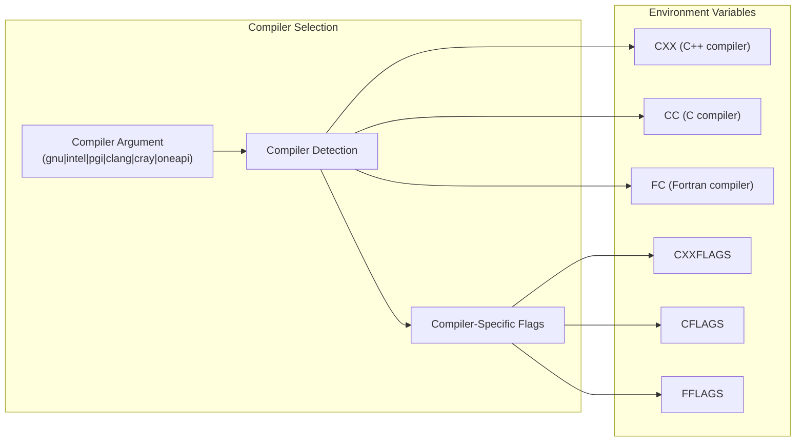
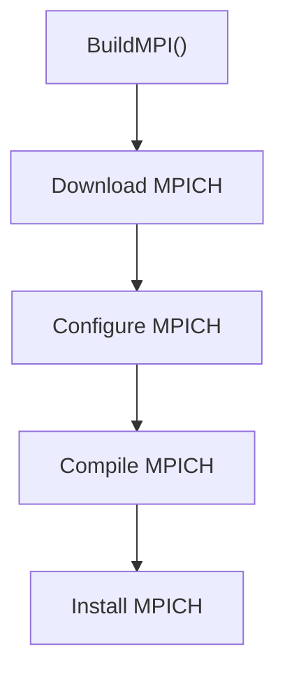
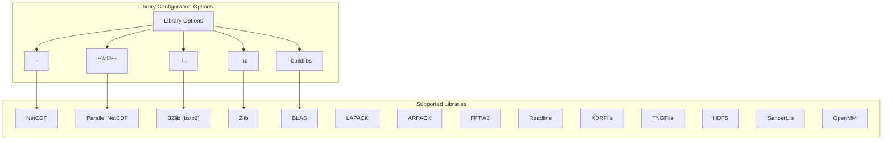

# Build Configuration Options

<details>
<summary>Relevant source files</summary>

The following files were used as context for generating this wiki page:

- [.github/workflows/merge-gate.yml](.github/workflows/merge-gate.yml)
- [Makefile](Makefile)
- [configure](configure)
- [devtools/ci/environment.yml](devtools/ci/environment.yml)
- [doc/Makefile](doc/Makefile)
- [get_library.sh](get_library.sh)
- [src/Action_AtomMap.cpp](src/Action_AtomMap.cpp)
- [src/Action_AtomMap.h](src/Action_AtomMap.h)
- [src/Makefile](src/Makefile)
- [src/tng/Makefile](src/tng/Makefile)
- [test/Test_AtomMap/ADD.names.mol2](test/Test_AtomMap/ADD.names.mol2)
- [test/Test_AtomMap/remap.ADD.mol2.save](test/Test_AtomMap/remap.ADD.mol2.save)
- [test/Test_AtomMap/template-base-adenine.pdb](test/Test_AtomMap/template-base-adenine.pdb)

</details>


This page documents the various compilation options available when building CPPTRAJ from source. It covers compiler selection, optimization flags, external library integration, and feature toggles to help you build CPPTRAJ optimally for your computational environment. For information about the general installation process, see [Installation](#2).

## Overview of the Build System

CPPTRAJ uses a custom configuration script (`configure`) to generate a `config.h` file, which is then used by the build system (Make or CMake) to compile the source code. The configuration process detects required libraries, sets compiler flags, and enables or disables various features based on user preferences.



Sources: [configure:1-109](), [Makefile:1-46]()

## Basic Usage

The configuration script is run from the main CPPTRAJ directory. The basic syntax is:

```
./configure [OPTIONS] [COMPILER]
```

Where `[COMPILER]` is one of: `gnu`, `intel`, `pgi`, `clang`, `cray`, or `oneapi`.

### Essential Options

| Option | Description |
|--------|-------------|
| `--help` | Display basic help message |
| `--full-help` | Display additional options |
| `--prefix <dir>` | Install CPPTRAJ to specified directory (default: current directory) |
| `-openmp` | Enable OpenMP parallelization |
| `-mpi` | Use MPI for parallel processing |
| `-cuda` | Enable CUDA GPU acceleration |
| `-hip` | Enable HIP GPU acceleration |
| `-cray` | Use Cray compiler wrappers |
| `-amberlib` | Use BLAS/ARPACK/LAPACK/NetCDF libraries from AMBERHOME |
| `-cmake` | Use CMake instead of Make |

Sources: [configure:13-27]()

## Compiler Selection

CPPTRAJ supports several compiler suites, each with specific optimizations and features. The compiler selection is specified as the last argument to the `configure` script.



Sources: [configure:67-81]()

### Setting Compiler Environment Variables

You can override the default compiler selection by setting environment variables:

| Variable | Description |
|----------|-------------|
| `CXX` | Name of the C++ compiler |
| `CC` | Name of the C compiler |
| `FC` | Name of the Fortran compiler |
| `MPICXX` | Name of MPI C++ compiler |
| `MPICC` | Name of MPI C compiler |
| `MPIF90` | Name of MPI Fortran compiler |
| `CXXFLAGS` | Additional flags for the C++ compiler |
| `CFLAGS` | Additional flags for the C compiler |
| `FFLAGS` | Additional flags for the Fortran compiler |
| `LDFLAGS` | Additional flags for the linker |

Sources: [configure:67-78](), [.github/workflows/merge-gate.yml:60-65]()

## Optimization Options

CPPTRAJ provides several options to control optimization level and debugging information.

| Option | Description |
|--------|-------------|
| `-debug` | Turn on compiler debugging info |
| `-noopt` | Disable compiler optimizations |
| `-tune` | Enable host-specific compiler optimizations |
| `-d` | Enable debugging and disable optimization (equivalent to `-debug -noopt`) |
| `TUNEFLAGS` | Environment variable for host-specific tuning flags |
| `DBGFLAGS` | Additional flags to pass to all compilers |

Sources: [configure:34-39](), [configure:78-81]()

## Parallelization Options

CPPTRAJ supports multiple forms of parallelization to accelerate processing on multi-core CPUs and clusters.

### OpenMP

OpenMP is used for shared-memory parallelization on multi-core systems:

```
./configure -openmp [COMPILER]
```

When running CPPTRAJ with OpenMP, you can control the number of threads with:

```bash
export OMP_NUM_THREADS=N  # Where N is the number of threads
```

Sources: [configure:18](), [.github/workflows/merge-gate.yml:66-73]()

### MPI

MPI (Message Passing Interface) is used for distributed memory parallelization across multiple nodes:

```
./configure -mpi [COMPILER]      # Standard MPI
./configure -intelmpi [COMPILER] # Intel MPI
```

When using MPI, you'll need to run CPPTRAJ with the appropriate MPI launcher:

```bash
mpirun -np N cpptraj [arguments]  # Where N is the number of processes
```

Sources: [configure:19-20](), [.github/workflows/merge-gate.yml:76-95]()

### Building MPI from Source

If MPI is not available on your system, CPPTRAJ can download and build it:



Sources: [configure:478-508](), [.github/workflows/merge-gate.yml:76-95]()

## GPU Acceleration

CPPTRAJ supports GPU acceleration through both CUDA (NVIDIA GPUs) and HIP (AMD GPUs).

### CUDA Support

To enable CUDA support:

```
./configure -cuda [COMPILER]
```

Important environment variables for CUDA:

| Variable | Description |
|----------|-------------|
| `CUDA_HOME` | Path to CUDA installation |
| `NVCC` | Name of the NVIDIA CUDA compiler |
| `NVCCFLAGS` | Flags to pass to the NVCC compiler |
| `SHADER_MODEL` | CUDA compute architecture (e.g., `sm_70` for Volta GPUs) |

Sources: [configure:21-22](), [configure:82-99]()

### HIP Support

To enable HIP support for AMD GPUs:

```
./configure -hip [COMPILER]
```

Important environment variables for HIP:

| Variable | Description |
|----------|-------------|
| `HIP_HOME` | Path to ROCm installation (default: `/opt/rocm`) |
| `NVCC` | Name of the HIP compiler (e.g., `hipcc`) |
| `NVCCFLAGS` | Flags to pass to the HIP compiler |

Sources: [configure:23](), [configure:83-84]()

## External Library Configuration

CPPTRAJ uses several external libraries. You can control how these libraries are detected and used through various configuration options.



Sources: [configure:47-56](), [configure:219-402]()

### Library Options

| Option | Description |
|--------|-------------|
| `-<lib>` | Enable library |
| `--with-<lib>=<DIR>` | Use library in specified directory |
| `-l<lib>=<FILE>` | Use specified library file |
| `-no<lib>` | Disable library |
| `--buildlibs` | Attempt to build enabled libraries if they are not present |
| `--nobuildlibs` | Do not ask about building enabled libraries |
| `-makenetcdf` | Have CPPTRAJ build its own NetCDF |
| `-makeblas` | Have CPPTRAJ build its own LAPACK/BLAS |
| `--libdir=<dir>` | Look for libraries in specified directory |

Sources: [configure:47-56]()

### Supported Libraries

| Library | Purpose |
|---------|---------|
| `netcdf` | Reading/writing NetCDF trajectory files |
| `pnetcdf` | Writing NetCDF trajectories with MPI |
| `zlib` | Compression support |
| `bzlib` | Bzip2 compression support |
| `blas` | Basic Linear Algebra Subprograms |
| `lapack` | Linear Algebra Package |
| `arpack` | Arnoldi package (for clustering, etc.) |
| `fftw3` | Fast Fourier Transform library |
| `readline` | Command-line editing capabilities |
| `sanderlib` | Interface with Amber's sander library |
| `xdrfile` | Reading/writing XTC/TRR files |
| `tng` | Reading/writing TNG files |
| `hdf5` | HDF5 support for NetCDF4 |
| `openmm` | Interface with OpenMM library |

Sources: [configure:219-402]()

### Building Libraries

CPPTRAJ can download and build required libraries if they're not available on your system:

```
./configure --buildlibs [COMPILER]
```

Specific libraries can be built with:

```
./configure -makenetcdf [COMPILER]  # Build NetCDF
./configure -makeblas [COMPILER]    # Build BLAS/LAPACK
```

Sources: [configure:52-53](), [get_library.sh:1-247]()

## Math Library Options

CPPTRAJ supports several BLAS/LAPACK implementations, which can be selected with specific options:

| Option | Description |
|--------|-------------|
| `-mkl` | Use Intel MKL for BLAS/LAPACK (requires MKL_HOME/MKLROOT set) |
| `-nomklfftw` | Prevent use of FFTW from MKL |
| `-openblas` | Use OpenBLAS for BLAS/LAPACK |
| `-macAccelerate` | Use Accelerate framework for BLAS/LAPACK on macOS |
| `-libsci` | Use Cray LibSci for BLAS/LAPACK |

Sources: [configure:61-66]()

## Installation Options

You can control where CPPTRAJ is installed using the `--prefix` option:

```
./configure --prefix=/path/to/install [COMPILER]
```

This will install:
- Executable: `/path/to/install/bin/cpptraj`
- Library: `/path/to/install/lib/libcpptraj.so` (if built with `-shared`)
- Headers: `/path/to/install/include/` (if built with `-shared`)
- Data files: `/path/to/install/dat/`

Sources: [configure:16](), [src/Makefile:43-85]()

## Build Targets

After configuration, several build targets are available:

| Target | Description | Command |
|--------|-------------|---------|
| Default | Build CPPTRAJ executable | `make install` |
| Library | Build shared library | `make libcpptraj` |
| Static Libraries | Build static libraries | `make libstatic` |
| Tests | Run test suite | `make check` |
| Verbose Tests | Run tests with detailed output | `make verbosecheck` |
| Unit Tests | Run unit tests | `make unittest` |

Sources: [Makefile:6-38]()

## Advanced Configuration Options

### Code Generation Options

| Option | Description |
|--------|-------------|
| `-noc++11` | Disable C++11 support |
| `-nolfs` | Disable large file support |
| `-single-ensemble` | Enable support for reading/writing single ensemble trajectories |

Sources: [configure:38-105]()

### Build Type Options

| Option | Description |
|--------|-------------|
| `-shared` | Configure for generating libcpptraj (implies `-nosanderlib`) |
| `-static` | Use static linking |
| `-libstatic` | Use static linking only for specified libraries |
| `-windows` | Set up for use with MinGW compilers for a native Windows build |

Sources: [configure:43-59]()

### Profiling Options

| Option | Description |
|--------|-------------|
| `-timer` | Enable additional timing info |
| `-debugon` | Add -DDEBUG flag to activate additional internal debugging |
| `-profile` | Use GNU compiler profiling (>= V4.5) |
| `-gprofile` | Use GNU compiler GLIBC profiling (>= V4.5) |
| `-vtune` | Enable options for use with Intel Vtune |

Sources: [configure:41-42](), [configure:102-104]()

## Example Configuration Commands

### Basic Build with GNU Compilers

```bash
./configure gnu
make install
```

### Optimized Build with OpenMP

```bash
./configure -openmp -tune gnu
make install
```

### MPI Parallel Build

```bash
./configure -mpi gnu
make install
```

### CUDA-Enabled Build

```bash
export CUDA_HOME=/usr/local/cuda
export SHADER_MODEL=sm_70
./configure -cuda gnu
make install
```

### Build with Custom Libraries

```bash
./configure --with-netcdf=/opt/netcdf --with-fftw3=/opt/fftw gnu
make install
```

### Build Shared Library

```bash
./configure -shared gnu
make libcpptraj
```

Sources: [.github/workflows/merge-gate.yml:60-126]()

## Troubleshooting

### Common Issues

1. **Missing libraries**: If configure can't find a library, try using `--with-<lib>=<DIR>` to specify its location.
2. **Compiler errors**: Make sure you have the correct compiler version and required development packages installed.
3. **MPI errors**: Ensure MPI compilers are in your PATH or use `--buildlibs` to build MPI.
4. **CUDA errors**: Check that CUDA_HOME is set correctly and you're using a compatible SHADER_MODEL.

### Checking Configuration

After running `configure`, you can examine the generated `config.h` file to see which options were enabled and which libraries were found. This is useful for diagnosing build issues.

### Library Building Process

If you use `--buildlibs`, CPPTRAJ will attempt to download and build libraries automatically. This process is handled by the `get_library.sh` script, which:

1. Downloads library source code
2. Unpacks the archive
3. Configures the library
4. Compiles and installs it to the specified prefix

Sources: [get_library.sh:9-246]()

---