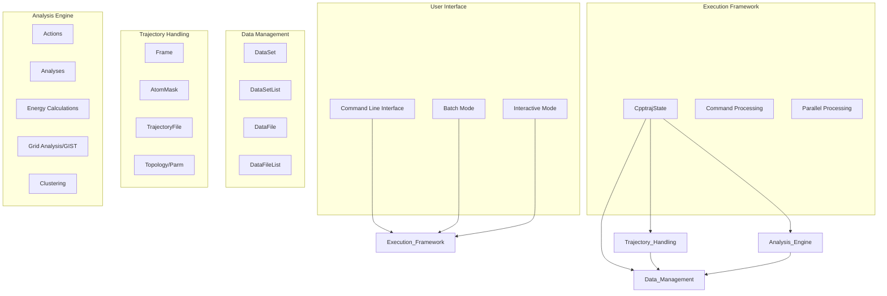
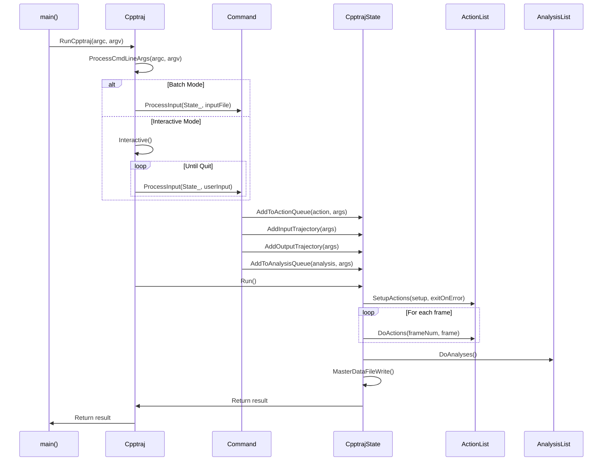
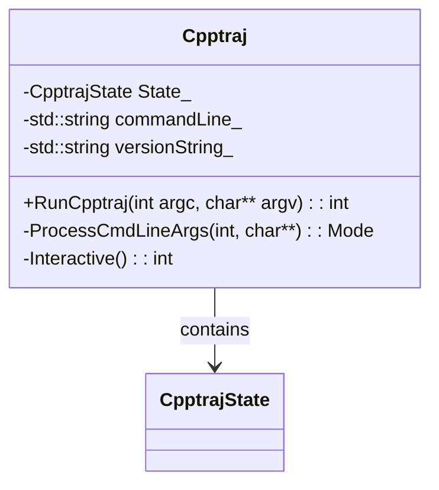
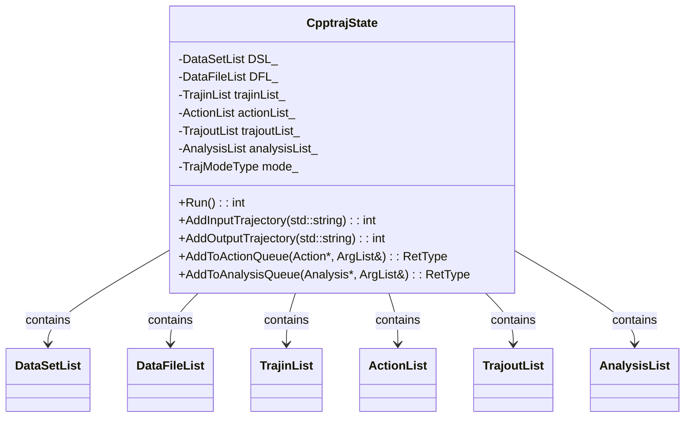
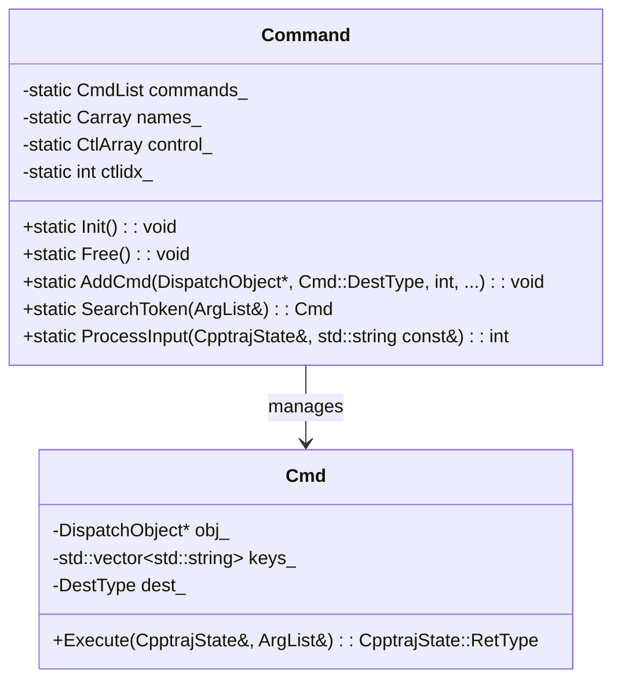
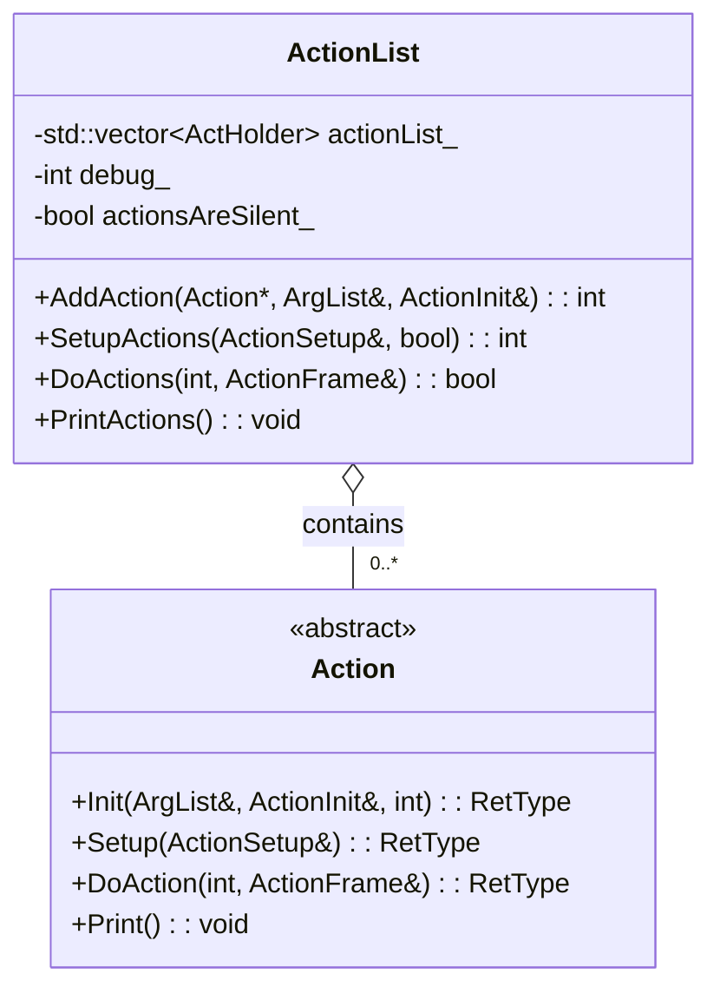
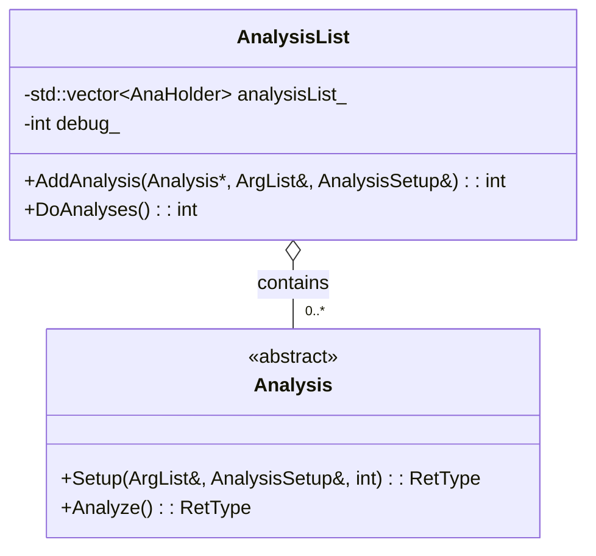
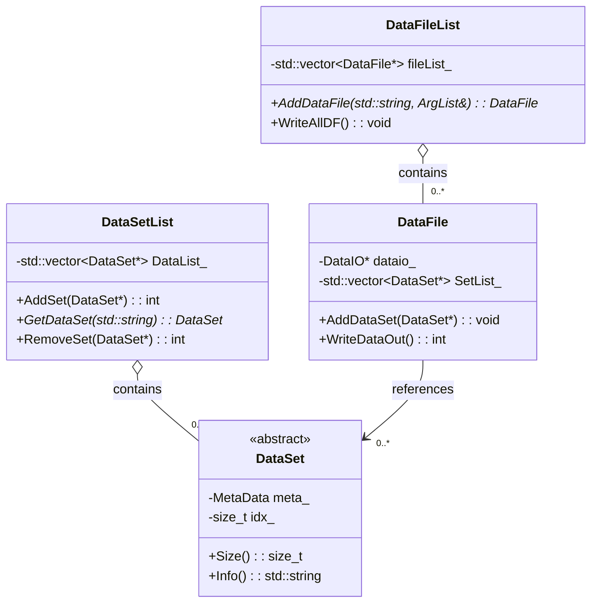
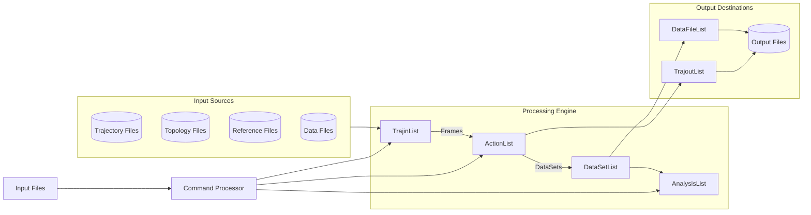
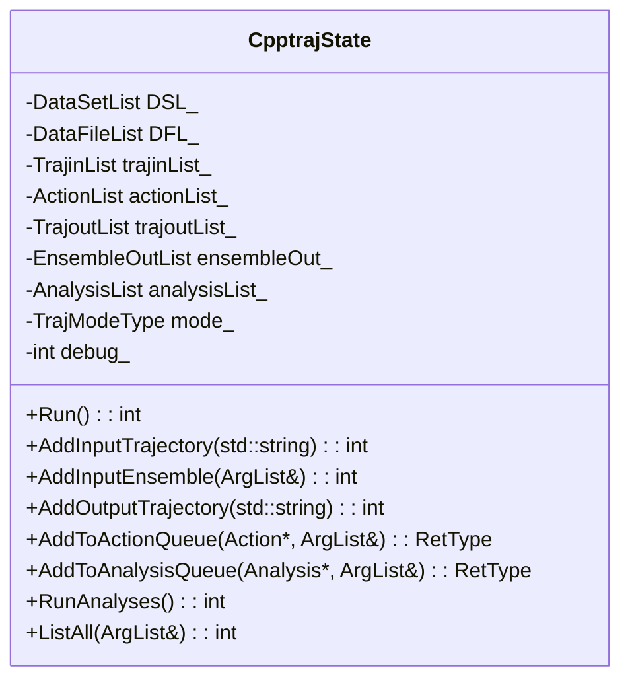

# Core Architecture

<details>
<summary>Relevant source files</summary>

The following files were used as context for generating this wiki page:

- [doc/CpptrajManual.pdf](doc/CpptrajManual.pdf)
- [doc/DocumentChecksums.txt](doc/DocumentChecksums.txt)
- [doc/cpptraj.lyx](doc/cpptraj.lyx)
- [src/Action.h](src/Action.h)
- [src/ActionList.cpp](src/ActionList.cpp)
- [src/ActionList.h](src/ActionList.h)
- [src/Analysis.h](src/Analysis.h)
- [src/AnalysisList.cpp](src/AnalysisList.cpp)
- [src/AnalysisList.h](src/AnalysisList.h)
- [src/Command.cpp](src/Command.cpp)
- [src/Cpptraj.cpp](src/Cpptraj.cpp)
- [src/Cpptraj.h](src/Cpptraj.h)
- [src/CpptrajState.cpp](src/CpptrajState.cpp)
- [src/CpptrajState.h](src/CpptrajState.h)
- [src/Energy/EnergyDecomposer.cpp](src/Energy/EnergyDecomposer.cpp)
- [src/Energy/EnergyDecomposer.h](src/Energy/EnergyDecomposer.h)
- [src/Version.h](src/Version.h)
- [src/cpptrajdepend](src/cpptrajdepend)
- [src/cpptrajfiles](src/cpptrajfiles)
- [src/main.cpp](src/main.cpp)
- [test/Makefile](test/Makefile)
- [test/Test_EneDecomp/RunTest.sh](test/Test_EneDecomp/RunTest.sh)
- [test/Test_EneDecomp/decomp.components.nacl.box.dat.save](test/Test_EneDecomp/decomp.components.nacl.box.dat.save)
- [test/Test_EneDecomp/decomp.components.tz2.dat.save](test/Test_EneDecomp/decomp.components.tz2.dat.save)
- [test/Test_ReadData/RunTest.sh](test/Test_ReadData/RunTest.sh)

</details>


This page details the core architecture and fundamental components of cpptraj, the molecular dynamics trajectory processing and analysis tool. It focuses on how the major subsystems interact with each other to create a flexible, efficient framework for trajectory analysis. For information on specific analysis techniques or commands, see the relevant wiki pages.

## System Overview

Cpptraj's architecture is organized around several key components that work together to process molecular dynamics trajectories. The system follows a modular design that separates command processing, state management, trajectory handling, and analysis functionality.



Sources: [src/Cpptraj.h]()), [src/CpptrajState.h]()), [src/Command.cpp]())

## Control Flow and Execution Model

Cpptraj's execution follows a sequence of command processing, action setup, frame-by-frame processing, and analysis. The main program flow starts with the `main()` function in [src/main.cpp](), which initializes the environment, creates a `Cpptraj` object, and calls `RunCpptraj()`.



Sources: [src/main.cpp]()), [src/Cpptraj.cpp:159-209]()), [src/CpptrajState.cpp:452-527]())

## Key Classes and Components

### Cpptraj Class

The `Cpptraj` class serves as the main entry point and orchestrator for the application. It handles command-line argument processing, manages the program state, and coordinates the overall execution flow.



Sources: [src/Cpptraj.h:9-33]()), [src/Cpptraj.cpp:33-208]())

### CpptrajState Class

The `CpptrajState` class is the central component that holds all the state data for the program. It contains lists of data sets, data files, input trajectories, output trajectories, actions, and analyses. It also controls the execution of actions and analyses.



Sources: [src/CpptrajState.h:12-131]()), [src/CpptrajState.cpp:19-32]())

### Command System

The `Command` class is a static class responsible for processing and dispatching commands. It maintains a registry of all available commands and their implementations. When a command is entered, `Command` locates the appropriate handler and executes it.



Sources: [src/Command.cpp:216-478]()), [src/Command.cpp:1-215]())

### Action Framework

The `ActionList` class manages a collection of `Action` objects that process trajectory frames. Each action is initialized, set up for specific topologies, and executed on each frame during trajectory processing.



Sources: [src/ActionList.h:1-61]()), [src/ActionList.cpp:1-181]()), [src/Action.h:1-66]())

### Analysis Framework

The `AnalysisList` class manages a collection of `Analysis` objects that perform post-trajectory processing. Unlike actions that run on each frame, analyses run once after all frames have been processed.



Sources: [src/AnalysisList.h:1-36]()), [src/AnalysisList.cpp:1-91]()), [src/Analysis.h:1-27]())

### Data Management

Cpptraj uses a robust data management system to store and manipulate results from actions and analyses. The key components are `DataSet` (for storing data), `DataSetList` (for managing collections of data sets), `DataFile` (for output file definitions), and `DataFileList` (for managing collections of data files).



Sources: [src/CpptrajState.h:102-104]()), [src/CpptrajState.cpp:371-398]())

## Parallel Processing Framework

Cpptraj supports both OpenMP and MPI for parallel processing. OpenMP is used for intra-frame parallelization (within calculations), while MPI enables inter-frame parallelization (across frames) and ensemble parallelization.

```mermaid
graph TD
    subgraph "Parallelization Modes"
        openmp["OpenMP: Intra-frame parallelism"]
        mpi["MPI: Inter-frame parallelism"]
    end
    
    subgraph "MPI Modes"
        normal["NORMAL Mode"]
        ensemble["ENSEMBLE Mode"]
    end
    
    subgraph "NORMAL Mode"
        proc1n["Process 1: Frames 1-N/P"]
        proc2n["Process 2: Frames N/P+1-2N/P"]
        procpn["Process P: Frames (P-1)N/P+1-N"]
    end
    
    subgraph "ENSEMBLE Mode"
        proc1e["Process 1: Ensemble Member 1, All Frames"]
        proc2e["Process 2: Ensemble Member 2, All Frames"]
        procpe["Process P: Ensemble Member P, All Frames"]
    end
    
    openmp --> "Computations within actions"
    mpi --> normal
    mpi --> ensemble
    
    normal --> proc1n
    normal --> proc2n
    normal --> procpn
    
    ensemble --> proc1e
    ensemble --> proc2e
    ensemble --> procpe
```

Sources: [src/CpptrajState.cpp:92-125]()), [src/CpptrajState.h:126-130]())

## Trajectory Processing Pipeline

The trajectory processing pipeline is a central part of cpptraj's functionality. It involves reading frames from input files, applying actions to each frame, and writing modified frames to output files.



Sources: [src/CpptrajState.cpp:452-527]()), [src/ActionList.cpp:44-76]()), [src/ActionList.cpp:78-112]())

## Command Registration and Dispatch

Cpptraj uses a command registration system where all available commands are registered with the `Command` class during initialization. This registry maps command names to their implementations.

The following table shows the command categories in cpptraj:

| Category | Description | Examples |
|----------|-------------|----------|
| General | General program control | `help`, `exit`, `run` |
| Trajectory | Trajectory input/output | `trajin`, `trajout`, `ensemble` |
| Topology | Topology file operations | `parm`, `strip`, `parmbox` |
| Action | Frame-by-frame operations | `rmsd`, `center`, `image` |
| Analysis | Post-processing analyses | `hist`, `matrix`, `clustering` |
| Control | Script flow control | `for`, `if` |

Sources: [src/Command.cpp:227-478]())

## Memory Management Strategy

Cpptraj employs several strategies to efficiently manage memory, especially important when dealing with large trajectory files:

1. **Frame-by-frame processing**: Rather than loading entire trajectories into memory, cpptraj processes one frame at a time
2. **Data chunking**: Large datasets can be stored in chunks or on disk to reduce memory footprint
3. **Reference sharing**: Common reference structures are shared between actions
4. **Mask optimization**: Atom selection masks are optimized to reduce memory usage

Sources: [src/Frame.cpp]()), [src/CpptrajState.cpp:452-527]())

## Extension Points

Cpptraj is designed to be extensible through several key mechanisms:

1. **Action plugins**: New trajectory processing algorithms can be added by creating new Action classes
2. **Analysis plugins**: New post-processing analyses can be added by creating new Analysis classes
3. **File format support**: New trajectory or data file formats can be added through the I/O subsystem
4. **Command system**: New commands can be registered with the Command system

To add a new Action or Analysis, developers need to:
1. Create a new class inheriting from `Action` or `Analysis`
2. Implement the required virtual methods
3. Register the new class in `Command::Init()` in [src/Command.cpp]()

Sources: [src/Command.cpp:227-478]()), [src/Action.h:10-65]()), [src/Analysis.h:6-26]())

## State Management

The `CpptrajState` class manages the overall state of the program, including all data sets, input/output files, and analysis operations. It serves as the central coordination point for cpptraj's operations.

The following diagram shows the key components managed by `CpptrajState`:



Sources: [src/CpptrajState.h:12-131]()), [src/CpptrajState.cpp:19-32]())

## Conclusion

Cpptraj's core architecture provides a flexible, extensible framework for processing molecular dynamics trajectories. The modular design allows for easy addition of new functionality while maintaining high performance through efficient memory management and parallelization strategies. The command system provides a simple yet powerful interface for users, and the data management system ensures that results can be effectively stored and analyzed.

---