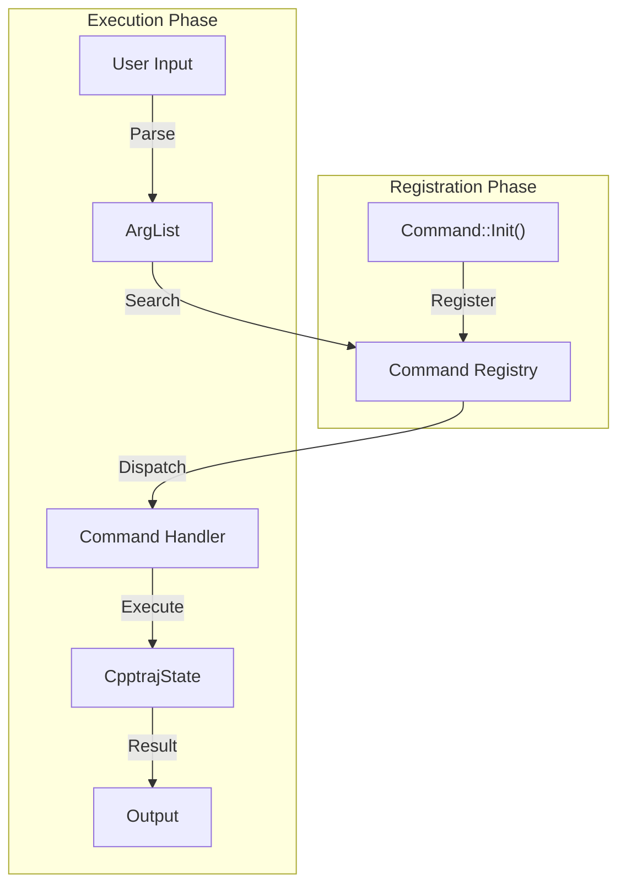
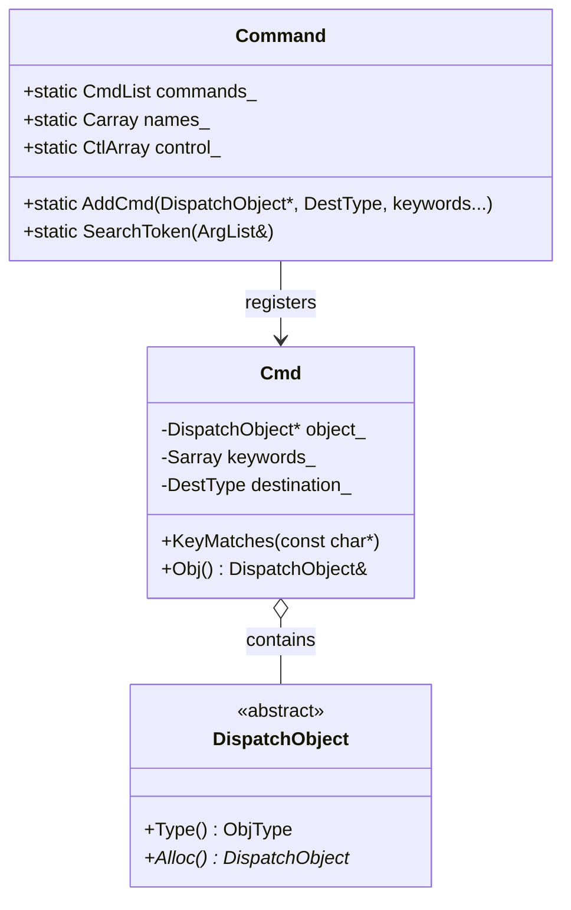
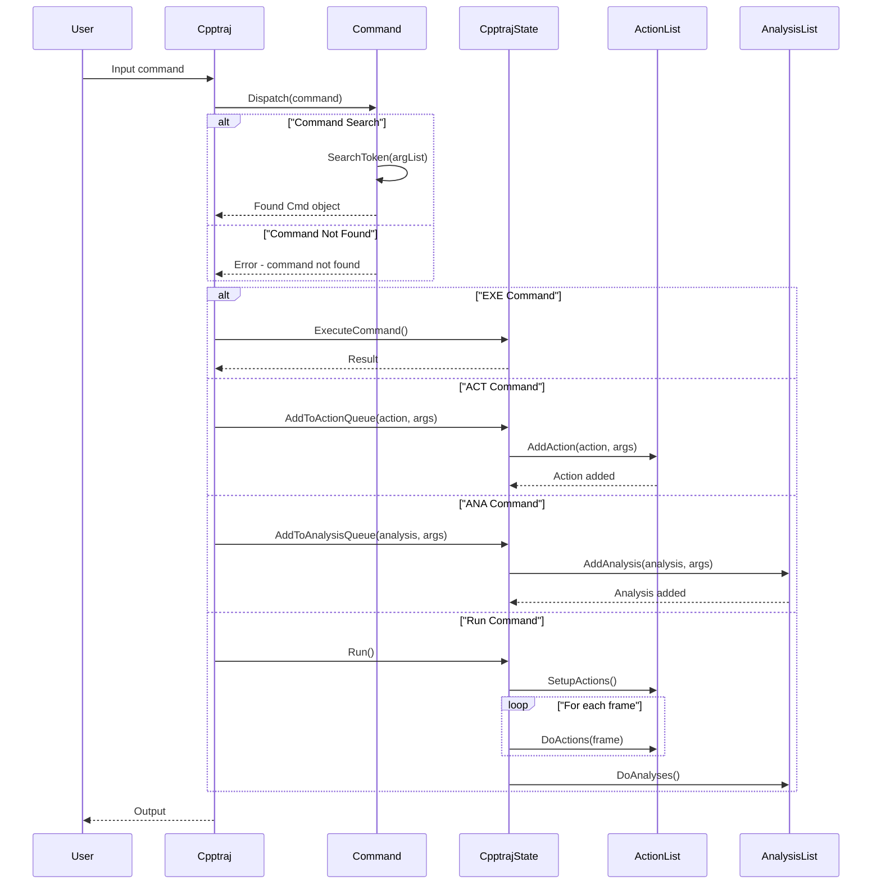
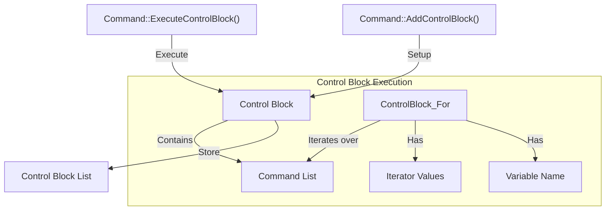
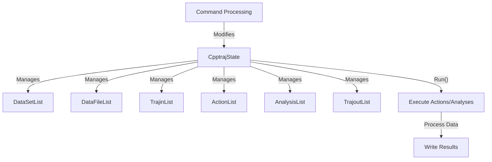

# Command Processing

<details>
<summary>Relevant source files</summary>

The following files were used as context for generating this wiki page:

- [doc/CpptrajManual.pdf](doc/CpptrajManual.pdf)
- [doc/DocumentChecksums.txt](doc/DocumentChecksums.txt)
- [doc/cpptraj.lyx](doc/cpptraj.lyx)
- [src/Action.h](src/Action.h)
- [src/ActionList.cpp](src/ActionList.cpp)
- [src/ActionList.h](src/ActionList.h)
- [src/Analysis.h](src/Analysis.h)
- [src/AnalysisList.cpp](src/AnalysisList.cpp)
- [src/AnalysisList.h](src/AnalysisList.h)
- [src/Command.cpp](src/Command.cpp)
- [src/Cpptraj.cpp](src/Cpptraj.cpp)
- [src/Cpptraj.h](src/Cpptraj.h)
- [src/CpptrajState.cpp](src/CpptrajState.cpp)
- [src/CpptrajState.h](src/CpptrajState.h)
- [src/Energy/EnergyDecomposer.cpp](src/Energy/EnergyDecomposer.cpp)
- [src/Energy/EnergyDecomposer.h](src/Energy/EnergyDecomposer.h)
- [src/Version.h](src/Version.h)
- [src/cpptrajdepend](src/cpptrajdepend)
- [src/cpptrajfiles](src/cpptrajfiles)
- [src/main.cpp](src/main.cpp)
- [test/Makefile](test/Makefile)
- [test/Test_EneDecomp/RunTest.sh](test/Test_EneDecomp/RunTest.sh)
- [test/Test_EneDecomp/decomp.components.nacl.box.dat.save](test/Test_EneDecomp/decomp.components.nacl.box.dat.save)
- [test/Test_EneDecomp/decomp.components.tz2.dat.save](test/Test_EneDecomp/decomp.components.tz2.dat.save)
- [test/Test_ReadData/RunTest.sh](test/Test_ReadData/RunTest.sh)

</details>


The command processing system in CPPTRAJ is responsible for parsing, dispatching, and executing user input commands. This system serves as the bridge between user input (whether from command line arguments, input files, or interactive mode) and the functional components of the application. This page explains how commands are registered, recognized, and executed within the CPPTRAJ codebase.

For information about specific commands available in CPPTRAJ, please refer to the API documentation or the CPPTRAJ user manual.

## Command System Architecture

The command processing system follows a registration-dispatch model where commands are first registered with the system, then later matched against user input and dispatched to appropriate handlers.



The execution pathway depends on the command type and changes the program state differently through various subsystems.

Sources: [src/Command.cpp:227-478](), [src/Command.h]()

## Command Registration

All available commands are registered during initialization via the `Command::Init()` method. Each command is tied to a dispatch object, a destination type, and one or more keywords.



The `Command::AddCmd()` method handles the registration of each command, setting up the appropriate dispatch object, destination type, and keywords.

Sources: [src/Command.cpp:496-515]()

## Command Types and Destination Categories

Commands in CPPTRAJ are categorized based on their destination type, which determines how they are processed:

| Destination | Description | Example Commands |
|-------------|-------------|-----------------|
| `EXE` | Executable commands (immediate execution) | `help`, `list`, `trajin` |
| `ACT` | Action commands (queued for trajectory processing) | `rmsd`, `distance`, `angle` |
| `ANA` | Analysis commands (executed after trajectories) | `histogram`, `clustering` |
| `BLK` | Control block commands (manage execution flow) | `for` |
| `DEP` | Deprecated commands | `donor`, `acceptor` |

This categorization enables CPPTRAJ to handle different types of operations appropriately within its processing framework.

Sources: [src/Command.cpp:227-478]()

## Command Processing Flow

When a user enters a command, it undergoes the following processing sequence:



The flow illustrates how commands are dispatched to different subsystems based on their type, with some executed immediately and others queued for later processing.

Sources: [src/Command.cpp:531-547](), [src/CpptrajState.cpp:159-214](), [src/Cpptraj.cpp:139-209]()

## Command Arguments Processing

Command arguments are handled through the `ArgList` class, which parses raw command strings into structured arguments. The `Command::SearchToken()` method uses the first word in the ArgList as the command name to search for a matching command in the registry.

```
# Example command processing:
rmsd MyRMSD @CA reference
↓
Command: "rmsd"
Arguments: ["MyRMSD", "@CA", "reference"]
↓
Search for "rmsd" command
↓
Create Action_RMSD object
↓
Initialize with arguments
↓
Add to Action Queue
```

This structured approach to argument parsing enables consistent command syntax throughout the application.

Sources: [src/Command.cpp:538-547](), [src/ArgList.cpp]()

## Control Blocks

CPPTRAJ supports control blocks for more complex command sequences, particularly through the `for` loop construct. Control blocks provide programmatic control flow within CPPTRAJ scripts.



Control blocks are managed through `Command::AddControlBlock()` and `Command::ExecuteControlBlock()` methods, allowing for structured iteration and conditional execution.

Sources: [src/Command.cpp:618-698](), [src/ControlBlock_For.cpp]()

## Integration with CpptrajState

Commands ultimately modify the application state maintained in the `CpptrajState` class, which orchestrates the overall execution flow:



The `CpptrajState` class serves as the central coordination point, maintaining all data structures and managing command execution.

Sources: [src/CpptrajState.h:11-131](), [src/CpptrajState.cpp:452-629]()

## Extensibility: Adding New Commands

The command system is designed for extensibility. New commands can be added by:

1. Creating a new class that inherits from `DispatchObject` (typically `Action` or `Analysis`)
2. Implementing the required virtual methods
3. Registering the command in `Command::Init()`

This architecture allows for clean separation between the command processing system and the actual implementation of commands.

Sources: [src/Command.cpp:227-478](), [src/Action.h:1-66](), [src/Analysis.h:1-26]()

By organizing commands into different types and processing them appropriately, CPPTRAJ provides a flexible framework for trajectory analysis while maintaining a consistent command interface.

Sources: [src/Cpptraj.cpp:159-209](), [src/Command.cpp:605-697](), [src/ActionList.cpp:44-76](), [src/AnalysisList.cpp:42-82]()

---