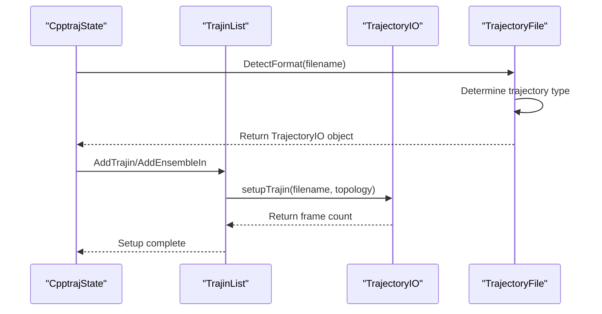
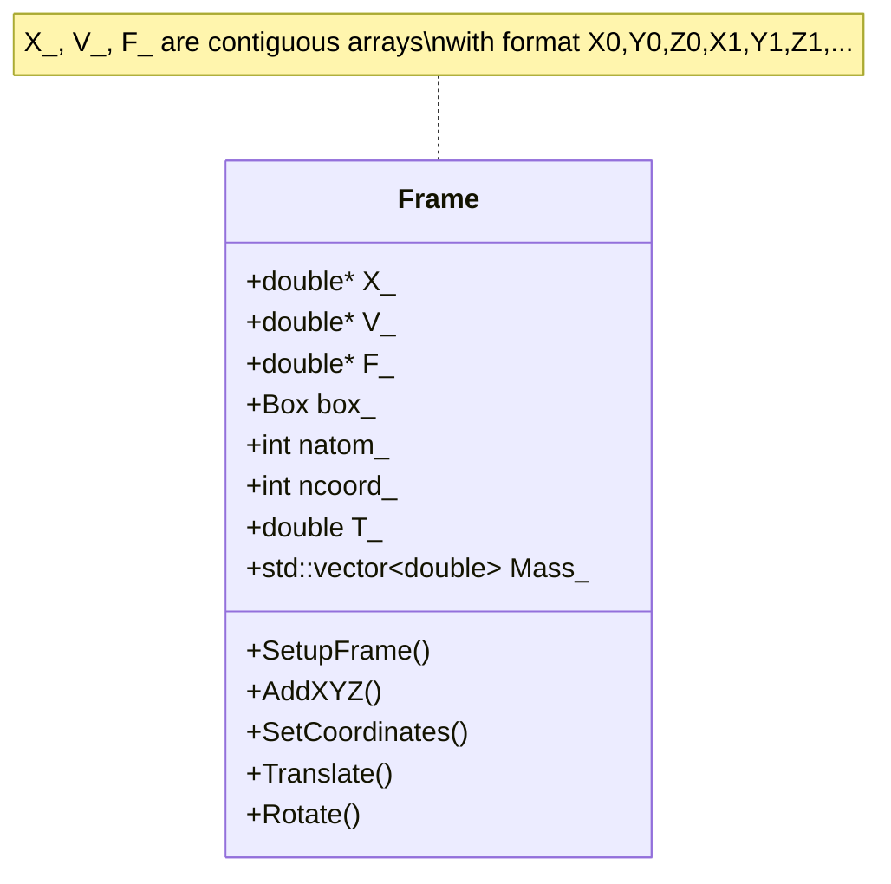
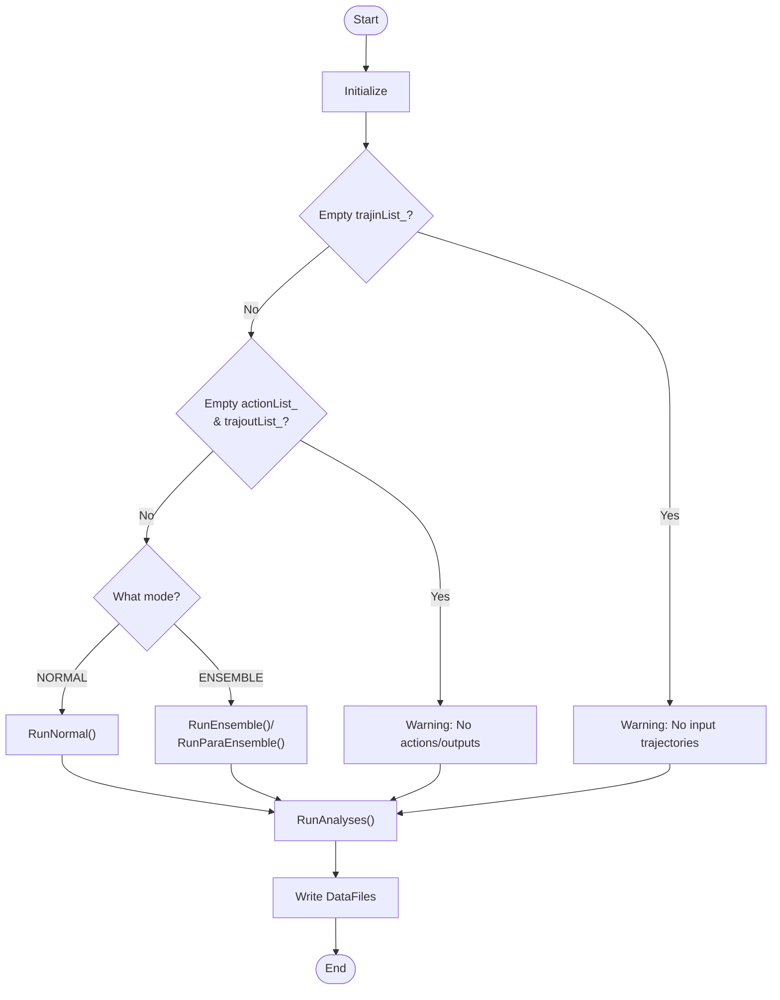
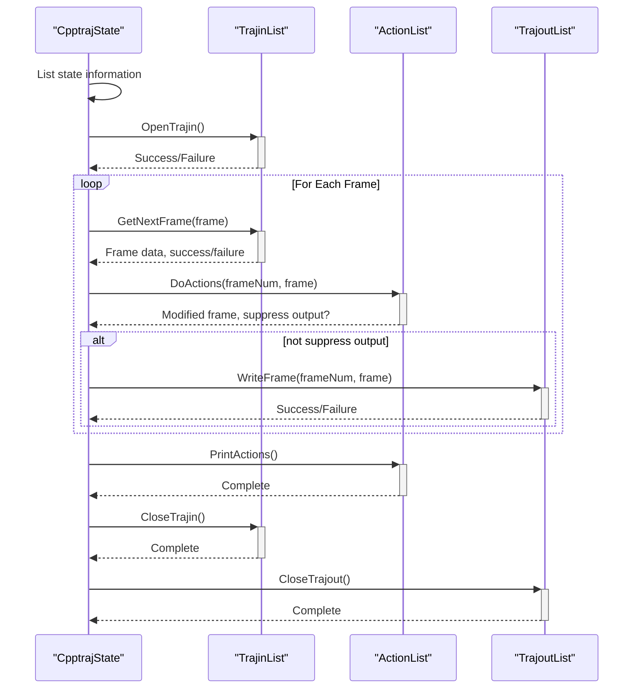
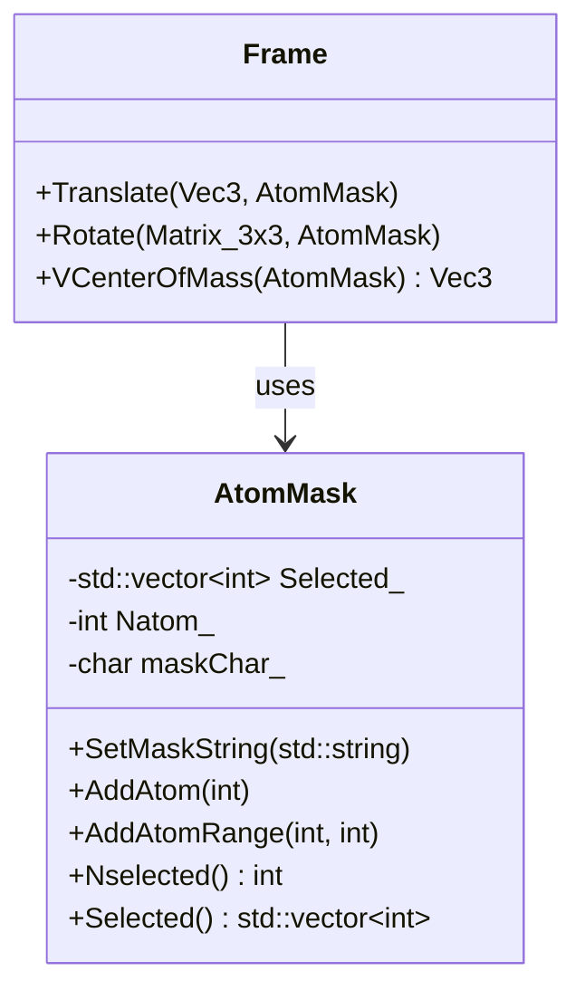
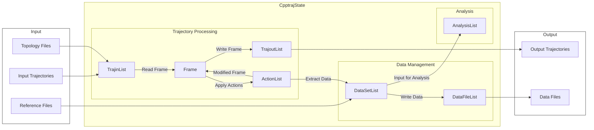
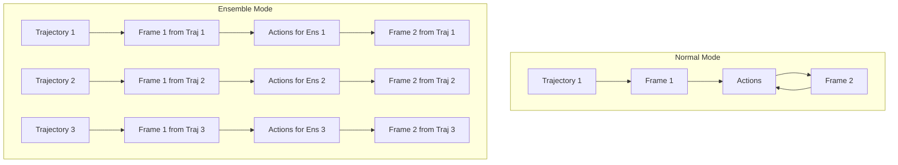

# Trajectory Processing Pipeline

<details>
<summary>Relevant source files</summary>

The following files were used as context for generating this wiki page:

- [src/Action.h](src/Action.h)
- [src/ActionList.cpp](src/ActionList.cpp)
- [src/ActionList.h](src/ActionList.h)
- [src/Action_AtomicFluct.cpp](src/Action_AtomicFluct.cpp)
- [src/Action_AtomicFluct.h](src/Action_AtomicFluct.h)
- [src/Action_Average.cpp](src/Action_Average.cpp)
- [src/Action_Average.h](src/Action_Average.h)
- [src/Action_Outtraj.cpp](src/Action_Outtraj.cpp)
- [src/Action_Outtraj.h](src/Action_Outtraj.h)
- [src/Analysis.h](src/Analysis.h)
- [src/AnalysisList.cpp](src/AnalysisList.cpp)
- [src/AnalysisList.h](src/AnalysisList.h)
- [src/AtomMask.cpp](src/AtomMask.cpp)
- [src/AtomMask.h](src/AtomMask.h)
- [src/Cpptraj.cpp](src/Cpptraj.cpp)
- [src/Cpptraj.h](src/Cpptraj.h)
- [src/CpptrajState.cpp](src/CpptrajState.cpp)
- [src/CpptrajState.h](src/CpptrajState.h)
- [src/Frame.cpp](src/Frame.cpp)
- [src/Frame.h](src/Frame.h)
- [src/TrajectoryFile.cpp](src/TrajectoryFile.cpp)
- [src/TrajectoryFile.h](src/TrajectoryFile.h)
- [src/TrajectoryIO.cpp](src/TrajectoryIO.cpp)
- [src/TrajectoryIO.h](src/TrajectoryIO.h)
- [src/main.cpp](src/main.cpp)

</details>


This document describes the core trajectory processing pipeline in CPPTRAJ, which is responsible for reading, processing, and writing molecular dynamics trajectory data. The pipeline forms the backbone of CPPTRAJ's functionality and enables the application of diverse analyses and transformations to trajectory data.

For information about command processing, see [Command Processing](#3.1). For details on parallelization capabilities, see [Parallelization](#3.3).

## Overview of the Trajectory Processing Pipeline

The CPPTRAJ trajectory processing pipeline follows a three-phase approach:

1. **Setup Phase**: Trajectories, topologies, and actions are prepared
2. **Action Phase**: Frame-by-frame processing of trajectories through actions 
3. **Output Phase**: Final processing and writing of results

The pipeline enables CPPTRAJ to efficiently process large trajectory datasets by handling one frame at a time, rather than loading entire trajectories into memory.

```mermaid
flowchart TB
    subgraph "Setup Phase"
        traj_setup["Setup Trajectories"]
        action_init["Initialize Actions"]
        action_setup["Setup Actions"]
    end
    
    subgraph "Action Phase (Frame Loop)"
        read_frame["Read Frame"]
        do_actions["Process Frame through Actions"]
        write_frame["Write Frame to Output"]
    end
    
    subgraph "Output Phase"
        action_output["Action Output"]
        analysis["Run Analyses"]
        data_output["Write DataSets"]
    end
    
    traj_setup --> action_init --> action_setup
    action_setup --> read_frame
    
    read_frame --> do_actions --> write_frame
    write_frame -->|Next Frame| read_frame
    write_frame -->|All Frames Processed| action_output
    
    action_output --> analysis --> data_output
    
    class "Setup Phase" phase
    class "Action Phase (Frame Loop)" phase
    class "Output Phase" phase
    classDef phase fill:none,stroke:#333,stroke-width:1px
```

Sources: [src/CpptrajState.cpp:452-531](), [src/ActionList.cpp:77-112]()

## Input Trajectory Management

CPPTRAJ can process trajectories in two modes:

1. **NORMAL**: Process a single trajectory at a time
2. **ENSEMBLE**: Process multiple trajectories simultaneously as an ensemble

### Input Trajectory Initialization

Trajectory input is initialized by adding trajectories to the `trajinList_` in the `CpptrajState` class. The `AddInputTrajectory` method handles this initialization:



Sources: [src/CpptrajState.cpp:127-151](), [src/TrajectoryFile.cpp:157-203]()

### Trajectory Format Detection

CPPTRAJ supports numerous trajectory formats through a plugin-like architecture. The `TrajectoryFile::DetectFormat` method attempts to detect the format of a trajectory file:

1. Opens the file
2. For each supported format, creates a corresponding `TrajectoryIO` object
3. Calls `ID_TrajFormat` on each object to see if it recognizes the format
4. Returns the appropriate `TrajectoryIO` object or `nullptr` if no format matches

Sources: [src/TrajectoryFile.cpp:158-180]()

## Frame Structure and Memory Management

A `Frame` object represents a single snapshot of a molecular system. It contains:

- Coordinates (X, Y, Z) for each atom
- Optional velocities and forces
- Box information (unit cell parameters)
- Atom masses
- Metadata (temperature, time, etc.)

### Frame Memory Layout



The `Frame` class uses manual memory management for coordinate data. The coordinate array (X_) is allocated as a contiguous block of memory with format `X0,Y0,Z0,X1,Y1,Z1,...` for efficient calculation and I/O.

Sources: [src/Frame.h:33-313](), [src/Frame.cpp:10-86](), [src/Frame.cpp:371-467]()

## Action Processing Architecture

Actions are operations that can be performed on trajectory frames. The `ActionList` manages a collection of `Action` objects that are applied to each frame in sequence.

### Action Lifecycle

Each action passes through the following stages:

1. **Init**: Parse command line arguments and initialize data structures
2. **Setup**: Prepare the action for a specific topology 
3. **DoAction**: Process a single frame
4. **Print**: Output results after all frames are processed

```mermaid
stateDiagram-v2
    [*] --> "Init" : AddAction()
    "Init" --> "Setup" : SetupActions()
    "Setup" --> "DoAction" : DoActions()
    "DoAction" --> "DoAction" : Next Frame
    "DoAction" --> "Print" : All Frames Processed
    
    "Init" --> INACTIVE : Setup Failure
    "Setup" --> INACTIVE : Setup Error
    "DoAction" --> INACTIVE : Action Error
    
    note right of "Init"
        Parse command arguments
        Initialize datasets
    end note
    
    note right of "Setup"
        Prepare for specific topology
        Can modify topology
    end note
    
    note right of "DoAction"
        Process one frame
        Can modify coordinates
    end note
    
    note right of "Print"
        Output results
        Perform final calculations
    end note
```

Sources: [src/ActionList.cpp:18-40](), [src/ActionList.cpp:44-76](), [src/ActionList.cpp:78-112](), [src/Action.h:10-26]()

### Frame Flow Through Actions

When processing a frame through actions, several special conditions can occur:

1. **Normal**: The frame is processed and passed to the next action
2. **USE_ORIGINAL_FRAME**: The frame is reset to its original state before the next action
3. **SUPPRESS_COORD_OUTPUT**: The remaining actions are skipped and the frame is not written
4. **MODIFY_TOPOLOGY**: The action has modified the topology
5. **MODIFY_COORDS**: The action has modified the coordinates

Sources: [src/ActionList.cpp:78-112](), [src/Action.h:31-39]()

## Main Pipeline Execution

The heart of CPPTRAJ's execution is in the `CpptrajState::Run()` method. This method orchestrates the entire trajectory processing pipeline.



Sources: [src/CpptrajState.cpp:452-531]()

### Frame Processing Loop

The core of the trajectory processing pipeline is in the frame processing loop. This loop:

1. Reads frames from input trajectories
2. Applies actions to each frame
3. Writes modified frames to output trajectories



Sources: [src/CpptrajState.cpp:500-506](), [src/ActionList.cpp:86-111]()

## Frame Selection and Atom Masking

The `AtomMask` class provides a powerful system for selecting subsets of atoms within a frame. Atom masks are used throughout the pipeline to:

1. Apply actions to specific atoms
2. Extract data from specific atoms
3. Output only specific atoms



Sources: [src/AtomMask.h:6-16](), [src/Frame.h:33-39](), [src/AtomMask.cpp:130-172]()

## Trajectory Output

CPPTRAJ can write modified frames to output trajectory files in various formats. The output trajectory system mirrors the input system:

1. Output trajectories are added via `AddOutputTrajectory`
2. During the frame processing loop, modified frames are written to output trajectories
3. Each output trajectory can have its own format and options

Sources: [src/CpptrajState.cpp:153-175](), [src/Action_Outtraj.cpp:16-32]()

## Complete Data Flow

The complete data flow through the trajectory processing pipeline is illustrated below:



Sources: [src/CpptrajState.h:12-131](), [src/CpptrajState.cpp:452-531](), [src/Cpptraj.cpp:158-209]()

## Trajectory Processing Modes

### Normal Mode

In normal mode, CPPTRAJ processes a single trajectory (or multiple trajectories sequentially):

1. For each input trajectory:
   - Open the trajectory
   - For each frame:
     - Read the frame
     - Process through actions
     - Write to output if requested
   - Close the trajectory

### Ensemble Mode

In ensemble mode, CPPTRAJ processes multiple trajectories simultaneously as an ensemble:

1. Open all trajectories in the ensemble
2. For each frame index:
   - Read frames from all trajectories
   - Process each frame through corresponding actions
   - Write ensemble output if requested
3. Close all trajectories



Sources: [src/CpptrajState.cpp:549-796](), [src/CpptrajState.h:16-19]()

## Performance Considerations

The pipeline is designed for efficiency:

1. Frame data is stored in contiguous memory for fast operations
2. Only one frame is in memory at a time (except for specific actions that require multiple frames)
3. The pipeline supports parallel processing via MPI and OpenMP
4. I/O operations use efficient, format-specific implementations

## Extending the Pipeline

To add a new trajectory format to CPPTRAJ:

1. Create a new `TrajectoryIO`-derived class 
2. Add a unique entry to the `TrajFormatType` enum
3. Add entries to the format arrays in `TrajectoryFile.cpp`

To add a new action:

1. Create a new `Action`-derived class implementing the required methods
2. Add the action to the command registration system

Sources: [src/TrajectoryIO.h:23-26](), [src/TrajectoryFile.h:8-16](), [src/Action.h:10-26]()

---