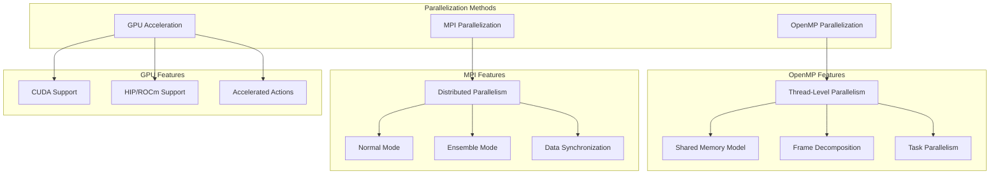
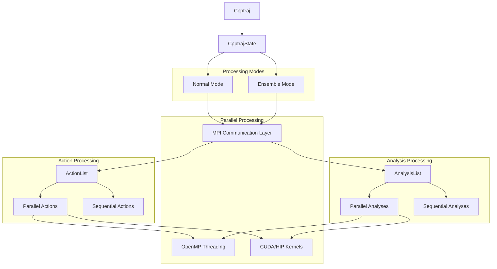
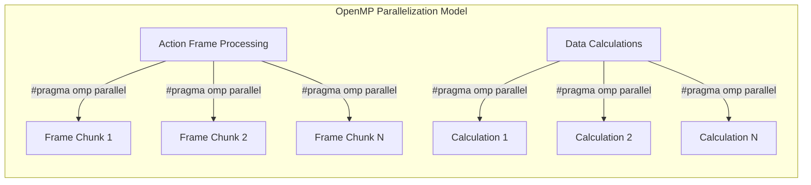
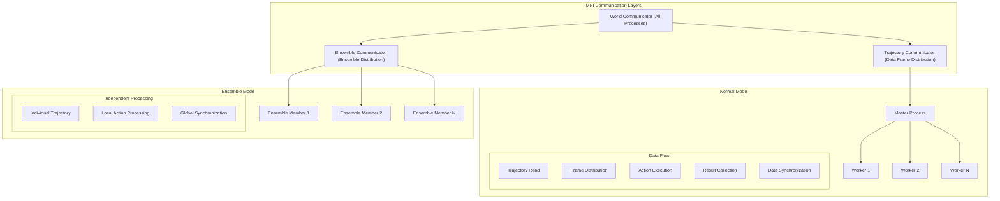
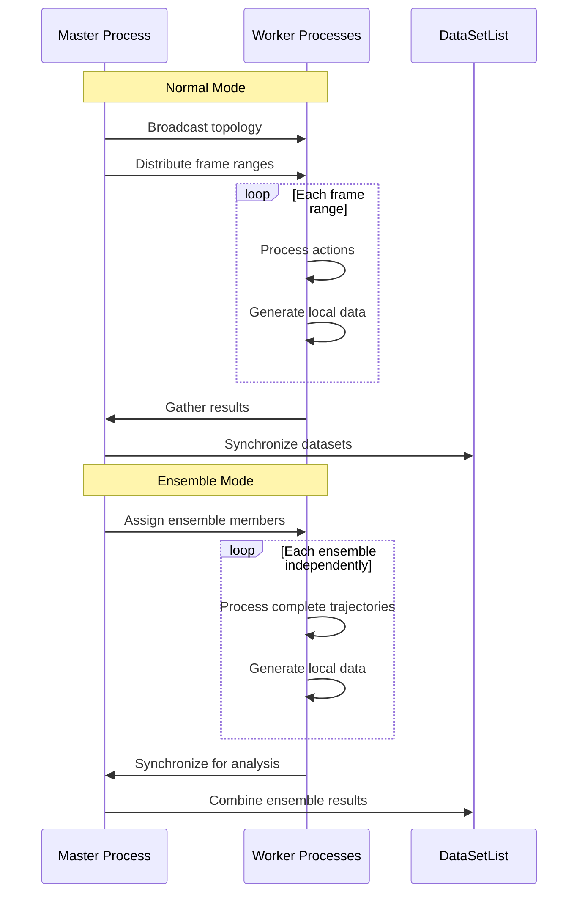
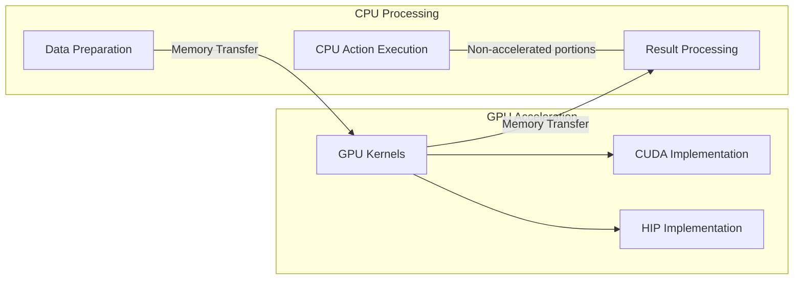

# Parallelization

<details>
<summary>Relevant source files</summary>

The following files were used as context for generating this wiki page:

- [.github/workflows/merge-gate.yml](.github/workflows/merge-gate.yml)
- [Makefile](Makefile)
- [configure](configure)
- [devtools/ci/environment.yml](devtools/ci/environment.yml)
- [doc/CpptrajManual.pdf](doc/CpptrajManual.pdf)
- [doc/DocumentChecksums.txt](doc/DocumentChecksums.txt)
- [doc/Makefile](doc/Makefile)
- [doc/cpptraj.lyx](doc/cpptraj.lyx)
- [get_library.sh](get_library.sh)
- [src/Action.h](src/Action.h)
- [src/ActionList.cpp](src/ActionList.cpp)
- [src/ActionList.h](src/ActionList.h)
- [src/Action_AtomMap.cpp](src/Action_AtomMap.cpp)
- [src/Action_AtomMap.h](src/Action_AtomMap.h)
- [src/Analysis.h](src/Analysis.h)
- [src/AnalysisList.cpp](src/AnalysisList.cpp)
- [src/AnalysisList.h](src/AnalysisList.h)
- [src/Command.cpp](src/Command.cpp)
- [src/Cpptraj.cpp](src/Cpptraj.cpp)
- [src/Cpptraj.h](src/Cpptraj.h)
- [src/CpptrajState.cpp](src/CpptrajState.cpp)
- [src/CpptrajState.h](src/CpptrajState.h)
- [src/Energy/EnergyDecomposer.cpp](src/Energy/EnergyDecomposer.cpp)
- [src/Energy/EnergyDecomposer.h](src/Energy/EnergyDecomposer.h)
- [src/Makefile](src/Makefile)
- [src/Version.h](src/Version.h)
- [src/cpptrajdepend](src/cpptrajdepend)
- [src/cpptrajfiles](src/cpptrajfiles)
- [src/main.cpp](src/main.cpp)
- [src/tng/Makefile](src/tng/Makefile)
- [test/Makefile](test/Makefile)
- [test/Test_AtomMap/ADD.names.mol2](test/Test_AtomMap/ADD.names.mol2)
- [test/Test_AtomMap/remap.ADD.mol2.save](test/Test_AtomMap/remap.ADD.mol2.save)
- [test/Test_AtomMap/template-base-adenine.pdb](test/Test_AtomMap/template-base-adenine.pdb)
- [test/Test_EneDecomp/RunTest.sh](test/Test_EneDecomp/RunTest.sh)
- [test/Test_EneDecomp/decomp.components.nacl.box.dat.save](test/Test_EneDecomp/decomp.components.nacl.box.dat.save)
- [test/Test_EneDecomp/decomp.components.tz2.dat.save](test/Test_EneDecomp/decomp.components.tz2.dat.save)
- [test/Test_ReadData/RunTest.sh](test/Test_ReadData/RunTest.sh)

</details>


This page documents the parallelization capabilities in CPPTRAJ, which includes support for shared-memory (OpenMP), distributed-memory (MPI), and GPU acceleration (CUDA/HIP). Understanding these parallelization options is essential for efficient processing of large trajectory datasets and complex analyses.

For information on executing commands in parallel, see [Parallel Analysis](#3.1) and for performance tuning see [Optimization](#6.2).

## Overview of Parallelization Methods

CPPTRAJ supports three main types of parallelization that can be used independently or in combination:



Sources: [src/Cpptraj.cpp:29-61](https://github.com/Amber-MD/cpptraj), [src/configure:2-109](https://github.com/Amber-MD/cpptraj), [src/Parallel.cpp](https://github.com/Amber-MD/cpptraj)

## Building with Parallelization Support

Each parallelization method requires specific compiler flags and libraries to be enabled during the build process.

### OpenMP Support

OpenMP parallelization is enabled with the `-openmp` flag during configuration:

```bash
./configure -openmp [compiler]
```

This sets up compiler flags for OpenMP support, allowing thread-level parallelism for actions and analyses that support it.

### MPI Support

MPI parallelization is enabled with the `-mpi` flag (for standard MPI implementations) or `-intelmpi` (for Intel MPI):

```bash
./configure -mpi [compiler]
```

### GPU Support

CUDA or HIP support for NVIDIA or AMD GPUs respectively can be enabled with:

```bash
./configure -cuda [compiler]   # For NVIDIA GPUs
./configure -hip [compiler]    # For AMD GPUs
```

The CUDA compute capability can be specified via the `SHADER_MODEL` environment variable.

Sources: [src/configure:11-109](https://github.com/Amber-MD/cpptraj), [src/configure:177-196](https://github.com/Amber-MD/cpptraj)

## Parallelization Architecture

The following diagram illustrates how the different parallelization methods interact within CPPTRAJ:



Sources: [src/Cpptraj.cpp:29-61](https://github.com/Amber-MD/cpptraj), [src/Parallel.cpp](https://github.com/Amber-MD/cpptraj), [src/ActionList.cpp:78-112](https://github.com/Amber-MD/cpptraj), [src/AnalysisList.cpp:42-95](https://github.com/Amber-MD/cpptraj)

## OpenMP Parallelization

OpenMP is used for shared-memory parallelism, primarily within individual actions and analyses. When enabled, CPPTRAJ automatically detects and uses available threads:



Several computationally intensive operations benefit from OpenMP parallelization:

| Feature | Parallelization Method | Performance Impact |
|---------|------------------------|-------------------|
| Frame processing | Frame-level parallelism | High for multiple frames |
| Distance calculations | Loop-level parallelism | High for large systems |
| RMSD calculations | Task-level parallelism | Medium to high |
| Grid-based calculations | Domain decomposition | High for large grids |
| Clustering | Work distribution | Variable by algorithm |

The number of OpenMP threads can be controlled using the standard `OMP_NUM_THREADS` environment variable before running CPPTRAJ.

Sources: [src/Cpptraj.cpp:113-114](https://github.com/Amber-MD/cpptraj), [src/ActionList.cpp:78-112](https://github.com/Amber-MD/cpptraj)

## MPI Parallelization

CPPTRAJ implements two main modes of MPI parallelization:

1. **Normal Mode**: Distributes frames of a single trajectory across multiple processes
2. **Ensemble Mode**: Each process handles a different trajectory from an ensemble

### MPI Communication Architecture



Sources: [src/CpptrajState.cpp:67-125](https://github.com/Amber-MD/cpptraj), [src/CpptrajState.cpp:632-765](https://github.com/Amber-MD/cpptraj)

### MPI Process Flow

The process flow differs significantly between Normal and Ensemble modes:



### Parallel Analysis Considerations

Not all analyses can be parallelized with MPI. The `AnalysisList` class checks if an analysis supports parallelization and adapts accordingly:

```cpp
// For parallel-capable analyses:
if (ana->ptr_->IsParallel()) {
  ret = ana->ptr_->Analyze();
} else {
  // For non-parallel analyses, only run on master:
  if (Parallel::TrajComm().Master())
    ret = ana->ptr_->Analyze();
  else
    ret = Analysis::OK;
  // Broadcast result to other processes
  Parallel::World().MasterBcast(&ret, 1, MPI_INT);
}
```

Data synchronization between processes occurs after action processing to ensure all analyses have access to complete datasets.

Sources: [src/AnalysisList.cpp:42-95](https://github.com/Amber-MD/cpptraj), [src/CpptrajState.cpp:632-765](https://github.com/Amber-MD/cpptraj)

## GPU Acceleration

CPPTRAJ supports GPU acceleration through CUDA (for NVIDIA GPUs) and HIP (for AMD GPUs).



GPU-accelerated functionality includes:

1. GIST (Grid Inhomogeneous Solvation Theory) calculations
2. Certain distance-based calculations
3. Closest water calculations

The system automatically detects GPU devices at startup and reports their capabilities:

```
| CUDA device: NVIDIA GeForce RTX 3080
| Available GPU memory: 10,240,000,000 bytes
| Compute capability: 8.6
```

For actions that support GPU acceleration, the calculation-intensive portions are offloaded to the GPU, while the CPU handles data preparation and post-processing of results.

Sources: [src/Cpptraj.cpp:120-141](https://github.com/Amber-MD/cpptraj), [src/Action_Closest.cpp](https://github.com/Amber-MD/cpptraj), [src/Action_GIST.cpp](https://github.com/Amber-MD/cpptraj)

## Performance Considerations

### Selecting the Right Parallelization Method

| Scenario | Recommended Parallelization |
|----------|----------------------------|
| Single large trajectory | MPI Normal mode + OpenMP |
| Multiple trajectories/replicates | MPI Ensemble mode |
| Compute-intensive analyses | OpenMP + GPU if supported |
| Limited memory systems | MPI to distribute memory usage |
| Interactive usage | OpenMP only (MPI doesn't support interactive mode) |

### Practical Guidelines

1. **OpenMP Scaling**: Performance generally scales well to the number of physical cores, but hyperthreading benefits vary by action.

2. **MPI Process Count**: For Normal mode, use a process count that divides the trajectory frame count evenly to avoid load imbalance.

3. **Hybrid Parallelization**: When using both MPI and OpenMP, adjust `OMP_NUM_THREADS` to ensure you don't oversubscribe CPU cores.

4. **GPU Memory Management**: For very large systems, monitor GPU memory usage as some actions may require significant GPU memory.

5. **I/O Bottlenecks**: When processing many frames with multiple MPI processes, I/O can become a bottleneck. Consider using SSD storage or high-performance parallel filesystems.

Sources: [src/Cpptraj.cpp:5-141](https://github.com/Amber-MD/cpptraj), [src/CpptrajState.cpp:632-765](https://github.com/Amber-MD/cpptraj)

---