# Core Data Structures

Relevant source files

The following files were used as context for generating this wiki page:

- [src/Action_AtomicFluct.cpp](src/Action_AtomicFluct.cpp)
- [src/Action_AtomicFluct.h](src/Action_AtomicFluct.h)
- [src/Action_Average.cpp](src/Action_Average.cpp)
- [src/Action_Average.h](src/Action_Average.h)
- [src/Action_Outtraj.cpp](src/Action_Outtraj.cpp)
- [src/Action_Outtraj.h](src/Action_Outtraj.h)
- [src/Atom.cpp](src/Atom.cpp)
- [src/Atom.h](src/Atom.h)
- [src/AtomMask.cpp](src/AtomMask.cpp)
- [src/AtomMask.h](src/AtomMask.h)
- [src/DataFile.cpp](src/DataFile.cpp)
- [src/DataFile.h](src/DataFile.h)
- [src/DataFileList.cpp](src/DataFileList.cpp)
- [src/DataFileList.h](src/DataFileList.h)
- [src/DataSet.cpp](src/DataSet.cpp)
- [src/DataSet.h](src/DataSet.h)
- [src/DataSetList.cpp](src/DataSetList.cpp)
- [src/DataSetList.h](src/DataSetList.h)
- [src/Frame.cpp](src/Frame.cpp)
- [src/Frame.h](src/Frame.h)
- [src/ParameterTypes.h](src/ParameterTypes.h)
- [src/Parm_Amber.cpp](src/Parm_Amber.cpp)
- [src/Parm_Amber.h](src/Parm_Amber.h)
- [src/Topology.cpp](src/Topology.cpp)
- [src/Topology.h](src/Topology.h)

This document describes the fundamental data structures that CPPTRAJ uses to represent molecular systems and analysis data. These structures form the foundation for all trajectory processing, analysis, and data management operations within the software. For information about the overall system architecture, see [Overview](#1).

## Molecular Representation

CPPTRAJ uses several core classes to represent molecular systems, with `Topology` as the central container that holds information about atoms, residues, molecules, and their connectivity.

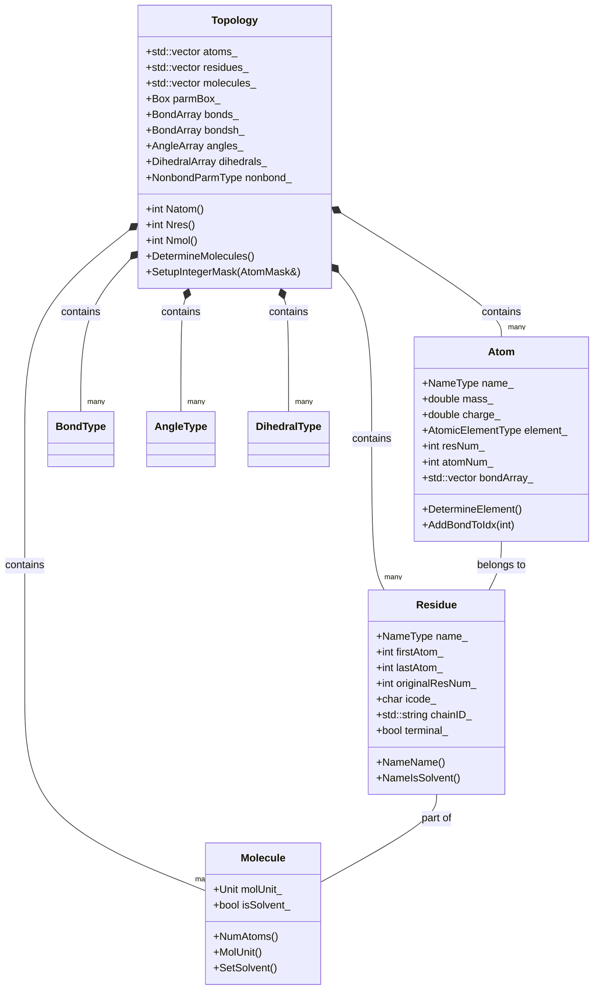

The `Topology` class is the central container that holds all information about the molecular system structure. It manages collections of atoms, residues, molecules, and their connectivity through bonds, angles, and dihedrals.

Sources: [src/Topology.h:16-255](), [src/Topology.cpp:15-183]()

### Atom

The `Atom` class represents individual atoms and stores properties such as name, mass, charge, and element type. It also maintains bonding information through a list of indices to atoms it is bonded to.

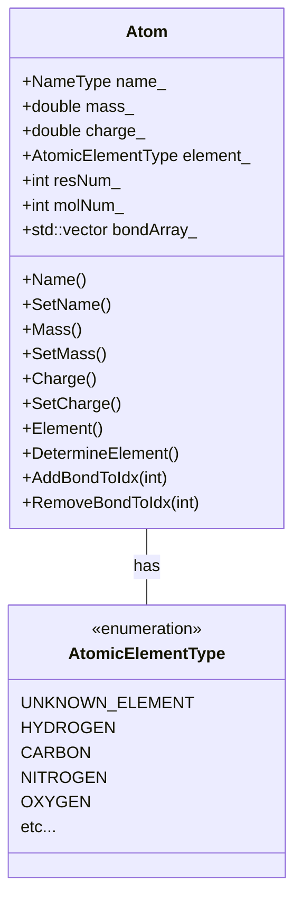

Sources: [src/Atom.h:6-89](), [src/Atom.cpp:6-22]()

### Residue and Molecule

Residues are groups of atoms that form functional units (like amino acids or nucleotides), while molecules are collections of atoms connected by bonds.

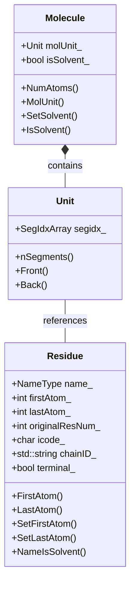

Molecules track their constituent atoms through the `Unit` class, which maintains segments of contiguous atom indices.

Sources: [src/Topology.h:90-105](), [src/Topology.cpp:90-176]()

### Connectivity: Bonds, Angles, and Dihedrals

Molecular connectivity is represented by classes for bonds, angles, and dihedrals, along with their associated parameters.

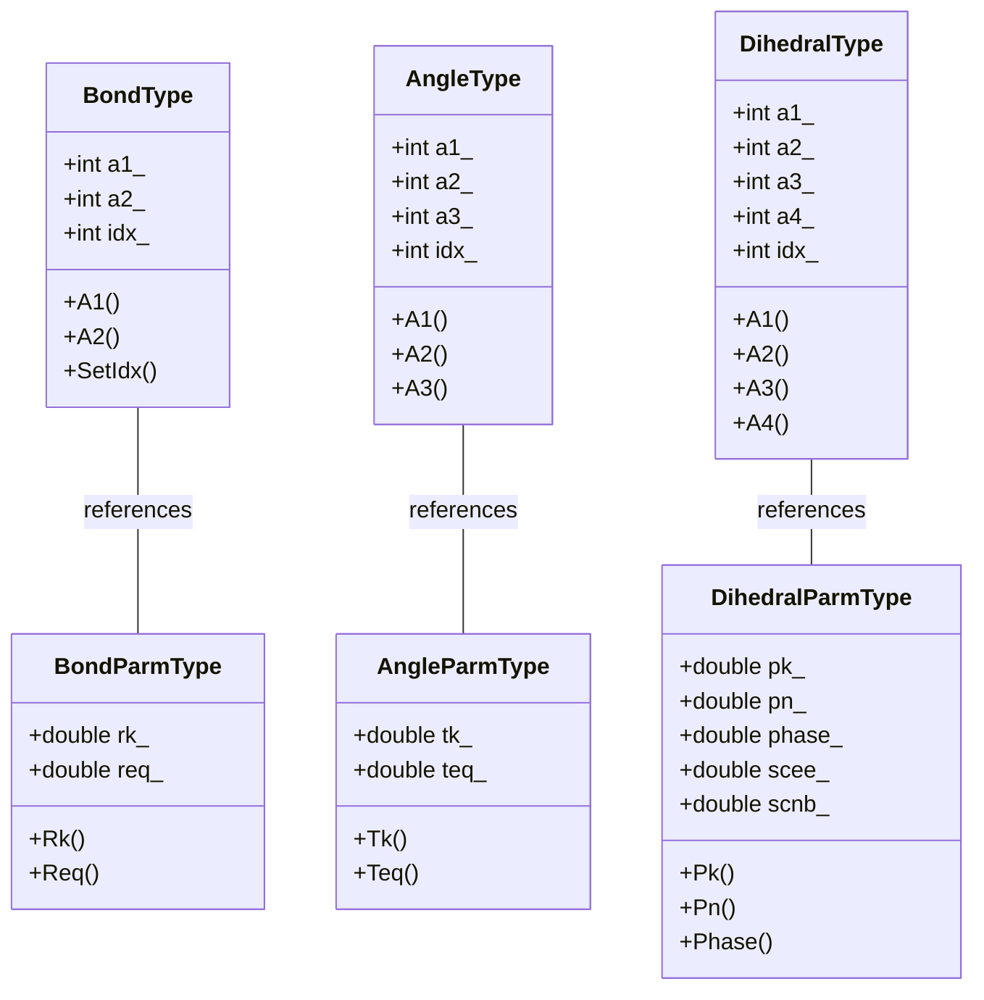

Sources: [src/ParameterTypes.h:22-45](), [src/Topology.h:111-147]()

## Coordinate Management

### Frame

The `Frame` class is a fundamental data structure that stores the coordinates, velocities, and forces for all atoms in a molecular system at a single point in time.

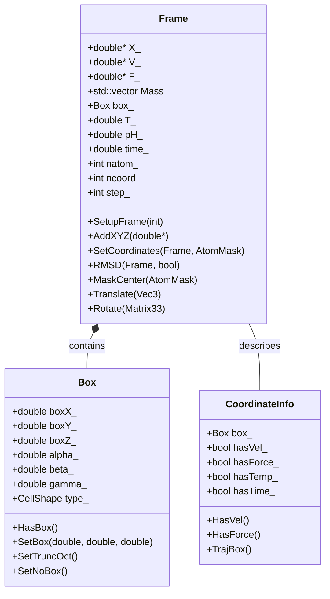

The `Frame` class is designed to efficiently store and manipulate atomic coordinates (X_), velocities (V_), and forces (F_). It supports various operations like RMSD calculations, translations, and rotations.

Sources: [src/Frame.h:9-193](), [src/Frame.cpp:9-117]()

### AtomMask

`AtomMask` provides a way to select specific atoms from a topology using mask expressions.

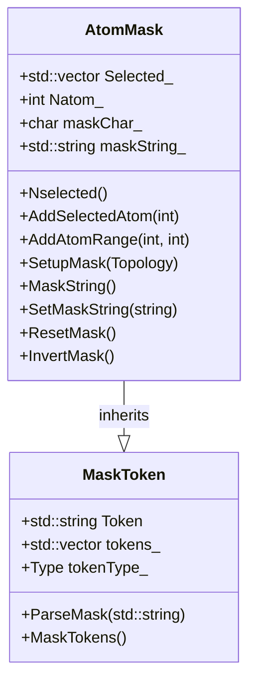

`AtomMask` is used throughout CPPTRAJ to select subsets of atoms for various operations. It can be created from mask expressions like `:1-10@CA,C,N` (selecting backbone atoms from residues 1-10).

Sources: [src/AtomMask.h:6-104](), [src/AtomMask.cpp:6-54]()

## Data Management

CPPTRAJ uses a sophisticated data management system centered around the `DataSet` hierarchy to store and process analysis results.

### DataSet Hierarchy

`DataSet` is the base class for all types of data that can be collected during analysis. Specific types inherit from this base class.

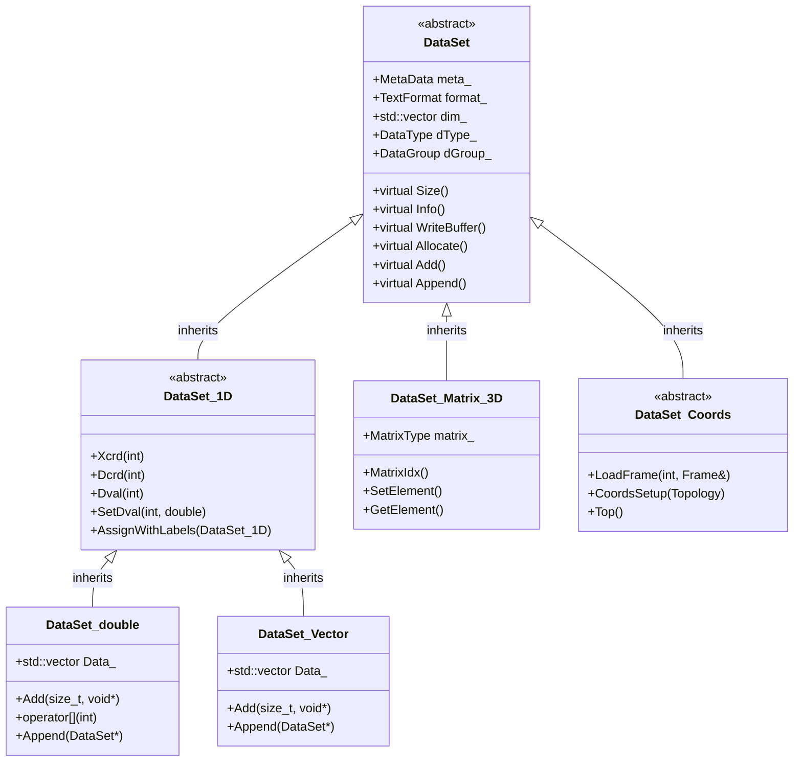

The `DataSet` hierarchy supports many data types, from simple 1D arrays to complex structures like coordinate sets and matrices.

Sources: [src/DataSet.h:13-166](), [src/DataSet.cpp:5-37]()

### DataSetList

`DataSetList` manages collections of DataSet objects, providing functions for adding, finding, and accessing datasets.

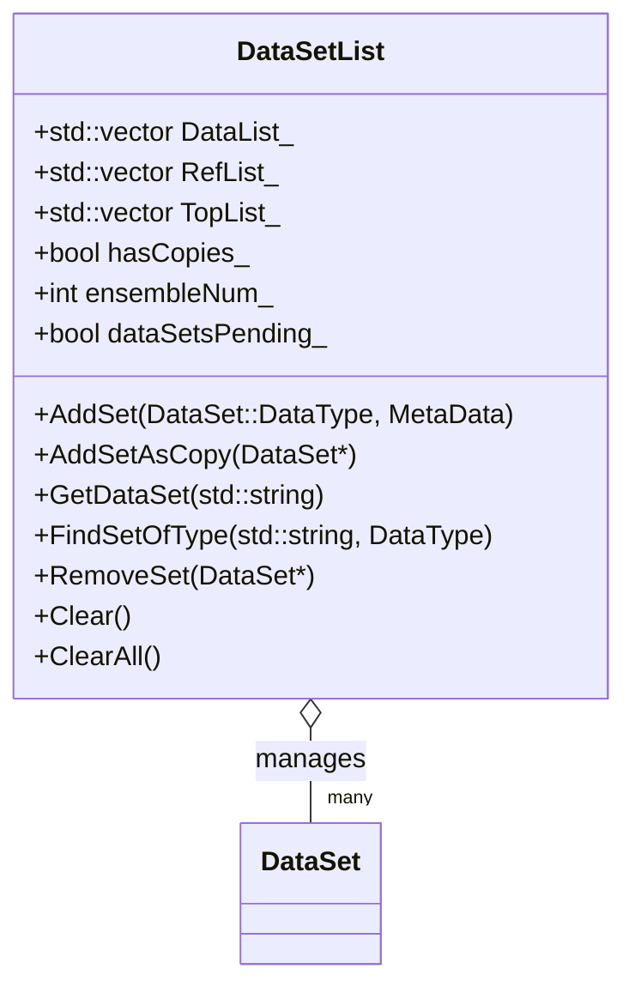

Sources: [src/DataSetList.h:22-103](), [src/DataSetList.cpp:43-126]()

### DataFile and DataFileList

The `DataFile` class handles writing data to files in various formats, while `DataFileList` manages multiple output files.

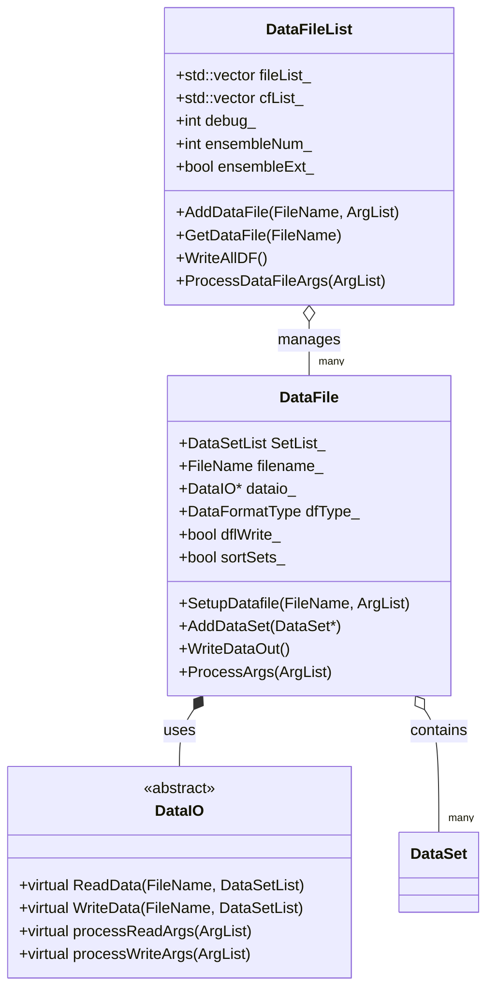

Sources: [src/DataFile.h:8-111](), [src/DataFile.cpp:38-142](), [src/DataFileList.h:9-39](), [src/DataFileList.cpp:10-43]()

## Integration of Core Structures

The following diagram illustrates how these core data structures interact within CPPTRAJ:

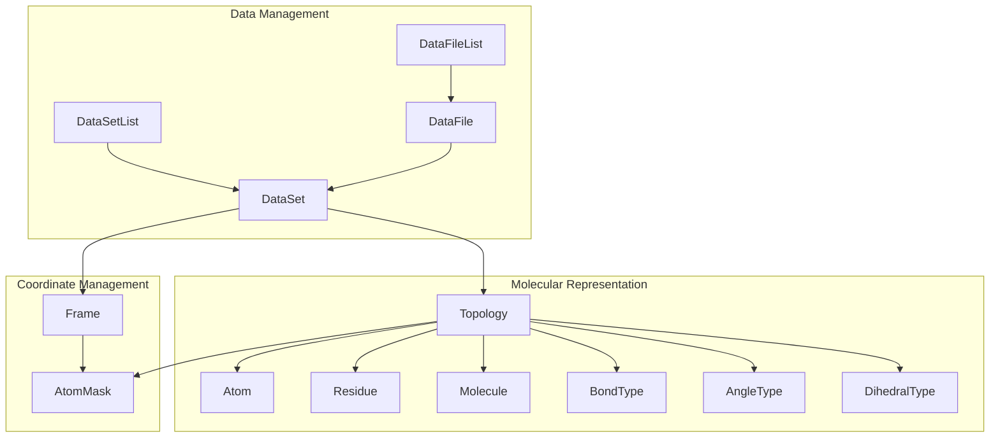

Sources: [src/Topology.cpp:358-403](), [src/Frame.cpp:264-284](), [src/DataSetList.cpp:298-351]()

## Memory Management and Performance Considerations

CPPTRAJ's core data structures are designed with performance in mind, particularly for large molecular systems and trajectory analysis.

### Frame Memory Layout

The `Frame` class uses contiguous arrays for coordinates, velocities, and forces to maximize cache efficiency and enable vectorized operations:

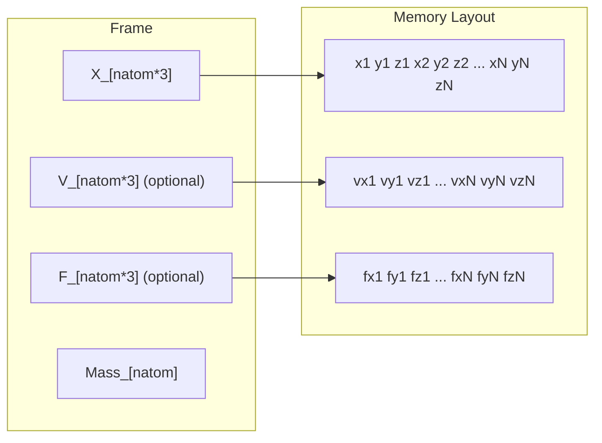

Sources: [src/Frame.h:33-103](), [src/Frame.cpp:371-407]()

### Data Sets and Disk Caching

For memory-intensive analyses, CPPTRAJ provides options for disk caching of large datasets:

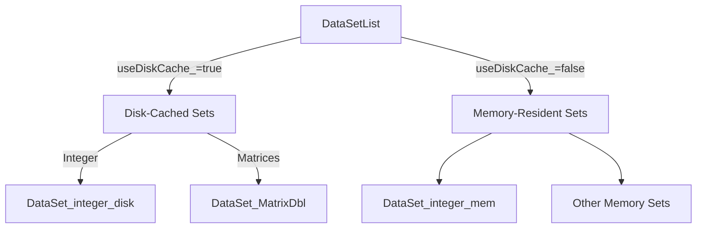

Sources: [src/DataSetList.cpp:40-108]()

This summarizes the core data structures in CPPTRAJ and their relationships. These structures form the foundation for all molecular system representation, coordinate manipulation, and data analysis capabilities within the software.

---