# Topology

Relevant source files

The following files were used as context for generating this wiki page:

- [src/Atom.cpp](src/Atom.cpp)
- [src/Atom.h](src/Atom.h)
- [src/ParameterTypes.h](src/ParameterTypes.h)
- [src/Parm_Amber.cpp](src/Parm_Amber.cpp)
- [src/Parm_Amber.h](src/Parm_Amber.h)
- [src/Topology.cpp](src/Topology.cpp)
- [src/Topology.h](src/Topology.h)

The Topology class represents the complete molecular structure and parameters of a chemical system in CPPTRAJ. It serves as a comprehensive container for atoms, residues, molecules, and the connections between them (bonds, angles, dihedrals), as well as force field parameters. This page documents the internal structure and functionality of the Topology class, which is a fundamental data structure in CPPTRAJ's architecture.

For information about how topologies are read from files, see the Trajectory Processing Pipeline section [3.2](#3.2).

## Class Overview

The Topology class encapsulates all structural information about a molecular system. It contains collections of atoms, residues, and molecules, along with their connectivity information and force field parameters. The class serves as the backbone for most operations in CPPTRAJ that require knowledge of molecular structure.

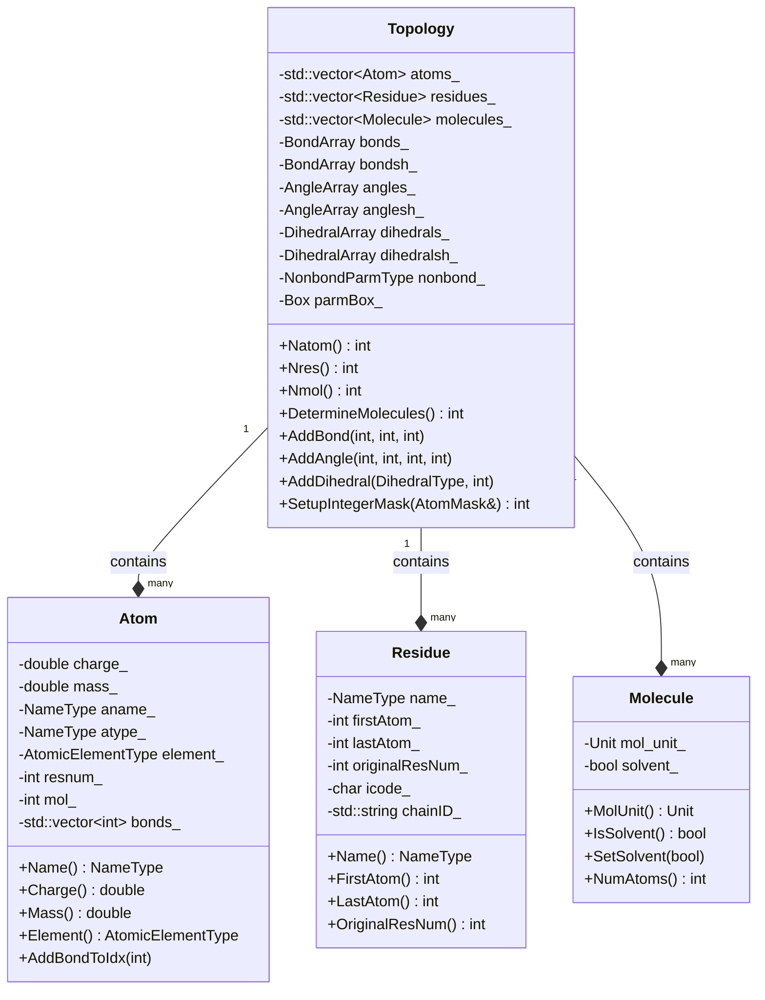

Sources: [src/Topology.h:16-364](), [src/Atom.h:7-129](), [src/ParameterTypes.h:1-624]()

## Core Data Structures

### Atoms

The Atom class is the basic building block of a Topology. Each atom contains information about its name, type, element, mass, charge, and bonding partners.

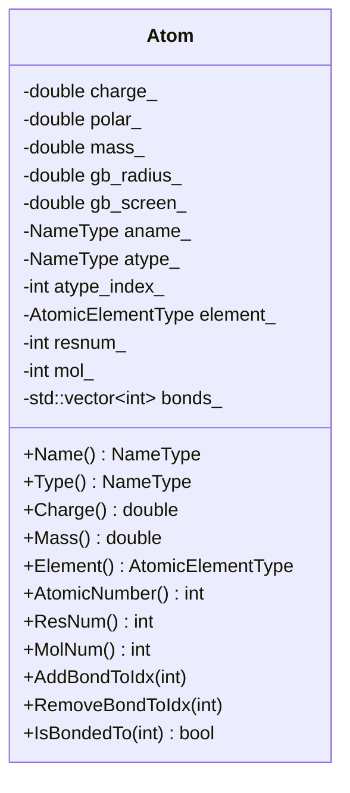

Atoms in CPPTRAJ store their element type using the `AtomicElementType` enumeration, which includes common elements like HYDROGEN, CARBON, NITROGEN, etc. This element information is used to determine bond lengths, radii, and other properties.

Sources: [src/Atom.h:7-129](), [src/Atom.cpp:1-760]()

### Residues

Residues represent groups of atoms that form a chemical unit (e.g., amino acids, nucleotides, small molecules). A residue defines its boundaries by storing the indices of its first and last atoms.

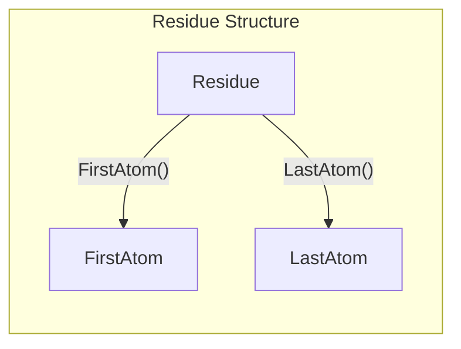

Each residue stores:

- Name: Residue name (e.g., "GLY", "ALA")
- First and last atom indices: Define the residue boundaries
- Original residue number: From the input file
- Chain ID: PDB chain identifier
- Insertion code: PDB insertion code

Sources: [src/Topology.h:90-97](), [src/Topology.cpp:425-437]()

### Molecules

Molecules are collections of atoms connected by bonds. They are determined automatically based on bond connectivity when a topology is loaded or can be explicitly defined.

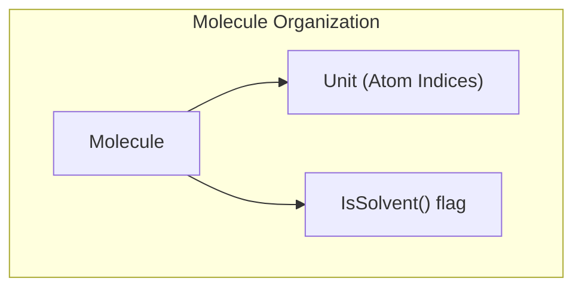

CPPTRAJ can identify solvent molecules based on naming conventions or explicitly through the `SetSolvent()` method. This distinction is important for many analyses that treat solvent differently from solute.

Sources: [src/Topology.h:99-106](), [src/Topology.cpp:140-176]()

### Bonds, Angles, and Dihedrals

The topology contains information about bonds, angles, and dihedrals (both involving hydrogen and not involving hydrogen):

| Container | Description |
|-----------|-------------|
| `bonds_` | Bonds not involving hydrogen |
| `bondsh_` | Bonds involving hydrogen |
| `angles_` | Angles not involving hydrogen |
| `anglesh_` | Angles involving hydrogen |
| `dihedrals_` | Dihedrals not involving hydrogen |
| `dihedralsh_` | Dihedrals involving hydrogen |

Each bond, angle, and dihedral stores the indices of the involved atoms and an index into parameter arrays that hold force constants and equilibrium values.

Sources: [src/Topology.h:110-146](), [src/ParameterTypes.h:22-252]()

### Parameter Sets

Topology contains force field parameters for bonds, angles, dihedrals, and non-bonded interactions:

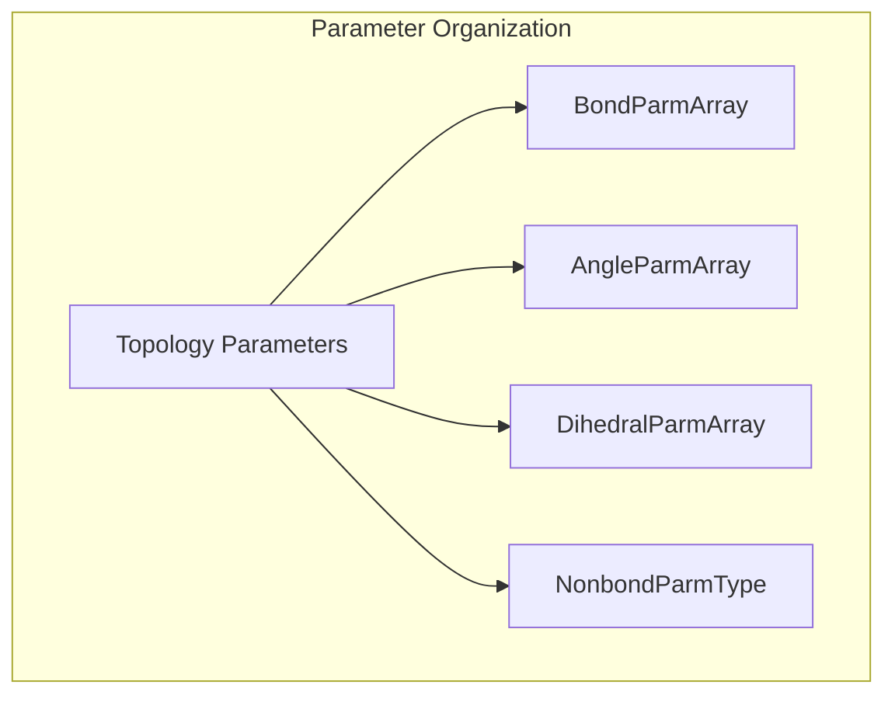

The parameters include:
- Bond parameters: Force constants and equilibrium bond lengths
- Angle parameters: Force constants and equilibrium angles
- Dihedral parameters: Force constants, periodicity, and phase values
- Non-bonded parameters: Lennard-Jones parameters for atom type pairs

Sources: [src/Topology.h:154-166](), [src/ParameterTypes.h:253-449]()

## Key Functionality

### Creating and Modifying Topologies

There are several ways to create or modify a Topology:

1. Reading from files (via `Parm_Amber` and other format readers)
2. Adding atoms, residues, and bonds manually
3. Modifying an existing topology (stripping atoms, merging residues, etc.)

Key methods for modifying a topology include:

- `AddTopAtom()`: Add a new atom to the topology
- `AddBond()`: Add a bond between two atoms
- `AddAngle()`: Add an angle between three atoms
- `AddDihedral()`: Add a dihedral between four atoms
- `MergeResidues()`: Merge consecutive residues into a single residue

Sources: [src/Topology.cpp:420-437](), [src/Topology.cpp:824-891](), [src/Topology.cpp:924-954]()

### Topology Analysis and Information Retrieval

Topology provides methods to access and analyze its components:

- `Natom()`, `Nres()`, `Nmol()`: Get count of atoms, residues, molecules
- `SoluteResidues()`: Get range of solute residues
- `FindAtomInResidue()`: Find atom within a specific residue
- `DetermineMolecules()`: Analyze bonds to determine molecule information
- `Summary()`, `Brief()`: Print information about the topology

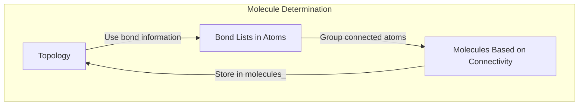

The `DetermineMolecules()` method analyzes bond connectivity to divide atoms into distinct molecules. This is important for analyses that need to know about molecular boundaries.

Sources: [src/Topology.cpp:267-293](), [src/Topology.cpp:358-417]()

### Atom Selection and Masking

The Topology class provides methods to set up atom masks, which are used throughout CPPTRAJ to select subsets of atoms for analysis:

- `SetupIntegerMask()`: Set up an AtomMask using this topology
- `SetupCharMask()`: Set up a CharMask using this topology

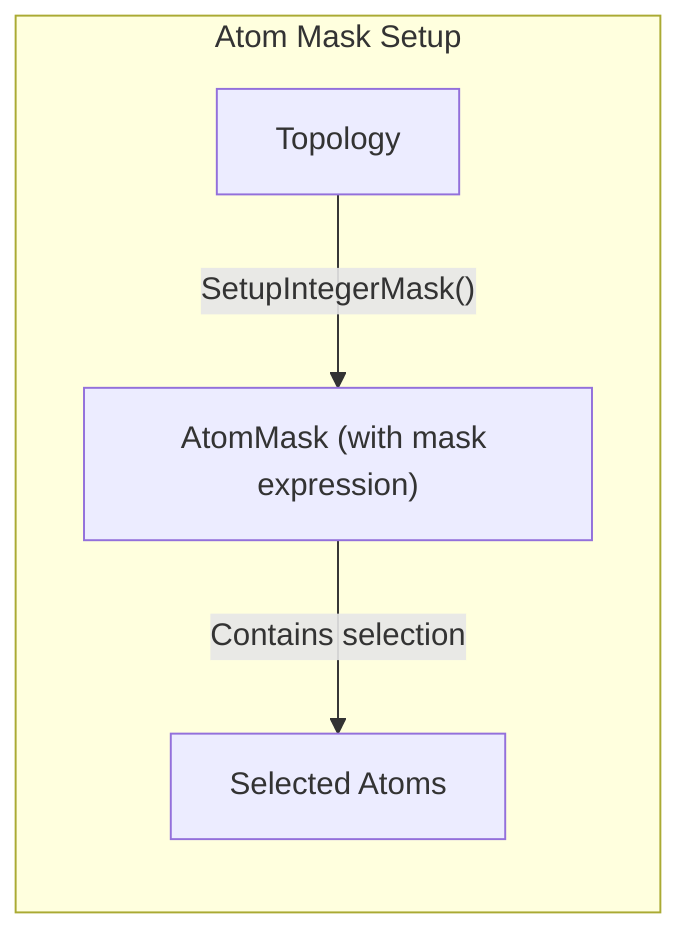

These methods parse mask expressions (like `:1-10` or `@CA`) and select the appropriate atoms based on the topology information.

Sources: [src/Topology.h:223-233]()

## Integration with Other Components

### Topology and Frame

Topology works closely with the Frame class, which stores the actual coordinate data. A Frame without a corresponding Topology lacks context about what the coordinates represent.

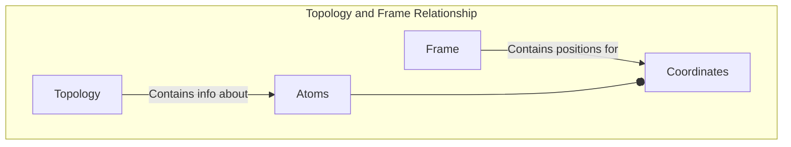

The Topology provides the structural context (what atoms are where, how they're connected), while the Frame provides the spatial information (where atoms are in 3D space).

Sources: [src/Topology.h:209-211]()

### Topology in the CPPTRAJ Workflow

In the broader CPPTRAJ architecture, Topology is central to many operations:

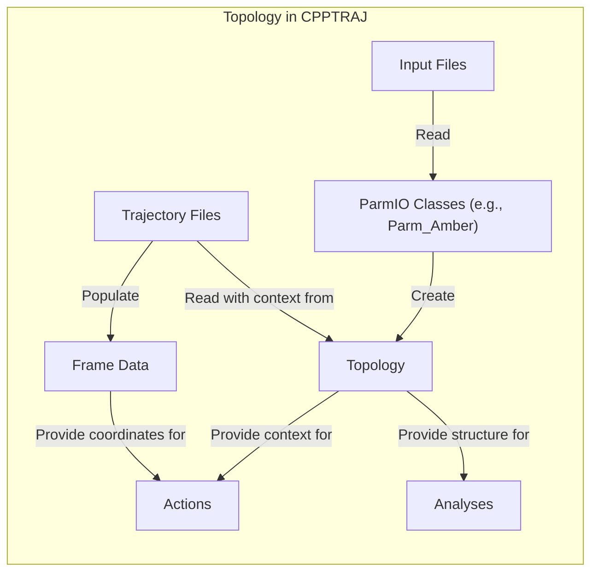

The Topology is created from input files, then provides context for trajectories, actions, and analyses throughout CPPTRAJ.

Sources: High-Level System Architecture diagram, Trajectory Handling section, Data Flow Architecture diagram provided in the context.

## Special Features

### PDB-Specific Information

Topology can store PDB-specific information such as alternate locations, B-factors, occupancies, and original atom numbering. These details are preserved when reading from and writing to PDB files.

Sources: [src/Topology.h:65-89](), [src/Topology.cpp:52-70]()

### Non-Standard Force Field Support

Topology supports specialized force field features:

- CHAMBER parameters for CHARMM force fields
- LES (Locally Enhanced Sampling) parameters
- CMAP (Correction Map) for improved protein backbone energetics
- Water cap information

Sources: [src/Topology.h:169-179](), [src/ParameterTypes.h:450-622]()

## Common Operations

### Determining Bond Connectivity

When bond parameters aren't available, CPPTRAJ can estimate them based on elemental types:

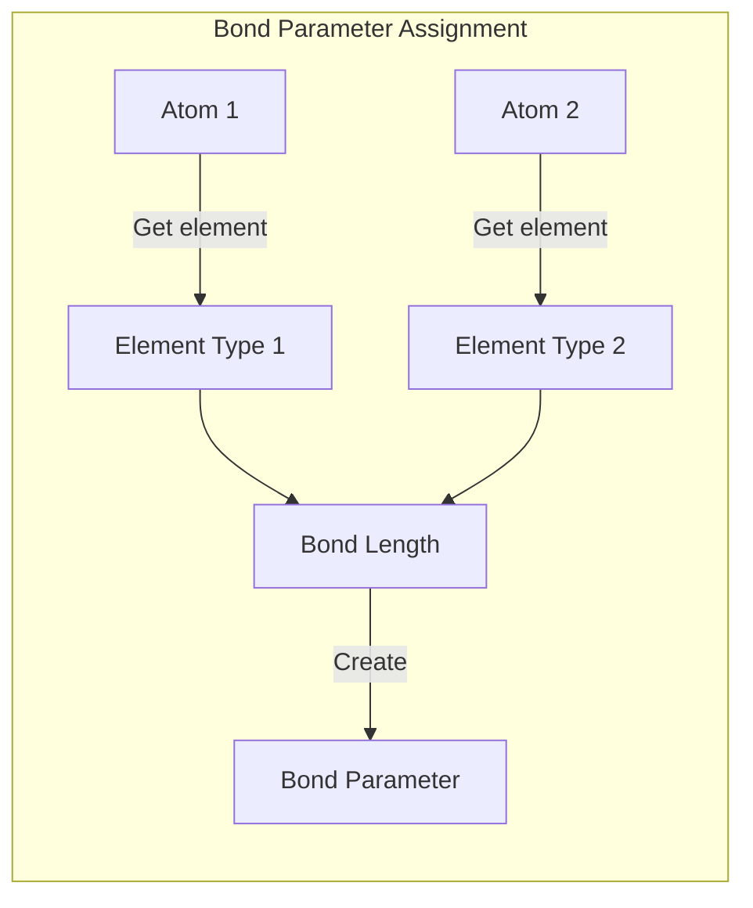

The `AssignBondParameters()` method uses atom elements to determine appropriate bond lengths when they're not explicitly provided in the input file.

Sources: [src/Topology.cpp:736-745](), [src/Atom.cpp:624-739]()

### Solvent Identification

CPPTRAJ can automatically identify solvent molecules based on residue naming or explicit marking:

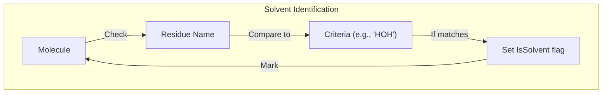

Methods like `SetSolventInfo()` and `SetSolvent()` are used to identify and mark solvent molecules, which is important for many analyses that treat solvent differently.

Sources: [src/Topology.cpp:140-176](), [src/Topology.cpp:565-570]()

## Summary

The Topology class is a central component in CPPTRAJ that holds all the structural and parametric information about a molecular system. It manages atoms, residues, molecules, and their connectivity, providing context for trajectory processing and analysis. Understanding the Topology class is essential for effectively using CPPTRAJ and extending its functionality.

---