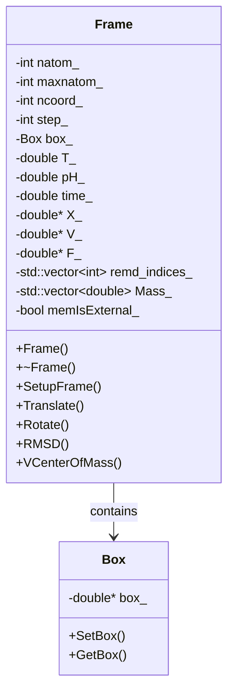
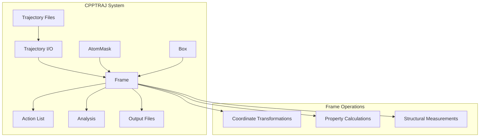
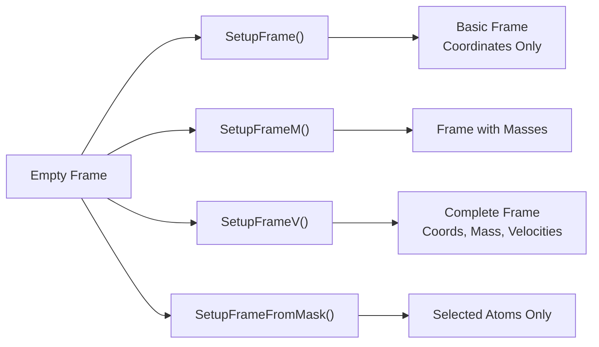
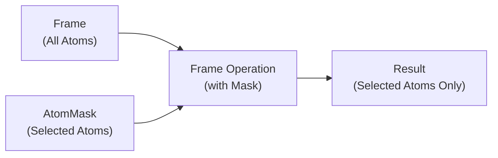

# Frame

<details>
<summary>Relevant source files</summary>

The following files were used as context for generating this wiki page:

- [src/Action_AtomicFluct.cpp](src/Action_AtomicFluct.cpp)
- [src/Action_AtomicFluct.h](src/Action_AtomicFluct.h)
- [src/Action_Average.cpp](src/Action_Average.cpp)
- [src/Action_Average.h](src/Action_Average.h)
- [src/Action_Outtraj.cpp](src/Action_Outtraj.cpp)
- [src/Action_Outtraj.h](src/Action_Outtraj.h)
- [src/AtomMask.cpp](src/AtomMask.cpp)
- [src/AtomMask.h](src/AtomMask.h)
- [src/Frame.cpp](src/Frame.cpp)
- [src/Frame.h](src/Frame.h)

</details>


## Introduction

The Frame class is a fundamental data structure in the CPPTRAJ system that holds atomic coordinates and related information for molecular systems. It serves as the primary container for processing trajectories, performing coordinate transformations, and calculating structural properties.

Frame is designed to efficiently store and manipulate coordinates, along with optional velocity and force data, and provides functionality for transformations like translations and rotations, as well as analysis operations like RMSD calculations.

Sources: [src/Frame.h:9-32]()

## Structure of the Frame Class

A Frame object contains several key components:

- **Coordinates**: 3D positions for all atoms in the system, stored as a contiguous array
- **Optional components**: Velocities and forces when available
- **Box information**: Unit cell dimensions and angles for periodic systems
- **Metadata**: Temperature, time, pH, step information, etc.
- **Mass information**: Mass of each atom used in various calculations



Sources: [src/Frame.h:287-306](), [src/Frame.h:34-593]()

## Frame in the CPPTRAJ Architecture

The Frame class is a core component of the CPPTRAJ Trajectory Handling subsystem, serving as the central data structure for coordinate manipulation throughout the program.



Sources: [src/Frame.h:9-32](), [src/Frame.cpp:3-6]()

## Memory Management

Frame employs careful memory management to handle coordinate data efficiently:

1. **Internal vs External Memory**:
   - Frames can own their memory (internal) or reference external memory
   - The `memIsExternal_` flag tracks this distinction
   - Only internally managed memory is freed in the destructor

2. **Dynamic Resizing**:
   - The class maintains `maxnatom_` to track the maximum capacity
   - When more space is needed, methods like `IncreaseX()` allocate larger arrays

3. **Memory Layout**:
   - Coordinates are stored in a flat array as X₁Y₁Z₁X₂Y₂Z₂...
   - This layout enables efficient memory operations and interfacing with file I/O

Sources: [src/Frame.cpp:29-36](), [src/Frame.cpp:307-318](), [src/Frame.h:285-306]()

## Frame Construction and Setup

The Frame class offers multiple constructors and setup methods to accommodate different use cases:

### Constructors

- **Default constructor**: Creates an empty frame
- **Size constructor**: Creates a frame for a given number of atoms
- **Atom-based constructor**: Initializes from a vector of Atom objects
- **Mask-based constructor**: Creates a frame with selected atoms from another frame
- **External memory constructor**: Creates a frame that references external coordinate data

### Setup Methods



Sources: [src/Frame.cpp:11-158](), [src/Frame.cpp:390-508](), [src/Frame.h:145-160]()

## Coordinate Access and Manipulation

Frame provides numerous methods to access and manipulate coordinates:

### Coordinate Access

- Direct access through operators: `frame[idx]`
- Atom-specific access: `XYZ(atom_num)` returns pointer to x,y,z coordinates for a given atom
- System information access: `Natom()`, `Temperature()`, `BoxCrd()`, etc.

### Coordinate Manipulation

The class offers comprehensive methods for common coordinate operations:

1. **Translations**
   - Whole system: `Translate()`, `NegTranslate()`
   - Atom subsets: `Translate(mask)`, `Translate(begin, end)`
   
2. **Rotations**
   - Whole system: `Rotate(matrix)`, `InverseRotate(matrix)`
   - Atom subsets: `Rotate(matrix, mask)`
   
3. **Combined Operations**
   - `Trans_Rot_Trans()`: Translation, rotation, and a second translation

Sources: [src/Frame.h:440-592](), [src/Frame.cpp:472-574]()

## Structural Calculations

Frame implements various methods for structural analysis:

1. **Center Calculations**
   - `VCenterOfMass()`: Calculate center of mass
   - `VGeometricCenter()`: Calculate geometric center
   - Variants for different atom selections

2. **RMSD Calculations**
   - `RMSD()`: Calculate RMSD between frames
   - `RMSD_CenteredRef()`: RMSD to a previously centered reference
   - `RMSD_NoFit()`: RMSD without structural alignment

3. **Other Analysis**
   - `VMomentum()`: Calculate momentum
   - `CalcTemperature()`: Calculate temperature

Sources: [src/Frame.h:214-269](), [src/Frame.cpp:1022-1207]()

## Coordinate Array Structure

The coordinate array in Frame is organized as a contiguous block of memory for performance reasons:

```
X_[0]   X_[1]   X_[2]   X_[3]   X_[4]   X_[5]   ...
X₁      Y₁      Z₁      X₂      Y₂      Z₂      ...
```

This layout provides:
- Efficient memory access patterns
- Straightforward interfacing with external libraries
- Simple pointer arithmetic for atom access

Access to coordinates is typically done via methods that calculate the appropriate offset:
- `XYZ(atom)` returns a pointer to the coordinates of the specified atom
- When iterating through atom masks, the coordinates are accessed via `X_ + (*atom * 3)`

Sources: [src/Frame.h:84-86](), [src/Frame.cpp:580-583]()

## Frame Manipulation with AtomMask

The AtomMask class is frequently used with Frame to operate on subsets of atoms:



Common operations using AtomMask include:
- Creating a new Frame from a subset of atoms: `Frame(frameIn, maskIn)`
- Setting coordinates based on a mask: `SetCoordinates(frameIn, maskIn)`
- Manipulating specific atoms: `Translate(Vec, maskIn)`, `Rotate(Matrix, maskIn)`
- Calculating properties: `VCenterOfMass(maskIn)`, `RMSD(frameIn, maskIn)`

Sources: [src/Frame.cpp:86-140](), [src/Frame.cpp:561-574](), [src/AtomMask.h:5-90]()

## Usage Examples

The Frame class is used extensively throughout CPPTRAJ. Here are some common usage patterns:

### Creating and Setting Up a Frame

```
// Create a frame for a specific number of atoms
Frame coords(natoms);

// Set up a frame for selected atoms
AtomMask mask(":1-10");  // Residues 1-10
parm.SetupIntegerMask(mask);
Frame selectedAtoms;
selectedAtoms.SetupFrameFromMask(mask, parm.Atoms());
```

### Computing Properties

```
// Calculate center of mass
AtomMask proteinMask(":1-100");
Vec3 center = frame.VCenterOfMass(proteinMask);

// Calculate RMSD between frames
double rmsd = frame.RMSD(reference, true); // true = use mass-weighting
```

### Applying Transformations

```
// Translate atoms
Vec3 translation(1.0, 0.0, 0.0);  // Move 1Å along x-axis
frame.Translate(translation);

// Rotate atoms
Matrix_3x3 rotation;
rotation.RotationMatrix(Vec3(0,0,1), 45.0);  // 45° around z-axis
frame.Rotate(rotation);
```

## Action Usage Examples

Several CPPTRAJ actions use Frame as their core data structure:

### Atomic Fluctuations

The `AtomicFluct` action calculates atomic fluctuations by accumulating coordinate sums and variances in Frame objects:

```
SumCoords_.SetupFrame(Mask_.Nselected());   // For average positions
SumCoords2_.SetupFrame(Mask_.Nselected());  // For squared positions
```

Sources: [src/Action_AtomicFluct.cpp:123-126](), [src/Action_AtomicFluct.h:22-26]()

### Coordinate Averaging

The `Average` action uses Frame to accumulate and average coordinates:

```
AvgFrame_.SetupFrame(Mask_.Nselected());
AvgFrame_.ZeroCoords();
AvgFrame_.AddByMask(frm.Frm(), Mask_);  // Add coordinates from current frame
// Later:
AvgFrame_.Divide(double(Nframes_));     // Divide by number of frames
```

Sources: [src/Action_Average.cpp:93-94](), [src/Action_Average.cpp:135-136](), [src/Action_Average.h:25-26]()

## Summary

The Frame class is a core component of CPPTRAJ that:
- Efficiently stores atomic coordinates, velocities, forces, and related information
- Provides methods for coordinate manipulation and structural analysis
- Interfaces with other key components like AtomMask for atom selection
- Forms the foundation for many analysis actions in the CPPTRAJ system

Understanding Frame is essential for working with trajectory data in CPPTRAJ, as it forms the central data structure around which much of the system's functionality is built.

---