# Data Management

<details>
<summary>Relevant source files</summary>

The following files were used as context for generating this wiki page:

- [src/DataFile.cpp](src/DataFile.cpp)
- [src/DataFile.h](src/DataFile.h)
- [src/DataFileList.cpp](src/DataFileList.cpp)
- [src/DataFileList.h](src/DataFileList.h)
- [src/DataIO.cpp](src/DataIO.cpp)
- [src/DataIO.h](src/DataIO.h)
- [src/DataIO_Gnuplot.cpp](src/DataIO_Gnuplot.cpp)
- [src/DataIO_Gnuplot.h](src/DataIO_Gnuplot.h)
- [src/DataIO_Grace.cpp](src/DataIO_Grace.cpp)
- [src/DataIO_Grace.h](src/DataIO_Grace.h)
- [src/DataIO_Mdout.cpp](src/DataIO_Mdout.cpp)
- [src/DataIO_Mdout.h](src/DataIO_Mdout.h)
- [src/DataIO_Std.cpp](src/DataIO_Std.cpp)
- [src/DataIO_Std.h](src/DataIO_Std.h)
- [src/DataSet.cpp](src/DataSet.cpp)
- [src/DataSet.h](src/DataSet.h)
- [src/DataSetList.cpp](src/DataSetList.cpp)
- [src/DataSetList.h](src/DataSetList.h)

</details>


This page documents the data management system in CPPTRAJ, which is responsible for storing, organizing, and handling various types of data throughout the application. This includes how data is represented in memory, how it's organized into collections, and how it's written to and read from files.

The data management system provides a flexible framework that supports numerous data types (from simple scalars to complex matrices and coordinates) and file formats (standard text, Grace, Gnuplot, etc.). It serves as the central data handling backbone for the entire application, bridging trajectory processing with analysis and output.

For information on trajectory input/output, see [Trajectory Handling](#3.2).

## Core Data Management Classes

The data management system in CPPTRAJ consists of several key classes that work together to provide a flexible and extensible framework:

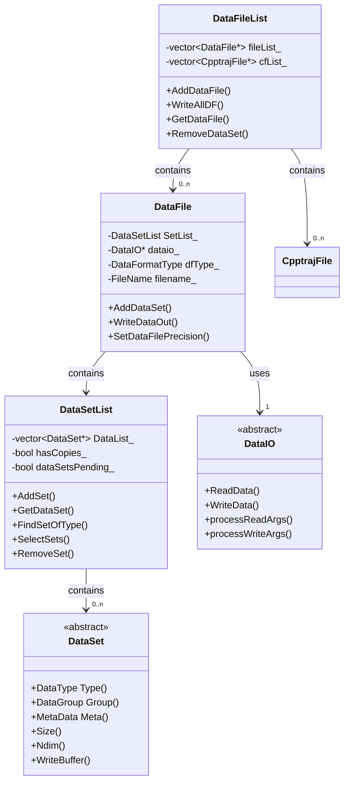

Sources: [src/DataSet.h:13-166](). [src/DataSetList.h:12-205](). [src/DataFile.h:8-125](). [src/DataFileList.h:8-113](). [src/DataIO.h:8-58]().

### DataSet

`DataSet` is the base class for all data types in CPPTRAJ. It's an abstract class that defines the interface for storing and accessing various types of data. Each `DataSet` contains metadata, dimension information, and the actual data values.

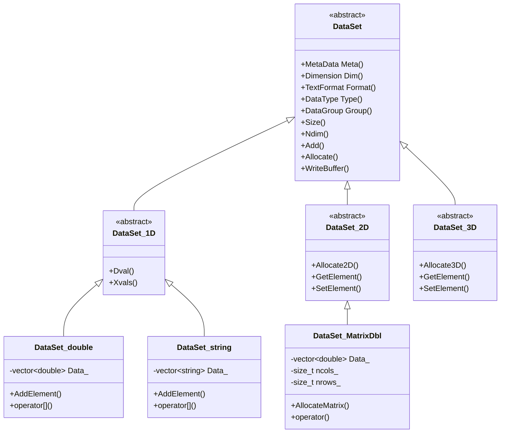

Sources: [src/DataSet.h:13-166](). [src/DataSet.cpp:1-144]().

DataSets are categorized by both type and group:

1. **DataSet::DataType** - Specific data type (e.g., DOUBLE, STRING, MATRIX_DBL)
2. **DataSet::DataGroup** - General category (e.g., SCALAR_1D, MATRIX_2D, GRID_3D)

This dual categorization provides flexibility when searching for and operating on DataSets.

### DataSetList

`DataSetList` is a container class that manages collections of `DataSet` objects. It provides methods for adding, finding, and manipulating DataSets.

Key features of the DataSetList include:

- Adding DataSets of various types
- Finding DataSets by name, type, group, or other attributes
- Selecting multiple DataSets based on criteria
- Managing special types of DataSets (reference frames, topologies)
- Allocating memory for time series data

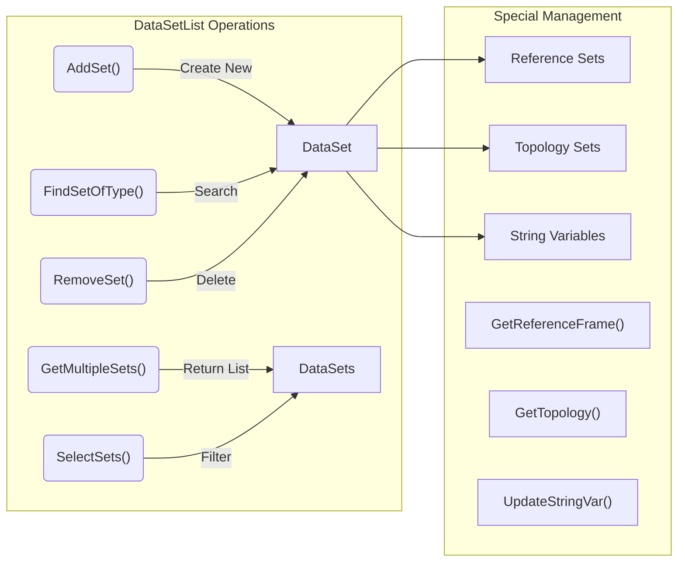

Sources: [src/DataSetList.h:12-205](). [src/DataSetList.cpp:1-141](). [src/DataSetList.cpp:142-282](). [src/DataSetList.cpp:283-422](). [src/DataSetList.cpp:840-953]().

### DataFile and DataIO

`DataFile` handles the writing of DataSets to files in various formats. It uses `DataIO` objects to perform the actual file I/O operations.

`DataIO` is an abstract base class for file I/O operations. Different file formats have their own `DataIO` implementations:

```mermaid
classDiagram
    class DataIO {
        <<abstract>>
        +ReadData()
        +WriteData()
        +processReadArgs()
        +processWriteArgs()
    }
    
    class DataIO_Std {
        +Read_1D()
        +Read_2D()
        +Read_3D()
        +WriteDataNormal()
    }
    
    class DataIO_Grace {
        +WriteDataNormal()
        +WriteDataXYDY()
        +WriteDataInverted()
    }
    
    class DataIO_Gnuplot {
        +WriteSets1D()
        +WriteSet2D()
    }
    
    class DataIO_Mdout {
        +GetAmberEterms()
    }
    
    DataIO <|-- DataIO_Std
    DataIO <|-- DataIO_Grace
    DataIO <|-- DataIO_Gnuplot
    DataIO <|-- DataIO_Mdout
    DataIO <|-- DataIO_XYZ["Many Others..."]
```

Sources: [src/DataIO.h:8-58](). [src/DataIO.cpp:1-122](). [src/DataIO_Std.h:5-65](). [src/DataIO_Grace.h:4-25](). [src/DataIO_Gnuplot.h:5-52](). [src/DataIO_Mdout.h:6-35]().

`DataFile` wraps a `DataIO` implementation and provides a higher-level interface:

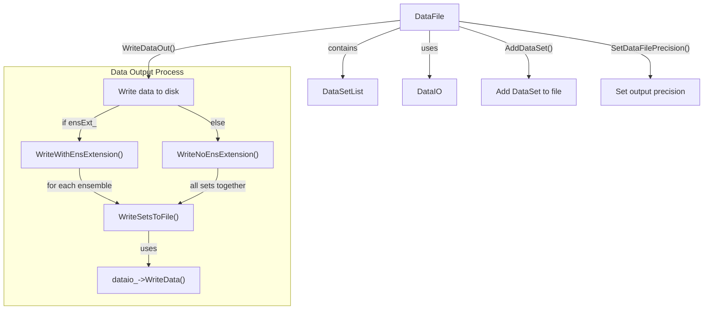

Sources: [src/DataFile.h:8-125](). [src/DataFile.cpp:39-172](). [src/DataFile.cpp:173-346](). [src/DataFile.cpp:347-520](). [src/DataFile.cpp:521-669]().

### DataFileList

`DataFileList` manages collections of `DataFile` objects and `CpptrajFile` objects (for text output). It ensures that multiple data sets can be directed to the same file and coordinates writing all files at appropriate times.

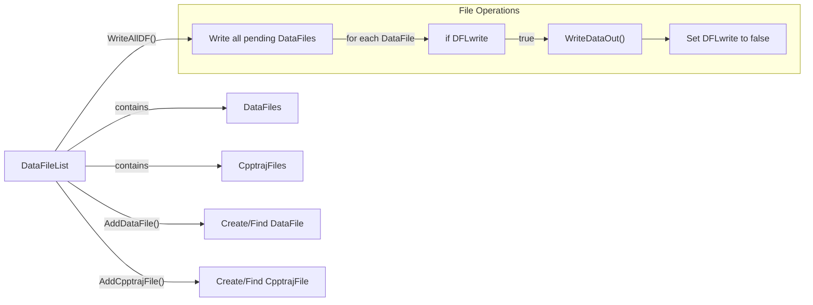

Sources: [src/DataFileList.h:8-113](). [src/DataFileList.cpp:11-99](). [src/DataFileList.cpp:100-210](). [src/DataFileList.cpp:343-380]().

## DataSet Types and Hierarchies

CPPTRAJ supports a wide variety of data types, organized in a hierarchical manner. Each DataSet has both a type and a group categorization.

### DataSet Types

The `DataSet::DataType` enumeration defines all possible data types:

```
DOUBLE         - Double precision floating point
FLOAT          - Single precision floating point
INTEGER        - Integer values
STRING         - String values
MATRIX_DBL     - Double precision matrices
MATRIX_FLT     - Single precision matrices
COORDS         - Coordinate data
VECTOR         - Vector data
MODES          - Eigenmodes
GRID_FLT       - Single precision grids
GRID_DBL       - Double precision grids
REMLOG         - Replica exchange logs
XYMESH         - XY mesh data
TRAJ           - Trajectory data
REF_FRAME      - Reference frames
MAT3X3         - 3x3 matrices
TOPOLOGY       - Topology data
PH             - pH data
...and more
```

Sources: [src/DataSet.h:26-34](). [src/DataSet.cpp:6-37]().

### DataSet Groups

The `DataSet::DataGroup` enumeration defines broader categories:

```
GENERIC        - Generic data not fitting other categories
SCALAR_1D      - One-dimensional scalar data
MATRIX_2D      - Two-dimensional matrix data
GRID_3D        - Three-dimensional grid data
COORDINATES    - Coordinate data sets
PHREMD         - pH replica exchange data
PWCACHE        - Pairwise caches
VECTOR_1D      - One-dimensional vector data
```

Sources: [src/DataSet.h:36-37]().

## Data File Formats

CPPTRAJ supports numerous file formats for data input and output through the `DataIO` class hierarchy:

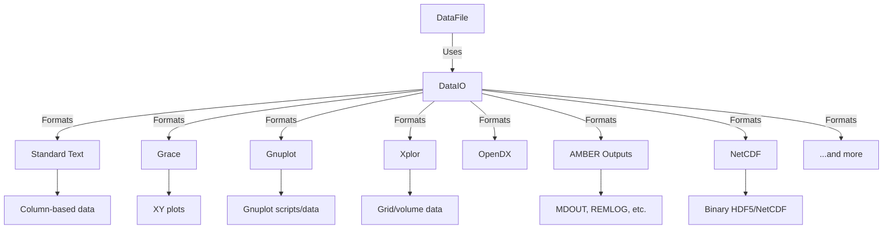

Sources: [src/DataFile.h:17-22](). [src/DataFile.cpp:59-93](). [src/DataIO_Std.h:5-65](). [src/DataIO_Grace.h:4-25](). [src/DataIO_Gnuplot.h:5-52]().

The format used is determined by:
1. Explicit specification in commands
2. File extension
3. Automatic detection by content (for reading)

## DataSet Creation and Management

DataSets are primarily created and managed through the `DataSetList` class.

### Creating DataSets

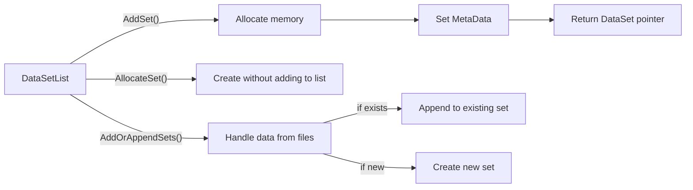

Sources: [src/DataSetList.cpp:424-578](). [src/DataSetList.cpp:579-696]().

### Finding DataSets

DataSets can be located in multiple ways:

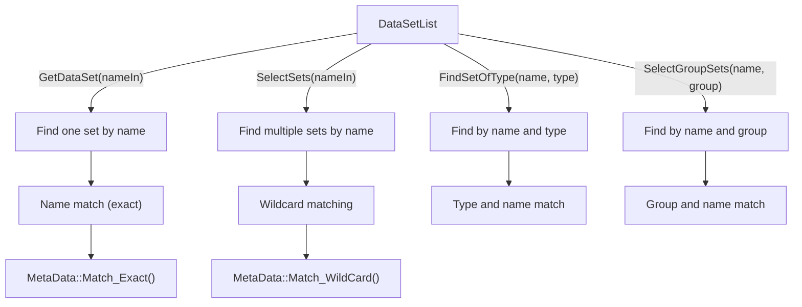

Sources: [src/DataSetList.cpp:298-410]().

### DataSet MetaData

The `MetaData` class stores information about each DataSet, including:

- Name - Primary identifier
- Aspect - Secondary qualifier
- Index - Numerical qualifier 
- Legend - Display name
- Ensemble number - For ensemble simulations

This metadata system provides a flexible way to identify and organize data sets within the application.

## Data Output Process

When data is written, the process follows this flow:

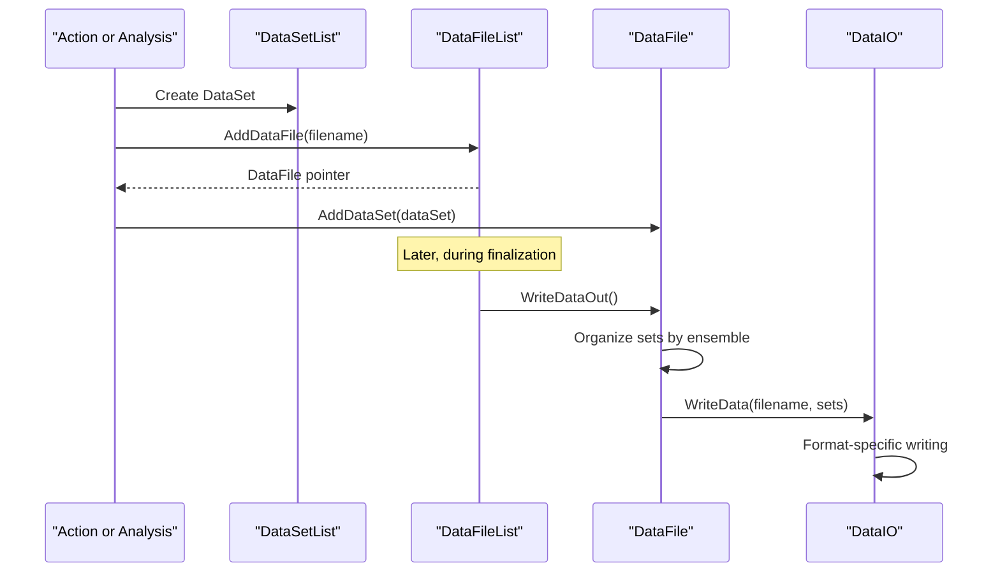

Sources: [src/DataFile.cpp:610-629](). [src/DataFileList.cpp:364-380]().

## Ensemble Data Management

CPPTRAJ provides special handling for ensemble data:

1. DataSets can have ensemble number metadata
2. DataFiles can write ensemble data to separate files
3. Ensemble member numbers can be appended to filenames

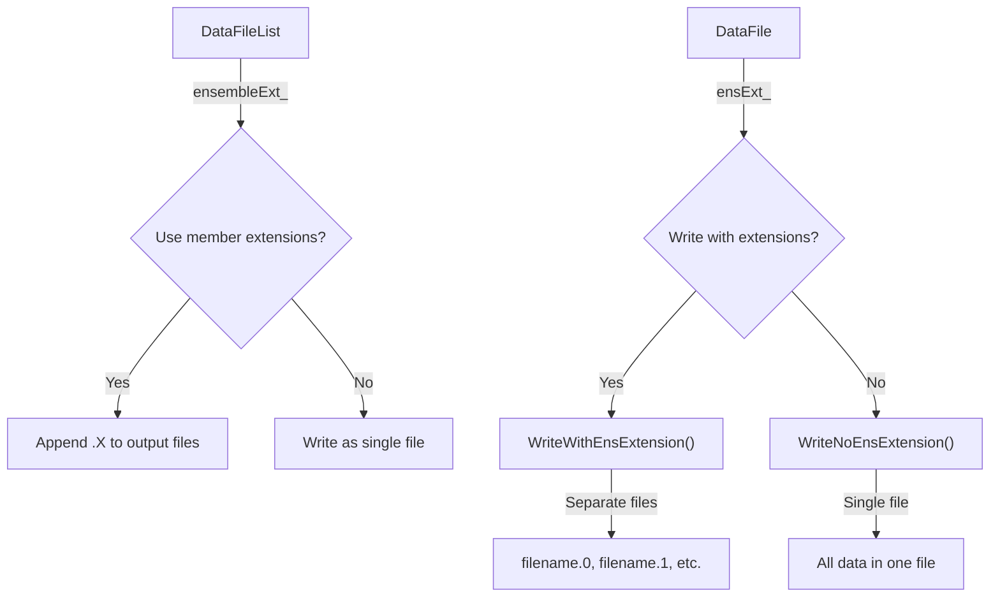

Sources: [src/DataFile.cpp:553-608](). [src/DataFileList.cpp:155-280]().

## Error Handling and Status Management

The data management system includes various mechanisms for tracking status and handling errors:

- `dflWrite_` flag in DataFile indicates files that need to be written
- `dataSetsPending_` in DataSetList signals when Actions will create sets later
- Return codes from read/write operations indicate success or failure
- Debug output can be enabled at various levels

Each component also provides its own error reporting through the `mprintf()` and `mprinterr()` functions.

## Example Data Flow

A typical data flow in CPPTRAJ might look like this:

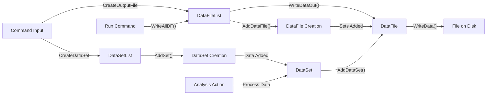

Sources: [src/DataSetList.cpp:424-578](). [src/DataFile.cpp:406-440](). [src/DataFileList.cpp:364-380]().

## Data Management Best Practices

When working with the CPPTRAJ data management system, consider these best practices:

1. Use appropriate DataSet types for your data
2. Set meaningful metadata for better organization and searching
3. Group related data sets into the same output files
4. Be aware of ensemble data handling when working with multiple trajectories
5. Use data file arguments to control output format, precision, labels, etc.

## Conclusion

The data management system in CPPTRAJ provides a flexible framework for storing, organizing, and outputting data from trajectory analysis. By understanding the relationships between DataSets, DataSetLists, DataFiles, DataFileList, and DataIO objects, you can effectively work with the various data types and formats supported by CPPTRAJ.

---