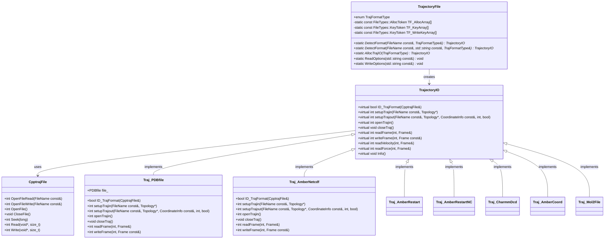
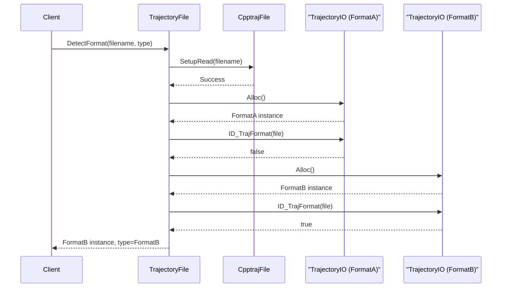
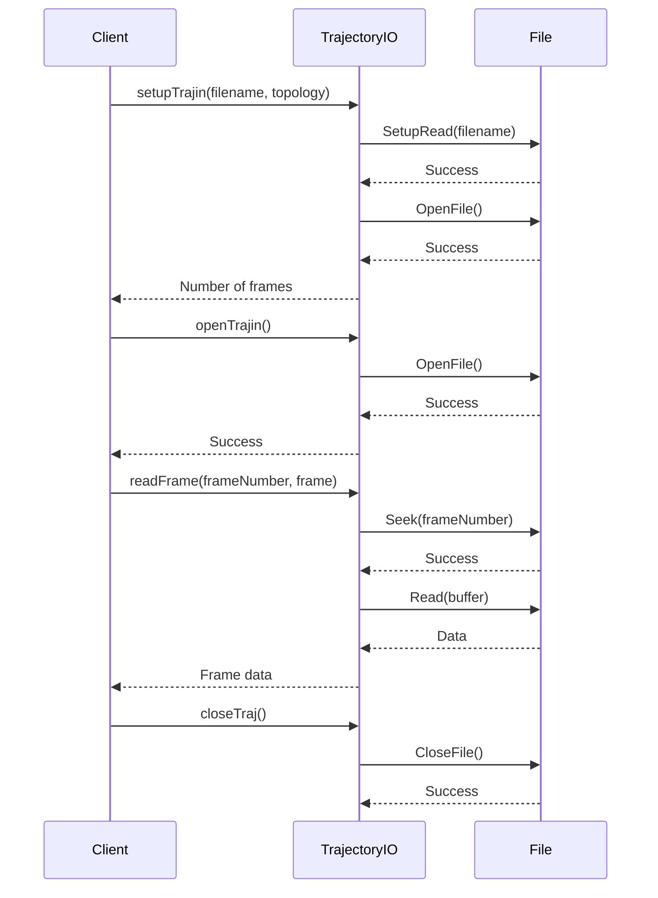
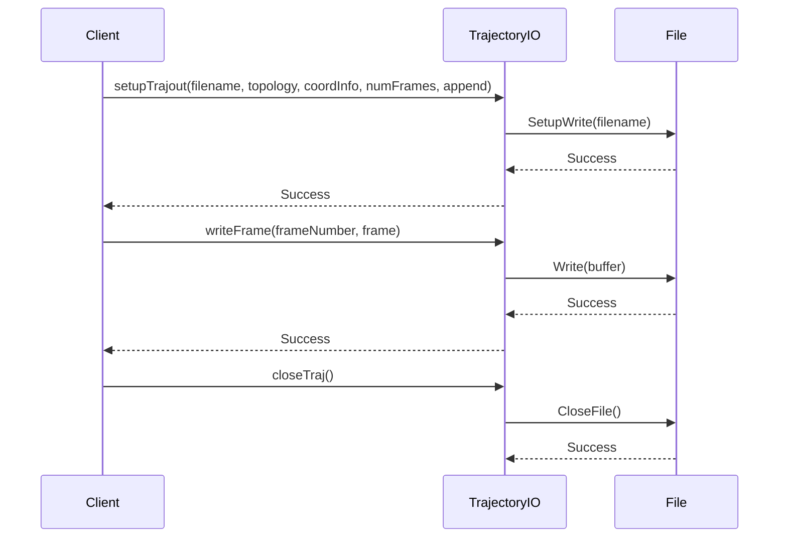

# File I/O

<details>
<summary>Relevant source files</summary>

The following files were used as context for generating this wiki page:

- [src/Mol2File.cpp](src/Mol2File.cpp)
- [src/Mol2File.h](src/Mol2File.h)
- [src/NetcdfFile.cpp](src/NetcdfFile.cpp)
- [src/NetcdfFile.h](src/NetcdfFile.h)
- [src/PDBfile.cpp](src/PDBfile.cpp)
- [src/PDBfile.h](src/PDBfile.h)
- [src/Parm_CIF.cpp](src/Parm_CIF.cpp)
- [src/Parm_Mol2.cpp](src/Parm_Mol2.cpp)
- [src/Parm_PDB.cpp](src/Parm_PDB.cpp)
- [src/Traj_AmberCoord.cpp](src/Traj_AmberCoord.cpp)
- [src/Traj_AmberCoord.h](src/Traj_AmberCoord.h)
- [src/Traj_AmberNetcdf.cpp](src/Traj_AmberNetcdf.cpp)
- [src/Traj_AmberNetcdf.h](src/Traj_AmberNetcdf.h)
- [src/Traj_AmberRestart.cpp](src/Traj_AmberRestart.cpp)
- [src/Traj_AmberRestart.h](src/Traj_AmberRestart.h)
- [src/Traj_AmberRestartNC.cpp](src/Traj_AmberRestartNC.cpp)
- [src/Traj_AmberRestartNC.h](src/Traj_AmberRestartNC.h)
- [src/Traj_CharmmDcd.cpp](src/Traj_CharmmDcd.cpp)
- [src/Traj_CharmmDcd.h](src/Traj_CharmmDcd.h)
- [src/Traj_Conflib.cpp](src/Traj_Conflib.cpp)
- [src/Traj_Conflib.h](src/Traj_Conflib.h)
- [src/Traj_Mol2File.cpp](src/Traj_Mol2File.cpp)
- [src/Traj_Mol2File.h](src/Traj_Mol2File.h)
- [src/Traj_NcEnsemble.cpp](src/Traj_NcEnsemble.cpp)
- [src/Traj_PDBfile.cpp](src/Traj_PDBfile.cpp)
- [src/Traj_PDBfile.h](src/Traj_PDBfile.h)
- [src/TrajectoryFile.cpp](src/TrajectoryFile.cpp)
- [src/TrajectoryFile.h](src/TrajectoryFile.h)
- [src/TrajectoryIO.cpp](src/TrajectoryIO.cpp)
- [src/TrajectoryIO.h](src/TrajectoryIO.h)

</details>


The CPPTRAJ file I/O system provides a unified framework for reading and writing molecular dynamics trajectory data in various file formats. This page documents the architecture of the file I/O system, how trajectory formats are detected, and the process of reading/writing trajectory data.

For information about how to use file I/O from the command line, see the user documentation. This page focuses on the internal implementation details for developers.

## File I/O Architecture

CPPTRAJ uses a factory pattern to handle different file formats. The system consists of a `TrajectoryFile` class that acts as a factory for creating format-specific `TrajectoryIO` instances.



Sources: [src/TrajectoryFile.h:1-72](), [src/TrajectoryIO.h:1-73](), [src/Traj_PDBfile.h:1-99](), [src/Traj_AmberNetcdf.h:1-40]()

### Key Classes

1. **TrajectoryFile**: Acts as a factory for creating `TrajectoryIO` instances based on file format. It contains static methods for format detection and allocation:
   - `DetectFormat()`: Determines the format of a trajectory file
   - `AllocTrajIO()`: Creates a `TrajectoryIO` instance for a specific format

2. **TrajectoryIO**: Abstract base class defining the interface for trajectory I/O operations. Key methods include:
   - `ID_TrajFormat()`: Identifies if a file matches this format
   - `setupTrajin()/setupTrajout()`: Prepares for reading/writing
   - `openTrajin()`: Opens a trajectory for reading
   - `readFrame()/writeFrame()`: Reads/writes a single frame
   - `closeTraj()`: Closes the trajectory

3. **Format-specific implementations**: Each supported file format has a corresponding class that inherits from `TrajectoryIO` and implements its methods. Examples include:
   - `Traj_PDBfile` for PDB files
   - `Traj_AmberNetcdf` for Amber NetCDF files
   - `Traj_AmberRestart` for Amber restart files
   - `Traj_CharmmDcd` for CHARMM DCD files

## Format Detection Process

When opening a trajectory, CPPTRAJ needs to determine its format. This is done by the `DetectFormat()` method in `TrajectoryFile`, which tries each registered format until one matches.



Sources: [src/TrajectoryFile.cpp:159-180](), [src/TrajectoryFile.cpp:185-203]()

The format detection process uses three important arrays defined in `TrajectoryFile.cpp`:

1. **TF_AllocArray**: Maps format types to allocator functions and help text
2. **TF_KeyArray**: Maps format keywords and file extensions to format types for reading
3. **TF_WriteKeyArray**: Maps format keywords and file extensions to format types for writing

These arrays allow CPPTRAJ to:
- Create the appropriate `TrajectoryIO` object for a given format
- Recognize formats based on file extensions or format keywords
- Provide help text for read/write options specific to each format

## Reading Trajectories

Reading from a trajectory involves several steps:



Sources: [src/Traj_PDBfile.cpp:81-178](), [src/Traj_AmberNetcdf.cpp:61-103](), [src/Traj_AmberNetcdf.cpp:180-231]()

The general process for reading trajectories is:

1. **setupTrajin()**: Sets up the trajectory for reading, determines the number of frames
2. **openTrajin()**: Opens the file for reading
3. **readFrame()**: Reads a specific frame from the trajectory
4. **closeTraj()**: Closes the file when done

Each format-specific implementation handles the details differently. For example, PDB files may need to handle TER records and multiple models, while NetCDF files need to interact with the NetCDF library.

## Writing Trajectories

Writing to a trajectory follows a similar pattern:



Sources: [src/Traj_PDBfile.cpp:459-807](), [src/Traj_AmberNetcdf.cpp:106-173](), [src/Traj_AmberNetcdf.cpp:402-498]()

The general process for writing trajectories is:

1. **setupTrajout()**: Sets up the trajectory for writing, creates the file
2. **writeFrame()**: Writes a specific frame to the trajectory
3. **closeTraj()**: Closes the file and updates metadata when done

Writing also includes format-specific considerations. For instance, PDB files may need to handle ATOM vs. HETATM records, while NetCDF files need to define dimensions and variables before writing data.

## Supported File Formats

CPPTRAJ supports a wide range of file formats through the `TrajFormatType` enumeration in `TrajectoryFile`:

```mermaid
flowchart TB
    FileFormats["Supported File Formats (TrajFormatType)"]
    FileFormats --> Amber["Amber Formats"]
    FileFormats --> PDB["PDB Format (PDBFILE)"]
    FileFormats --> CHARMM["CHARMM Formats"]
    FileFormats --> Gromacs["Gromacs Formats"]
    FileFormats --> Other["Other Formats"]
    
    Amber --> AmberNetcdf["Amber NetCDF (AMBERNETCDF)"]
    Amber --> AmberRestart["Amber Restart (AMBERRESTART)"]
    Amber --> AmberRestartNC["Amber NetCDF Restart (AMBERRESTARTNC)"]
    Amber --> AmberCoord["Amber Coordinate (AMBERTRAJ)"]
    Amber --> AmberEnsemble["Amber NC Ensemble (AMBERNCENSEMBLE)"]
    
    CHARMM --> CharmmDcd["CHARMM DCD (CHARMMDCD)"]
    CHARMM --> CharmmCor["CHARMM COR (CHARMMCOR)"]
    CHARMM --> CharmmRest["CHARMM Restart (CHARMMREST)"]
    
    Gromacs --> GmxTrX["Gromacs TRX (GMXTRX)"]
    Gromacs --> GmxXtc["Gromacs XTC (GMXXTC)"]
    Gromacs --> GmxTng["Gromacs TNG (GMXTNG)"]
    Gromacs --> Gro["GRO file (GRO)"]
    Gromacs --> GmxDump["Gromacs Dump (GMXDUMP)"]
    
    Other --> Mol2["Mol2 (MOL2FILE)"]
    Other --> CIF["CIF (CIF)"]
    Other --> Binpos["BINPOS (BINPOS)"]
    Other --> Tinker["Tinker (TINKER)"]
    Other --> SQM["SQM Input (SQM)"]
    Other --> SDF["SDF (SDF)"]
    Other --> XYZ["XYZ (XYZ)"]
    Other --> Conflib["LMOD conflib (CONFLIB)"]
    Other --> DTR["Desmond DTR (DTR)"]
    Other --> H5["MDtraj H5 (H5)"]
    Other --> H5MD["MDanalysis H5MD (H5MD)"]
```



Sources: [src/TrajectoryFile.h:25-33](), [src/TrajectoryFile.cpp:33-90](), [src/TrajectoryFile.cpp:93-126](), [src/TrajectoryFile.cpp:129-154]()

### Format Registration System

The format registration system in `TrajectoryFile.cpp` defines three key arrays:

1. **TF_AllocArray**: Maps format types to allocator functions and help text
   ```cpp
   const FileTypes::AllocToken TrajectoryFile::TF_AllocArray[] = {
     { "Amber NetCDF",       Traj_AmberNetcdf::ReadHelp, Traj_AmberNetcdf::WriteHelp, Traj_AmberNetcdf::Alloc    },
     { "Amber NC Restart",   Traj_AmberRestartNC::ReadHelp, Traj_AmberRestartNC::WriteHelp, Traj_AmberRestartNC::Alloc },
     // More formats...
   };
   ```

2. **TF_KeyArray**: Maps format keywords and file extensions to format types for reading
   ```cpp
   const FileTypes::KeyToken TrajectoryFile::TF_KeyArray[] = {
     { AMBERNETCDF,    "netcdf",    ".nc"      },
     { AMBERNETCDF,    "cdf",       ".nc"      },
     { AMBERRESTARTNC, "ncrestart", ".ncrst"   },
     // More mappings...
   };
   ```

3. **TF_WriteKeyArray**: Maps format keywords and file extensions to format types for writing
   ```cpp
   const FileTypes::KeyToken TrajectoryFile::TF_WriteKeyArray[] = {
     { AMBERNETCDF,    "netcdf",    ".nc"      },
     { AMBERNETCDF,    "cdf",       ".nc"      },
     { AMBERRESTARTNC, "ncrestart", ".ncrst"   },
     // More mappings...
   };
   ```

This registration system allows CPPTRAJ to:
- Create the appropriate `TrajectoryIO` object for a given format
- Recognize formats based on file extensions or format keywords
- Provide help text for read/write options specific to each format

## Format-Specific Details

### PDB Files

PDB files are handled by the `Traj_PDBfile` class. Key features include:
- Support for reading/writing standard PDB records (ATOM, HETATM, TER, etc.)
- Multiple write modes: single file, model records, or multiple files
- Options for handling B-factors, occupancy, and other PDB-specific fields

Sources: [src/Traj_PDBfile.cpp:13-42](), [src/Traj_PDBfile.cpp:233-266](), [src/Traj_PDBfile.cpp:268-383]()

### Amber NetCDF

Amber NetCDF files are handled by the `Traj_AmberNetcdf` class. Key features include:
- Support for coordinates, velocities, forces, and other data
- Compression options for HDF5/NetCDF4 files
- Options for temperature and time data

Sources: [src/Traj_AmberNetcdf.cpp:17-46](), [src/Traj_AmberNetcdf.cpp:72-74](), [src/Traj_AmberNetcdf.cpp:98-173]()

### Amber Restart/Coordinates

Amber restart and coordinate files are handled by:
- `Traj_AmberRestart` for ASCII restart files
- `Traj_AmberRestartNC` for NetCDF restart files
- `Traj_AmberCoord` for Amber trajectory files

These formats support different combinations of coordinates, velocities, forces, and box information.

Sources: [src/Traj_AmberRestart.cpp:9-27](), [src/Traj_AmberRestartNC.cpp:14-33](), [src/Traj_AmberCoord.cpp:9-29]()

### CHARMM Formats

CHARMM formats include:
- `Traj_CharmmDcd` for DCD files
- `Traj_CharmmCor` for coordinate files
- `Traj_CharmmRest` for restart files

Sources: [src/Traj_CharmmDcd.cpp:12-36]()

## Implementation Details for Developers

When adding a new trajectory format to CPPTRAJ, you need to:

1. Create a new class that inherits from `TrajectoryIO`
2. Implement all required virtual methods
3. Add a unique entry to the `TrajFormatType` enum in `TrajectoryFile.h`
4. Add entries to the `TF_AllocArray`, `TF_KeyArray`, and `TF_WriteKeyArray` arrays in `TrajectoryFile.cpp`
5. Include the new class's header file in `TrajectoryFile.cpp`

### Required Virtual Methods

At a minimum, your new format class must implement:

```cpp
// Identify if a file matches this format
bool ID_TrajFormat(CpptrajFile&);

// Set up for reading
int setupTrajin(FileName const&, Topology*);

// Set up for writing
int setupTrajout(FileName const&, Topology*, CoordinateInfo const&, int, bool);

// Open file for reading
int openTrajin();

// Close file
void closeTraj();

// Read a frame
int readFrame(int, Frame&);

// Write a frame
int writeFrame(int, Frame const&);

// Print format info
void Info();
```

For more specialized formats, you may also need to implement `readVelocity()`, `readForce()`, and other methods.

---