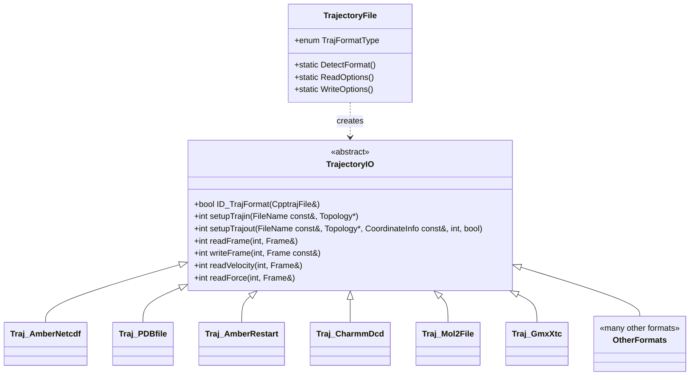
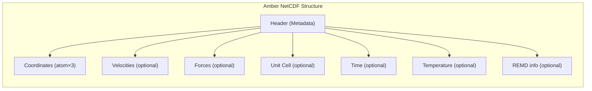
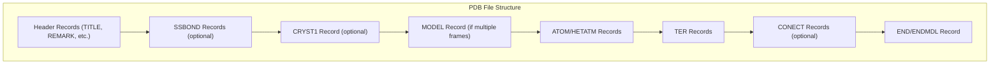
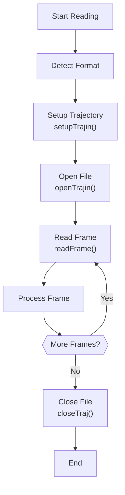
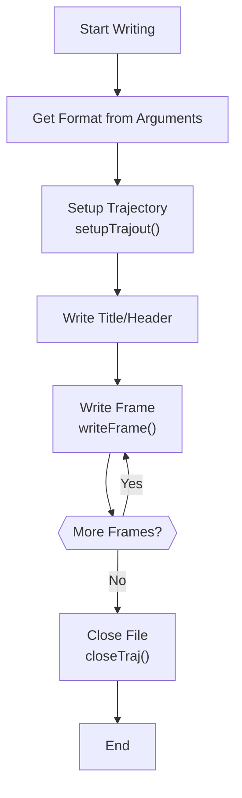

# Trajectory File Formats

<details>
<summary>Relevant source files</summary>

The following files were used as context for generating this wiki page:

- [src/Mol2File.cpp](src/Mol2File.cpp)
- [src/Mol2File.h](src/Mol2File.h)
- [src/NetcdfFile.cpp](src/NetcdfFile.cpp)
- [src/NetcdfFile.h](src/NetcdfFile.h)
- [src/PDBfile.cpp](src/PDBfile.cpp)
- [src/PDBfile.h](src/PDBfile.h)
- [src/Parm_CIF.cpp](src/Parm_CIF.cpp)
- [src/Parm_Mol2.cpp](src/Parm_Mol2.cpp)
- [src/Parm_PDB.cpp](src/Parm_PDB.cpp)
- [src/Traj_AmberCoord.cpp](src/Traj_AmberCoord.cpp)
- [src/Traj_AmberCoord.h](src/Traj_AmberCoord.h)
- [src/Traj_AmberNetcdf.cpp](src/Traj_AmberNetcdf.cpp)
- [src/Traj_AmberNetcdf.h](src/Traj_AmberNetcdf.h)
- [src/Traj_AmberRestart.cpp](src/Traj_AmberRestart.cpp)
- [src/Traj_AmberRestart.h](src/Traj_AmberRestart.h)
- [src/Traj_AmberRestartNC.cpp](src/Traj_AmberRestartNC.cpp)
- [src/Traj_AmberRestartNC.h](src/Traj_AmberRestartNC.h)
- [src/Traj_CharmmDcd.cpp](src/Traj_CharmmDcd.cpp)
- [src/Traj_CharmmDcd.h](src/Traj_CharmmDcd.h)
- [src/Traj_Conflib.cpp](src/Traj_Conflib.cpp)
- [src/Traj_Conflib.h](src/Traj_Conflib.h)
- [src/Traj_Mol2File.cpp](src/Traj_Mol2File.cpp)
- [src/Traj_Mol2File.h](src/Traj_Mol2File.h)
- [src/Traj_NcEnsemble.cpp](src/Traj_NcEnsemble.cpp)
- [src/Traj_PDBfile.cpp](src/Traj_PDBfile.cpp)
- [src/Traj_PDBfile.h](src/Traj_PDBfile.h)
- [src/TrajectoryFile.cpp](src/TrajectoryFile.cpp)
- [src/TrajectoryFile.h](src/TrajectoryFile.h)
- [src/TrajectoryIO.cpp](src/TrajectoryIO.cpp)
- [src/TrajectoryIO.h](src/TrajectoryIO.h)

</details>


## Overview

This page documents the trajectory file formats supported by CPPTRAJ for reading and writing molecular dynamics (MD) trajectory data. CPPTRAJ supports a wide range of file formats, allowing interoperability with various MD software packages and enabling efficient analysis of simulation data.

For information about data file formats used for analysis results, see [Data File I/O](#5.2).

Sources: [src/TrajectoryFile.h:14-36]()

## Trajectory Format Architecture

CPPTRAJ uses a polymorphic architecture to handle different trajectory formats. Two primary classes form the foundation:

1. `TrajectoryFile`: Handles format detection and serves as a factory for creating appropriate I/O handlers
2. `TrajectoryIO`: Abstract base class that defines the interface for reading and writing trajectory data

Each supported format has its own implementation class derived from `TrajectoryIO`, providing format-specific reading and writing capabilities.



Sources: [src/TrajectoryFile.h:14-36](), [src/TrajectoryIO.h:23-43]()

### Format Detection Process

When a trajectory file is read, CPPTRAJ determines its format using the following process:

```mermaid
sequenceDiagram
    participant User
    participant TrajectoryFile
    participant FormatImplementation
    participant File

    User->>TrajectoryFile: DetectFormat(filename)
    TrajectoryFile->>File: Open file
    loop for each registered format
        TrajectoryFile->>FormatImplementation: Create implementation instance
        TrajectoryFile->>FormatImplementation: ID_TrajFormat(file)
        FormatImplementation->>File: Read header/check signature
        FormatImplementation-->>TrajectoryFile: Return format match result
        alt Format matches
            TrajectoryFile-->>User: Return implementation instance
            break
        else No match
            TrajectoryFile->>FormatImplementation: Delete instance
        end
    end
    TrajectoryFile-->>User: Return null if no match found
```

Sources: [src/TrajectoryFile.cpp:158-203]()

## Supported Trajectory Formats

CPPTRAJ supports numerous trajectory file formats. The table below summarizes the most commonly used formats:

| Format | Extension | Read | Write | Coordinates | Velocities | Forces | Box | Description |
|--------|-----------|:----:|:-----:|:-----------:|:----------:|:------:|:---:|-------------|
| Amber NetCDF | .nc | ✓ | ✓ | ✓ | ✓ | ✓ | ✓ | Binary NetCDF format with high precision |
| Amber Restart NetCDF | .ncrst | ✓ | ✓ | ✓ | ✓ | ✓ | ✓ | NetCDF-based restart format |
| Amber ASCII | .crd | ✓ | ✓ | ✓ | ✗ | ✗ | ✓ | Traditional ASCII coordinate format |
| Amber Restart | .rst7 | ✓ | ✓ | ✓ | ✓ | ✓ | ✓ | ASCII-based restart format |
| PDB | .pdb | ✓ | ✓ | ✓ | ✗ | ✗ | ✓ | Standard Protein Data Bank format |
| Mol2 | .mol2 | ✓ | ✓ | ✓ | ✗ | ✗ | ✓ | Tripos Mol2 format |
| Charmm DCD | .dcd | ✓ | ✓ | ✓ | ✓ | ✗ | ✓ | Binary CHARMM trajectory format |
| Gromacs TRX | .trr | ✓ | ✓ | ✓ | ✓ | ✓ | ✓ | Binary GROMACS trajectory |
| Gromacs XTC | .xtc | ✓ | ✓ | ✓ | ✗ | ✗ | ✓ | Compressed GROMACS trajectory |
| BINPOS | .binpos | ✓ | ✓ | ✓ | ✗ | ✗ | ✓ | Binary trajectory format |

Sources: [src/TrajectoryFile.cpp:37-89](), [src/TrajectoryFile.cpp:93-126](), [src/TrajectoryFile.cpp:129-153]()

### Format Registration

Trajectory formats are registered in CPPTRAJ through three key static arrays in `TrajectoryFile.cpp`:

1. `TF_AllocArray`: Maps format types to allocation functions and help text
2. `TF_KeyArray`: Maps format keywords and file extensions to format types (for input)
3. `TF_WriteKeyArray`: Maps format keywords and file extensions to format types (for output)

Sources: [src/TrajectoryFile.cpp:37-89](), [src/TrajectoryFile.cpp:93-126](), [src/TrajectoryFile.cpp:129-153]()

## Format-Specific Details

### Amber NetCDF Format

The Amber NetCDF format is a binary format based on the NetCDF (Network Common Data Form) library. It offers several advantages over ASCII formats:

- Binary representation for better precision
- Self-describing format with metadata
- Efficient random access to frames
- Support for additional data (velocities, forces, etc.)



#### NetCDF Reading Options
- `usevelascoords`: Use velocities instead of coordinates
- `usefrcascoords`: Use forces instead of coordinates

#### NetCDF Writing Options
- `remdtraj`: Include temperature information (makes a REMD trajectory)
- `mdvel`: Write only velocities to trajectory
- `mdfrc`: Write only forces to trajectory
- `mdcrd`: Write coordinates (only needed when specifying mdvel/mdfrc)
- `hdf5`: Create file as NetCDF4/HDF5 instead of NetCDF3
- `compress`: Use compression in HDF5 file
- `icompress`: Use lossy compression via integer conversion (HDF5 only)

Sources: [src/Traj_AmberNetcdf.cpp:72-116](), [src/NetcdfFile.cpp:27-43](), [src/Traj_AmberNetcdf.h:13-25]()

### Amber ASCII Trajectory Format

The traditional Amber trajectory format is an ASCII file with coordinates written in a fixed-width format. Each coordinate is written as an 8.3 floating point number, with 10 values per line.

#### ASCII Format Reading
The format is detected by checking if the second line contains atom coordinates in the expected format.

#### ASCII Format Writing Options
- `remdtraj`: Include replica temperature information
- `highprecision`: Use higher precision format (12.7) for writing coordinates
- `mdvel`: Write velocities instead of coordinates
- `mdfrc`: Write forces instead of coordinates

Sources: [src/Traj_AmberCoord.cpp:44-80](), [src/Traj_AmberCoord.h:12-24]()

### Amber Restart Format

Amber restart files contain a snapshot of a simulation:
- Title line
- Number of atoms (and optionally time and temperature) 
- Coordinates for all atoms (formatted as 6 float values per line)
- Optionally velocities (same format as coordinates)
- Optionally box dimensions

#### Restart Format Reading
Restart files are identified by the presence of an integer (atom count) followed by 0-2 scientific floats (time, temperature) and then a line with 3 or more coordinates in the expected format.

#### Restart Format Writing Options
- `remdtraj`: Write temperature to restart file (also writes time)
- `time0`: Time for first frame (if not specified, time is not written)
- `dt`: Time step for subsequent frames, t=(time0+frame)*dt (default: 1.0)
- `keepext`: Keep filename extension; write '<name>.<num>.<ext>' instead

Sources: [src/Traj_AmberRestart.cpp:30-53](), [src/Traj_AmberRestart.cpp:64-79](), [src/Traj_AmberRestart.h:7-19]()

### PDB Format

The PDB (Protein Data Bank) format is a widely used standard for representing molecular structures. CPPTRAJ's implementation supports both reading and writing PDB files.



#### PDB Reading Options
- `keepaltloc <char>`: If specified, alternate location ID to keep

#### PDB Writing Options
- `dumpq`: Write atom charge/GB radius in occupancy/B-factor columns (PQR format)
- `parse`: Write atom charge/PARSE radius in occupancy/B-factor columns (PQR format)
- `vdw`: Write atom charge/VDW radius in occupancy/B-factor columns (PQR format)
- `pdbres`: Use PDB V3 residue names
- `pdbatom`: Use PDB V3 atom names
- `pdbv3`: Use PDB V3 residue/atom names
- `model`: Write to single file separated by MODEL records
- `multi`: Write each frame to separate files
- `conect`: Write CONECT records using bond information

Sources: [src/Traj_PDBfile.cpp:68-265](), [src/PDBfile.cpp:166-256]()

### Charmm DCD Format

The DCD format is a binary trajectory format originally developed for the CHARMM molecular dynamics package.

#### DCD Reading Options
- `shape`: Force reading of box info as CHARMM shape matrix (XX XY YY XZ YZ ZZ)
- `namdcell`: Force reading of box info as NAMD unit cell (X cos(g) Y cos(b) cos(a) Z)
- `charmmcell`: Force reading of box info as old CHARMM unit cell (X Y Z a b g)

The DCD format is detected by checking for 'CORD' or 'VELD' strings in the file header and determining the endianness and bit size.

Sources: [src/Traj_CharmmDcd.cpp:237-254](), [src/Traj_CharmmDcd.cpp:74-118]()

## Reading and Writing Trajectory Data

### Reading Process



Sources: [src/TrajectoryIO.h:34-44]()

### Writing Process



Sources: [src/TrajectoryIO.h:46-55]()

## Advanced Features

### Compression Options

Several trajectory formats support compression to reduce file size:

- NetCDF HDF5 offers standard compression with `compress` option
- NetCDF HDF5 supports lossy compression with `icompress` option, which converts coordinates to integers
- Gromacs XTC format uses lossy compression natively

### Parallel I/O

Some trajectory formats support parallel I/O operations in MPI builds:

- NetCDF formats can use parallel NetCDF for efficient parallel reading/writing
- Other formats use serial I/O even in parallel builds

Sources: [src/Traj_AmberNetcdf.cpp:513-516]()

## Format Conversion

CPPTRAJ can be used to convert trajectories between formats. This is done by reading frames from one format and writing them to another. This capability is valuable for:

- Reducing file size (e.g., converting to compressed formats)
- Adding or extracting information (coordinates, velocities, forces)
- Converting between simulation packages
- Creating visualization-friendly formats from simulation outputs

## Format Detection

CPPTRAJ uses a combination of file extension matching and content examination to determine trajectory formats. Each format implementation provides an `ID_TrajFormat` method that examines the file header to determine if it matches that format.

Sources: [src/TrajectoryFile.cpp:158-180]()

---