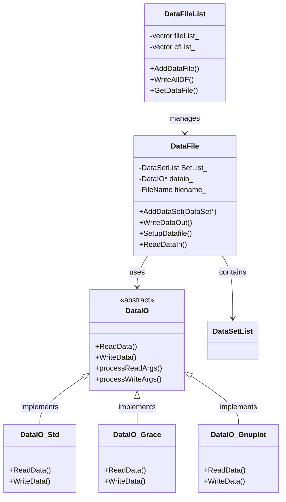
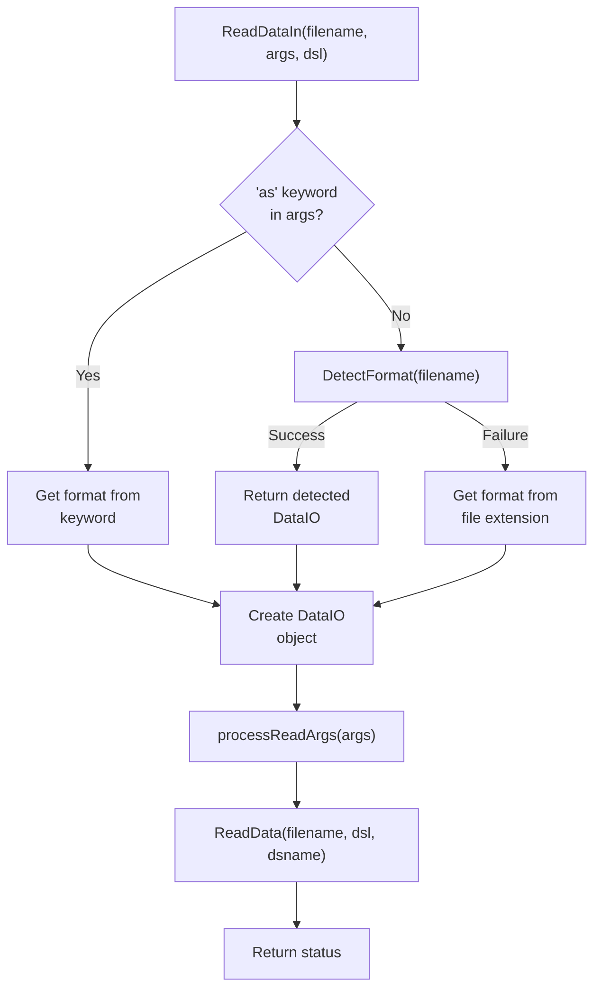
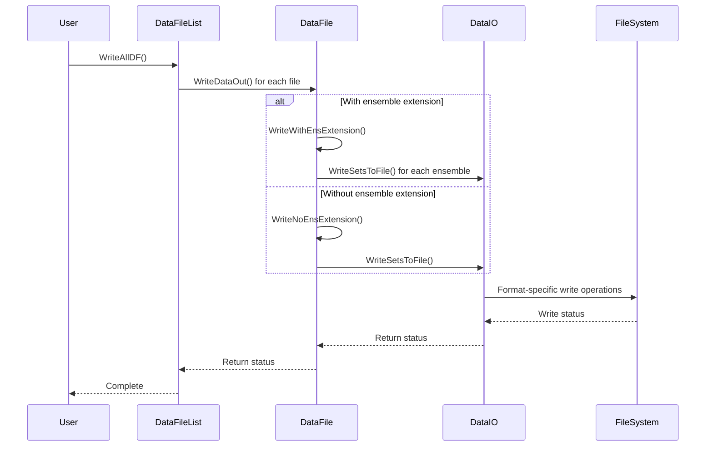
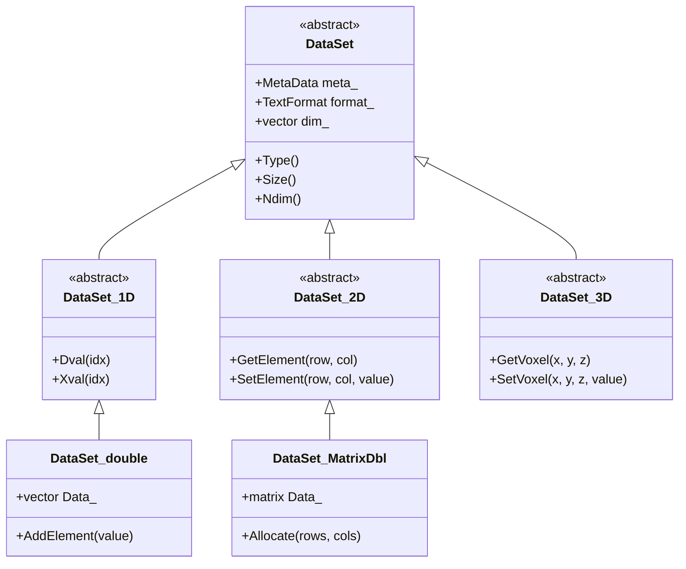

# Data File I/O

<details>
<summary>Relevant source files</summary>

The following files were used as context for generating this wiki page:

- [src/DataFile.cpp](src/DataFile.cpp)
- [src/DataFile.h](src/DataFile.h)
- [src/DataFileList.cpp](src/DataFileList.cpp)
- [src/DataFileList.h](src/DataFileList.h)
- [src/DataIO.cpp](src/DataIO.cpp)
- [src/DataIO.h](src/DataIO.h)
- [src/DataIO_Gnuplot.cpp](src/DataIO_Gnuplot.cpp)
- [src/DataIO_Gnuplot.h](src/DataIO_Gnuplot.h)
- [src/DataIO_Grace.cpp](src/DataIO_Grace.cpp)
- [src/DataIO_Grace.h](src/DataIO_Grace.h)
- [src/DataIO_Mdout.cpp](src/DataIO_Mdout.cpp)
- [src/DataIO_Mdout.h](src/DataIO_Mdout.h)
- [src/DataIO_Std.cpp](src/DataIO_Std.cpp)
- [src/DataIO_Std.h](src/DataIO_Std.h)
- [src/DataSet.cpp](src/DataSet.cpp)
- [src/DataSet.h](src/DataSet.h)
- [src/DataSetList.cpp](src/DataSetList.cpp)
- [src/DataSetList.h](src/DataSetList.h)

</details>


This document covers CPPTRAJ's data file input/output system, which is responsible for reading data from files and writing analysis results to files in various formats. For information about trajectory file I/O, see [Trajectory File Formats](#5.1).

## Overview

CPPTRAJ's Data File I/O system provides a flexible framework for reading data from and writing data to files in multiple formats. The system separates the concerns of file management, format-specific I/O operations, and data storage, allowing for easy extension with new file formats.



Sources: [src/DataFile.h:1-126](). [src/DataFileList.h:1-114](). [src/DataIO.h:1-59]().

## Core Classes

### DataFile

The `DataFile` class represents a data file that can contain multiple `DataSet` objects. It serves as the main interface between the data sets and the file I/O operations. Each `DataFile` instance has:

- A filename (`filename_`)
- A format type (`dfType_`)
- A list of data sets to be written to the file (`SetList_`)
- A `DataIO` object responsible for the actual I/O operations (`dataio_`)

Key responsibilities include:
- Setting up files for reading or writing
- Adding data sets to be written
- Coordinating the reading/writing operations via the `DataIO` object

Sources: [src/DataFile.h:1-126](). [src/DataFile.cpp:1-669]().

### DataFileList

The `DataFileList` class manages a collection of `DataFile` objects. It provides methods for:

- Adding new data files
- Retrieving existing data files
- Writing all data files in the list
- Processing command-line arguments related to data files

This class is useful for directing multiple data sets to the same file and managing file-related options.

Sources: [src/DataFileList.h:1-114](). [src/DataFileList.cpp:1-470]().

### DataIO

`DataIO` is an abstract base class that defines the interface for reading from and writing to specific file formats. The key methods include:

- `ReadData`: Read data from a file into a DataSetList
- `WriteData`: Write data from a DataSetList to a file
- `processReadArgs`: Process format-specific read arguments
- `processWriteArgs`: Process format-specific write arguments

Each specific file format has its own implementation of `DataIO`.

Sources: [src/DataIO.h:1-59](). [src/DataIO.cpp:1-122]().

## Data Flow

The following diagram illustrates the data flow during reading and writing operations:


Sources: [src/DataFile.cpp:178-247](). [src/DataFile.cpp:601-628]().

## Supported File Formats

CPPTRAJ supports numerous file formats for data input and output through various implementations of the `DataIO` interface:

| Format Type | File Extension | DataIO Implementation | Description |
|-------------|----------------|----------------------|-------------|
| Standard    | .dat           | DataIO_Std           | Simple text format with columns of data |
| Grace       | .agr, .xmgr    | DataIO_Grace         | XMGrace plotting program format |
| Gnuplot     | .gnu           | DataIO_Gnuplot       | Gnuplot plotting program format |
| Xplor       | .xplor, .grid  | DataIO_Xplor         | Xplor electron density map format |
| OpenDX      | .dx            | DataIO_OpenDx        | Open Data Explorer format |
| RemLog      | .log           | DataIO_RemLog        | Amber REMD log format |
| Mdout       | .mdout         | DataIO_Mdout         | Amber MD output format |
| Evecs       | .evecs         | DataIO_Evecs         | Eigenvector file format |
| VecTraj     | .vectraj       | DataIO_VecTraj       | Vector pseudo-trajectory format |
| XVG         | .xvg           | DataIO_XVG           | GROMACS graph format |
| CCP4        | .ccp4          | DataIO_CCP4          | CCP4 electron density map format |
| NetCDF      | .nc            | DataIO_NetCDF        | NetCDF format for various data types |

Sources: [src/DataFile.cpp:58-93](). [src/DataFile.cpp:95-122](). [src/DataFile.cpp:124-143]().

## Reading Data

The process of reading data from a file involves several steps:

1. Determining the file format
2. Creating the appropriate `DataIO` object
3. Processing format-specific arguments
4. Reading the data into data sets
5. Adding those data sets to a `DataSetList`

### Format Detection

CPPTRAJ can detect the file format based on the file extension or through explicit specification using the `as` keyword. If the format is not specified and cannot be determined from the extension, CPPTRAJ defaults to the standard format.



Sources: [src/DataFile.cpp:153-167](). [src/DataFile.cpp:178-248]().

### Example: Reading Standard Format Data

The standard format reader (`DataIO_Std`) is the most versatile and can handle various types of data:

- 1D data (columns of values)
- 2D data (matrices)
- 3D data (volumetric grids)
- Vectors
- 3x3 matrices

When reading 1D data, it automatically determines the type of each column (integer, float, double, string) and creates appropriate data sets.

Sources: [src/DataIO_Std.cpp:102-410](). [src/DataIO_Std.h:16-64]().

## Writing Data

Writing data to files involves:

1. Setting up a `DataFile` with the desired format
2. Adding data sets to the `DataFile`
3. Calling `WriteDataOut()` to write the data sets to the file

### Writing Process Flow



Sources: [src/DataFile.cpp:525-640](). [src/DataFileList.cpp:358-407]().

### Format-Specific Options

Each file format has its own set of options that can be specified when setting up the `DataFile`. These options are processed by the format-specific `DataIO` implementation.

For example, the standard format (`DataIO_Std`) supports options for:

- Precision (float or double)
- Column labels
- Data grouping

While the Grace format (`DataIO_Grace`) has options for:

- Inverting X/Y axes
- XYDY data format

And the Gnuplot format (`DataIO_Gnuplot`) offers options for:

- PM3D output
- Color palettes
- JPEG output

Sources: [src/DataIO_Std.cpp:76-97](). [src/DataIO_Grace.cpp:121-126](). [src/DataIO_Gnuplot.cpp:218-239]().

## Command Usage Examples

Here are examples of how to use the Data File I/O system from the CPPTRAJ command line:

1. Reading data from a file:
```
readdata data.dat
```

2. Reading with format specification:
```
readdata data.xmgr as grace
```

3. Writing data to a file:
```
writedata output.dat data1,data2,data3
```

4. Writing with format-specific options:
```
writedata output.gnu data1,data2,data3 gnu xpm3d
```

5. Setting precision for output:
```
writedata output.dat data1,data2,data3 prec 10.4
```

Sources: [src/DataFile.cpp:145-151](). [src/DataFile.cpp:443-516]().

## Internal Data Representation

Data read from files is stored in `DataSet` objects, which are organized in a `DataSetList`. The `DataSet` base class has various specialized implementations for different data types:

- `DataSet_double`, `DataSet_float`, `DataSet_integer` for scalar data
- `DataSet_MatrixDbl`, `DataSet_MatrixFlt` for 2D data
- `DataSet_Grid` for 3D data
- `DataSet_Vector` for vector data

Each `DataSet` has associated metadata that describes its dimensions, labels, and other attributes.



Sources: [src/DataSet.h:1-168](). [src/DataSet.cpp:1-144](). [src/DataSetList.h:1-206](). [src/DataSetList.cpp:1-1666]().

## Extending the System with New Formats

To add support for a new file format, you would need to:

1. Create a new class deriving from `DataIO`
2. Implement the required methods:
   - `ReadData`
   - `WriteData`
   - `processReadArgs`
   - `processWriteArgs`
   - `ID_DataFormat`
3. Register the new format in the `DataFile` static arrays:
   - `DF_AllocArray`
   - `DF_KeyArray`
   - `DF_WriteKeyArray`

This modular design makes it straightforward to extend the system with new file formats without modifying the core data management classes.

Sources: [src/DataFile.cpp:58-93](). [src/DataFile.cpp:95-122](). [src/DataFile.cpp:124-143]().

---