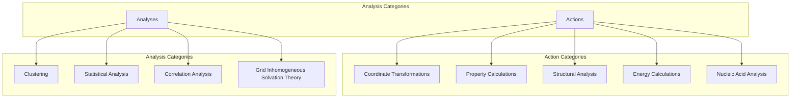
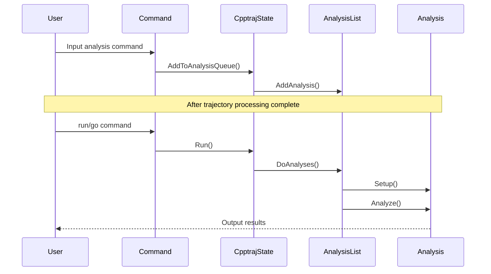
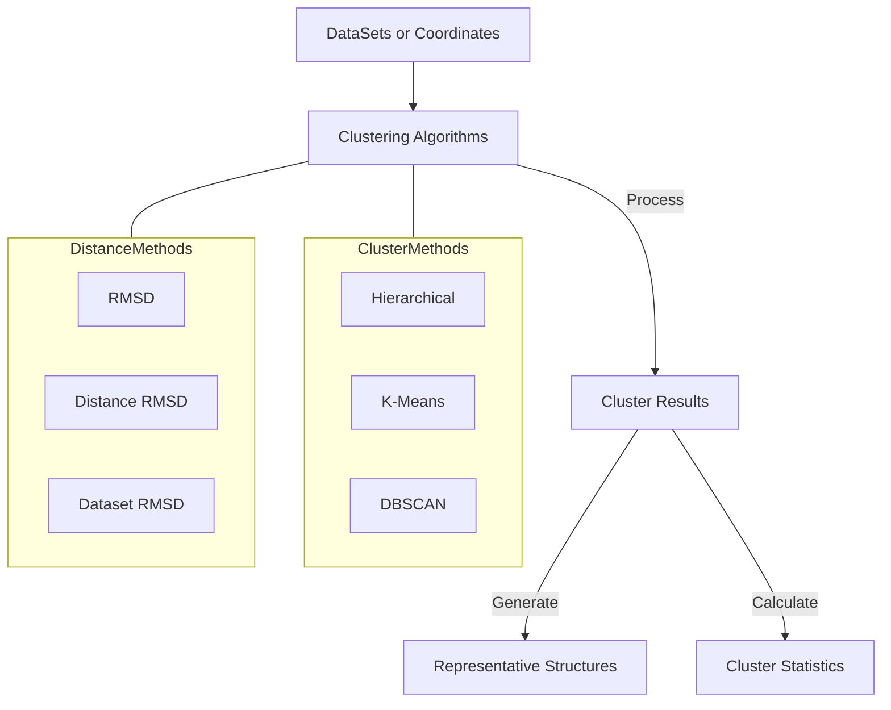
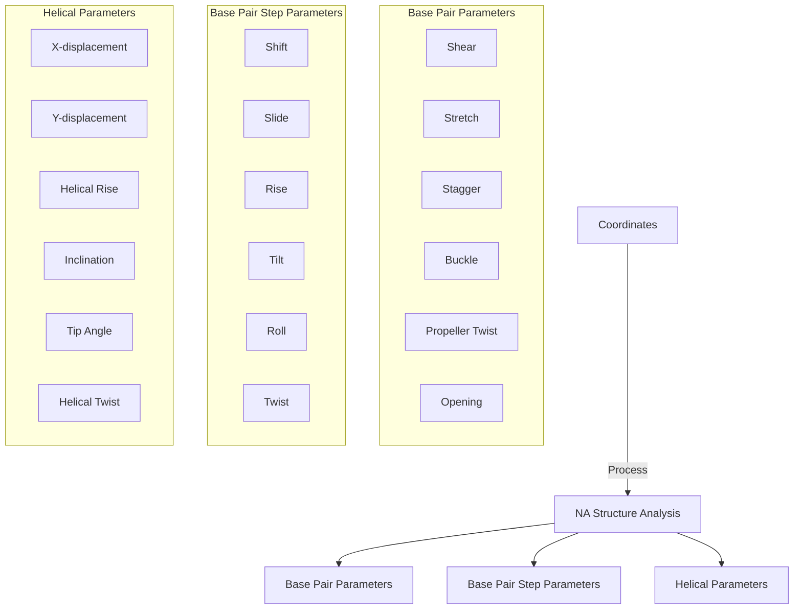
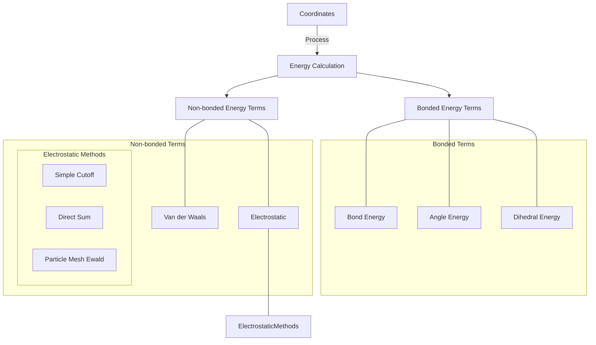
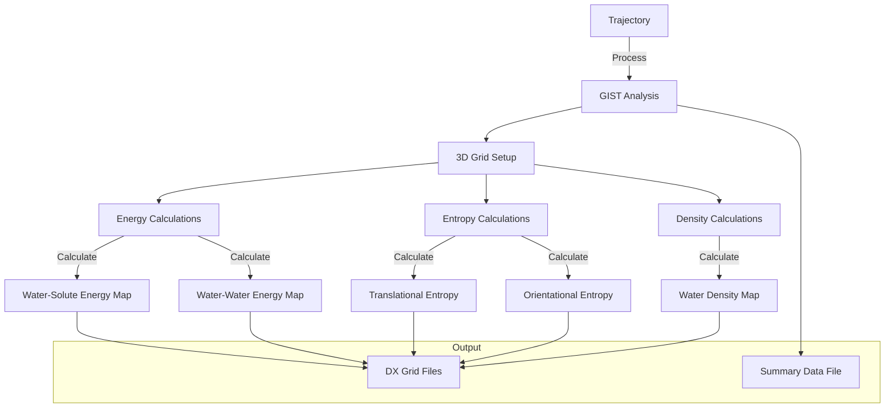
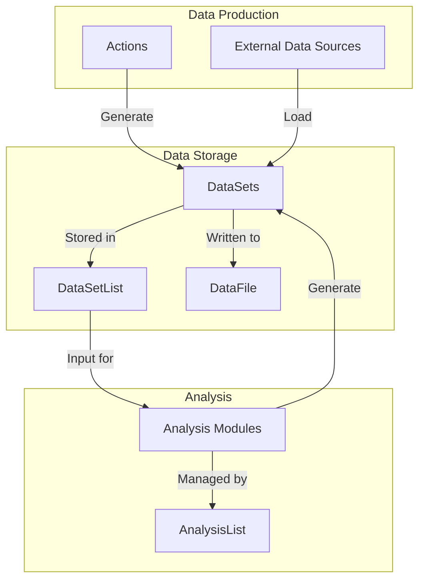

# Analysis Features

Relevant source files

The following files were used as context for generating this wiki page:

- [doc/CpptrajManual.pdf](doc/CpptrajManual.pdf)
- [doc/DocumentChecksums.txt](doc/DocumentChecksums.txt)
- [doc/cpptraj.lyx](doc/cpptraj.lyx)
- [src/Action_Energy.cpp](src/Action_Energy.cpp)
- [src/Action_Energy.h](src/Action_Energy.h)
- [src/Action_GIST.cpp](src/Action_GIST.cpp)
- [src/Action_GIST.h](src/Action_GIST.h)
- [src/Action_NAstruct.cpp](src/Action_NAstruct.cpp)
- [src/Action_NAstruct.h](src/Action_NAstruct.h)
- [src/Analysis_Clustering.cpp](src/Analysis_Clustering.cpp)
- [src/Analysis_Clustering.h](src/Analysis_Clustering.h)
- [src/AxisType.cpp](src/AxisType.cpp)
- [src/AxisType.h](src/AxisType.h)
- [src/Command.cpp](src/Command.cpp)
- [src/Energy.cpp](src/Energy.cpp)
- [src/Energy.h](src/Energy.h)
- [src/Energy/Ene_Angle.h](src/Energy/Ene_Angle.h)
- [src/Energy/EnergyDecomposer.cpp](src/Energy/EnergyDecomposer.cpp)
- [src/Energy/EnergyDecomposer.h](src/Energy/EnergyDecomposer.h)
- [src/PairList.cpp](src/PairList.cpp)
- [src/PairList.h](src/PairList.h)
- [src/Version.h](src/Version.h)
- [src/cpptrajdepend](src/cpptrajdepend)
- [src/cpptrajfiles](src/cpptrajfiles)
- [test/Makefile](test/Makefile)
- [test/Test_EneDecomp/RunTest.sh](test/Test_EneDecomp/RunTest.sh)
- [test/Test_EneDecomp/decomp.components.nacl.box.dat.save](test/Test_EneDecomp/decomp.components.nacl.box.dat.save)
- [test/Test_EneDecomp/decomp.components.tz2.dat.save](test/Test_EneDecomp/decomp.components.tz2.dat.save)
- [test/Test_GIST/Gist10-Info.dat.save](test/Test_GIST/Gist10-Info.dat.save)
- [test/Test_GIST/Gist3-output.dat.save](test/Test_GIST/Gist3-output.dat.save)
- [test/Test_GIST/Gist4-Info.dat.save](test/Test_GIST/Gist4-Info.dat.save)
- [test/Test_GIST/Gist4-Solute-Etot-pme-dens.dx.save](test/Test_GIST/Gist4-Solute-Etot-pme-dens.dx.save)
- [test/Test_GIST/Gist5-Info.dat.save](test/Test_GIST/Gist5-Info.dat.save)
- [test/Test_GIST/Gist5-Solute-Etot-pme-dens.dx.save](test/Test_GIST/Gist5-Solute-Etot-pme-dens.dx.save)
- [test/Test_GIST/Gist6.out.save](test/Test_GIST/Gist6.out.save)
- [test/Test_GIST/Gist7.out.save](test/Test_GIST/Gist7.out.save)
- [test/Test_GIST/RunTest.sh](test/Test_GIST/RunTest.sh)
- [test/Test_GIST/gist.out.save](test/Test_GIST/gist.out.save)
- [test/Test_GIST_Order/gist-order-norm.dx.save](test/Test_GIST_Order/gist-order-norm.dx.save)
- [test/Test_GIST_Order/gistout.dat.save](test/Test_GIST_Order/gistout.dat.save)
- [test/Test_GIST_Order/test_gist-center.crd](test/Test_GIST_Order/test_gist-center.crd)
- [test/Test_GIST_Order/test_gist.prmtop](test/Test_GIST_Order/test_gist.prmtop)
- [test/Test_GIST_Order/tip4p.dat.save](test/Test_GIST_Order/tip4p.dat.save)
- [test/Test_GIST_Order/tip4pew.cluster.parm7](test/Test_GIST_Order/tip4pew.cluster.parm7)
- [test/Test_GIST_Order/tip4pew.cluster.rst7](test/Test_GIST_Order/tip4pew.cluster.rst7)
- [test/Test_GIST_Order/tip5p.cluster.parm7](test/Test_GIST_Order/tip5p.cluster.parm7)
- [test/Test_GIST_Order/tip5p.cluster.rst7](test/Test_GIST_Order/tip5p.cluster.rst7)
- [test/Test_GIST_Order/tip5p.dat.save](test/Test_GIST_Order/tip5p.dat.save)
- [test/Test_NAstruct/RunTest.sh](test/Test_NAstruct/RunTest.sh)
- [test/Test_NAstruct/SS.mol1.dat.save](test/Test_NAstruct/SS.mol1.dat.save)
- [test/Test_NAstruct/SS.mol1.selected.dat.save](test/Test_NAstruct/SS.mol1.selected.dat.save)
- [test/Test_NAstruct/axes.bases.pdb.save](test/Test_NAstruct/axes.bases.pdb.save)
- [test/Test_NAstruct/axes.bp.mol2.save](test/Test_NAstruct/axes.bp.mol2.save)
- [test/Test_NAstruct/axes.step.crd.save](test/Test_NAstruct/axes.step.crd.save)
- [test/Test_NAstruct/axes.step.parm7.save](test/Test_NAstruct/axes.step.parm7.save)
- [test/Test_ReadData/RunTest.sh](test/Test_ReadData/RunTest.sh)

This page documents the analysis capabilities in CPPTRAJ, which allow users to analyze data generated from trajectory processing or external sources. CPPTRAJ provides a rich set of analysis methods ranging from statistical analysis to advanced molecular structure characterization. For information about trajectory processing actions, see [Core Architecture](#3).

## Analysis Framework Overview

CPPTRAJ divides analysis capabilities into two primary categories:

1. **Actions** - Operations performed on coordinate frames as they are read during trajectory processing
2. **Analyses** - Operations performed on accumulated data after frames have been processed

Sources: [src/Command.cpp:74-169](). [src/Command.cpp:170-215]().

## Analysis Execution Flow

Analysis operations in CPPTRAJ follow a specific execution flow:

Sources: [src/Command.cpp:604-662]().

## Key Analysis Features

### Clustering

Clustering groups similar conformations together based on a distance metric, useful for identifying dominant states in a simulation.

CPPTRAJ provides multiple clustering algorithms:
- Hierarchical (bottom-up, top-down)
- K-means
- DBSCAN
- DPeaks (density peaks)

Distance metrics include:
- RMSD (standard, best-fit, mass-weighted, symmetry-corrected)
- Distance-RMSD
- Dataset-based metrics

Sources: [src/Analysis_Clustering.cpp:1-75](). [test/Makefile:102-116]().

### Nucleic Acid Structure Analysis (NAstruct)

NAstruct calculates structural parameters for nucleic acids following established conventions.

Features of NAstruct:
- Compatible with standard 3DNA and Curves+ conventions
- Support for custom base pair definitions
- Multiple options for determining base pairing
- Groove width calculations
- Analysis of non-canonical structures
- Output of base reference frames

Sources: [src/Action_NAstruct.cpp:1-454](). [src/Action_NAstruct.h:1-139](). [src/AxisType.cpp:1-66](). [test/Makefile:70-72]().

### Energy Calculations

CPPTRAJ can calculate various energy terms for molecules or systems.

Energy calculation features:
- Multiple supported terms (bond, angle, dihedral, non-bonded)
- Various electrostatic calculation methods (simple, direct sum, Ewald, PME)
- OpenMM integration for full potential calculations
- Support for kinetic energy calculations
- Per-residue and per-molecule decomposition

Sources: [src/Action_Energy.cpp:1-100](). [src/Action_Energy.h:1-30](). [src/Energy.cpp:1-56](). [test/Makefile:278-280]().

### Grid Inhomogeneous Solvation Theory (GIST)

GIST is a method for analyzing the thermodynamic properties of water molecules on a 3D grid.

GIST analysis features:
- 3D grid-based analysis of solvent properties
- Water-water and water-solute interaction energies
- Translational and orientational entropy calculations
- Order parameter calculations
- Support for PME-based energy calculations
- CUDA acceleration for performance
- Output in standard visualizable formats

Sources: [src/Action_GIST.cpp:1-321](). [src/Action_GIST.h:1-136](). [test/Test_GIST/RunTest.sh:1-11](). [test/Makefile:205-207]().

## Statistical Analyses

CPPTRAJ includes numerous statistical analysis tools for processing trajectory-derived data:

| Analysis Type | Description | Key Features |
|--------------|-------------|--------------|
| Correlation | Calculate auto/cross-correlation between time series | Supports FFT methods, handles multiple datasets |
| Regression | Linear/polynomial regression analysis | Supports weighted fits, multiple datasets |
| Clustering | Group similar conformations | Multiple algorithms and metrics |
| Histogram | Generate 1D/2D histograms of data | Customizable bin sizes, normalization |
| Wavelet | Time-frequency analysis | Multi-resolution capabilities |
| IRED | Isotropic Reorientational Eigenmode Dynamics | Model-free approach for NMR order parameters |
| Lifetime | Analyze state transitions | Statistics on persistence of interactions |
| Timeseries | Time series analysis tools | Autocorrelation, moving averages |

Sources: [src/Command.cpp:171-214](). [test/Makefile:89-116](). [test/Makefile:117-145]().

## Data Management for Analysis

Analysis features in CPPTRAJ rely on a sophisticated data management system:

Key aspects of the data management system:
- Various dataset types (scalars, vectors, matrices, grids)
- Flexible data access and manipulation
- Unified interface for file I/O
- Support for mathematical operations on datasets
- Integration between Actions and Analyses

Sources: [src/Command.cpp:227-245](). [test/Makefile:209-210](). [test/Makefile:337-339]().

## Implementing Custom Analysis

CPPTRAJ has an extensible architecture that allows new analysis methods to be added:

1. For new **Actions**, create a class that inherits from `Action` with the required methods:
   - `Init()` - Initialize the action with command line arguments
   - `Setup()` - Set up the action for a specific topology
   - `DoAction()` - Process each frame
   - `Print()` - Output results

2. For new **Analyses**, create a class that inherits from `Analysis` with the required methods:
   - `Setup()` - Initialize the analysis with command line arguments
   - `Analyze()` - Perform the analysis on accumulated data

3. Register the new analysis in `Command.cpp` using `Command::AddCmd()` to make it available to users

Sources: [src/Command.cpp:226-478](). [src/Analysis_Clustering.cpp:1-75](). [src/Action_NAstruct.cpp:1-139]().

## Parallel Analysis

Many CPPTRAJ analysis methods support parallel processing through OpenMP and MPI:

- **OpenMP** parallelization for shared-memory performance on multi-core systems
- **MPI** parallelization for distributed-memory systems and cluster computing
- Support for ensemble-level parallelism (multiple trajectories)
- Frame-level parallelism for certain compute-intensive analyses

Sources: [src/Action_GIST.cpp:14-16](). [src/Action_NAstruct.cpp:43-47]().

## Analysis Data Visualization

Analysis results can be output in various formats for visualization:

- Standard data file formats (text, CSV, etc.)
- Grace/xmgrace format for 2D plotting
- DX format for 3D grid visualization
- PDB/trajectory files for structural outputs
- NumPy-compatible formats for integration with Python tools

Sources: [test/Test_GIST/RunTest.sh:5-10](). [test/Test_ReadData/RunTest.sh:5-7]().

---