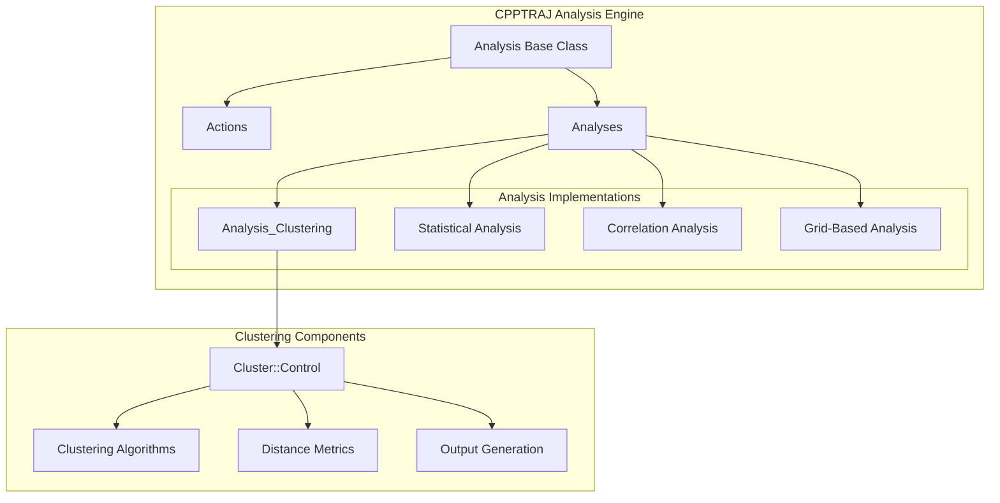
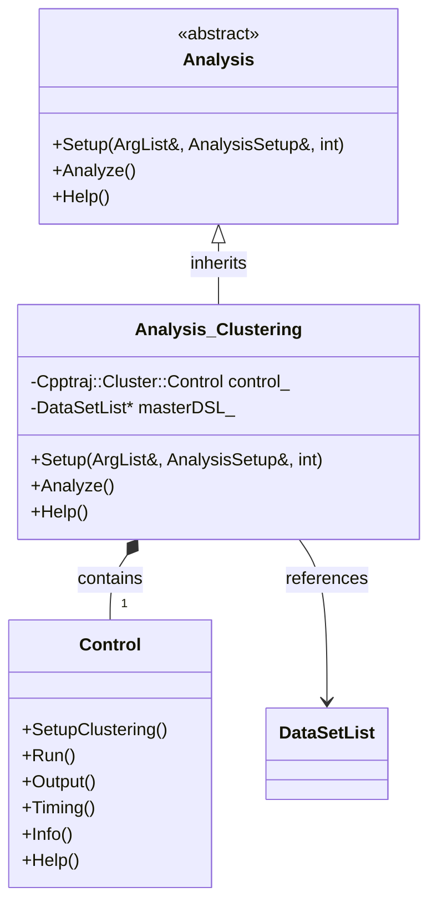
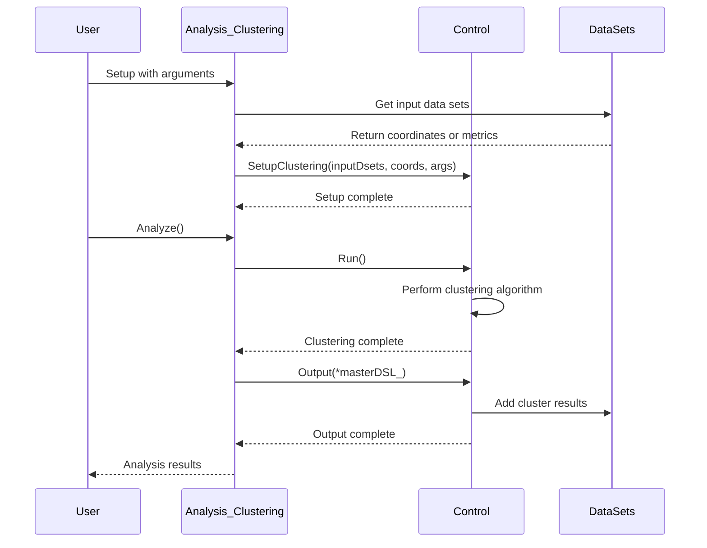
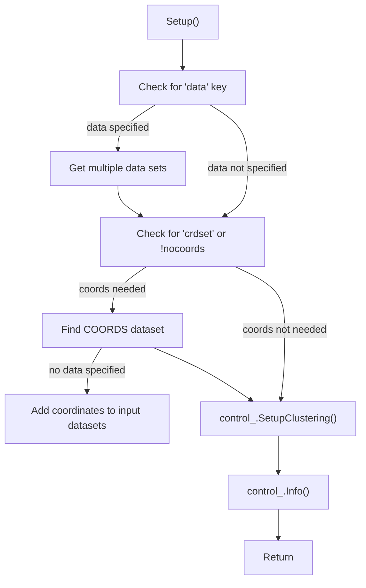
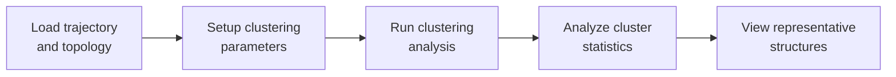

# Clustering

Relevant source files

The following files were used as context for generating this wiki page:

- [src/Analysis_Clustering.cpp](src/Analysis_Clustering.cpp)
- [src/Analysis_Clustering.h](src/Analysis_Clustering.h)

This document provides a comprehensive overview of the clustering functionality in CPPTRAJ. Clustering is a powerful analysis technique that groups similar conformations from molecular dynamics trajectories, helping researchers identify predominant structural states and simplify trajectory analysis. For other analysis features, see [Analysis Features](#6).

## Purpose and Overview

Clustering in CPPTRAJ allows users to group trajectory frames based on structural similarity or other metrics. The implementation supports multiple clustering algorithms, distance metrics, and processing options to accommodate different research needs. This system enables:

- Identification of representative structures from large trajectory datasets
- Analysis of conformational space sampling
- Reduction of trajectory complexity for further analysis
- Generation of structural ensembles for visualization and interpretation

Sources: [src/Analysis_Clustering.h:5-6]()

## Integration with CPPTRAJ Architecture

Clustering is implemented as an Analysis module within CPPTRAJ's Analysis Engine. It operates on trajectory data or other datasets and produces clustered datasets that can be further processed or output.

Sources: [src/Analysis_Clustering.h:1-19](), [src/Analysis_Clustering.cpp:4-5]()

## Class Structure

The clustering functionality is primarily implemented through two key classes:

1. `Analysis_Clustering` - Entry point that inherits from the `Analysis` base class
2. `Cpptraj::Cluster::Control` - Core implementation that handles the clustering algorithms and processing

Sources: [src/Analysis_Clustering.h:4-18](), [src/Analysis_Clustering.cpp:4-15]()

## Processing Workflow

The clustering analysis follows a specific workflow through the CPPTRAJ processing pipeline:

Sources: [src/Analysis_Clustering.cpp:14-75]()

## Data Handling

Clustering can be performed on two types of input data:

1. **Coordinate Data** (`DataSet_Coords`): Clustering based on structural similarity of trajectory frames
2. **Generic Data Sets**: Clustering based on arbitrary data metrics

The input data selection is handled in the `Setup()` method of `Analysis_Clustering`:

Sources: [src/Analysis_Clustering.cpp:14-56]()

## Clustering Execution

The actual clustering analysis is executed in the `Analyze()` method:

1. Start a timer to measure performance
2. Call `control_.Run()` to execute the clustering algorithm
3. Call `control_.Output(*masterDSL_)` to generate output data
4. Stop the timer and record timing information

Sources: [src/Analysis_Clustering.cpp:59-75]()

## Supported Clustering Algorithms

CPPTRAJ supports multiple clustering algorithms, including:

| Algorithm | Description |
|-----------|-------------|
| Hierarchical | Groups data points based on distance between them in a tree-like structure |
| K-means | Partitions data into k clusters based on the mean distance to cluster centers |
| DBSCAN | Density-based spatial clustering - groups based on regions of high density |
| DPeaks | Density peaks clustering algorithm |

The specific algorithm used is determined by parameters passed during setup.

Sources: System Architecture Diagrams

## Usage Parameters

The clustering functionality accepts several key parameters:

| Parameter | Description |
|-----------|-------------|
| `crdset <crd set>` | Specifies a coordinate dataset for structural clustering |
| `data <dset0>[,<dset1>...]` | Specifies arbitrary datasets for metric-based clustering |
| `nocoords` | Disables use of coordinate data, even if available |

Additional parameters for specific algorithms, distance metrics, and output options are handled by the `Control` class.

Sources: [src/Analysis_Clustering.cpp:8-11](), [src/Analysis_Clustering.cpp:19-46]()

## Practical Workflow

The typical workflow for using clustering in CPPTRAJ involves:

## Implementation Notes

1. The `Analysis_Clustering` class acts primarily as a wrapper that delegates the actual clustering functionality to the `Cpptraj::Cluster::Control` class.

2. Input data processing is flexible, allowing for:
   - Coordinate-based clustering (structural similarity)
   - Data metric-based clustering (arbitrary metrics)
   - Combinations of both approaches

3. Performance timing is built in to track the efficiency of the clustering operation.

4. Results are stored in the master DataSetList for further processing or output.

Sources: [src/Analysis_Clustering.cpp:1-76](), [src/Analysis_Clustering.h:1-19]()

## Integration with Other CPPTRAJ Components

Clustering analysis interacts with several other components of CPPTRAJ:

1. **Data Management System**: Results are stored as DataSets
2. **Output System**: Cluster statistics and representative structures can be written to various output formats
3. **Command Processing**: Clustering parameters are parsed from user input

For more information on these related systems, see [Data Management](#4.3) and [Command Processing](#3.1).

---