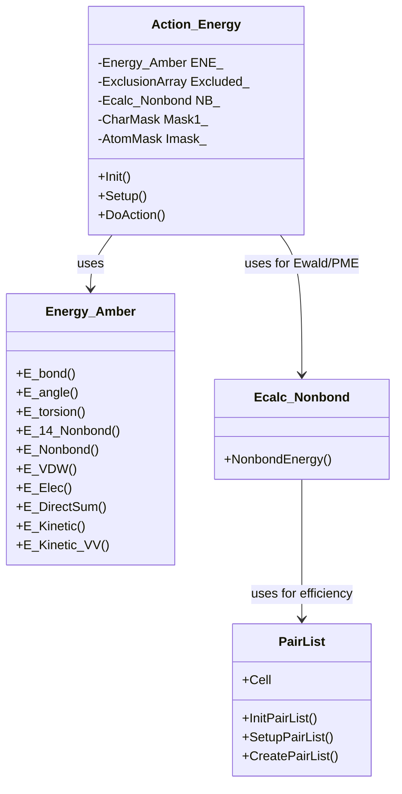
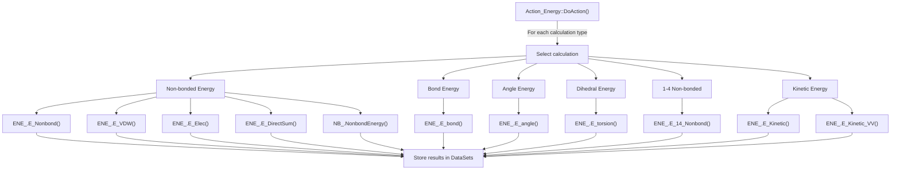
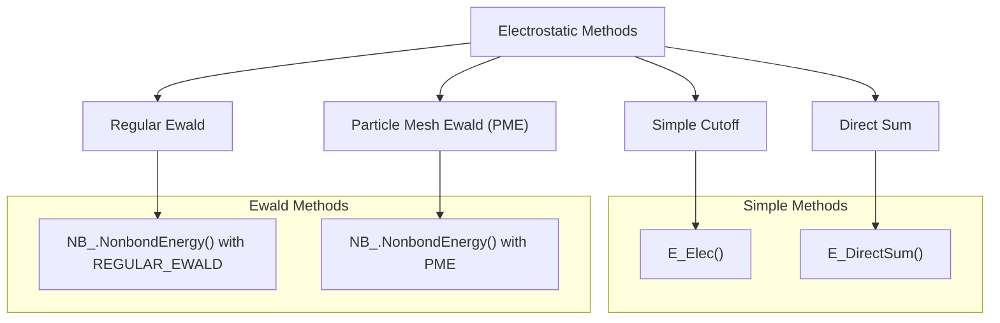
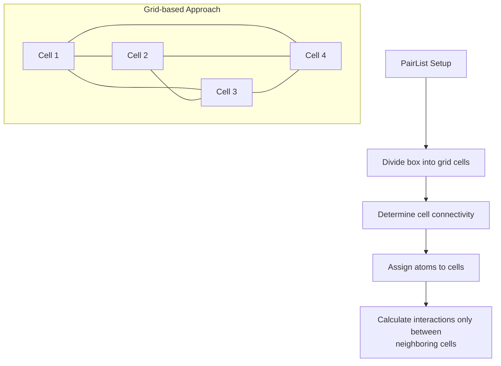

# Energy Calculations

<details>
<summary>Relevant source files</summary>

The following files were used as context for generating this wiki page:

- [src/Action_Energy.cpp](src/Action_Energy.cpp)
- [src/Action_Energy.h](src/Action_Energy.h)
- [src/Energy.cpp](src/Energy.cpp)
- [src/Energy.h](src/Energy.h)
- [src/Energy/Ene_Angle.h](src/Energy/Ene_Angle.h)
- [src/PairList.cpp](src/PairList.cpp)
- [src/PairList.h](src/PairList.h)

</details>


This page documents the energy calculation functionality in CPPTRAJ, which provides methods for computing various energy components from molecular simulations. Energy calculations in CPPTRAJ can analyze bond, angle, dihedral, van der Waals, electrostatic, and kinetic energy terms both individually and in combination.

For information about potential functions used by other components, see the Analysis Engine Architecture [Analysis Engine](#6).

## Architecture Overview

Energy calculations in CPPTRAJ are implemented through the Action framework as `Action_Energy`, which uses the `Energy_Amber` class to perform actual calculations. The relationship between these components is illustrated below:



Sources: [src/Action_Energy.h:10-71](), [src/Energy.h:10-42](), [src/PairList.h:57-173]()

## Energy Components

CPPTRAJ can calculate the following energy components:

| Component | Description | Implementation |
|-----------|-------------|----------------|
| Bond      | Energy from bond stretching | `E_bond()` |
| Angle     | Energy from angle bending | `E_angle()` |
| Dihedral  | Energy from dihedral torsions | `E_torsion()` |
| VDW       | Van der Waals non-bonded energy | `E_VDW()` |
| Electrostatic | Coulombic interactions | `E_Elec()`, `E_DirectSum()` |
| 1-4 Non-bonded | Scaled interactions between atoms separated by 3 bonds | `E_14_Nonbond()` |
| Kinetic   | Kinetic energy from velocities | `E_Kinetic()`, `E_Kinetic_VV()` |

Sources: [src/Action_Energy.cpp:64-69](), [src/Action_Energy.h:26](), [src/Energy.h:15-27]()

### Calculation Flow

The energy calculation workflow follows this sequence:



Sources: [src/Action_Energy.cpp:407-523]()

## Bonded Energy Terms

Bonded energy terms include bond, angle, and dihedral energies which are calculated using the standard Amber force field formulations.

### Bond Energy

Bond energy is calculated using a harmonic potential:

```
E_bond = k * (r - r_eq)²
```

where `k` is the force constant, `r` is the actual bond length, and `r_eq` is the equilibrium bond length.

Implementation uses the `Ene_Bond` templated function to calculate each bond's energy contribution, separately handling bonds to hydrogen if requested.

Sources: [src/Energy.cpp:18-55]()

### Angle Energy

Angle energy uses a harmonic potential around the equilibrium angle:

```
E_angle = k * (θ - θ_eq)²
```

where `θ` is the angle between three atoms and `θ_eq` is the equilibrium angle.

The implementation calculates angles using the dot product of the two bond vectors, ensuring the cosine value stays within reasonable bounds (-0.999 to 0.999).

Sources: [src/Energy.cpp:59-97](), [src/Energy/Ene_Angle.h:6-40]()

### Dihedral Energy

Dihedral energy is calculated using a periodic function:

```
E_dihedral = k * (1 + cos(n*φ - φ_0))
```

where `k` is the force constant, `n` is the periodicity, `φ` is the dihedral angle, and `φ_0` is the phase.

Sources: [src/Energy.cpp:100-142]()

## Non-bonded Energy Terms

Non-bonded energy terms include van der Waals and electrostatic interactions between atoms that are not connected by bonds.

### Van der Waals Energy

Van der Waals energy uses the Lennard-Jones 6-12 potential:

```
E_vdw = (A/r¹²) - (B/r⁶)
```

where `A` and `B` are parameters derived from the atom types, and `r` is the distance between atoms.

Sources: [src/Energy.cpp:268-317]()

### Electrostatics 

Electrostatic energy can be calculated using several methods:



Sources: [src/Action_Energy.cpp:160-196](), [src/Energy.cpp:320-409]()

#### Simple Cutoff Method

The simplest method which calculates Coulomb's law directly:

```
E_elec = q₁q₂/(ε*r)
```

where `q₁` and `q₂` are the charges on the atoms, `ε` is the dielectric constant, and `r` is the distance.

Sources: [src/Energy.cpp:320-365]()

#### Direct Sum Method

Calculates electrostatic energy including periodic images:

```
E_direct = E_elec + ∑(image cells) q₁q₂/(ε*r_image)
```

This method can be computationally expensive for large systems but is useful for validation.

Sources: [src/Energy.cpp:367-409](), [src/Action_Energy.cpp:391-404]()

#### Ewald and PME Methods

For more efficient treatment of long-range electrostatics, CPPTRAJ implements:

1. Regular Ewald Summation - Splits the calculation into short-range and long-range components
2. Particle Mesh Ewald (PME) - Uses Fast Fourier Transforms to accelerate the long-range part

These methods require the `Ecalc_Nonbond` class which uses a spatial grid via `PairList` for efficient calculation.

Sources: [src/Action_Energy.cpp:163-186]()

### 1-4 Non-bonded Interactions

1-4 interactions (between atoms separated by exactly three bonds) are calculated separately with scaling factors (SCNB for VDW, SCEE for electrostatics) to prevent over-estimation of these forces:

```
E_vdw14 = ((A/r¹²) - (B/r⁶)) / SCNB
E_elec14 = (q₁q₂/(ε*r)) / SCEE
```

Sources: [src/Energy.cpp:146-202]()

## Kinetic Energy

CPPTRAJ can calculate kinetic energy in two ways:

1. From velocities directly (on-step): `E_k = 0.5 * m * v²`
2. Using the velocity Verlet approach (half-step velocities): Estimates on-step velocities using force information

Sources: [src/Energy.cpp:412-469](), [src/Action_Energy.cpp:140-156]()

## Efficiency Considerations

### Exclusion Lists

Non-bonded interactions are not calculated between atoms that are already connected via bonds, angles, or dihedrals. CPPTRAJ uses an `ExclusionArray` to track these relationships and skip unnecessary calculations.

Sources: [src/Action_Energy.cpp:345-362]()

### Spatial Decomposition with PairList

For efficient handling of non-bonded interactions, CPPTRAJ implements a grid-based neighbor list through the `PairList` class. This divides the simulation box into grid cells and only calculates interactions between atoms in neighboring cells.



Sources: [src/PairList.cpp:70-96](), [src/PairList.cpp:159-229]()

## Command Usage

Energy calculations are invoked using the `energy` command in CPPTRAJ:

```
energy [<name>] [<mask1>] [out <filename>] [nobondstoh] [openmm [<mdopts>]]
       [bond] [angle] [dihedral] {[nb14]|[e14]|[v14]} {[nonbond] | [elec] [vdw]}
       [{nokinetic|kinetic [ketype {vel|vv}] [dt <dt>]}]
       [ etype { simple |
                 directsum [npoints <N>] |
                 ewald ... |
                 pme ...
               } ]
```

Key options:
- Specify energy terms to calculate: `bond`, `angle`, `dihedral`, `nonbond`, etc.
- Select electrostatics method: `etype simple|directsum|ewald|pme`
- Kinetic energy options: `kinetic [ketype {vel|vv}] [dt <dt>]`

Sources: [src/Action_Energy.cpp:29-53](), [src/Action_Energy.cpp:86-317]()

## Example Applications

Energy calculations in CPPTRAJ can be used for:

1. Evaluating structure quality by examining energy components
2. Analyzing energy conservation in MD trajectories
3. Comparing different force field terms and their contributions
4. Calculating binding energies by selecting specific groups of atoms

When calculating total energies, it's important to consider which electrostatic method is most appropriate for the system size and boundary conditions.

Sources: [src/Action_Energy.cpp:282-317]()

---