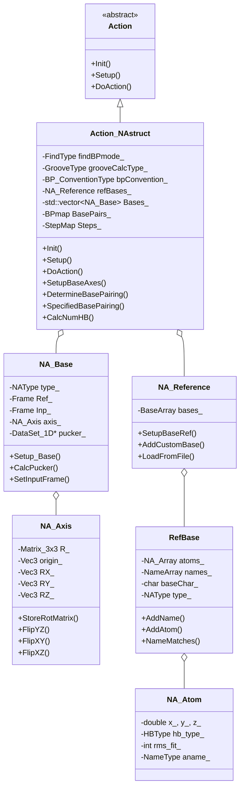
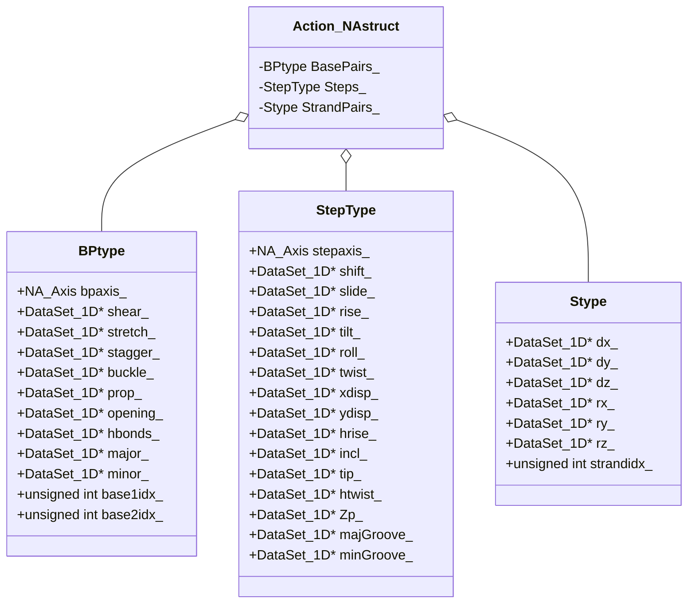
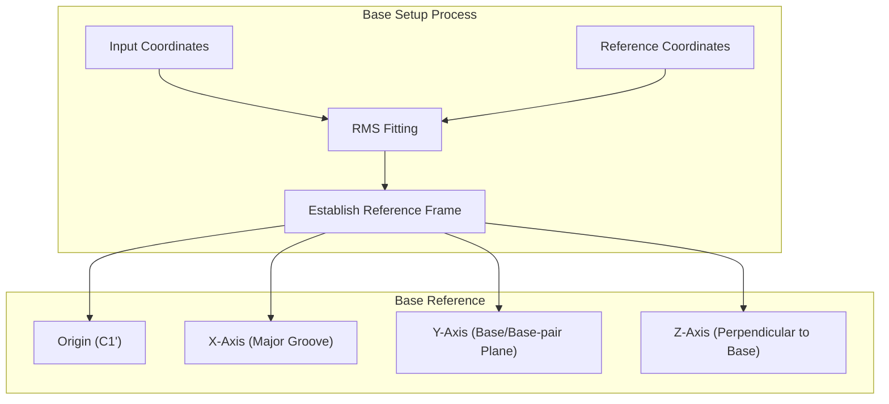
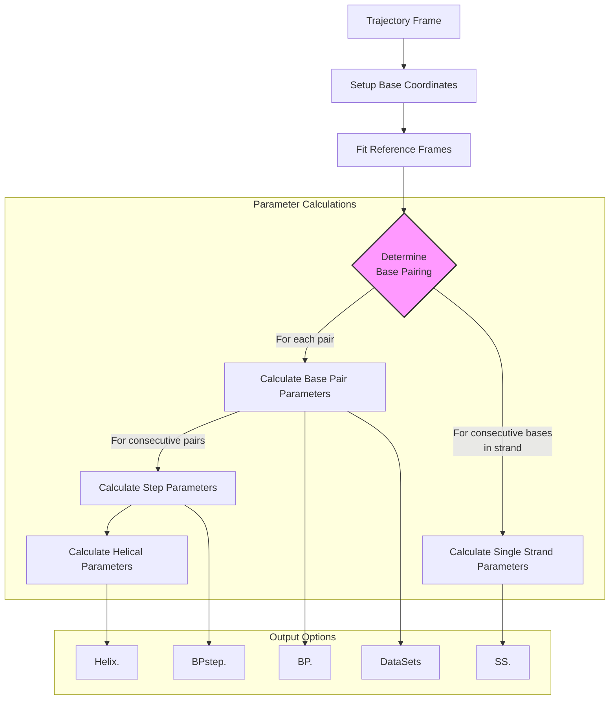
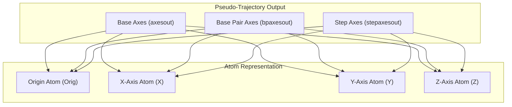

# Nucleic Acid Analysis

<details>
<summary>Relevant source files</summary>

The following files were used as context for generating this wiki page:

- [src/Action_NAstruct.cpp](src/Action_NAstruct.cpp)
- [src/Action_NAstruct.h](src/Action_NAstruct.h)
- [src/AxisType.cpp](src/AxisType.cpp)
- [src/AxisType.h](src/AxisType.h)
- [test/Test_NAstruct/RunTest.sh](test/Test_NAstruct/RunTest.sh)
- [test/Test_NAstruct/SS.mol1.dat.save](test/Test_NAstruct/SS.mol1.dat.save)
- [test/Test_NAstruct/SS.mol1.selected.dat.save](test/Test_NAstruct/SS.mol1.selected.dat.save)
- [test/Test_NAstruct/axes.bases.pdb.save](test/Test_NAstruct/axes.bases.pdb.save)
- [test/Test_NAstruct/axes.bp.mol2.save](test/Test_NAstruct/axes.bp.mol2.save)
- [test/Test_NAstruct/axes.step.crd.save](test/Test_NAstruct/axes.step.crd.save)
- [test/Test_NAstruct/axes.step.parm7.save](test/Test_NAstruct/axes.step.parm7.save)

</details>


The Nucleic Acid Analysis module in CPPTRAJ provides comprehensive analysis of nucleic acid structure from molecular dynamics trajectories. It calculates a wide range of geometric parameters describing the spatial arrangements of nucleic acid bases, base pairs, base-pair steps, and helical conformations, allowing detailed characterization of DNA and RNA structural dynamics.

## Overview of NAstruct

The `NAstruct` command enables analysis of nucleic acid structures through several key capabilities:

- Base pair identification through geometric criteria or user specification
- Calculation of standard base-pair parameters (shear, stretch, stagger, buckle, propeller, opening)
- Base-pair step parameters calculation (shift, slide, rise, tilt, roll, twist)
- Helical parameter analysis (x-displacement, y-displacement, inclination, tip)
- Sugar pucker analysis using Altona-Sundaralingam or Cremer-Pople methods
- Groove width measurements
- Single-strand analysis
- Reference frame extraction and visualization

The implementation follows established conventions from structural biology literature, particularly the mathematical framework of Babcock et al. and the standard reference frame definitions of Olson et al.

Sources: [src/Action_NAstruct.h:12-31](), [src/Action_NAstruct.cpp:123-166]()

## System Architecture

### Class Hierarchy



Sources: [src/Action_NAstruct.h:32-236](), [src/AxisType.h:1-190]()

### Data Structures

The NAstruct implementation uses several specialized data structures to track nucleic acid components and their parameters:



Sources: [src/Action_NAstruct.h:56-122]()

## Nucleic Acid Reference Frames

A core concept in nucleic acid analysis is the reference frame assigned to each base. These reference frames enable the calculation of geometric parameters between bases.

### Base Reference Frames



Each nucleic acid base is assigned a reference coordinate system following conventions established by Olson et al. The origin is typically placed at the C1' atom, with the axes oriented so that:
- The x-axis points toward the major groove
- The y-axis lies in the base plane
- The z-axis is perpendicular to the base plane

This reference frame is established by fitting standard reference coordinates onto the actual base coordinates from the trajectory.

Sources: [src/Action_NAstruct.cpp:505-581](), [src/AxisType.cpp:40-111]()

## Base Pairing and Parameter Calculation

### Base Pair Determination

CPPTRAJ offers several methods to determine which bases are paired:

1. **First frame** (default): Base pairs are determined from the first trajectory frame and used for all subsequent frames
2. **Reference structure**: Uses a reference structure to define base pairs
3. **All frames**: Base pairs are determined independently for each frame
4. **User-specified**: Base pairs are explicitly defined by the user

Geometric criteria for automatic base pairing include:
- Distance between reference frame origins
- Angle between z-axes
- Presence of hydrogen bonds
- Vertical separation (stagger)

Sources: [src/Action_NAstruct.cpp:825-959](), [src/Action_NAstruct.cpp:241-319]()

### Parameter Calculation Workflow



Sources: [src/Action_NAstruct.cpp:159-169](), [src/Action_NAstruct.cpp:505-581]()

## Calculated Parameters

### Base Pair Parameters

These parameters describe the relative position and orientation of two bases in a pair:

| Parameter | Description |
|-----------|-------------|
| Shear     | Displacement along x-axis |
| Stretch   | Displacement along y-axis |
| Stagger   | Displacement along z-axis |
| Buckle    | Rotation around x-axis |
| Propeller | Rotation around y-axis |
| Opening   | Rotation around z-axis |

### Base Pair Step Parameters

These describe the relative position and orientation of two consecutive base pairs:

| Parameter | Description |
|-----------|-------------|
| Shift     | Displacement along x-axis |
| Slide     | Displacement along y-axis |
| Rise      | Displacement along z-axis |
| Tilt      | Rotation around x-axis |
| Roll      | Rotation around y-axis |
| Twist     | Rotation around z-axis |

### Helical Parameters

These describe the helical structure:

| Parameter      | Description |
|----------------|-------------|
| X-displacement | Displacement of base pair from helical axis along x |
| Y-displacement | Displacement of base pair from helical axis along y |
| Helical rise   | Rise along helical axis |
| Inclination    | Inclination of base pair to helical axis |
| Tip            | Tip of base pair with respect to helical axis |
| Helical twist  | Twist around helical axis |

Sources: [src/Action_NAstruct.h:70-80](), [src/Action_NAstruct.h:96-110]()

## Using the NAstruct Command

### Basic Syntax

```
nastruct [<dataset name>] [resrange <range>] [sscalc] [naout <suffix>]
         [noheader] [resmap <ResName>:{A,C,G,T,U} ...] [calcnohb]
         [noframespaces] [baseref <file>] ...
         [bpmode {3dna|babcock}] [allhb]
         [hbcut <hbcut>] [origincut <origincut>] [altona | cremer]
         [zcut <zcut>] [zanglecut <zanglecut>] [groovecalc {simple | 3dna}]
         [axesout <file> [axesoutarg <arg> ...] [axesparmout <file>]]
         [bpaxesout <file> [bpaxesoutarg <arg> ...] [bpaxesparmout <file>]]
         [stepaxesout <file> [stepaxesoutarg <arg> ...] [stepaxesparmout <file>]]
         [{ refindex <#> | reference | ref <name> | first | allframes |
            specifiedbp pairs <b1>-<b2>,... }]
```

Sources: [src/Action_NAstruct.cpp:123-147]()

### Key Command Options

| Option | Description |
|--------|-------------|
| `resrange <range>` | Residue range to analyze |
| `sscalc` | Calculate single strand parameters |
| `naout <suffix>` | Output file suffix |
| `baseref <file>` | Custom reference base file |
| `bpmode {3dna\|babcock}` | Base pair convention to use |
| `allhb` | Count all hydrogen bonds (not just Watson-Crick) |
| `altona \| cremer` | Sugar pucker calculation method |
| `groovecalc {simple\|3dna}` | Groove width calculation method |
| `axesout`, `bpaxesout`, `stepaxesout` | Write pseudo-trajectories with reference axes |
| `specifiedbp pairs <b1>-<b2>,...` | Explicitly specify base pairs |

Sources: [src/Action_NAstruct.cpp:190-249]()

### Command Examples

Basic usage:
```
nastruct naout dna.dat
```

Specific base pairs with custom output:
```
nastruct naout custom.dat specifiedbp pairs 1-16,2-15,3-14,4-13
```

With reference frame output:
```
nastruct naout analysis.dat axesout axes.pdb
```

Using different groove calculation:
```
nastruct naout groove.dat groovecalc 3dna
```

Sources: [test/Test_NAstruct/RunTest.sh:16-80]()

## Visualization of Reference Frames

The NAstruct command can generate pseudo-trajectories representing the reference frames of bases, base pairs, and base pair steps. These can be visualized with molecular visualization software.



In the pseudo-trajectory files, each reference frame is represented by four atoms:
- Origin atom: Represents the origin of the reference frame
- X-axis atom: Positioned one unit from origin along the x-axis
- Y-axis atom: Positioned one unit from origin along the y-axis
- Z-axis atom: Positioned one unit from origin along the z-axis

These representations can be used to visualize how the reference frames change during a trajectory, providing insight into structural dynamics.

Sources: [src/Action_NAstruct.cpp:82-120](), [src/Action_NAstruct.cpp:492-503]()

## Implementation Details

### Reference Handling

CPPTRAJ includes built-in reference coordinates for standard nucleic acid bases:
- Adenine (A)
- Cytosine (C)
- Guanine (G)
- Thymine (T)
- Uracil (U)

These references define the standard orientation and positioning of each base and are used to establish reference frames.

Custom reference bases can be loaded using the `baseref` option, allowing for analysis of modified nucleotides.

Sources: [src/AxisType.cpp:32-111](), [src/AxisType.cpp:204-310]()

### Base Pair Detection

Base pairs are detected using several geometric criteria:

1. **Distance between origins**: The origins of the two reference frames must be within a specified cutoff distance (default: 5.0 Å)
2. **Z-axis angle**: The angle between the z-axes of the two bases must indicate proper orientation
3. **Vertical separation**: The vertical (z-axis) separation of the bases must be within a cutoff (default: 2.0 Å)
4. **Hydrogen bonds**: The presence of hydrogen bonds between donor and acceptor atoms

For Watson-Crick base pairs, specific hydrogen bond patterns are recognized:
- A-T/A-U: N6(A)-O4(T/U) and N1(A)-N3(T/U)
- G-C: O6(G)-N4(C), N1(G)-N3(C), and N2(G)-O2(C)

Sources: [src/Action_NAstruct.cpp:584-657](), [src/Action_NAstruct.cpp:825-959]()

## Output Files

The NAstruct command can generate several output files:

| File | Content |
|------|---------|
| BP.\<suffix\> | Base pair parameters (shear, stretch, stagger, buckle, propeller, opening) |
| BPstep.\<suffix\> | Base pair step parameters (shift, slide, rise, tilt, roll, twist, etc.) |
| Helix.\<suffix\> | Helical parameters (x-disp, y-disp, h-rise, inclination, tip, h-twist) |
| SS.\<suffix\> | Single strand parameters (DX, DY, DZ, RX, RY, RZ) |

These files are formatted as space-delimited text files with headers describing each column.

Sources: [src/Action_NAstruct.cpp:170-180](), [test/Test_NAstruct/RunTest.sh:16-80]()

## References

The NAstruct implementation is based on methods from the following publications:

1. Babcock MS, Pednault EPD, Olson WK (1994). "Nucleic Acid Structure Analysis: Mathematics for Local Cartesian and Helical Structure Parameters That Are Truly Comparable Between Structures", J. Mol. Biol. 237, 125-156.

2. Olson WK, et al. (2001). "A Standard Reference Frame for the Description of Nucleic Acid Base-pair Geometry", J. Mol. Biol. 313, 229-237.

3. El Hassan MA, Calladine CR (1998). "Two Distinct Modes of Protein-induced Bending in DNA", J. Mol. Biol. 282, 331-343. (Used for 3DNA groove calculations)

4. Lu XJ, Olson WK (2003). "3DNA: a software package for the analysis, rebuilding and visualization of three-dimensional nucleic acid structures", Nucleic Acids Res. 31(17), 5108-21.

Sources: [src/Action_NAstruct.h:12-31](), [src/Action_NAstruct.cpp:454-466]()

---