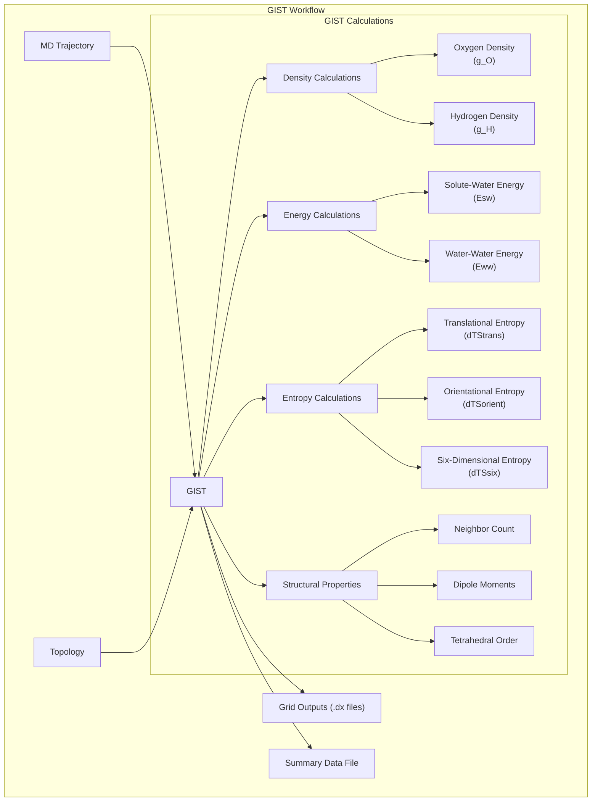
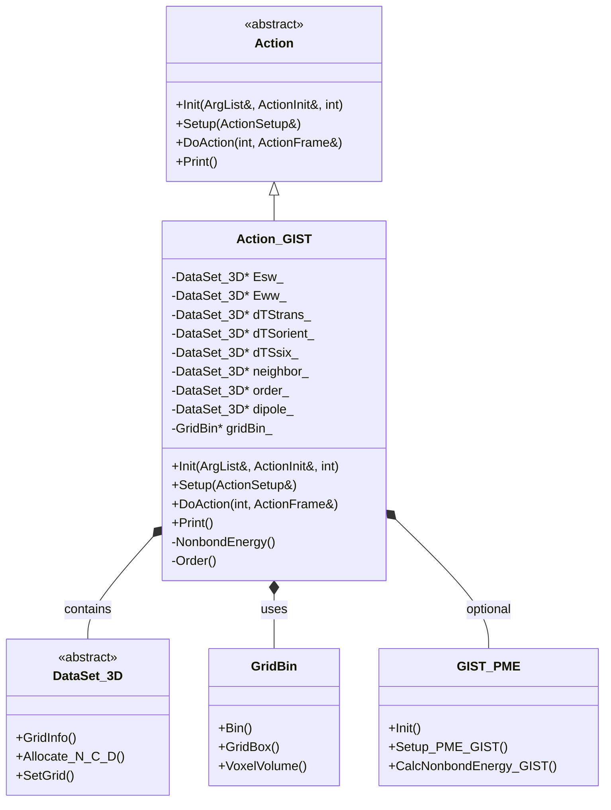
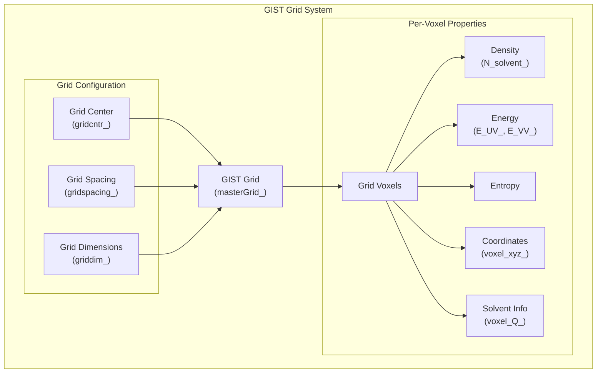
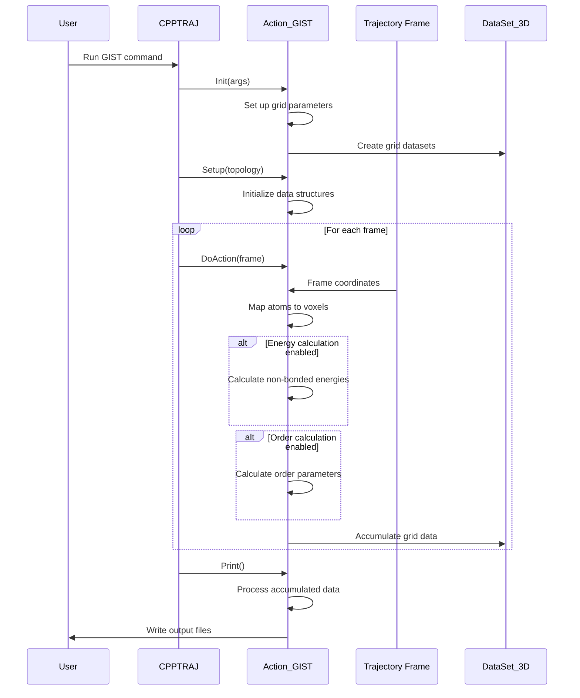
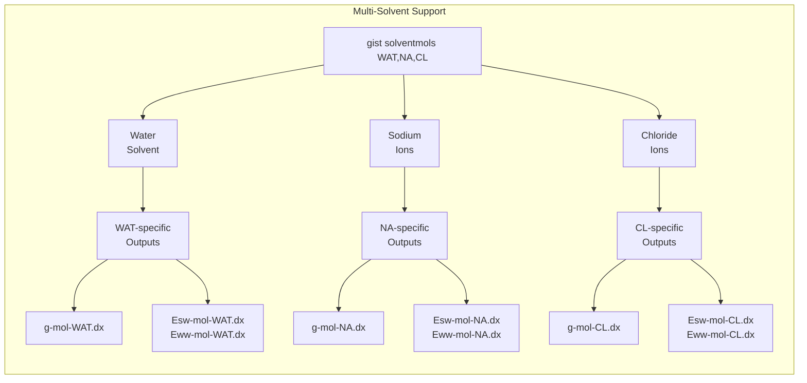

# Grid Inhomogeneous Solvation Theory (GIST)

<details>
<summary>Relevant source files</summary>

The following files were used as context for generating this wiki page:

- [src/Action_GIST.cpp](src/Action_GIST.cpp)
- [src/Action_GIST.h](src/Action_GIST.h)
- [test/Test_GIST/Gist10-Info.dat.save](test/Test_GIST/Gist10-Info.dat.save)
- [test/Test_GIST/Gist3-output.dat.save](test/Test_GIST/Gist3-output.dat.save)
- [test/Test_GIST/Gist4-Info.dat.save](test/Test_GIST/Gist4-Info.dat.save)
- [test/Test_GIST/Gist4-Solute-Etot-pme-dens.dx.save](test/Test_GIST/Gist4-Solute-Etot-pme-dens.dx.save)
- [test/Test_GIST/Gist5-Info.dat.save](test/Test_GIST/Gist5-Info.dat.save)
- [test/Test_GIST/Gist5-Solute-Etot-pme-dens.dx.save](test/Test_GIST/Gist5-Solute-Etot-pme-dens.dx.save)
- [test/Test_GIST/Gist6.out.save](test/Test_GIST/Gist6.out.save)
- [test/Test_GIST/Gist7.out.save](test/Test_GIST/Gist7.out.save)
- [test/Test_GIST/RunTest.sh](test/Test_GIST/RunTest.sh)
- [test/Test_GIST/gist.out.save](test/Test_GIST/gist.out.save)
- [test/Test_GIST_Order/gist-order-norm.dx.save](test/Test_GIST_Order/gist-order-norm.dx.save)
- [test/Test_GIST_Order/gistout.dat.save](test/Test_GIST_Order/gistout.dat.save)
- [test/Test_GIST_Order/test_gist-center.crd](test/Test_GIST_Order/test_gist-center.crd)
- [test/Test_GIST_Order/test_gist.prmtop](test/Test_GIST_Order/test_gist.prmtop)
- [test/Test_GIST_Order/tip4p.dat.save](test/Test_GIST_Order/tip4p.dat.save)
- [test/Test_GIST_Order/tip4pew.cluster.parm7](test/Test_GIST_Order/tip4pew.cluster.parm7)
- [test/Test_GIST_Order/tip4pew.cluster.rst7](test/Test_GIST_Order/tip4pew.cluster.rst7)
- [test/Test_GIST_Order/tip5p.cluster.parm7](test/Test_GIST_Order/tip5p.cluster.parm7)
- [test/Test_GIST_Order/tip5p.cluster.rst7](test/Test_GIST_Order/tip5p.cluster.rst7)
- [test/Test_GIST_Order/tip5p.dat.save](test/Test_GIST_Order/tip5p.dat.save)

</details>


## Overview

Grid Inhomogeneous Solvation Theory (GIST) is a method for analyzing the thermodynamic properties of solvent molecules in molecular dynamics simulations. It provides detailed spatial insights into solvent behavior around solutes by discretizing the system onto a three-dimensional grid and calculating thermodynamic quantities at each grid point (voxel). GIST in CPPTRAJ enables the calculation of energetics, entropies, and structural properties of water and other solvents.

Sources: [src/Action_GIST.h:23-25](), [src/Action_GIST.cpp:136-141]()

## Theory and Implementation

GIST is based on inhomogeneous solvation theory, which breaks down the thermodynamic properties of solvation into spatial contributions. The implementation in CPPTRAJ calculates:

1. **Solvent densities**: Distribution of solvent atoms on the grid
2. **Energetics**: Solute-water (Esw) and water-water (Eww) interaction energies
3. **Entropies**: Translational (dTStrans), orientational (dTSorient), and combined six-dimensional (dTSsix) entropy terms
4. **Structural properties**: Neighbor counts, dipole moments, and tetrahedral order parameters

These properties are calculated per voxel and can be visualized or further analyzed.



Sources: [src/Action_GIST.h:212-228](), [src/Action_GIST.cpp:339-351]()

## Core Classes and Components

The GIST implementation in CPPTRAJ is centered around the `Action_GIST` class, which inherits from the `Action` base class. This integration allows GIST to be used within CPPTRAJ's action framework for trajectory processing.



Sources: [src/Action_GIST.h:26-334](), [src/Action_GIST.cpp:50-118]()

## Grid Data Structure

The core of GIST is its grid representation. CPPTRAJ implements a 3D grid system using the `DataSet_3D` class hierarchy, with specific grid types for different data formats (float, double). The grid is defined by:

1. **Dimensions**: Number of grid points in x, y, z directions
2. **Center**: Center coordinates of the grid
3. **Spacing**: Distance between adjacent grid points

Each voxel in the grid stores calculated thermodynamic properties.



Sources: [src/Action_GIST.h:190-196](), [src/Action_GIST.cpp:376-399]()

## Calculation Workflow

When processing a trajectory, GIST performs several steps for each frame:

1. **Grid Setup**: Initializes the grid based on user specifications
2. **Atom Assignment**: Maps atoms to grid voxels
3. **Energy Calculation**: Computes non-bonded interactions (optional PME for long-range electrostatics)
4. **Entropy Calculation**: Calculates translational and orientational entropy contributions
5. **Structural Analysis**: Computes order parameters and neighbor counts
6. **Data Collection**: Accumulates statistics over all processed frames



Sources: [src/Action_GIST.cpp:545-732](), [src/Action_GIST.cpp:973-1114]()

## Energy Calculations

GIST calculates two main energy components:

1. **Solute-Water Energy (Esw)**: Interaction energy between solute atoms and water molecules
2. **Water-Water Energy (Eww)**: Interaction energy between water molecules

These energies can be calculated using direct pairwise summation or, optionally, with Particle Mesh Ewald (PME) for improved handling of long-range electrostatics. The energy calculations account for both electrostatic and van der Waals interactions.

| Energy Component | Description | Output Grid |
|------------------|-------------|-------------|
| Solute-Water | Interaction between solute and water | Esw-dens.dx |
| Water-Water | Interaction between water molecules | Eww-dens.dx |
| PME Total Water | Total PME energy for water (if PME enabled) | Water-Etot-pme-dens.dx |
| PME Total Solute | Total PME energy for solute (if PME enabled) | Solute-Etot-pme-dens.dx |

Sources: [src/Action_GIST.cpp:973-1134](), [src/Action_GIST.h:212-215](), [src/Action_GIST.h:227-228]()

## Entropy Calculations

GIST calculates three types of entropy contributions:

1. **Translational Entropy (dTStrans)**: Related to the positional freedom of water molecules
2. **Orientational Entropy (dTSorient)**: Related to the rotational freedom of water molecules
3. **Six-Dimensional Entropy (dTSsix)**: Combined translational and orientational entropy

These entropies are referenced to bulk water values and provide insights into how water behavior differs near solutes compared to bulk water.

Sources: [src/Action_GIST.h:216-218](), [src/Action_GIST.cpp:136-137]()

## Structural Analysis

GIST provides several structural analyses:

1. **Neighbor Count**: Average number of water molecules within a cutoff distance (3.5 Å by default)
2. **Dipole Moments**: Components and magnitude of water dipole orientation
3. **Tetrahedral Order**: Measure of local water structure based on tetrahedral coordination

These metrics help characterize the structural organization of water around the solute.

Sources: [src/Action_GIST.h:219-225](), [src/Action_GIST.cpp:142-143]()

## Command Syntax and Usage

GIST is invoked in CPPTRAJ as an action command with various options to control the analysis:

```
gist [name <dataset name>] [doorder [nopl] [plcut <plcut>]]
    [doeij] [skipE] [skipS] [refdens <rdval>] [temp <tval>]
    [noimage] [gridcntr <xval> <yval> <zval>]
    [griddim <nx> <ny> <nz>] [gridspacn <spaceval>] [neighborcut <ncut>]
    [prefix <filename prefix>] [ext <grid extension>] [out <output suffix>]
    [solute <mask>] [solventmols <str>]
    [rigidatoms <i1> <i2> <i3>] [nocom]
    [info <info suffix>]
    [nopme|pme ...]
```

Key parameters:
- **gridcntr**: Center coordinates of the grid
- **griddim**: Number of grid points in each dimension
- **gridspacn**: Spacing between grid points
- **refdens**: Reference bulk water density (default: 0.0334 molecules/ų)
- **temp**: Simulation temperature (default: 300 K)
- **solute**: Mask for defining solute atoms
- **solventmols**: Specification of solvent molecule types
- **prefix**: Prefix for output files

Sources: [src/Action_GIST.cpp:122-143](), [test/Test_GIST/RunTest.sh:42-47]()

## Output Files

GIST produces several output files:

1. **Grid Files (.dx)**: 3D grids in OpenDX format containing various properties
2. **Summary Data File**: Tabular data with values for each voxel
3. **Info File**: Overall statistics and information about the analysis

### Example Grid Output Files

| Filename Pattern | Description |
|------------------|-------------|
| prefix-gO.dx | Oxygen density |
| prefix-gH.dx | Hydrogen density |
| prefix-Esw-dens.dx | Solute-water energy density |
| prefix-Eww-dens.dx | Water-water energy density |
| prefix-dTStrans-dens.dx | Translational entropy density |
| prefix-dTSorient-dens.dx | Orientational entropy density |
| prefix-dTSsix-dens.dx | 6D entropy density |
| prefix-neighbor-norm.dx | Normalized neighbor counts |
| prefix-order-norm.dx | Normalized tetrahedral order parameter |
| prefix-dipole-dens.dx | Dipole moment density |

Sources: [src/Action_GIST.cpp:339-350](), [test/Test_GIST/RunTest.sh:8-12]()

## Multi-Solvent Support

GIST in CPPTRAJ supports analysis of multiple solvent types, not limited to water. This can be configured using the `solventmols` parameter to specify different solvent molecules and the `rigidatoms` parameter to define the reference atoms for orientation calculations.



Sources: [src/Action_GIST.cpp:332](), [test/Test_GIST/RunTest.sh:239-243](), [test/Test_GIST/RunTest.sh:263-266]()

## Performance Enhancements

GIST supports several performance enhancement features:

1. **OpenMP Parallelization**: For energy and entropy calculations
2. **PME-based Electrostatics**: For more efficient long-range interactions
3. **CUDA Acceleration**: For GPU-accelerated calculations (when compiled with CUDA support)

These features can significantly speed up GIST analyses, especially for large systems or high-resolution grids.

| Feature | Description | Prerequisites |
|---------|-------------|---------------|
| OpenMP | Multi-threaded CPU calculations | Compile with OpenMP |
| PME | Fast electrostatics | Compile with LIBPME |
| CUDA | GPU acceleration | Compile with CUDA |

Sources: [src/Action_GIST.cpp:14-16](), [src/Action_GIST.cpp:241-253](), [src/Action_GIST.cpp:408-414]()

## Example Usage

Basic GIST analysis:
```
parm system.parm7
trajin trajectory.nc
autoimage origin
gist gridcntr 1.5 1.0 0.0 griddim 40 40 40 gridspacn 0.5 prefix gist_output
```

Advanced analysis with PME and order calculation:
```
parm system.parm7
trajin trajectory.nc
autoimage origin
gist pme doorder refdens 0.033422885325 gridcntr 1.5 1.0 0.0 griddim 40 40 40 gridspacn 0.5 prefix gist_output
```

Multi-solvent analysis:
```
parm system.parm7
trajin trajectory.nc
autoimage origin
gist refdens 0.033 gridcntr 0 0 0 griddim 40 40 40 gridspacn 0.5 solute :1-100 solventmols WAT,NA,CL prefix gist_output
```

Sources: [test/Test_GIST/RunTest.sh:41-47](), [test/Test_GIST/RunTest.sh:94-97](), [test/Test_GIST/RunTest.sh:263-266]()

## Citing GIST

When using GIST results in publications, please cite the relevant papers:

1. Ramsey et al., J. Comp. Chem. 37 (21) 2016
2. Waibl et al., J. Chem. Phys. 156, 204101 (2022)
3. Nguyen, Gilson, and Young, arXiv:1108.4876v1 (2011)
4. Nguyen, Kurtzman Young, and Gilson, J. Chem. Phys. 137, 044101 (2012)
5. Lazaridis, J. Phys. Chem. B 102, 3531–3541 (1998)

For PME-enhanced GIST:
- Chen et al., JCTC (2021)

For multi-solvent GIST:
- Waibl et al., J Comput Aided Mol Des. 2022 Feb;36(2):101-116

For GPU-accelerated GIST:
- Kraml et al., JCTC (2019)

Sources: [src/Action_GIST.cpp:493-511]()

---