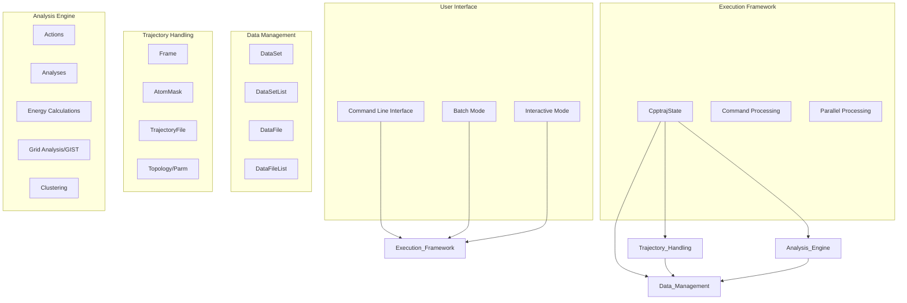
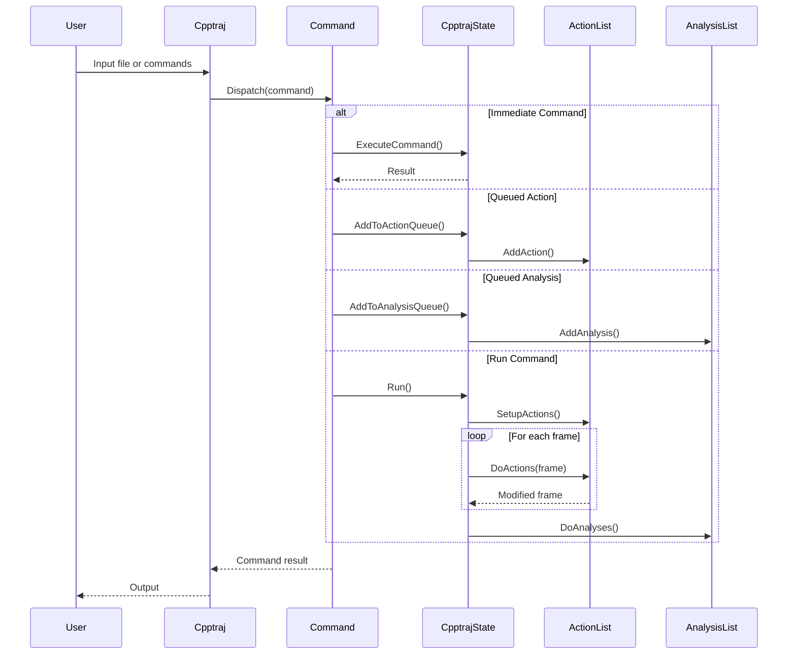
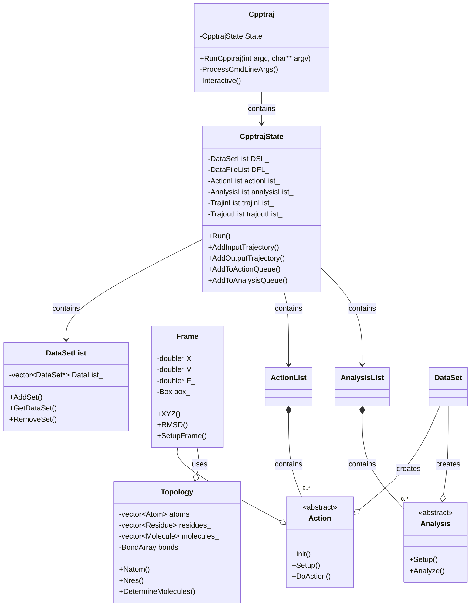
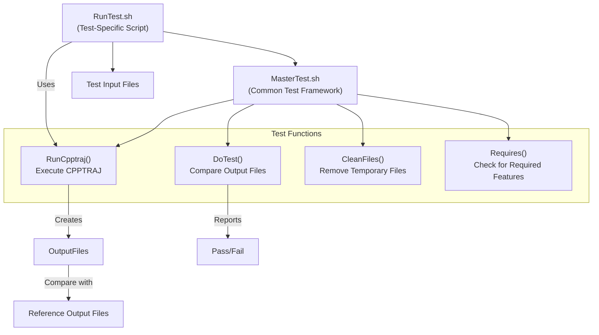

# Developer Guide

<details>
<summary>Relevant source files</summary>

The following files were used as context for generating this wiki page:

- [.github/workflows/merge-gate.yml](.github/workflows/merge-gate.yml)
- [Makefile](Makefile)
- [configure](configure)
- [devtools/ci/environment.yml](devtools/ci/environment.yml)
- [doc/CpptrajManual.pdf](doc/CpptrajManual.pdf)
- [doc/DocumentChecksums.txt](doc/DocumentChecksums.txt)
- [doc/Makefile](doc/Makefile)
- [doc/cpptraj.lyx](doc/cpptraj.lyx)
- [get_library.sh](get_library.sh)
- [src/Action_AtomMap.cpp](src/Action_AtomMap.cpp)
- [src/Action_AtomMap.h](src/Action_AtomMap.h)
- [src/Command.cpp](src/Command.cpp)
- [src/Energy/EnergyDecomposer.cpp](src/Energy/EnergyDecomposer.cpp)
- [src/Energy/EnergyDecomposer.h](src/Energy/EnergyDecomposer.h)
- [src/Makefile](src/Makefile)
- [src/Version.h](src/Version.h)
- [src/cpptrajdepend](src/cpptrajdepend)
- [src/cpptrajfiles](src/cpptrajfiles)
- [src/tng/Makefile](src/tng/Makefile)
- [test/Makefile](test/Makefile)
- [test/MasterTest.sh](test/MasterTest.sh)
- [test/Test_AtomMap/ADD.names.mol2](test/Test_AtomMap/ADD.names.mol2)
- [test/Test_AtomMap/remap.ADD.mol2.save](test/Test_AtomMap/remap.ADD.mol2.save)
- [test/Test_AtomMap/template-base-adenine.pdb](test/Test_AtomMap/template-base-adenine.pdb)
- [test/Test_DihCovar/RunTest.sh](test/Test_DihCovar/RunTest.sh)
- [test/Test_EneDecomp/RunTest.sh](test/Test_EneDecomp/RunTest.sh)
- [test/Test_EneDecomp/decomp.components.nacl.box.dat.save](test/Test_EneDecomp/decomp.components.nacl.box.dat.save)
- [test/Test_EneDecomp/decomp.components.tz2.dat.save](test/Test_EneDecomp/decomp.components.tz2.dat.save)
- [test/Test_General/RunTest.sh](test/Test_General/RunTest.sh)
- [test/Test_IRED/RunTest.sh](test/Test_IRED/RunTest.sh)
- [test/Test_IRED/orderparam.save](test/Test_IRED/orderparam.save)
- [test/Test_IRED/plateau.norm.dat.save](test/Test_IRED/plateau.norm.dat.save)
- [test/Test_IRED/v0.cjt.new.save](test/Test_IRED/v0.cjt.new.save)
- [test/Test_IRED/v0.cmt.new.norm.save](test/Test_IRED/v0.cmt.new.norm.save)
- [test/Test_ReadData/RunTest.sh](test/Test_ReadData/RunTest.sh)
- [test/Test_Rotdif/RunTest.sh](test/Test_Rotdif/RunTest.sh)
- [test/Test_trajout_framerange/RunTest.sh](test/Test_trajout_framerange/RunTest.sh)

</details>


This guide provides detailed information for developers who want to contribute to CPPTRAJ, understand its internal architecture, implement new features, or extend its functionality. It's intended for technical users who are familiar with C++ programming and want to work with the CPPTRAJ codebase. For information about using CPPTRAJ, see [Overview](#1).

## Core Architecture

CPPTRAJ follows a modular design with several interdependent subsystems. The diagram below illustrates the high-level architecture:



Sources: [src/Command.cpp], [src/CpptrajState.cpp], [src/cpptrajfiles]

## Command Processing System

CPPTRAJ uses a command-based interface where users specify operations to be executed. Commands are processed through a dispatch system that routes them to appropriate handlers.



The command processing system is defined in [src/Command.cpp] which manages a registry of available commands. When initialized, all supported commands are registered through `Command::AddCmd()` calls.

Sources: [src/Command.cpp:216-478], [src/Cpptraj.cpp]

## Core Classes

CPPTRAJ uses several key classes that form the foundation of its architecture:



Sources: [src/CpptrajState.cpp], [src/Frame.cpp], [src/Topology.cpp], [src/Action.h], [src/Analysis.h]

## Adding New Features

CPPTRAJ is designed to be extensible. Below are instructions for adding new Actions or Analyses to the codebase.

### Adding a New Action

Actions process individual frames of a trajectory as they are read. To add a new action:

1. **Create a new class derived from `Action`**
   - Create two new files: `Action_MyNewAction.h` and `Action_MyNewAction.cpp`
   - Define a class that inherits from the `Action` base class

2. **Implement required methods**
   - `Init()`: Initialize the action, parse command arguments
   - `Setup()`: Set up for trajectory processing (called for each topology)
   - `DoAction()`: Process a single frame
   - `Print()`: Output results after all frames are processed

3. **Register the action in Command.cpp**
   - Add the header to the includes section
   - Register using `Command::AddCmd()`

Example Action header:

```cpp
// Action_MyNewAction.h
#ifndef INC_ACTION_MYNEWACTION_H
#define INC_ACTION_MYNEWACTION_H
#include "Action.h"

class Action_MyNewAction : public Action {
  public:
    Action_MyNewAction();
    ~Action_MyNewAction();
    DispatchObject* Alloc() const { return (DispatchObject*)new Action_MyNewAction(); }
    void Help() const;
  private:
    Action::RetType Init(ArgList&, ActionInit&, int);
    Action::RetType Setup(ActionSetup&);
    Action::RetType DoAction(int, ActionFrame&);
    void Print();
    
    // Action-specific data members
    DataSet* output_;
};
#endif
```

Register the action in [src/Command.cpp] in the `Command::Init()` function:

```cpp
// In Command::Init()
Command::AddCmd( new Action_MyNewAction(), Cmd::ACT, 1, "mynewaction" );
```

Then add the file to the `COMMON_SOURCES` list in [src/cpptrajfiles].

### Adding a New Analysis

Analyses process entire datasets after all frames have been read. To add a new analysis:

1. **Create a new class derived from `Analysis`**
   - Create two new files: `Analysis_MyNewAnalysis.h` and `Analysis_MyNewAnalysis.cpp`
   - Define a class that inherits from the `Analysis` base class

2. **Implement required methods**
   - `Setup()`: Initialize the analysis, parse command arguments
   - `Analyze()`: Perform the analysis on the collected data

3. **Register the analysis in Command.cpp**
   - Add the header to the includes section
   - Register using `Command::AddCmd()`

Example registration in Command.cpp:

```cpp
// In Command::Init()
Command::AddCmd( new Analysis_MyNewAnalysis(), Cmd::ANA, 1, "mynewanalysis" );
```

Sources: [src/Action_AtomMap.cpp], [src/Action_AtomMap.h], [src/Command.cpp:323-417], [src/Command.cpp:418-462]

## Testing Framework

CPPTRAJ has a comprehensive testing framework that facilitates validation of both existing functionality and new features.



### Test Organization

Tests are organized by functionality in separate directories under the `test/` directory:

| Directory | Purpose |
|-----------|---------|
| `Test_General` | Basic functionality tests |
| `Test_RMSD` | RMSD calculation tests |
| `Test_Cluster` | Clustering algorithm tests |
| `Test_IRED` | IRED vector/matrix tests |
| ... | ... |

Each test directory contains:
- A `RunTest.sh` script that sets up and executes the test
- Input files for CPPTRAJ
- Reference output files to compare against

### Running Tests

Tests can be run using the Makefile in the `test/` directory:

- `make test.all`: Run all tests
- `make test.general`: Run general functionality tests
- `make test.rmsd`: Run RMSD calculation tests
- Etc.

### Writing a New Test

To create a test for a new feature:

1. **Create a new test directory**
   ```bash
   mkdir test/Test_MyFeature
   ```

2. **Create a RunTest.sh script**
   ```bash
   #!/bin/bash
   
   . ../MasterTest.sh
   
   # Clean up before and after
   CleanFiles myfeature.in myoutput.dat
   
   TESTNAME='My Feature Test'
   Requires notparallel
   
   # Create input file
   cat > myfeature.in <<EOF
   parm ../tz2.parm7
   trajin ../tz2.nc
   mynewaction param1 param2 out myoutput.dat
   EOF
   
   INPUT="myfeature.in"
   RunCpptraj "$TESTNAME"
   DoTest myoutput.dat.save myoutput.dat
   
   EndTest
   exit 0
   ```

3. **Create reference output files**
   - Run your test manually first
   - Verify the output is correct
   - Save the output as `myoutput.dat.save`

4. **Add the test to the Makefile**
   Add a new target to [test/Makefile]:
   ```make
   test.myfeature:
       @-cd Test_MyFeature && ./RunTest.sh $(OPT)
   ```

5. **Add the test to the complete test list**
   Add your test to the `test.all` target dependencies

Sources: [test/MasterTest.sh:87-115], [test/MasterTest.sh:228-228], [test/Test_General/RunTest.sh], [test/Test_IRED/RunTest.sh], [test/Makefile]

## Build System

CPPTRAJ uses a flexible build system that supports various compilers, libraries, and configuration options.

### Configuration

The `configure` script generates configuration files that specify compiler options, library dependencies, and feature flags:

```bash
./configure [compiler] [options]
```

Compiler options:
- `gnu`: GCC compiler suite
- `intel`: Intel compiler suite
- `clang`: Clang compiler
- `pgi`: PGI compiler
- `cray`: Cray compiler wrappers

Common options:
- `-openmp`: Enable OpenMP parallelization
- `-mpi`: Enable MPI parallelization
- `-cuda`: Enable CUDA GPU support
- `-debug`: Build with debugging information
- `-noopt`: Disable compiler optimizations

### Building

After configuration, CPPTRAJ can be built using `make`:

```bash
make              # Build cpptraj
make install      # Install cpptraj
make libcpptraj   # Build libcpptraj.so library
make check        # Run tests
```

### Adding Files to the Build

To add new source files to the build system:
1. Add the `.cpp` file to the `COMMON_SOURCES` list in [src/cpptrajfiles]
2. Add the `.h` file to [src/cpptrajheaders]

Sources: [configure:1-109], [Makefile], [src/Makefile], [src/cpptrajfiles]

## Parallelization

CPPTRAJ supports multiple parallelization methods:

### OpenMP Parallelization

Many computationally intensive operations are parallelized using OpenMP, which enables shared-memory parallelism:

- Enabled with `-openmp` configuration flag
- Controlled at runtime with the `OMP_NUM_THREADS` environment variable
- Primarily used for loop-level parallelism within Actions and Analyses

### MPI Parallelization

CPPTRAJ can distribute work across multiple compute nodes using MPI:

- Enabled with `-mpi` configuration flag
- Controlled with the MPI run command (`mpirun`, `mpiexec`, etc.)
- Used for parallel processing of:
  - Multiple frames from the same trajectory
  - Multiple trajectories
  - Multiple analyses

### CUDA/HIP GPU Acceleration

Some computationally intensive operations can be accelerated using GPUs:

- Enabled with `-cuda` or `-hip` configuration flag
- Requires CUDA or ROCm development environment
- Used for specific operations like GIST and some energy calculations

Sources: [configure:183-189], [.github/workflows/merge-gate.yml:66-73], [test/MasterTest.sh:40-46]

## Conclusion

This Developer Guide provides an overview of CPPTRAJ's architecture and guidance for extending its functionality. The modular design allows for straightforward addition of new features through the Action and Analysis interfaces. The comprehensive testing framework helps ensure that new features work correctly and don't break existing functionality.

For further details on specific subsystems, refer to the source code and comments in the relevant files, particularly the header files which typically contain detailed documentation of class interfaces.

Sources: [src/Version.h], [doc/cpptraj.lyx], [README.md]

---