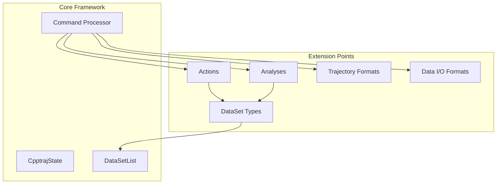
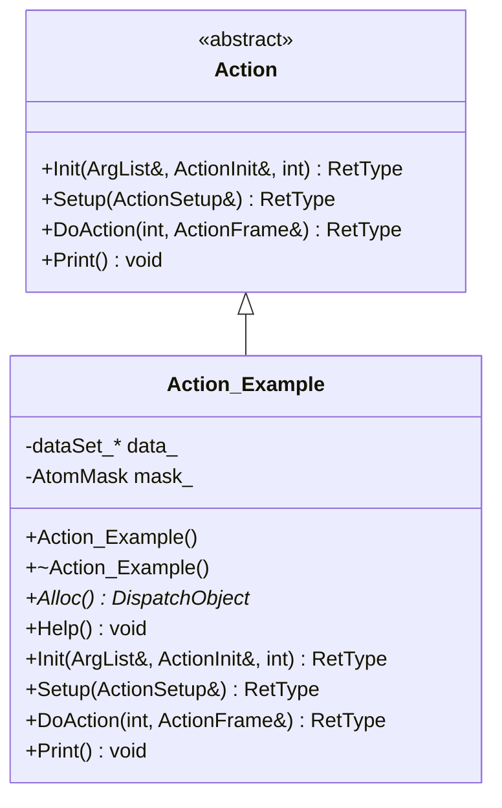
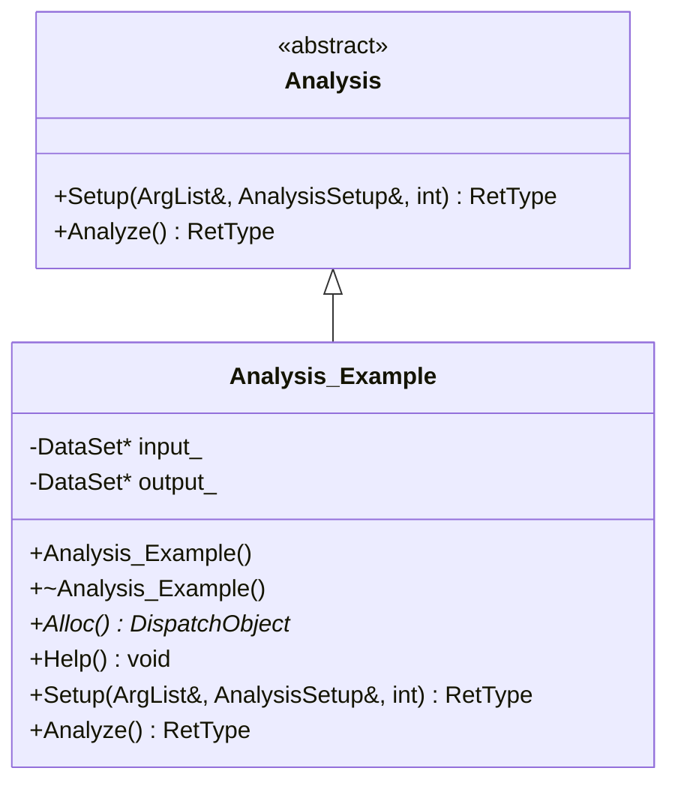
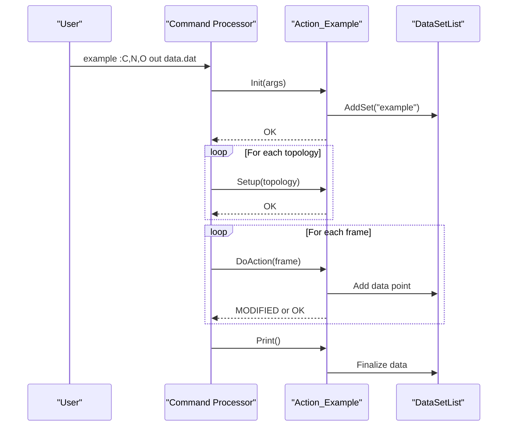
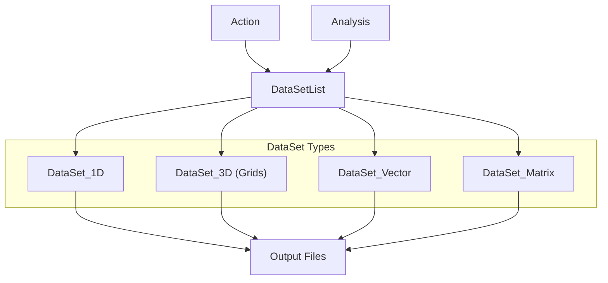

# Adding New Features

<details>
<summary>Relevant source files</summary>

The following files were used as context for generating this wiki page:

- [doc/CpptrajManual.pdf](doc/CpptrajManual.pdf)
- [doc/DocumentChecksums.txt](doc/DocumentChecksums.txt)
- [doc/cpptraj.lyx](doc/cpptraj.lyx)
- [src/Action_GIST.cpp](src/Action_GIST.cpp)
- [src/Action_GIST.h](src/Action_GIST.h)
- [src/Action_NAstruct.cpp](src/Action_NAstruct.cpp)
- [src/Action_NAstruct.h](src/Action_NAstruct.h)
- [src/AxisType.cpp](src/AxisType.cpp)
- [src/AxisType.h](src/AxisType.h)
- [src/Command.cpp](src/Command.cpp)
- [src/Energy/EnergyDecomposer.cpp](src/Energy/EnergyDecomposer.cpp)
- [src/Energy/EnergyDecomposer.h](src/Energy/EnergyDecomposer.h)
- [src/Version.h](src/Version.h)
- [src/cpptrajdepend](src/cpptrajdepend)
- [src/cpptrajfiles](src/cpptrajfiles)
- [test/Makefile](test/Makefile)
- [test/Test_EneDecomp/RunTest.sh](test/Test_EneDecomp/RunTest.sh)
- [test/Test_EneDecomp/decomp.components.nacl.box.dat.save](test/Test_EneDecomp/decomp.components.nacl.box.dat.save)
- [test/Test_EneDecomp/decomp.components.tz2.dat.save](test/Test_EneDecomp/decomp.components.tz2.dat.save)
- [test/Test_GIST/Gist10-Info.dat.save](test/Test_GIST/Gist10-Info.dat.save)
- [test/Test_GIST/Gist3-output.dat.save](test/Test_GIST/Gist3-output.dat.save)
- [test/Test_GIST/Gist4-Info.dat.save](test/Test_GIST/Gist4-Info.dat.save)
- [test/Test_GIST/Gist4-Solute-Etot-pme-dens.dx.save](test/Test_GIST/Gist4-Solute-Etot-pme-dens.dx.save)
- [test/Test_GIST/Gist5-Info.dat.save](test/Test_GIST/Gist5-Info.dat.save)
- [test/Test_GIST/Gist5-Solute-Etot-pme-dens.dx.save](test/Test_GIST/Gist5-Solute-Etot-pme-dens.dx.save)
- [test/Test_GIST/Gist6.out.save](test/Test_GIST/Gist6.out.save)
- [test/Test_GIST/Gist7.out.save](test/Test_GIST/Gist7.out.save)
- [test/Test_GIST/RunTest.sh](test/Test_GIST/RunTest.sh)
- [test/Test_GIST/gist.out.save](test/Test_GIST/gist.out.save)
- [test/Test_GIST_Order/gist-order-norm.dx.save](test/Test_GIST_Order/gist-order-norm.dx.save)
- [test/Test_GIST_Order/gistout.dat.save](test/Test_GIST_Order/gistout.dat.save)
- [test/Test_GIST_Order/test_gist-center.crd](test/Test_GIST_Order/test_gist-center.crd)
- [test/Test_GIST_Order/test_gist.prmtop](test/Test_GIST_Order/test_gist.prmtop)
- [test/Test_GIST_Order/tip4p.dat.save](test/Test_GIST_Order/tip4p.dat.save)
- [test/Test_GIST_Order/tip4pew.cluster.parm7](test/Test_GIST_Order/tip4pew.cluster.parm7)
- [test/Test_GIST_Order/tip4pew.cluster.rst7](test/Test_GIST_Order/tip4pew.cluster.rst7)
- [test/Test_GIST_Order/tip5p.cluster.parm7](test/Test_GIST_Order/tip5p.cluster.parm7)
- [test/Test_GIST_Order/tip5p.cluster.rst7](test/Test_GIST_Order/tip5p.cluster.rst7)
- [test/Test_GIST_Order/tip5p.dat.save](test/Test_GIST_Order/tip5p.dat.save)
- [test/Test_NAstruct/RunTest.sh](test/Test_NAstruct/RunTest.sh)
- [test/Test_NAstruct/SS.mol1.dat.save](test/Test_NAstruct/SS.mol1.dat.save)
- [test/Test_NAstruct/SS.mol1.selected.dat.save](test/Test_NAstruct/SS.mol1.selected.dat.save)
- [test/Test_NAstruct/axes.bases.pdb.save](test/Test_NAstruct/axes.bases.pdb.save)
- [test/Test_NAstruct/axes.bp.mol2.save](test/Test_NAstruct/axes.bp.mol2.save)
- [test/Test_NAstruct/axes.step.crd.save](test/Test_NAstruct/axes.step.crd.save)
- [test/Test_NAstruct/axes.step.parm7.save](test/Test_NAstruct/axes.step.parm7.save)
- [test/Test_ReadData/RunTest.sh](test/Test_ReadData/RunTest.sh)

</details>


This document provides guidance for developers who want to extend CPPTRAJ's functionality by implementing new features. CPPTRAJ has a modular, plugin-based architecture that allows you to add new analytical capabilities without modifying the core codebase. This guide primarily focuses on implementing new Actions and Analyses, which are the two main extension points for adding scientific functionality.

For information about building and setting up CPPTRAJ for development, see [Installation](#2).

## Extension Points Overview

CPPTRAJ provides several categories of extendable functionality, with Actions and Analyses being the most common types of extensions that developers implement.



Sources: [src/Command.cpp:216-478](), [src/cpptrajdepend:1-73]()

### Types of Extensions

| Extension Type | Purpose | Base Class | Example |
|----------------|---------|------------|---------|
| Actions | Process trajectory frames one at a time | `Action` | `Action_RMSD`, `Action_Distance` |
| Analyses | Analyze data after trajectory processing | `Analysis` | `Analysis_Clustering`, `Analysis_Hist` |
| Trajectory Formats | Read/write trajectory file formats | `TrajectoryIO` | `Traj_PDBfile`, `Traj_AmberNetcdf` |
| DataSet Types | Store specific types of analysis data | `DataSet` | `DataSet_1D`, `DataSet_Matrix` |
| Data I/O | Read/write analysis data from/to files | `DataIO` | `DataIO_Gnuplot`, `DataIO_Grace` |

Sources: [src/Command.cpp:74-145](), [src/Command.cpp:171-214]()

## Adding a New Action

Actions operate on individual trajectory frames as they are read. They can perform calculations, modify coordinates, or generate data for subsequent analysis.



Sources: [src/Action_NAstruct.h:32-279](), [src/Action_GIST.h:26-192]()

### Required Steps

1. Create a new header file (`Action_Example.h`) and implementation file (`Action_Example.cpp`)
2. Declare a class that inherits from `Action`
3. Implement the required virtual methods
4. Register your action with the command system

### Core Action Methods

| Method | Purpose |
|--------|---------|
| `Help()` | Display documentation when `help <command>` is executed |
| `Init(ArgList&, ActionInit&, int)` | Parse command arguments and initialize the action |
| `Setup(ActionSetup&)` | Set up the action for each new topology |
| `DoAction(int, ActionFrame&)` | Process each frame of the trajectory |
| `Print()` | Output results after all frames are processed |

Sources: [src/Action_NAstruct.cpp:159-465](), [src/Action_GIST.cpp:151-320]()

### Example Implementation Overview

Here's an overview of the implementation process:

1. Create the header file (`Action_Example.h`):
   - Declare your class inheriting from `Action`
   - Override the virtual methods
   - Add private variables for your specific functionality

2. Implement the methods in `Action_Example.cpp`:
   - `Help()`: Provide detailed help text
   - `Init()`: Parse arguments, set up datasets
   - `Setup()`: Validate topology, prepare for processing
   - `DoAction()`: Process each frame
   - `Print()`: Output final results

3. Register your action in `Command.cpp`:
   - Add `#include "Action_Example.h"` to the includes section
   - Add `Command::AddCmd( new Action_Example(), Cmd::ACT, 1, "example" );` to the `Init()` method

Sources: [src/Command.cpp:323-417]()

### Example: Help and Init Methods

The `Help()` method should provide information about the command's purpose and syntax:

```cpp
void Action_Example::Help() const {
  mprintf("\t[<mask>] [out <filename>]\n"
          "  This example action calculates something on the atoms in <mask>.\n"
          "  If 'out' is specified, results are written to <filename>.\n");
}
```

The `Init()` method parses command-line arguments and sets up datasets:

```cpp
Action::RetType Action_Example::Init(ArgList& actionArgs, ActionInit& init, int debugIn) {
  // Get mask string
  std::string maskStr = actionArgs.GetMaskNext();
  if (maskStr.empty()) {
    mprinterr("Error: No mask specified.\n");
    return Action::ERR;
  }
  if (mask_.SetMaskString(maskStr)) return Action::ERR;
  
  // Get output filename
  std::string outname = actionArgs.GetStringKey("out");
  if (!outname.empty()) {
    // Set up dataset
    data_ = init.DSL().AddSet(DataSet::DOUBLE, actionArgs.GetStringNext(), "example");
    if (data_ == 0) return Action::ERR;
    // Add dataset to datafile
    CpptrajFile* outfile = init.DFL().AddDataFile(outname, actionArgs);
    if (outfile == 0) return Action::ERR;
    outfile->AddDataSet(data_);
  }
  
  mprintf("    EXAMPLE: Using atoms in mask '%s'\n", mask_.MaskString());
  if (!outname.empty())
    mprintf("\tOutput to '%s'\n", outname.c_str());
  
  return Action::OK;
}
```

Sources: [src/Action_NAstruct.cpp:122-156](), [src/Action_GIST.cpp:121-142]()

### Testing Your Action

Create a test directory and scripts under the `test/` directory:

1. Create a directory `test/Test_Example/`
2. Create a test script `RunTest.sh` based on other test scripts
3. Create input files and reference output files
4. Add your test to the main `test/Makefile`

Sources: [test/Makefile:1-548](), [test/Test_GIST/RunTest.sh:1-67]()

## Adding a New Analysis

Analyses operate on data that has been collected during Action processing, performing calculations after trajectory reading is complete.



Sources: [src/Command.cpp:171-214]()

### Required Steps

1. Create a new header file (`Analysis_Example.h`) and implementation file (`Analysis_Example.cpp`)
2. Declare a class that inherits from `Analysis`
3. Implement the required virtual methods
4. Register your analysis with the command system

### Core Analysis Methods

| Method | Purpose |
|--------|---------|
| `Help()` | Display documentation when `help <command>` is executed |
| `Setup(ArgList&, AnalysisSetup&, int)` | Parse command arguments and set up the analysis |
| `Analyze()` | Perform the analysis on the data |

Sources: [src/Command.cpp:419-462]()

### Registering Your Extensions

New Actions and Analyses must be registered in `Command.cpp`. Add an include for your header file and register your class in the `Init()` method:

```cpp
// For Actions:
Command::AddCmd( new Action_Example(), Cmd::ACT, 1, "example" );

// For Analyses:
Command::AddCmd( new Analysis_Example(), Cmd::ANA, 1, "analysisexample" );
```

The `Cmd::ACT` and `Cmd::ANA` parameters indicate whether it's an Action or Analysis. The number `1` indicates how many command keywords to register, and the string is the command name.

Sources: [src/Command.cpp:227-477]()

## Common Extension Patterns

### Processing Data with Actions

The most common pattern for Actions is:

1. Parse command arguments in `Init()`
2. Set up atom masks in `Setup()`
3. Process coordinate data in `DoAction()`
4. Create and populate datasets
5. Finalize calculations in `Print()`



Sources: [src/Action_NAstruct.cpp:159-734](), [src/Action_GIST.cpp:151-1123]()

### Working with DataSets

DataSets are the primary way to store and manage analysis data:



Sources: [src/Action_NAstruct.cpp:68-95](), [src/Action_GIST.cpp:77-108]()

## Best Practices

### Code Organization

1. Keep related functionality in a single Action or Analysis class
2. Use descriptive variable names
3. Document your code with comments
4. Follow the existing coding style (indentation, naming conventions)

### Documentation

1. Provide comprehensive help text in the `Help()` method
2. Document command-line options clearly
3. Add examples of how to use your feature
4. Update any relevant documentation files

### Testing

1. Create a test directory with comprehensive test cases
2. Include reference output files
3. Test with different input options
4. Test with different topologies and trajectory types

Sources: [test/Test_GIST/RunTest.sh:1-67](), [test/Test_NAstruct/RunTest.sh:1-31]()

## Examples to Study

Here are some examples of existing Actions and Analyses that you can use as references:

| Type | Simple Example | Complex Example |
|------|----------------|----------------|
| Action | `Action_Distance` | `Action_GIST`, `Action_NAstruct` |
| Analysis | `Analysis_Statistics` | `Analysis_Clustering` |

Looking at these examples will help you understand the patterns and best practices for implementing new features in CPPTRAJ.

Sources: [src/Action_NAstruct.cpp:1-734](), [src/Action_GIST.cpp:1-1123]()

---