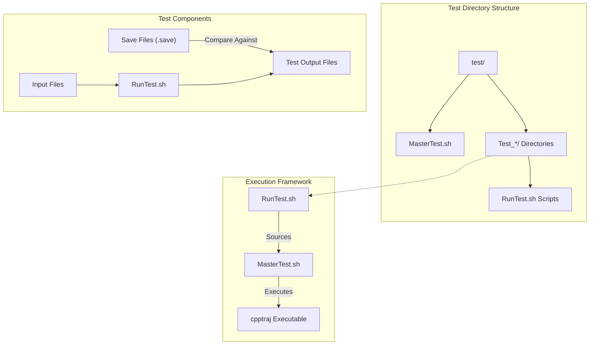
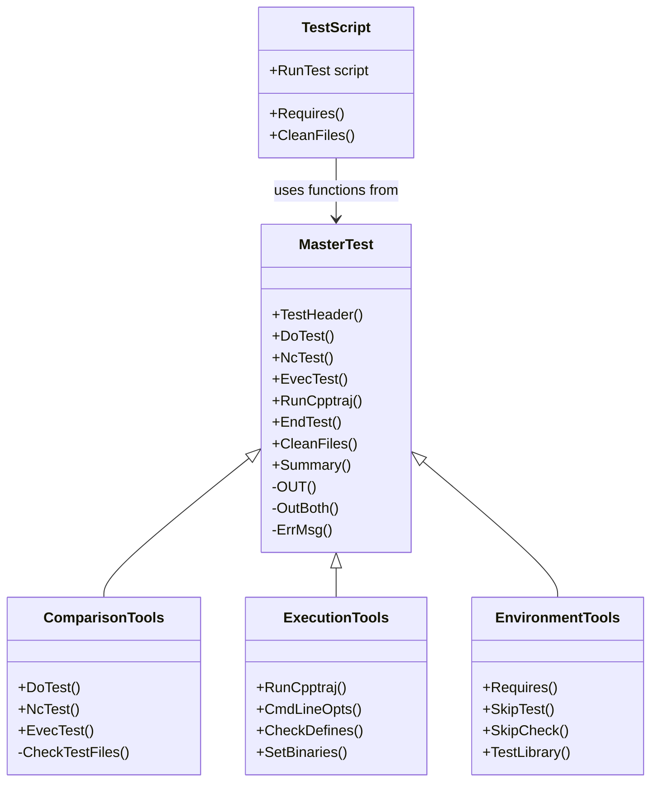
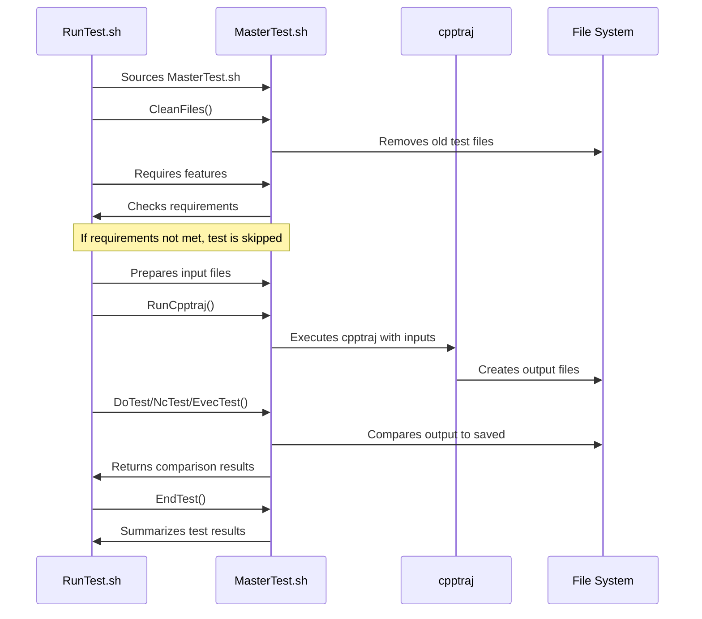
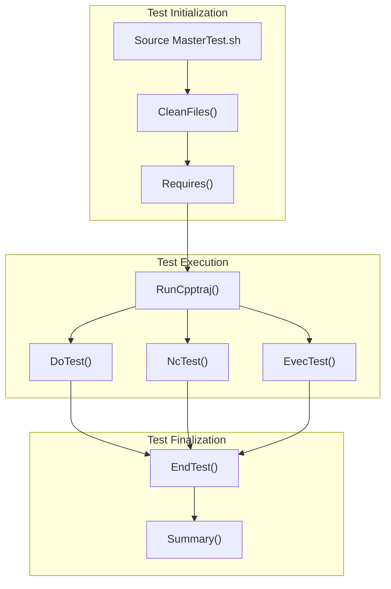
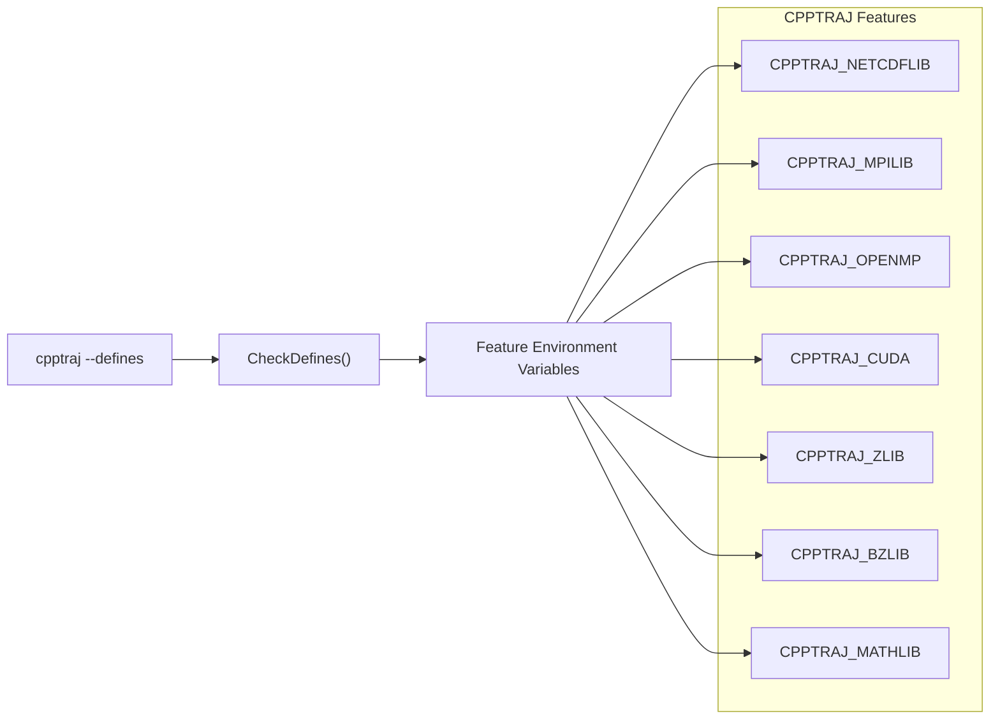

# Testing Framework

<details>
<summary>Relevant source files</summary>

The following files were used as context for generating this wiki page:

- [test/MasterTest.sh](test/MasterTest.sh)
- [test/Test_DihCovar/RunTest.sh](test/Test_DihCovar/RunTest.sh)
- [test/Test_General/RunTest.sh](test/Test_General/RunTest.sh)
- [test/Test_IRED/RunTest.sh](test/Test_IRED/RunTest.sh)
- [test/Test_IRED/orderparam.save](test/Test_IRED/orderparam.save)
- [test/Test_IRED/plateau.norm.dat.save](test/Test_IRED/plateau.norm.dat.save)
- [test/Test_IRED/v0.cjt.new.save](test/Test_IRED/v0.cjt.new.save)
- [test/Test_IRED/v0.cmt.new.norm.save](test/Test_IRED/v0.cmt.new.norm.save)
- [test/Test_Rotdif/RunTest.sh](test/Test_Rotdif/RunTest.sh)
- [test/Test_trajout_framerange/RunTest.sh](test/Test_trajout_framerange/RunTest.sh)

</details>


The CPPTRAJ Testing Framework provides a comprehensive system for validating the functionality and correctness of CPPTRAJ across different environments and configurations. This page documents how the testing system works and explains how to add new tests to ensure CPPTRAJ's reliability. For information about implementing new CPPTRAJ features, see [Adding New Features](#7.1).

## Overview

CPPTRAJ's testing framework is built around a master testing script (`MasterTest.sh`) that provides common functionality used by all tests, and individual test scripts (`RunTest.sh`) organized in directories by feature or subsystem. The framework allows for:

- Verification of results against known correct outputs
- Testing across different environments (MPI, OpenMP, CUDA)
- Memory checking using Valgrind
- Automatic reporting of test results

Sources: [test/MasterTest.sh:1-7]()

## Test Framework Architecture

### Test Organization Structure



Sources: [test/MasterTest.sh:1-105](), [test/Test_General/RunTest.sh:1-5]()

### Core Testing Components



Sources: [test/MasterTest.sh:87-330](), [test/MasterTest.sh:620-657](), [test/MasterTest.sh:778-835]()

## Test Execution Flow

### Test Lifecycle



Sources: [test/MasterTest.sh:620-657](), [test/MasterTest.sh:660-709](), [test/Test_General/RunTest.sh:59-71]()

### Test Function Relationships



Sources: [test/MasterTest.sh:160-224](), [test/MasterTest.sh:234-274](), [test/MasterTest.sh:277-330](), [test/MasterTest.sh:660-709]()

## Key Components

### MasterTest.sh

The `MasterTest.sh` script is the core of the testing framework, providing all common functionality required by individual test scripts. It defines numerous functions and variables that control test behavior and execution:

| Function | Purpose |
|----------|---------|
| `TestHeader()` | Outputs test header information |
| `DoTest()` | Compares output files against saved reference files |
| `NcTest()` | Compares NetCDF files using `ncdump` |
| `EvecTest()` | Compares eigenmode files using RMSIP |
| `RunCpptraj()` | Executes cpptraj with specified inputs |
| `CleanFiles()` | Removes test output files before/after tests |
| `EndTest()` | Finalizes testing and reports results |
| `Summary()` | Summarizes test results across all tests |
| `Requires()` | Checks if required features are available |

Key environment variables that control testing:

| Variable | Purpose |
|----------|---------|
| `CPPTRAJ` | Path to the cpptraj binary being tested |
| `VALGRIND` | Command for memory checking, if requested |
| `CPPTRAJ_TEST_RESULTS` | File to record test results |
| `CPPTRAJ_TEST_ERROR` | File to record test errors |
| `CPPTRAJ_OUTPUT` | File for cpptraj stdout |
| `CPPTRAJ_ERROR` | File for cpptraj stderr |
| `DO_PARALLEL` | MPI run command for parallel tests |
| `OMP_NUM_THREADS` | Number of OpenMP threads |

Sources: [test/MasterTest.sh:7-54](), [test/MasterTest.sh:87-104](), [test/MasterTest.sh:151-274](), [test/MasterTest.sh:620-657](), [test/MasterTest.sh:660-709]()

### Test Scripts

Individual test scripts (RunTest.sh) are organized in feature-specific directories (e.g., Test_General, Test_IRED). Each test script performs the following:

1. Sources MasterTest.sh to access common functionality
2. Calls `CleanFiles()` to remove previous test outputs
3. Defines test requirements using `Requires()`
4. Prepares input files and variables
5. Calls `RunCpptraj()` to execute the test
6. Uses `DoTest()`, `NcTest()`, or `EvecTest()` to verify results
7. Calls `EndTest()` to finalize the test

Example test script structure:

```
#!/bin/bash

. ../MasterTest.sh

# Clean previous test files
CleanFiles file1 file2 dir1

# Define requirements
Requires netcdf mathlib 

# Prepare test inputs
cat > input.in <<EOF
...
EOF

# Run the test
INPUT="input.in"
TOP="topology.parm7"
RunCpptraj "Test Description"

# Verify results
DoTest output.save output
NcTest trajectory.nc.save trajectory.nc

# End the test
EndTest
```

Sources: [test/Test_General/RunTest.sh:1-86](), [test/Test_IRED/RunTest.sh:1-46](), [test/Test_Rotdif/RunTest.sh:1-28]()

## Test Comparison Functions

The framework provides specialized functions for comparing different types of output files:

### DoTest

`DoTest()` compares two text files and reports differences. It supports relative and absolute error tolerances for numeric comparisons:

```
DoTest file1.save file2           # Simple comparison
DoTest file1.save file2 -r 0.001  # Relative error tolerance of 0.001
DoTest file1.save file2 -a 0.01   # Absolute error tolerance of 0.01
```

Sources: [test/MasterTest.sh:152-228]()

### NcTest

`NcTest()` compares NetCDF files by converting them to text using `ncdump` and then comparing:

```
NcTest trajectory.nc.save trajectory.nc           # Simple comparison
NcTest trajectory.nc.save trajectory.nc -r 0.001  # With relative error tolerance
```

Sources: [test/MasterTest.sh:234-274]()

### EvecTest

`EvecTest()` is specialized for comparing eigenmode/eigenvector files by calculating root-mean-square inner products (RMSIP):

```
EvecTest modes.save modes.dat
```

Sources: [test/MasterTest.sh:277-330]()

## Environment Detection and Requirements

The testing framework automatically detects the capabilities of the CPPTRAJ binary being tested and provides functions to ensure tests only run when required features are available.

### Feature Detection

The framework detects CPPTRAJ's compiled-in features using the `--defines` flag and sets corresponding environment variables:



Sources: [test/MasterTest.sh:868-904]()

### Test Requirements

The `Requires()` function checks if necessary features are available before running a test:

```
Requires netcdf           # Test requires NetCDF support
Requires mathlib cuda     # Test requires math libraries and CUDA
Requires notparallel      # Test cannot run in parallel
```

If requirements aren't met, the test is skipped with an appropriate message.

Sources: [test/MasterTest.sh:1030-1070](), [test/Test_General/RunTest.sh:12](), [test/Test_IRED/RunTest.sh:10]()

## Adding New Tests

### Creating a Test Directory

To add a new test for a feature:

1. Create a directory named `Test_<FeatureName>` in the `test/` directory
2. Create a `RunTest.sh` script in the new directory
3. Add appropriate test input files and reference output files

### Writing the Test Script

A basic test script should include:

```bash
#!/bin/bash

# Source the master test script
. ../MasterTest.sh

# Clean any existing files that will be generated by the test
CleanFiles output1.dat output2.dat test.in 

# Define feature requirements for this test
Requires netcdf mathlib

# Create input file
cat > test.in <<EOF
parm ../tz2.parm7
trajin ../tz2.nc
# Add commands to test your feature
EOF

# Set the input and topology files
INPUT="-i test.in"
TOP="../tz2.parm7"

# Run cpptraj with the test
RunCpptraj "Your feature test description"

# Verify results using appropriate test functions
DoTest output1.dat.save output1.dat
NcTest trajectory.nc.save trajectory.nc

# End the test
EndTest

exit 0
```

### Creating Reference Files

Reference (`.save`) files are crucial for testing. To create them:

1. Run your test and verify the results are correct
2. Copy the output files to files with the same name plus `.save` extension
3. Include these reference files in the repository

Sources: [test/Test_General/RunTest.sh:1-86](), [test/Test_IRED/RunTest.sh:1-46]()

## Advanced Testing Features

### Conditional Tolerances

The `SetConditionalTol()` function allows setting different comparison tolerances based on the test environment:

```bash
# Set higher tolerance for MPI tests
SetConditionalTol "Energy calculation" mpi -r 0.001 default -r 0.0001
```

Sources: [test/MasterTest.sh:332-393]()

### Skipping Tests and Comparisons

To skip entire tests when certain conditions aren't met:

```bash
# Skip if running on Windows
CheckFor testos Windows
if [ $? -eq 0 ] ; then
  SkipTest "Test not supported on Windows"
fi
```

To skip individual comparisons:

```bash
# Skip this comparison on non-Linux systems
UNITNAME='Gzipped output data file comparison'
CheckFor testos Linux
if [ $? -eq 0 ] ; then
  DoTest a2.dat.gz.save a2.dat.gz
fi
```

Sources: [test/MasterTest.sh:1032-1056](), [test/Test_General/RunTest.sh:76-80]()

### Memory Testing with Valgrind

Tests can be run with Valgrind to detect memory issues:

```bash
# Run test with Valgrind
./RunTest.sh vg
```

The framework will automatically use Valgrind to execute CPPTRAJ and report memory errors.

Sources: [test/MasterTest.sh:942-971](), [test/MasterTest.sh:798-799]()

## Running Tests

### Individual Tests

To run a single test:

```bash
cd test/Test_Feature
./RunTest.sh
```

### Multiple Tests

To run multiple tests:

```bash
cd test
./MasterTest.sh Test_Feature1 Test_Feature2
```

### All Tests

To run all tests:

```bash
cd test
./MasterTest.sh alltests
```

### Test Options

Common test options include:

| Option | Description |
|--------|-------------|
| `mpi` | Use MPI version of CPPTRAJ |
| `openmp` | Use OpenMP version of CPPTRAJ |
| `cuda` | Use CUDA version of CPPTRAJ |
| `time` | Time the test execution |
| `stdout` | Print CPPTRAJ output to stdout |
| `vg` | Run test with Valgrind memcheck |
| `clean` | Clean test output without running |
| `summary` | Print summary of test results |

Sources: [test/MasterTest.sh:746-774](), [test/MasterTest.sh:778-835]()