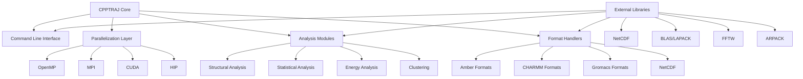

CPPTRAJ is a fast, parallelized program designed for processing and analyzing molecular dynamics trajectory data and relevant datasets derived from their analysis. As a powerful computational chemistry tool, CPPTRAJ provides comprehensive capabilities for analyzing MD simulations from multiple popular software packages including [Amber](http://ambermd.org/), [CHARMM](https://www.charmm.org/charmm/), [Gromacs](http://www.gromacs.org/), and [NAMD](http://www.ks.uiuc.edu/Research/namd/). The program is distributed as part of the freely available AmberTools software package and also offers Python integration through [Pytraj](https://github.com/Amber-MD/pytraj) for script-based workflows.

Sources: [README.md](README.md#L11-L20)

## Project Architecture

The repository follows a well-organized structure that separates source code, documentation, tests, and development tools. The architectural design emphasizes modularity, extensive testing, and support for multiple parallelization strategies.

Sources: [README.md](README.md#L1-L253), [doc/README.md](doc/README.md#L1-L9)

## Core Architecture Diagram

This architecture demonstrates CPPTRAJ's modular design where the core engine interfaces with multiple parallelization backends, analysis modules, and trajectory format handlers. The system leverages external scientific libraries for optimized mathematical operations.

Sources: [README.md](README.md#L53-L82), [CMakeLists.txt](CMakeLists.txt#L1-L50)

## Project Structure Overview

The repository is organized into logical directories that support development, testing, and documentation:

| Directory | Purpose | Contents |
|-----------|---------|----------|
| `src/` | Core source code | Main program implementation |
| `doc/` | Documentation | PDF manuals, LyX source files, bibliography |
| `test/` | Integration tests | 150+ test directories covering all functionality |
| `unitTests/` | Unit tests | Focused tests for specific components |
| `examples/` | Usage examples | Practical demonstrations (e.g., NIST-mAb preparation) |
| `dat/` | Data files | Atom type tables, residue name mappings, parameter files |
| `cmake/` & `cmake-cpptraj/` | Build system | CMake configuration modules |
| `devtools/` | Development tools | Utilities for developers, CI configurations |

Sources: [test/README](test/README#L1-L42), [examples/prepareforleap/NIST-mAb/README.md](examples/prepareforleap/NIST-mAb/README.md#L1-L25)

## Key Features and Capabilities

CPPTRAJ provides a comprehensive suite of analysis capabilities for molecular dynamics simulations:

### Trajectory Processing
- **Multi-format Support**: Native support for Amber, CHARMM, Gromacs (XTC, TRR, TNG), and NAMD trajectory formats
- **Coordinate Transformations**: RMSD calculations, structural alignment, rotations, and translations
- **Periodic Boundary Conditions**: Advanced imaging and unwrapping capabilities

### Statistical Analysis
- **Basic Statistics**: RMSD, RMSF, distance, and angle measurements
- **Correlation Functions**: Auto-correlation and cross-correlation analysis
- **Principal Component Analysis**: Dimensionality reduction and mode analysis
- **Time-Series Analysis**: Time-correlation functions and spectral analysis

### Structural Analysis
- **Hydrogen Bond Analysis**: Comprehensive H-bond detection and characterization
- **Secondary Structure**: DSSP-based assignment and analysis
- **Clustering**: Multiple algorithms including K-means, DBSCAN, and hierarchical clustering
- **Contact Analysis**: Native contacts and contact map generation

### Energy and Thermodynamics
- **Energy Extraction**: Process energy data from trajectories
- **Free Energy Calculations**: Thermodynamic integration and MM/PBSA methods
- **Lipid Analysis**: Order parameters and lipid-specific metrics
- **GIST**: Grid Inhomogeneous Solvation Theory for solvation analysis

### Advanced Features
- **Normal Mode Analysis**: Eigenmode calculations and analysis
- **Wavelet Analysis**: Time-frequency analysis of trajectories
- **Diffusion Coefficients**: Calculation of molecular diffusion properties
- **Ensemble Analysis**: Support for REMD, MREMD, and HREMD simulations
- **PME Calculations**: Particle Mesh Ewald electrostatic calculations

Sources: [README.md](README.md#L29-L54), [doc/CpptrajManual.pdf](doc/CpptrajManual.pdf)

## Parallelization and Performance

CPPTRAJ offers multiple parallelization strategies to handle large-scale trajectory analysis:

| Parallelization Type | Use Case | Configuration Flag |
|---------------------|----------|---------------------|
| OpenMP | Multi-core shared memory systems | `-openmp` |
| MPI | Distributed memory clusters | `-mpi` |
| CUDA | GPU acceleration (NVIDIA) | `-cuda` |
| HIP | GPU acceleration (AMD) | `-hip` |

The system supports hybrid parallelization, combining MPI with OpenMP for optimal performance on modern HPC architectures. When using both MPI and OpenMP, users must properly configure thread allocation to ensure processes × threads does not exceed physical cores.

Sources: [README.md](README.md#L83-L105), [configure](configure#L11-L35)

## Build and Configuration

CPPTRAJ provides flexible build options through both traditional configure scripts and CMake:

### Required Dependencies
- **Core Libraries**: NetCDF, BLAS, LAPACK
- **Compression**: Gzip, Bzip2
- **Optional Libraries**: FFTW (for PME), CUDA/HIP (for GPU acceleration)

### Bundled Libraries
CPPTRAJ includes several libraries internally but can use external versions if preferred:
- ARPACK (sparse matrix diagonalization)
- helPME (Particle Mesh Ewald calculations)
- XDR (Gromacs XTC format support)
- TNG (Gromacs TNG format support)

### Build Systems
- **Configure Script**: Traditional Unix-style build system with extensive options
- **CMake**: Modern build system with cross-platform support

Sources: [README.md](README.md#L53-L82), [CMakeLists.txt](CMakeLists.txt#L1-L50), [configure](configure#L1-L50)

## Testing Framework

CPPTRAJ maintains an extensive testing infrastructure to ensure reliability:

### Integration Tests (`test/`)
- 150+ test directories covering all major functionality
- Named with descriptive `Test_X` convention
- Support for parallel testing via `DO_PARALLEL` environment variable
- Memory testing through valgrind integration
- Individual test execution support

### Unit Tests (`unitTests/`)
- Focused testing of individual components
- Tests for ArgList, StringRoutines, Range, NameType, and GistEntropyUtils
- Automated execution through UnitMaster.sh

### Continuous Integration
- GitHub Actions workflow
- AppVeyor for Windows builds
- Jenkins build status monitoring
- CodeQL security analysis

Sources: [test/README](test/README#L1-L42), [README.md](README.md#L4-L10)

## Documentation and Resources

CPPTRAJ provides comprehensive documentation for users and developers:

| Documentation Type | Location | Format |
|-------------------|----------|--------|
| User Manual | `/doc/CpptrajManual.pdf` | PDF |
| Development Guide | `/doc/CpptrajDevelopmentGuide.pdf` | PDF |
| HTML Documentation | [https://amber-md.github.io/cpptraj/](https://amber-md.github.io/cpptraj/) | HTML |
| Interactive Help | `help [<command>]` in cpptraj | Built-in |
| Doxygen Code Docs | Generated via `make docs` | HTML |
| Tutorials | [Amber Tutorials](http://ambermd.org/tutorials/TrajectoryAnalysis.php#cpptraj) | Web |
| Amber-Hub Recipes | [Amber-Hub](https://amberhub.chpc.utah.edu/) | Web |

Sources: [README.md](README.md#L35-L49), [doc/README.md](doc/README.md#L1-L9)

## License and Citation

CPPTRAJ is licensed under the GNU General Public License Version 3, providing users with the freedom to use, modify, and distribute the software. The project is Copyright © 2010-2025 Daniel R. Roe.

When using CPPTRAJ in research, please cite the primary publication:

**Roe, D. R.; Cheatham, T. E., III** "PTRAJ and CPPTRAJ: Software for Processing and Analysis of Molecular Dynamics Trajectory Data." *J. Chem. Theory Comput.* **2013**, *9* (7), pp 3084-3095. DOI: 10.1021/ct400341p

For parallel trajectory/ensemble analysis, also cite:

**Roe, D. R.; Cheatham, T. E., III** "Parallelization of CPPTRAJ enables large scale analysis of molecular dynamics trajectory data." *J. Comp. Chem.* **2018**, DOI: 10.1002/jcc25382

Sources: [README.md](README.md#L29-L45), [LICENSE](LICENSE#L1-L35)

## Getting Started

To begin using CPPTRAJ, we recommend the following progression through the documentation:

1. **[Quick Start](2-quick-start)** - Learn the basics of running CPPTRAJ
2. **[Installation and Configuration](3-installation-and-configuration)** - Set up CPPTRAJ on your system
3. **[Basic Command Line Usage](4-basic-command-line-usage)** - Master fundamental commands
4. **[Trajectory Formats Support](5-trajectory-formats-support-netcdf-xtc-trr-tng-dtr)** - Work with different file formats

Once comfortable with the basics, explore specific analysis capabilities through the **Deep Dive** sections, starting with core concepts like **[Atom Selection and Mask Expressions](6-atom-selection-and-mask-expressions)** and **[Trajectory Processing Pipeline](7-trajectory-processing-pipeline)**.

> [!TIP]
> For optimal performance on multi-core systems, enable OpenMP parallelization during configuration (`./configure -openmp gnu`) and consider using the MPI build for distributed memory clusters (`./configure -mpi gnu`)

> [!TIP]
> The test suite (`make test`) is an excellent learning resource - examining test inputs and outputs in the `/test` directory provides practical examples of nearly every CPPTRAJ feature