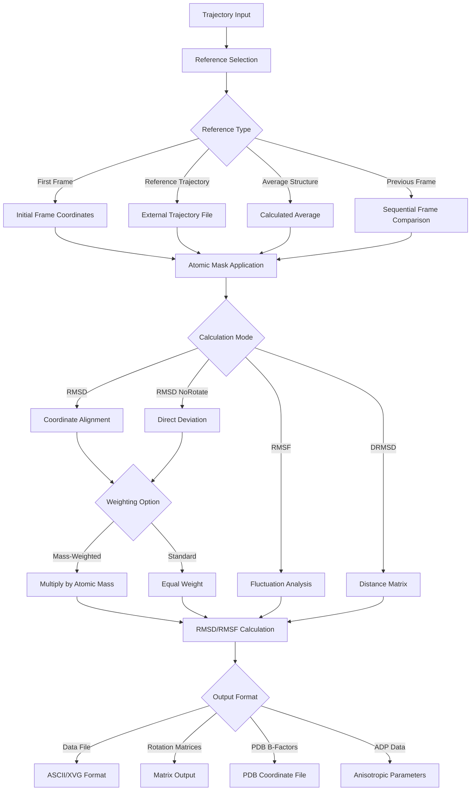
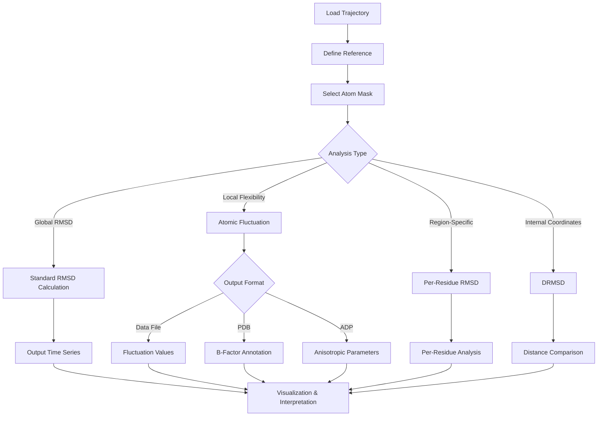

This documentation provides comprehensive guidance on Root Mean Square Deviation (RMSD) and Root Mean Square Fluctuation (RMSF) calculations in CPPTRAJ, two fundamental statistical metrics for analyzing molecular dynamics trajectories. RMSD measures the structural deviation between atomic coordinates over time, while RMSF quantifies the flexibility of individual atoms or residues throughout a simulation. These calculations form the foundation for understanding structural stability, conformational changes, and dynamic behavior in molecular systems.

## Conceptual Overview

RMSD and RMSF calculations in CPPTRAJ are built upon a coordinate transformation framework that enables precise structural comparisons across trajectory frames. The architecture integrates multiple calculation modes including mass-weighted RMSD, per-residue analysis, distance-based RMSD (DRMSD), and anisotropic displacement parameters (ADP) for enhanced structural insights.

The calculation pipeline follows a systematic flow where reference coordinates are established, atomic selections are applied through mask expressions, and statistical metrics are computed across trajectory frames. CPPTRAJ supports both coordinate-fitting RMSD (where structures are optimally aligned before comparison) and no-rotation RMSD (where deviations are calculated without structural superposition), providing flexibility for different analysis scenarios.

Sources: [test/Test_RMSD/RunTest.sh](test/Test_RMSD/RunTest.sh#L1-L114), [test/Test_AtomicFluct/RunTest.sh](test/Test_AtomicFluct/RunTest.sh#L1-L68)

### Architectural Flow



## RMSD Calculations

RMSD calculations quantify the structural deviation between trajectory frames and a reference structure, providing insight into global conformational stability and large-scale structural transitions. The implementation supports multiple reference strategies and weighting schemes to accommodate diverse analysis requirements.

### Basic RMSD Configuration

The fundamental RMSD calculation requires specifying a reference frame, atomic selection, and output destination. By default, CPPTRAJ uses the first trajectory frame as reference, but alternative references can be specified including pre-processed average structures, external trajectory files, or sequential frame-to-frame comparisons.

```cpp
// Basic RMSD command syntax
rms <name> <reference> <mask> [options]
```

Key configuration options include:

| Option | Description | Default |
|--------|-------------|---------|
| `first` | Use first trajectory frame as reference | Yes |
| `reftraj <file>` | Use external trajectory file as reference | No |
| `previous` | Compare to preceding frame in trajectory | No |
| `mass` | Apply mass-weighting to calculations | No |
| `nomod` | Calculate without modifying coordinates | No |
| `norotate` | Skip optimal rotation alignment | No |
| `savevectors` | Save translation and rotation vectors | No |
| `savematrices` | Save rotation matrices | No |

Sources: [test/Test_RMSD/RunTest.sh](test/Test_RMSD/RunTest.sh#L15-L38)

### Reference Selection Strategies

**First Frame Reference**: The most common approach for analyzing structural convergence from an initial configuration. This mode automatically uses the first frame as reference:

```
rms Res2-11 first :2-11 out rmsd.dat
```

**Reference Trajectory**: Enables comparison against an external trajectory structure, useful for analyzing convergence to a target structure or comparing multiple simulations:

```
rms Res2_11_traj reftraj ../tz2.truncoct.nc :2-11 out rmsd.reftraj.dat
```

**Previous Frame Comparison**: Calculates sequential frame-to-frame RMSD values, highlighting instantaneous structural changes and identifying transition events:

```
rms ToPrevious :2-12@CA previous out Previous.dat
```

Sources: [test/Test_RMSD/RunTest.sh](test/Test_RMSD/RunTest.sh#L15-L48), [test/Test_RMSD/RunTest.sh](test/Test_RMSD/RunTest.sh#L71-L79)

### Mass-Weighted RMSD

Mass-weighting assigns higher importance to heavier atoms during structural comparison, which is particularly relevant for backbone-dominated analyses or when comparing structures with different atomic compositions. The weighting scheme multiplies coordinate deviations by the square root of atomic masses before computing the RMSD value:

```
rms Res2-11_mass first :2-11 out rmsd.mass.dat mass savevectors combined vecsout vecs.dat
```

The `savevectors` option combined with mass-weighting enables reconstruction of the optimal superposition transformation for downstream analyses.

Sources: [test/Test_RMSD/RunTest.sh](test/Test_RMSD/RunTest.sh#L16-L17)

### Rotation and Coordinate Modification

The default RMSD calculation performs optimal Kabsch alignment before computing deviations, modifying trajectory coordinates to minimize RMSD. The `norotate` option disables this alignment for direct coordinate comparison:

```
rms NOROT ref [first] norotate @CA
```

For analyses requiring preservation of original coordinates, the `nomod` option calculates RMSD without altering the frame data:

```
rms First_CA :2-12@CA out NoMod.dat nomod
```

These options are crucial for differentiating between structural fitting effects and actual conformational deviations.

Sources: [test/Test_RMSD/RunTest.sh](test/Test_RMSD/RunTest.sh#L52-L69)

## RMSF Calculations

RMSF (Root Mean Square Fluctuation) calculations measure the temporal variability of individual atoms or residues throughout a trajectory, revealing local flexibility and dynamic hotspots within molecular structures. CPPTRAJ provides comprehensive atomic fluctuation analysis with multiple output formats including standard data files, B-factors for structural visualization, and anisotropic displacement parameters.

### Atomic Fluctuation Syntax

The `atomicfluct` command computes positional fluctuations from trajectory data:

```
atomicfluct <name> <mask> [options]
```

This analysis typically follows an initial RMSD fitting step to remove global translational and rotational motions, ensuring that calculated fluctuations represent local dynamics rather than overall molecular motion.

Sources: [test/Test_AtomicFluct/RunTest.sh](test/Test_AtomicFluct/RunTest.sh#L14-L26)

### Calculation Modes

**By-Residue Fluctuations**: Aggregates atomic fluctuations at the residue level, providing per-residue flexibility metrics ideal for identifying mobile regions in proteins or nucleic acids:

```
atomicfluct out fluct.1.dat @C,CA,N byres bfactor
```

**Per-Atom Fluctuations**: Maintains atomic resolution for detailed flexibility mapping:

```
atomicfluct out fluct.2.dat :2-12 byatom
```

**By-Mask Fluctuations**: Enables custom atom groupings for specialized analyses:

```
atomicfluct out fluct.3.dat bymask :3,4,5
```

Sources: [test/Test_AtomicFluct/RunTest.sh](test/Test_AtomicFluct/RunTest.sh#L14-L20)

### B-Factor and PDB Output

RMSF values can be converted to B-factors for visualization in molecular graphics software. The conversion follows the standard relationship where B-factor = 8π² × RMSF²:

```
atomicfluct A0 :2-12
average crdset MyAvg
crdout MyAvg fluct.2.pdb bfacdata A0 chainid " "
```

CPPTRAJ also supports scaling factors for B-factor output and chain ID specification for multi-chain systems.

Sources: [test/Test_AtomicFluct/RunTest.sh](test/Test_AtomicFluct/RunTest.sh#L44-L53)

### Anisotropic Displacement Parameters (ADP)

For advanced structural analysis, CPPTRAJ can compute full anisotropic displacement tensors, providing directional information about atomic motion beyond the isotropic RMSF values:

```
rms first mass
atomicfluct MyFluct out dpdp.fluct.dat adpout dpdp.adp.dat
atomicfluct Heavy calcadp :2-21&!@/H
```

The `calcadp` option enables ADP calculation for selected atoms, and the resulting anisotropic parameters can be written to PDB files for visualization with ellipsoids representing directional mobility.

Sources: [test/Test_AtomicFluct/RunTest.sh](test/Test_AtomicFluct/RunTest.sh#L28-L38)

## Per-Residue RMSD Analysis

Per-residue RMSD analysis extends standard RMSD calculations by computing deviation metrics for individual residues, enabling identification of localized structural regions that contribute most to global conformational changes. This mode is particularly valuable for analyzing domain motions, flexible loops, and region-specific structural transitions.

### Per-Residue Configuration

The `rmsd` command with `perres` option activates residue-level RMSD calculations:

```
rmsd :2-11 refindex 0 perres perresout PerResRMSD.agr
```

The `perresout` option specifies the output file destination, while `refindex` selects the reference frame from loaded coordinates.

Sources: [test/Test_PerResRMSD/RunTest.sh](test/Test_PerResRMSD/RunTest.sh#L16-L20)

### Per-Residue Averaging

For enhanced statistical robustness, per-residue RMSD can be averaged across multiple frames or multiple reference frames:

```
rmsd R2-11 :2-11 refindex 0 perres perresavg perresavg.dat
```

The `perresavg` option generates averaged per-residue RMSD values, reducing noise in flexible regions and highlighting consistent structural differences.

Sources: [test/Test_PerResRMSD/RunTest.sh](test/Test_PerResRMSD/RunTest.sh#L28-L34)

### Residue Centering

The `perrescenter` option centers each residue before computing RMSD, which can improve accuracy for comparing regions with different spatial distributions:

```
rmsd :2-11 refindex 0 perres perresout center.agr range 1 perrescenter
```

The `range` parameter limits analysis to specific residue ranges, enabling targeted examination of interesting structural regions.

Sources: [test/Test_PerResRMSD/RunTest.sh](test/Test_PerResRMSD/RunTest.sh#L40-L44)

## DRMSD (Distance RMSD)

Distance RMSD provides an alternative measure of structural similarity based on interatomic distances rather than coordinate positions. This metric is invariant to overall rotation and translation, making it particularly useful for comparing structures where global alignment may be ambiguous or when focusing on internal coordinate changes.

> [!TIP]
> DRMSD calculations are computationally more intensive than coordinate-based RMSD as they require computing all pairwise distances within the selected atom set for each frame comparison.

DRMSD functionality is accessible through the `drmsd` command, supporting similar atomic selection mechanisms as standard RMSD calculations while operating on distance matrices rather than coordinate superposition.

Sources: [test/Test_DRMSD/RunTest.sh](test/Test_DRMSD/RunTest.sh#L1-L20)

## Practical Workflow

The following flowchart illustrates a typical RMSD/RMSF analysis workflow:



## Implementation Considerations

> [!TIP]
> When performing RMSD/RMSF calculations on large trajectories, consider using the `nofit` or `nomod` options when coordinate modification is not required to improve computational efficiency.

### Memory and Performance

The computational complexity scales quadratically with the number of atoms in selected masks for standard RMSD calculations due to the Kabsch alignment algorithm. For systems with large atom counts, consider using backbone-only selections (`@CA,C,N,O`) or residue-based averaging to reduce computational overhead.

### Reference Frame Management

Multiple reference structures can be loaded simultaneously and referenced by index, enabling comparative analysis against different structural baselines. Reference structures can be loaded via the `reference` command or extracted from loaded trajectories using `loadtraj` with explicit frame specifications.

### Output Data Integration

RMSD and RMSF data can be integrated with other analysis types through CPPTRAJ's data set system. Time-series RMSD values can be correlated with other observables, while RMSF data can be projected onto molecular surfaces or used as weights in further statistical analyses.

## Next Steps

For comprehensive trajectory analysis workflows, combine RMSD/RMSF calculations with:

- **[Trajectory Processing Pipeline](7-trajectory-processing-pipeline)** for preprocessing and data preparation
- **[Principal Component Analysis (PCA)](13-principal-component-analysis-pca)** to identify collective motions underlying observed fluctuations
- **[Clustering Algorithms](17-clustering-algorithms-k-means-dbscan-hierarchical)** to categorize structural states based on RMSD metrics
- **[Distance and Angle Measurements](11-distance-and-angle-measurements)** for complementary geometric analysis
