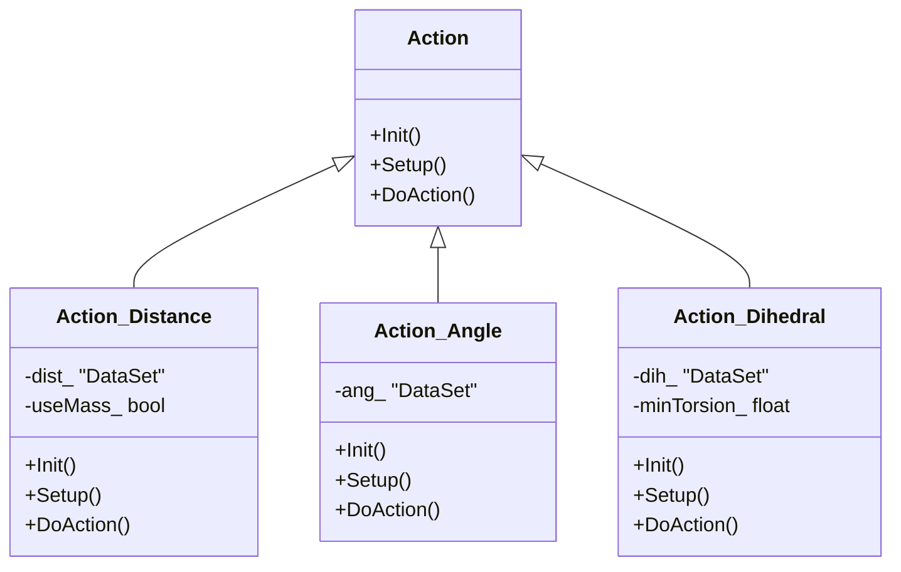
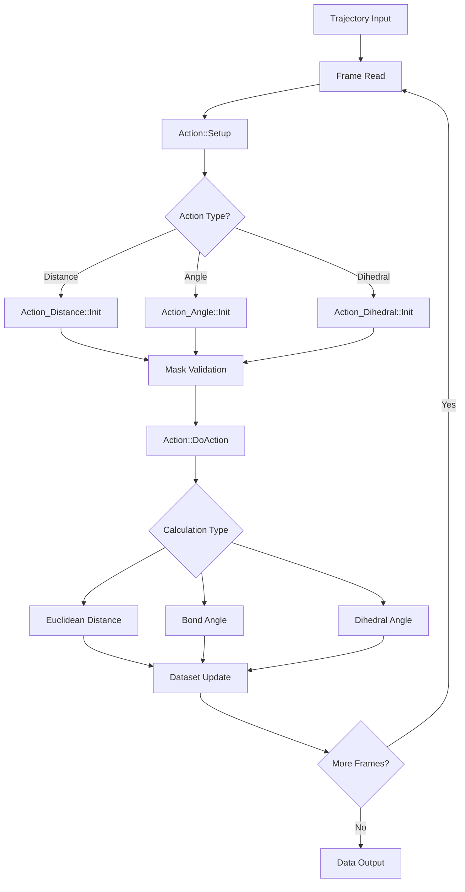

Distance and angle measurements form the foundation of quantitative molecular dynamics analysis in CPPTRAJ. These measurements enable researchers to track structural changes, monitor conformational transitions, and calculate geometric relationships between atoms or groups of atoms throughout trajectory simulation. This section explores the implementation and usage of distance calculations, angle measurements, and dihedral angle analysis within CPPTRAJ's modular architecture.

## Core Architecture

CPPTRAJ implements geometric measurements through a unified action framework that follows a consistent pattern across all measurement types. The architecture leverages a three-stage processing pipeline: initialization for parsing command arguments and setting up data sets, setup for mapping atom masks to trajectory coordinates, and action execution for per-frame calculations. This design enables efficient batch processing of trajectory frames while maintaining flexibility for different measurement types.

The measurement actions inherit from a base Action class and implement specific geometric calculations. Distance measurements support inter-atomic distances, point-to-atom distances, and periodic boundary condition handling. Angle calculations measure three-atom bond angles, while dihedral measurements compute torsional angles between four-atom sequences. Each measurement type produces time-series data suitable for statistical analysis, correlation studies, or visualization.



Sources: [Action_Distance.cpp](src/Action_Distance.cpp#L7-L12), [Action_Angle.cpp](src/Action_Angle.cpp#L8), [Action_Dihedral.cpp](src/Action_Dihedral.cpp#L9-L13)

## Distance Measurements

Distance calculations measure the Euclidean distance between two points in 3D space, which can be two atoms, an atom and a reference point, or an atom and a reference frame. The implementation supports both standard Cartesian distance calculations and minimum image conventions for periodic boundary conditions.

### Distance Action Implementation

The Action_Distance class initializes with configurable parameters including mass-weighting options and output dataset specifications. During initialization, it parses atom mask expressions for the two endpoints and optionally sets up periodic boundary condition handling. The Setup phase validates that masks select appropriate atoms from the topology, while the DoAction method performs the actual distance calculation for each frame.

The distance calculation supports several operational modes: normal distance between two atoms, distance to a fixed point in space, and distance to a reference structure. For periodic systems, CPPTRAJ automatically applies minimum image conventions unless explicitly disabled with the `noimage` keyword.

Sources: [Action_Distance.cpp](src/Action_Distance.cpp#L28-L113), [Action_Distance.cpp](src/Action_Distance.cpp#L151-L177)

### Distance Command Syntax

The distance command accepts multiple variations to accommodate different analysis scenarios:

```
distance <name> <mask1> <mask2> [out <filename>] [noimage] [type {mass|geom}]
distance <name> <mask> point <x> <y> <z> [out <filename>]
distance <name> <mask> <mask2> out <filename> reference [refmask]
```

Key parameters include:
- `name`: Dataset name for storing results
- `mask1`, `mask2`: Atom selection expressions defining the endpoints
- `out`: Output file for time-series data
- `noimage`: Disable minimum image convention for periodic systems
- `type`: `mass` for mass-weighted centroid distances, `geom` for geometric centers
- `point`: Fixed coordinates for point-to-atom distances
- `reference`: Calculate distance to first frame of trajectory

Sources: [Action_Distance.cpp](src/Action_Distance.cpp#L15-L26), [Test_Distance/RunTest.sh](test/Test_Distance/RunTest.sh#L15-L23)

### Distance Examples

The following examples demonstrate practical distance calculations for common MD analysis scenarios:

| Scenario | Command | Description |
|----------|---------|-------------|
| End-to-end distance | `distance EndToEnd :1 :13 out dist.dat` | Distance between first and last residues |
| Reference comparison | `distance ToRef @1 @1 out dist.dat reference` | Atom 1 position relative to reference frame |
| Point distance | `distance Point :1 point 0.0 0.0 0.0 out dist.dat` | Atom 1 distance from origin |
| Imaged distance | `distance EndToEnd :1 :13 out ortho.dat` | Distance with periodic boundary correction |
| No-image distance | `distance To553 ^1 :553 out ortho.553.dat noimage` | Distance without minimum image convention |

Sources: [Test_Distance/RunTest.sh](test/Test_Distance/RunTest.sh#L15-L35)

### Periodic Boundary Condition Handling

For simulations in periodic boxes, CPPTRAJ automatically applies minimum image conventions when calculating distances between atoms. This ensures that distances reflect the shortest path across periodic boundaries rather than artificial long paths due to periodic replication. The implementation handles both orthogonal and triclinic box geometries, with automatic detection of box type from the trajectory file.

The `noimage` keyword provides explicit control over this behavior for cases where the actual image跨越 periodic boundaries is of interest, such as tracking a molecule that has diffused across the simulation box boundary.

Sources: [Test_Distance/RunTest.sh](test/Test_Distance/RunTest.sh#L30-L58)

## Angle Measurements

Angle measurements calculate the bond angle between three atoms, defined as the angle subtended at the central atom by vectors extending to the two outer atoms. This measurement is fundamental for analyzing molecular geometry, monitoring conformational changes, and characterizing secondary structure elements.

### Angle Action Implementation

Action_Angle implements angle calculations through vector analysis of three-atom sets. The initialization phase parses three atom masks corresponding to the three atoms defining the angle, with validation that each mask selects exactly one atom. The calculation uses the dot product of normalized vectors from the central atom to each outer atom, applying the arccosine function to derive the angle in degrees.

The implementation maintains a dataset for storing per-frame angle values, enabling time-resolved analysis of angular fluctuations. Angle measurements do not support mass-weighting since they inherently depend on atomic positions rather than collective properties.

Sources: [Action_Angle.cpp](src/Action_Angle.cpp#L16-L51), [Action_Angle.cpp](src/Action_Angle.cpp#L75-L94)

### Angle Command Syntax

```
angle <name> <mask1> <mask2> <mask3> [out <filename>]
```

Parameters:
- `name`: Dataset identifier for the angle time series
- `mask1`, `mask2`, `mask3`: Single-atom masks defining the three atoms
- `mask2`: Central atom (vertex of the angle)
- `out`: Output file for results

Each mask must select exactly one atom. The angle is calculated as the arccosine of the dot product of normalized vectors from the central atom to each outer atom.

Sources: [Action_Angle.cpp](src/Action_Angle.cpp#L10-L14)

## Dihedral Angle Measurements

Dihedral angles (torsional angles) measure the rotation around a bond, defined by four consecutive atoms. These measurements are crucial for analyzing conformational preferences, monitoring backbone torsions in proteins (phi, psi, omega), and characterizing sidechain rotameric states.

### Dihedral Action Implementation

Action_Dihedral calculates torsional angles using the four-atom sequence defining the dihedral. The implementation employs vector cross products to determine the signed angle between planes defined by atoms (1-2-3) and (2-3-4). The calculation accounts for the proper sign convention using the dot product of cross products, providing dihedral values in the range -180° to 180° by default.

The class includes a `minTorsion_` parameter that defines the minimum torsion value for output formatting, supporting different range conventions used in various MD packages. The dihedral calculation is computationally more intensive than distances or angles but remains efficient for trajectory analysis.

Sources: [Action_Dihedral.cpp](src/Action_Dihedral.cpp#L23-L78), [Action_Dihedral.cpp](src/Action_Dihedral.cpp#L105-L130)

### Dihedral Command Syntax

```
dihedral <name> <mask1> <mask2> <mask3> <mask4> [out <filename>] [range360]
```

Parameters:
- `name`: Dataset name for dihedral time series
- `mask1` through `mask4`: Single-atom masks defining the four-atom torsion
- `out`: Output file specification
- `range360`: Output angles in 0-360° range instead of default -180° to 180°

### Multidihedral Analysis

For efficient analysis of multiple dihedrals, CPPTRAJ provides the `multidihedral` command that calculates multiple dihedral types simultaneously. This is particularly useful for protein backbone analysis where phi and psi angles for multiple residues need to be computed.

```
multidihedral <name> <dihedral_types> [resrange <range>]
```

Common dihedral types include:
- `phi`: Backbone phi angle (C-N-CA-C)
- `psi`: Backbone psi angle (N-CA-C-N)
- `omega`: Backbone omega angle (CA-C-N-CA)
- `chi1`, `chi2`, etc.: Sidechain torsions

Sources: [Test_PhiPsi/RunTest.sh](test/Test_PhiPsi/RunTest.sh#L15-L25)

### Dihedral Examples

The phi/psi analysis demonstrates practical dihedral measurements for protein conformational analysis:

```
multidihedral DPDP phi psi
run
phipsi DPDP[phi] DPDP[psi] out phipsi.dat resrange 1-22
writedata dihedrals.dat DPDP[phi]:2 DPDP[psi]:2
```

This example calculates phi and psi angles for the DPDP protein, generates a Ramachandran-style output file for residues 1-22, and writes specific residue data (residue 2 in this case) to a separate data file.

Sources: [Test_PhiPsi/RunTest.sh](test/Test_PhiPsi/RunTest.sh#L15-L25)

> [!TIP]
> When analyzing dihedral angles for large proteins, use the `resrange` option to focus on specific regions of interest. This reduces computational overhead and makes subsequent analysis more manageable by limiting the dataset to conformationally relevant segments.

## Processing Pipeline

Distance, angle, and dihedral measurements integrate seamlessly into CPPTRAJ's trajectory processing pipeline, following the standard action execution model. The pipeline stages enable efficient batch processing with minimal memory overhead.



The pipeline validates atom masks once during setup, then performs per-frame calculations efficiently during the DoAction phase. Data accumulation happens incrementally, with final output occurring after all frames are processed.

Sources: [Action_Distance.cpp](src/Action_Distance.cpp#L114-L150), [Action_Angle.cpp](src/Action_Angle.cpp#L52-L74), [Action_Dihedral.cpp](src/Action_Dihedral.cpp#L79-L104)

## Data Output and Analysis

All geometric measurements produce time-series datasets that can be output in various formats for subsequent analysis. CPPTRAJ supports standard data formats including Grace (.agr), columnar text, and NetCDF for efficient storage of large datasets.

The phipsi command provides specialized output for dihedral analysis, generating Ramachandran-style data formatted for visualization tools. This output pairs phi and psi angles by residue, facilitating backbone conformation analysis.

Sources: [Test_PhiPsi/RunTest.sh](test/Test_PhiPsi/RunTest.sh#L19-L21)

## Integration with Statistical Analysis

Distance and angle measurements serve as input for higher-level statistical analyses available in CPPTRAJ. The time-series data generated by these actions feeds directly into correlation functions, histograms, clustering algorithms, and principal component analysis workflows.

For correlation analysis, distance measurements can reveal coordinated motions between distant parts of a molecule, while dihedral time series enable analysis of conformational transitions and free energy landscapes. The modular design allows seamless combination of geometric measurements with advanced analysis commands.

Sources: [README.md](README.md#L32-L40)

> [!TIP]
> Combine distance measurements with [Time-Correlation Functions and Spectral Analysis](14-time-correlation-functions-and-spectral-analysis) to identify periodic motions or correlated conformational changes. The correlation of distance fluctuations can reveal allosteric communication pathways in large biomolecular systems.

## Further Reading

- **Atom Selection**: For advanced mask syntax and atom selection techniques, see [Atom Selection and Mask Expressions](6-atom-selection-and-mask-expressions)
- **Trajectory Processing**: Understanding the full processing pipeline is covered in [Trajectory Processing Pipeline](7-trajectory-processing-pipeline)
- **Coordinate Transformations**: For RMSD and alignment operations often used in conjunction with geometric measurements, see [Coordinate Transformations](8-coordinate-transformations-rmsd-alignment-rotation)
- **Statistical Analysis**: Applying statistical methods to geometric measurement data is detailed in [Correlation Functions](12-correlation-functions-auto-correlation-cross-correlation) and [Principal Component Analysis](13-principal-component-analysis-pca)
