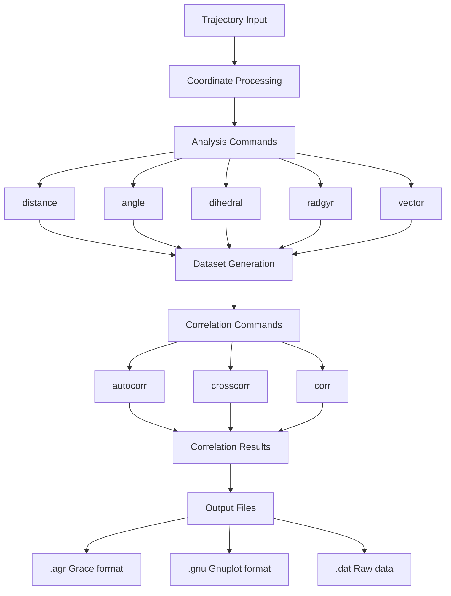

This page provides comprehensive coverage of correlation analysis capabilities in cpptraj, enabling you to quantify temporal relationships and periodic behaviors in molecular dynamics trajectories. Correlation functions are essential tools for understanding dynamic properties, identifying relaxation timescales, and detecting coupled motions in molecular systems.

## Mathematical Foundations

Correlation analysis in cpptraj operates on time series data derived from atomic coordinates, distances, angles, or any scalar or vector quantity computed along a trajectory. The implementation supports both auto-correlation (correlation of a time series with itself) and cross-correlation (correlation between two different time series).

The auto-correlation function C(τ) measures how a time series X(t) correlates with itself at different lag times τ:

**C(τ) = ⟨X(t) · X(t+τ)⟩**

where the angle brackets denote averaging over all time origins. Auto-correlation decays from 1 at τ=0 (perfect correlation with itself) toward 0 for uncorrelated signals, with the decay envelope revealing characteristic timescales of the system's dynamics.

The cross-correlation function C_xy(τ) quantifies the relationship between two different time series X(t) and Y(t):

**C_xy(τ) = ⟨X(t) · Y(t+τ)⟩**

This can reveal causal relationships, phase delays, and coupled motions between different degrees of freedom.

Sources: [Test_AutoCorr/RunTest.sh](test/Test_AutoCorr/RunTest.sh#L1-L24), [Test_CrossCorr/RunTest.sh](test/Test_CrossCorr/RunTest.sh#L1-L22), [Test_Corr/RunTest.sh](test/Test_Corr/RunTest.sh#L1-L24)

## Auto-Correlation Analysis

Auto-correlation analysis in cpptraj is invoked using the `autocorr` command, which processes one or more datasets and generates correlation functions as a function of lag time. This is particularly valuable for analyzing relaxation processes, identifying periodic motions, and computing characteristic decay times.

### Basic Syntax

The fundamental auto-correlation command structure:

```
autocorr name <output_name> <dataset1> <dataset2> ... out <output_file> [lagmax <max_lag>]
```

The command accepts multiple datasets simultaneously, computing auto-correlation for each independently. Each dataset must be pre-defined through analysis commands such as `distance`, `angle`, `dihedral`, `radgyr`, or `vector`.

### Practical Example

Consider computing auto-correlations for inter-residue distances and a vector quantity:

```
parm tz2.parm7
trajin tz2.nc
distance d1-13 :1 :13
distance d3-11 :3 :11
distance d5-9  :5 :9
vector v1 :2@N :2@H
autocorr name AC d1-13 d3-11 d5-9 v1 out ac.agr lagmax 50
```

This example demonstrates auto-correlation analysis on three inter-residue distances and one bond vector, with correlation computed up to lag time 50. The output file `ac.agr` contains the correlation values for all specified datasets.

### Key Parameters

| Parameter | Description | Default Value |
|-----------|-------------|---------------|
| `name` | Prefix for output dataset names | Required |
| `out` | Output file path for correlation results | Required |
| `lagmax` | Maximum lag time for correlation computation | Half trajectory length |
| `datasets` | One or more pre-defined datasets to analyze | Required |

The `lagmax` parameter is critical for balancing resolution and statistical quality. Smaller lagmax values provide better statistics for each lag point but limit the range of observable timescales.

Sources: [Test_AutoCorr/RunTest.sh](test/Test_AutoCorr/RunTest.sh#L1-L24)

## Cross-Correlation Analysis

Cross-correlation analysis quantifies relationships between different observables, revealing coupling, causality, and phase relationships in molecular dynamics. The `crosscorr` command computes pairwise correlations between specified datasets.

### Basic Syntax

The cross-correlation command structure:

```
crosscorr name <output_name> <dataset1> <dataset2> <dataset3> ... out <output_file>
```

Unlike auto-correlation which correlates each dataset with itself, cross-correlation computes all pairwise correlations between the specified datasets. For N input datasets, this generates N×N correlation values at each lag time.

### Practical Example

Computing cross-correlations between multiple inter-residue distances:

```
parm tz2.parm7
trajin tz2.nc
distance d1-13 :1 :13
distance d3-11 :3 :11
distance d5-9  :5 :9
crosscorr name CC d1-13 d3-11 d5-9 out cc.gnu
```

This command computes all nine pairwise correlations between the three distances: d1-13 with itself, d1-13 with d3-11, d1-13 with d5-9, d3-11 with itself, d3-11 with d5-9, and d5-9 with itself. The diagonal elements contain auto-correlations, while off-diagonal elements contain cross-correlations.

### Interpretation Guidelines

Cross-correlation values range from -1 to +1, with interpretation depending on the physical context:

- **+1**: Perfect positive correlation - variables move together synchronously
- **0**: No linear correlation - independent behaviors
- **-1**: Perfect negative correlation - variables move in opposite directions

In biomolecular systems, strong cross-correlations often indicate allosteric communication pathways, concerted domain motions, or coupled conformational changes.

Sources: [Test_CrossCorr/RunTest.sh](test/Test_CrossCorr/RunTest.sh#L1-L22)

## General Correlation Command

The `corr` command provides unified correlation analysis with automatic detection of correlation type based on input datasets. This flexible command handles both auto-correlation (same dataset specified twice) and cross-correlation (different datasets).

### Auto-Correlation Example

```
corr d1 d1 out corr.dat
```

Specifying the same dataset twice (`d1 d1`) triggers auto-correlation analysis, equivalent to the specialized `autocorr` command.

### Cross-Correlation Example

```
corr d1 rg out cross.dat
```

Specifying different datasets (`d1 rg`) triggers cross-correlation between a distance and radius of gyration, useful for coupling analysis between local and global structural descriptors.

### Integration with Other Analyses

The `corr` command seamlessly integrates with any cpptraj analysis that generates scalar datasets:

```
distance d1 :2 :12
radgyr rg :1-3 mass nomax
corr d1 d1 out corr.dat
corr d1 rg out cross.dat
```

This demonstrates combining distance measurements and radius of gyration calculations for comprehensive correlation analysis of both local inter-residue separations and overall protein compaction.

Sources: [Test_Corr/RunTest.sh](test/Test_Corr/RunTest.sh#L1-L24)

## Data Flow and Integration

Correlation analysis integrates naturally into the cpptraj trajectory processing pipeline, operating on datasets generated by analysis commands and producing output suitable for visualization and further processing.



This architectural diagram illustrates how correlation analysis fits within the broader analysis workflow, with datasets flowing from coordinate processing through analysis commands to correlation computation and output.

Sources: [Test_AutoCorr/RunTest.sh](test/Test_AutoCorr/RunTest.sh#L1-L24), [Test_CrossCorr/RunTest.sh](test/Test_CrossCorr/RunTest.sh#L1-L22), [Test_Corr/RunTest.sh](test/Test_Corr/RunTest.sh#L1-L24)

## Output Formats and Visualization

Correlation results can be written in multiple formats optimized for different visualization tools:

### Supported Output Formats

- **Grace/Xmgr (.agr)**: Binary format for Grace plotting software, ideal for publication-quality figures
- **Gnuplot (.gnu)**: Text format with embedded plotting commands for quick visualization
- **Raw data (.dat)**: Plain text format suitable for custom analysis or import into other software

The output format is determined by the file extension specified in the `out` parameter.

### Output Structure

Each correlation file contains:
- Header information with metadata
- Lag time values (first column or row)
- Correlation coefficients for each dataset pair
- Statistical information (if applicable)

> [!TIP]
> For auto-correlation, the first lag value (τ=0) always equals 1.0, representing perfect correlation of each dataset with itself. Deviations from this expected value may indicate normalization issues or insufficient trajectory length.

Sources: [Test_AutoCorr/RunTest.sh](test/Test_AutoCorr/RunTest.sh#L1-L24), [Test_CrossCorr/RunTest.sh](test/Test_CrossCorr/RunTest.sh#L1-L22)

## Applications in Molecular Dynamics

Correlation analysis provides insights into diverse molecular phenomena:

### Relaxation Time Analysis

Auto-correlation decay rates yield characteristic relaxation times (τ_relax) for various processes:

- **Side-chain rotameric transitions**: Fast decays (ps-ns timescale)
- **Loop motions**: Intermediate decays (ns-μs timescale)  
- **Domain reorientations**: Slow decays (μs-ms timescale)

Extract τ_relax by fitting correlation decay to exponential or multi-exponential functions.

### Coupled Motions Detection

Cross-correlation analysis reveals spatial communication pathways:

- Strong positive correlations indicate concerted motions
- Negative correlations suggest compensatory or anti-correlated movements
- Lag at maximum cross-correlation indicates time delays between motions

### Periodic Behavior Identification

Persistent oscillatory components in correlation functions indicate:

- Vibrational modes (high-frequency oscillations)
- Conformational transitions (intermediate frequencies)
- Global breathing motions (low-frequency oscillations)

Sources: [Test_AutoCorr/RunTest.sh](test/Test_AutoCorr/RunTest.sh#L1-L24), [Test_CrossCorr/RunTest.sh](test/Test_CrossCorr/RunTest.sh#L1-L22)

## Advanced Considerations

### Statistical Quality

The statistical quality of correlation functions depends on:

- **Trajectory length**: Longer trajectories provide better averaging
- **Lagmax selection**: Larger lagmax reduces samples per lag point
- **Sampling rate**: Must capture relevant timescales

A general guideline: lagmax should not exceed 10-20% of total trajectory length for reliable statistics at all lags.

### Normalization and Units

Correlation functions are computed using normalized quantities, making them dimensionless and comparable across different observables. However, ensure input datasets have consistent units and sampling frequencies.

### Periodic Boundary Effects

For vector-based correlations (velocity autocorrelations, bond vectors), ensure proper imaging and unwrapping to avoid artifacts from periodic boundary conditions. This can be achieved through preprocessing with `autoimage` or `unwrap` commands.

> [!TIP]
> When analyzing correlations in large systems, consider reducing computational cost by selecting specific regions of interest with atom masks and limiting analysis to relevant degrees of freedom.

Sources: [Test_AutoCorr/RunTest.sh](test/Test_AutoCorr/RunTest.sh#L1-L24), [Test_Corr/RunTest.sh](test/Test_Corr/RunTest.sh#L1-L24)

## Integration with Statistical Analysis

Correlation functions form a bridge between basic trajectory analysis and advanced statistical methods:

**Velocity Autocorrelation**: Foundation for [Diffusion Coefficients](26-diffusion-coefficients) calculations via Green-Kubo relations

**Dipole Autocorrelation**: Basis for [Time-Correlation Functions and Spectral Analysis](14-time-correlation-functions-and-spectral-analysis) and infrared spectroscopy prediction

**Coordinate Cross-Correlation**: Input for [Principal Component Analysis](13-principal-component-analysis-pca) and essential dynamics analysis

These connections demonstrate how correlation analysis provides the time-domain foundation for frequency-domain and ensemble-based analysis techniques.

Sources: [Test_Corr/RunTest.sh](test/Test_Corr/RunTest.sh#L1-L24)

## Performance Optimization

For large-scale correlation analyses:

1. **Batch processing**: Compute multiple correlations in a single pass using `autocorr` with multiple datasets
2. **Lagmax optimization**: Use smaller lagmax for preliminary scans, increase for focused analysis
3. **Parallelization**: Leverage [OpenMP Multi-threading](29-openmp-multi-threading) for trajectory processing stages
4. **Memory management**: For very long trajectories, process in chunks and combine results

Correlation computation scales linearly with trajectory length and number of datasets, making it amenable to parallel optimization strategies.

Sources: [Test_AutoCorr/RunTest.sh](test/Test_AutoCorr/RunTest.sh#L1-L24)

## Troubleshooting Guide

| Issue | Possible Cause | Solution |
|-------|----------------|----------|
| Correlation values > 1.0 | Non-normalized input data | Verify dataset normalization or pre-normalize values |
| Noisy correlation functions | Insufficient trajectory length | Increase trajectory length or reduce lagmax |
| Unexpected oscillations | Periodic boundary artifacts | Apply proper imaging before correlation analysis |
| Flat correlation at τ=0 | All zero values in dataset | Check atom masks and selection criteria |
| Memory errors | Very large correlation matrix | Reduce number of datasets or process in batches |

## Recommended Reading Path

For a complete understanding of cpptraj analysis capabilities:

1. **Prerequisites**: [Atom Selection and Mask Expressions](6-atom-selection-and-mask-expressions) for dataset definition
2. **Related Analysis**: [Time-Correlation Functions and Spectral Analysis](14-time-correlation-functions-and-spectral-analysis) for frequency-domain extensions
3. **Applications**: [Diffusion Coefficients](26-diffusion-coefficients) for transport property calculations
4. **Advanced**: [Principal Component Analysis](13-principal-component-analysis-pca) for collective motion analysis

This progression from basic correlation concepts to advanced applications provides a comprehensive toolkit for analyzing dynamic properties in molecular simulations.