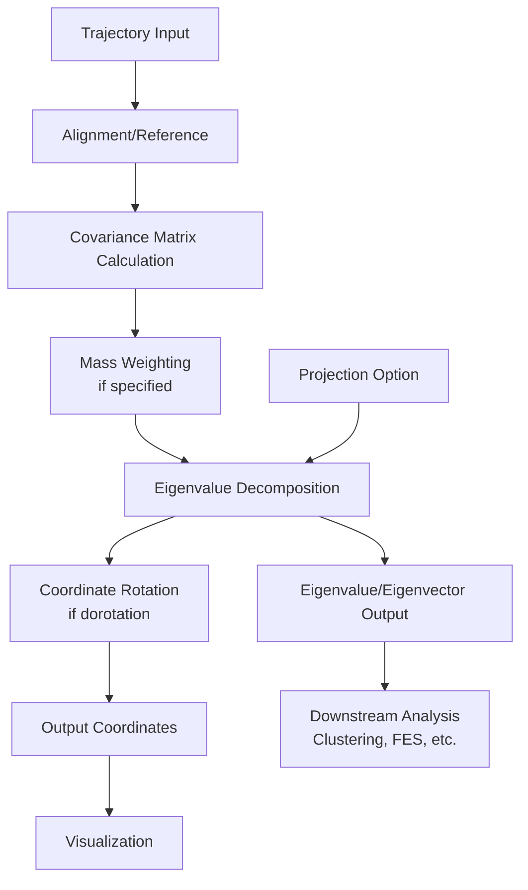

Principal Component Analysis in CPPTRAJ provides a powerful dimensionality reduction technique for molecular dynamics trajectory analysis, enabling extraction of collective motions and identification of dominant conformational changes. This analysis decomposes atomic positional fluctuations into orthogonal principal components ranked by variance, revealing the most significant large-scale motions in molecular systems.

## Mathematical Foundation

PCA in CPPTRAJ operates on the covariance matrix of atomic coordinates or derived coordinate systems. The fundamental process involves computing the covariance matrix of atomic fluctuations after aligning trajectories to a reference structure, then diagonalizing this matrix to obtain eigenvalues (variance) and eigenvectors (principal components). The mathematical foundation rests on the eigenvalue decomposition:

**C = AᵀA**

Where C is the covariance matrix and A contains the mass-weighted coordinate fluctuations. The eigenvectors of C form an orthonormal basis that diagonalizes the covariance, with eigenvalues representing the variance captured by each principal component.

The implementation supports both coordinate-based PCA (atomic positions) and data-based PCA (derived metrics like RMSD, distances, angles), providing flexibility for different analysis scenarios. The mass-weighting option enables incorporation of atomic masses into the calculation, making the analysis more physically meaningful for biomolecular systems.

## Core Command Architecture

The `principal` command serves as the primary interface for PCA analysis, supporting multiple operational modes and output options. The command structure follows CPPTRAJ's consistent analysis pattern with trajectory input, processing parameters, and output specifications.

```bash
principal <mask> [dorotation] [mass] [out <file>] [name <dataset_name>]
```

The test suite demonstrates typical usage patterns [RunTest.sh](test/Test_Principal/RunTest.sh#L15-L22):
```
trajin ../Test_IRED/1IEE_A_test.mdcrd 1 10
principal * dorotation mass out principal.dat name All
trajout Ctest.crd
run
writedata eigen.dat All[eval] All[evec]
```

**Key Parameters:**

| Parameter | Description | Default |
|-----------|-------------|---------|
| mask | Atom selection for analysis | All atoms |
| dorotation | Rotate coordinates to principal axes | No rotation |
| mass | Use mass-weighted coordinates | No mass weighting |
| out | Output file for per-frame results | None |
| name | Dataset name for eigenvalues/eigenvectors | Default name |

## Implementation Architecture

The PCA implementation in CPPTRAJ follows a modular design that integrates with the broader analysis framework:



The implementation processes trajectory frames sequentially, accumulating the covariance matrix incrementally. This design enables efficient memory usage for large trajectories and supports parallel processing for improved performance on multi-core systems.

## Output Structure and Data Organization

PCA results are organized into multiple output streams, each serving different analytical purposes:

**Per-Frame Output** (`principal.dat` format) [principal.dat.save](test/Test_Principal/principal.dat.save#L1-L41):
```
<Frame> EIGENVALUES: <λ1> <λ2> <λ3>
<Frame> EIGENVECTOR 0: <v1x> <v1y> <v1z>
<Frame> EIGENVECTOR 1: <v2x> <v2y> <v2z>
<Frame> EIGENVECTOR 2: <v3x> <v3y> <v3z>
```

Each frame section contains three eigenvalues (for 3D coordinate analysis) followed by three corresponding eigenvectors. The eigenvalues are ordered by magnitude, with PC1 representing the direction of maximum variance.

**Dataset Outputs** (via `writedata`):
- `All[eval]`: Eigenvalues across all frames
- `All[evec]`: Eigenvector components across all frames

> [!TIP]
> The eigenvector output uses 0-based indexing (EIGENVECTOR 0, 1, 2) corresponding to PC1, PC2, PC3 respectively, which is important when accessing programmatically via the dataset API.

## Coordinate Systems and Analysis Modes

PCA can be performed on different coordinate representations depending on the research question:

**Atomic Coordinates (Default):**
- Analyzes Cartesian coordinate fluctuations
- Requires trajectory alignment to remove translational/rotational motion
- Most common for protein backbone analysis

**Internal Coordinates:**
- Performed on dihedral angles, distances, or other metrics
- Eliminates need for explicit alignment
- Better for conformational sampling analysis

**Mass-Weighted PCA:**
- Incorporates atomic masses into covariance calculation
- Provides physically meaningful collective modes
- Particularly relevant for comparing systems with different atomic compositions

The command syntax adapts to the coordinate system through the mask specification and optional preprocessing commands like `dihedral` or `distance` before the `principal` analysis.

## Integration with Downstream Analyses

PCA results serve as foundational data for multiple advanced analyses in the CPPTRAJ ecosystem:

**Projection Analysis:**
- Project trajectories onto principal components
- Identify frames with extreme PC values
- Generate 2D/3D free energy surfaces
- Related to [Clustering Algorithms](17-clustering-algorithms-k-means-dbscan-hierarchical) for conformational space partitioning

**Essential Dynamics:**
- Animate principal components as collective motions
- Visualize dominant conformational changes
- Compare with experimental observables

**Dimensionality Reduction:**
- Input to machine learning analyses
- Preprocessing for [Time-Correlation Functions](14-time-correlation-functions-and-spectral-analysis)
- Feature extraction for enhanced sampling methods

## Advanced Features and Optimization

> [!TIP]
> For large-scale analyses, consider combining PCA with trajectory sieving or frame reduction strategies to manage computational cost while preserving statistical significance of the principal components.

The implementation supports several advanced features:

**Parallel Execution:**
- MPI and OpenMP parallelization available
- Noted in test script that certain output formats may not be supported in parallel mode [RunTest.sh](test/Test_Principal/RunTest.sh#L24-L31)
- Suitable for ensemble analysis [Ensemble Analysis](27-ensemble-analysis-remd-mremd-hremd)

**Memory Management:**
- Incremental covariance accumulation
- Efficient handling of large trajectory datasets
- Configurable through parallel execution parameters

**Visualization Integration:**
- Coordinate rotation enables direct visualization of principal axes
- Compatible with trajectory output formats for molecular graphics
- Integration with [Coordinate Transformations](8-coordinate-transformations-rmsd-alignment-rotation)

## Practical Implementation Patterns

**Basic PCA with Coordinate Rotation:**
```
trajin trajectory.nc
reference ref.pdb
rms first @CA
principal @CA dorotation mass name ProteinPC
run
writedata eigenvalues.dat ProteinPC[eval]
```

**PCA on Internal Coordinates:**
```
trajin trajectory.nc
dihedral phi1 :1@C :2@N :2@CA :2@C
dihedral psi1 :2@N :2@CA :2@C :3@N
principal data phi1 data psi1 name DihedralPC
run
```

**Trajectory Projection:**
```
# After PCA calculation
project evecs ProteinPC out projection.dat trajin trajectory.nc
```

## Relationship to Other Dimensionality Reduction Methods

CPPTRAJ provides multiple complementary dimensionality reduction techniques:

| Method | Input Type | Key Features | Typical Use Case |
|--------|-----------|--------------|------------------|
| PCA | Coordinates or data | Variance maximization | Global collective motions |
| TICA | Time-series data | Slow dynamics identification | Kinetic clustering |
| IRED | Bond vectors | Orientational correlations | NMR relaxation analysis |

The [Time-Correlation Functions](14-time-correlation-functions-and-spectral-analysis) documentation provides additional context for understanding temporal correlations that complement the spatial correlations captured by PCA.

## Performance Considerations

For optimal performance when working with large-scale datasets:

1. **Alignment**: Perform trajectory alignment before PCA using [RMSD Calculations](10-rmsd-and-rmsf-calculations)
2. **Parallel Execution**: Leverage [MPI Parallelization](30-mpi-parallelization-for-large-scale-analysis) for trajectory processing
3. **Memory Management**: Use trajectory sieving for initial exploratory analysis
4. **I/O Optimization**: Minimize per-frame output unless required for analysis

The computational complexity scales as O(n·m²) where n is the number of frames and m is the number of atoms (or degrees of freedom), making selective atom masks crucial for large systems.

## Next Steps

For comprehensive trajectory analysis workflows, consider integrating PCA with:

- [Clustering Algorithms](17-clustering-algorithms-k-means-dbscan-hierarchical) for conformational state identification based on PC space
- [Grid and Density Calculations](19-grid-and-density-calculations) for spatial distribution analysis in PC-projected coordinates
- [Correlation Functions](12-correlation-functions-auto-correlation-cross-correlation) for temporal dynamics of PC amplitudes
- [Diffusion Coefficients](26-diffusion-coefficients) for examining dynamics along principal components
