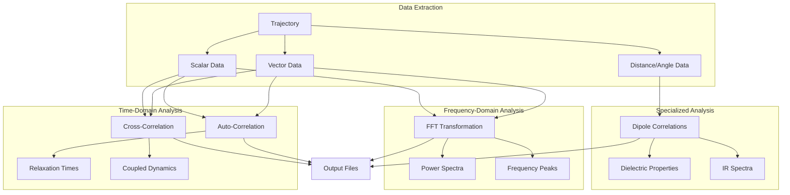

This section explores the advanced time-series analysis capabilities in CPPTRAJ, focusing on temporal correlation functions and frequency-domain spectral transformations. These tools enable you to extract dynamic information from molecular dynamics trajectories, revealing relaxation times, collective motion frequencies, and dipole moment correlations essential for understanding molecular behavior and spectroscopic properties.

## Architectural Overview

Time-correlation and spectral analysis in CPPTRAJ operate on vector and scalar data extracted from trajectories, transforming temporal domain information into correlation functions and frequency spectra. The architecture supports both time-domain correlation calculations and frequency-domain analysis through Fast Fourier Transforms (FFT), enabling comprehensive dynamic analysis through multiple computational pathways.



Sources: [test/Test_Timecorr/RunTest.sh](test/Test_Timecorr/RunTest.sh), [test/Test_FFT/RunTest.sh](test/Test_FFT/RunTest.sh)

## Time Correlation Functions

Time correlation functions quantify how dynamical variables evolve and correlate with themselves (auto-correlation) or with other variables (cross-correlation) over time. These functions provide fundamental insights into molecular relaxation processes, memory effects, and collective dynamics.

### Auto-Correlation Analysis

Auto-correlation functions measure the temporal persistence of a dynamical variable, revealing its characteristic relaxation times. In CPPTRAJ, vector auto-correlation is computed using the `timecorr` command with a single vector specification:

```cpp
analyze timecorr vec1 v1 out v1.auto.dat ptrajformat
```

The auto-correlation function C(t) for a vector v(τ) is defined as:

C(t) = ⟨v(τ) · v(τ+t)⟩

where the angle brackets denote an ensemble average over time origins τ. The function is normalized such that C(0) = 1 for unit vectors, providing decay curves that directly reflect relaxation dynamics.

Sources: [test/Test_Timecorr/RunTest.sh](test/Test_Timecorr/RunTest.sh#L11-L15)

### Cross-Correlation Analysis

Cross-correlation analysis examines the temporal relationship between two different dynamical variables, identifying coupled motions and delayed responses. The command syntax extends the auto-correlation case with a second vector specification:

```cpp
analyze timecorr vec1 v1 vec2 v2 out v1v2.cross.dat ptrajformat
```

The cross-correlation function C₁₂(t) between vectors v₁(τ) and v₂(τ) follows:

C₁₂(t) = ⟨v₁(τ) · v₂(τ+t)⟩

Non-zero cross-correlations indicate temporal coupling between the two degrees of freedom, which can reveal allosteric communication pathways or correlated conformational changes.

Sources: [test/Test_Timecorr/RunTest.sh](test/Test_Timecorr/RunTest.sh#L16-L17)

### Correlation Order and Normalization

The `order` parameter controls the moment order for correlation calculations, affecting the sensitivity to different correlation magnitudes:

```cpp
timecorr vec1 v1 out v1.o1.auto.dat order 1
timecorr vec1 v1 out v1.o0.auto.dat order 0
```

Order 0 (default) computes the standard correlation function normalized by initial values, while order 1 uses different normalization schemes suitable for specific physical quantities like dipole moments where magnitude variations are significant.

Sources: [test/Test_Timecorr/RunTest.sh](test/Test_Timecorr/RunTest.sh#L12-L14)

## Dipole Correlation and Spectral Properties

Dipole correlation functions bridge time-domain dynamics with frequency-domain spectroscopic properties, enabling prediction of infrared and dielectric spectra from MD trajectories.

### Dipole Moment Correlation Analysis

The `dplr` keyword activates specialized dipole correlation calculations, computing quantities directly relevant to dielectric and infrared spectroscopy:

```cpp
analyze timecorr vec1 v1 dplr out v1.dplr.auto.dat ptrajformat
analyze timecorr vec1 v1 vec2 v2 dplr out v1v2.dplr.cross.dat ptrajformat
```

Dipole correlations generate additional output columns including:
- **R**: Correlation function ⟨μ(τ)·μ(τ+t)⟩
- **RRIG**: Rotational-invariant correlation
- **R³**: Higher-order correlation terms
- **R⁶**: Extended correlation moments

These quantities enable calculation of dielectric permittivity and infrared absorption spectra through fluctuation-dissipation relationships.

Sources: [test/Test_Timecorr/RunTest.sh](test/Test_Timecorr/RunTest.sh#L18-L21)

### Infrared Spectrum Prediction

For dipole correlation functions, the infrared absorption coefficient α(ω) can be computed via Fourier transformation:

α(ω) ∝ ω² ∫₀^∞ ⟨μ(0)·μ(t)⟩ e^{-iωt} dt

The frequency-domain spectrum reveals molecular vibrational modes and their coupling to the electric field, providing direct connections between MD simulations and experimental IR spectroscopy.

Sources: [test/Test_Timecorr/RunTest.sh](test/Test_Timecorr/RunTest.sh#L24-L29)

## Cross-Correlation of Scalar Data

Beyond vector correlations, CPPTRAJ supports cross-correlation of scalar data such as distances, angles, and energies through the `crosscorr` command:

```cpp
distance d1-13 :1 :13
distance d3-11 :3 :11
distance d5-9  :5 :9
crosscorr name CC d1-13 d3-11 d5-9 out cc.gnu
```

This enables identification of correlated structural changes and delayed responses between geometric parameters, essential for understanding allosteric mechanisms and cooperative motions.

Sources: [test/Test_CrossCorr/RunTest.sh](test/Test_CrossCorr/RunTest.sh#L12-L16)

## Spectral Analysis via Fast Fourier Transform

Spectral analysis transforms time-domain data into frequency-domain representations, revealing periodic components and characteristic frequencies inherent in molecular motions.

### FFT Command Syntax

The `runanalysis fft` command performs Fast Fourier Transform on pre-existing data files:

```cpp
readdata sin_4pt.agr
runanalysis fft sin_4pt.agr out fft.agr dt 0.025
```

Critical parameters include:
- **dt**: Time step between data points (in appropriate time units)
- **out**: Output file for frequency spectrum
- Input data must be uniformly sampled in time

Sources: [test/Test_FFT/RunTest.sh](test/Test_FFT/RunTest.sh#L6-L8)

### Frequency Resolution and Aliasing

The FFT frequency resolution Δf is determined by the total sampling time T:

Δf = 1/T = (dt × N)⁻¹

where N is the number of data points. The Nyquist frequency f_Nyquist = 1/(2dt) represents the maximum detectable frequency. Proper parameter selection ensures:

1. Adequate sampling rate (dt small enough to capture fastest dynamics)
2. Sufficient duration (large T for fine frequency resolution)
3. Power-of-two data points (optimal for FFT efficiency)

Sources: [test/Test_FFT/RunTest.sh](test/Test_FFT/RunTest.sh#L10-L27)

## Practical Implementation Examples

### Vector Correlation Analysis Setup

Complete workflow for analyzing correlated vector motions between selected atoms:

```cpp
# Load trajectory
parm system.parm7
trajin trajectory.nc

# Define vectors for correlation analysis
vector v1 :2  :4          # Vector between atoms 2 and 4
vector v2 :12 :10         # Vector between atoms 12 and 10

# Compute auto-correlation
analyze timecorr vec1 v1 out v1.auto.dat ptrajformat

# Compute cross-correlation
analyze timecorr vec1 v1 vec2 v2 out v1v2.cross.dat ptrajformat

# Extract correlation time from decay
```

Sources: [test/Test_Timecorr/RunTest.sh](test/Test_Timecorr/RunTest.sh#L8-L17)

### Dipole Correlation for Spectroscopy

Analysis pipeline for predicting IR spectra from dipole moment correlations:

```cpp
# Define dipole vectors
vector v3 @14 @15
vector v4 @38 @39

# Compute dipole correlation
analyze timecorr vec1 v3 vec2 v4 dplr out tz2.2.3.cross.dat ptrajformat name dv3v4

# Extract correlation components
create dv3v4.dat dv3v4[R] dv3v4[RRIG] dv3v4[R3] dv3v4[R6] dv3v4[Name]
```

The output file `dv3v4.dat` contains multiple correlation quantities that can be Fourier transformed externally to obtain the IR spectrum.

Sources: [test/Test_Timecorr/RunTest.sh](test/Test_Timecorr/RunTest.sh#L27-L29)

### Multi-Dataset Cross-Correlation

Analysis of coupled geometric motions across multiple distance metrics:

```cpp
# Calculate distances
distance d1-13 :1 :13
distance d3-11 :3 :11
distance d5-9  :5 :9

# Compute cross-correlation matrix
crosscorr name CC d1-13 d3-11 d5-9 out cc.gnu
```

The output provides the cross-correlation matrix showing temporal relationships between all specified geometric variables.

Sources: [test/Test_CrossCorr/RunTest.sh](test/Test_CrossCorr/RunTest.sh#L12-L16)

## Output Format and Interpretation

### Time-Correlation Output Format

Time-correlation functions are typically output in two-column format:

```
# Frame   Correlation
0         1.0000
1         0.9523
2         0.8876
...
```

The first column represents time lag (in frames or time units), while the second column contains the correlation value. Normalization ensures C(0) = 1 for auto-correlations of unit vectors.

Sources: [test/Test_Timecorr/RunTest.sh](test/Test_Timecorr/RunTest.sh#L32-L40)

### Spectral Output Format

FFT output typically follows Grace/AGR format with frequency and magnitude/power columns:

```
@    title "FFT Spectrum"
@    xaxis  label "Frequency (cm^-1)"
@    yaxis  label "Intensity"
0.0    0.000
10.5   0.234
21.0   1.567
...
```

Frequency units depend on the input time step dt and any unit conversion applied.

Sources: [test/Test_FFT/RunTest.sh](test/Test_FFT/RunTest.sh#L6-L27)

> [!TIP]
> For accurate IR spectra from dipole correlations, ensure sufficient sampling time (at least 10× the longest correlation time of interest) and use a time step shorter than the fastest vibration period (typically <10 fs for molecular vibrations). The total trajectory length determines frequency resolution, while dt determines the maximum detectable frequency.

## Integration with Other Analysis Methods

Time-correlation and spectral analysis complement other dynamic analysis techniques in CPPTRAJ:

- **[Principal Component Analysis (PCA)](13-principal-component-analysis-pca)**: Identify collective modes whose time autocorrelation reveals relaxation timescales
- **[RMSD and RMSF Calculations](10-rmsd-and-rmsf-calculations)**: Correlate structural fluctuations with functional motions
- **[Diffusion Coefficients](26-diffusion-coefficients)**: Velocity autocorrelation functions provide alternative diffusion coefficient calculations
- **[Wavelet Analysis](25-wavelet-analysis)**: Time-frequency representations for non-stationary dynamics

These combined approaches provide comprehensive understanding of molecular dynamics across temporal and frequency domains.

## Performance Considerations

> [!TIP]
> FFT calculations benefit significantly from FFTW optimization. Configure CPPTRAJ with FFTW support (`-fftw3`) and enable FFTW wisdom files for production runs to achieve optimal performance. For time-correlation calculations, the computational cost scales as O(N²) with trajectory length N, so consider using trajectory subsets or appropriate frame skipping for exploratory analysis.

Parallelization options include:
- **OpenMP**: Enable with `-openmp` configure flag for multi-threaded FFT operations
- **MPI**: Useful for analyzing multiple trajectories or large ensemble data in parallel

Sources: [README.md](README.md#L60-L75), [configure](configure#L52-L54)

## Next Steps

For deeper exploration of dynamic analysis capabilities:

- **[Correlation Functions (Auto-correlation, Cross-correlation)](12-correlation-functions-auto-correlation-cross-correlation)**: Fundamental correlation theory and applications
- **[Normal Mode Analysis and Eigenmode Calculations](24-normal-mode-analysis-and-eigenmode-calculations)**: Frequency-domain analysis from harmonic approximations
- **[Wavelet Analysis](25-wavelet-analysis)**: Time-frequency analysis for non-stationary signals
- **[Ensemble Analysis (REMD, MREMD, HREMD)](27-ensemble-analysis-remd-mremd-hremd)**: Enhanced sampling and temperature-dependent dynamics

Time-correlation functions and spectral analysis provide powerful tools for extracting quantitative dynamical information from molecular dynamics simulations, bridging the gap between atomic-level motions and experimental observables.