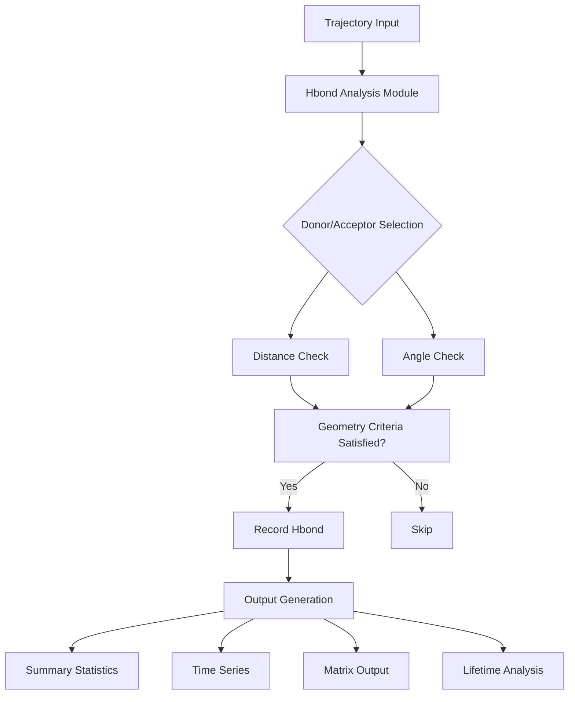

Hydrogen bond analysis in cpptraj provides comprehensive capabilities for detecting, quantifying, and characterizing hydrogen bonds in molecular dynamics trajectories. This analysis supports both solute-solute and solute-solvent hydrogen bonds, with options for geometric criteria, periodic imaging, and time-resolved statistics.

## Overview

The hydrogen bond analysis module identifies hydrogen bonds based on geometric criteria involving donor-hydrogen-acceptor distances and angles. The analysis can be performed on different atom selections through mask expressions and supports various output formats including time series, averages, matrices, and lifetime statistics. The module integrates seamlessly with [Atom Selection and Mask Expressions](6-atom-selection-and-mask-expressions) for flexible atom specification and [Periodic Boundary Conditions and Imaging](9-periodic-boundary-conditions-and-imaging) for systems with periodic boundaries.

## Architecture



The hydrogen bond detection process applies geometric criteria to donor-hydrogen-acceptor triplets, where donor atoms are typically electronegative atoms (N, O) with attached hydrogen atoms, and acceptor atoms are electronegative atoms capable of accepting hydrogen bonds. The detection algorithm can operate with or without periodic imaging, handles intramolecular filtering, and generates multiple output formats simultaneously.

## Core Concepts

### Geometric Criteria

Hydrogen bonds are identified using distance and angle cutoffs. The default distance cutoff is 3.0 Å between donor and acceptor atoms, and the default angle cutoff is 135° for the donor-hydrogen-acceptor angle. These parameters can be adjusted using the `dist` and `angle` keywords. Setting angle to -1.0 disables the angle check, allowing purely distance-based hydrogen bond detection.

Sources: [test/Test_Hbond/RunTest.sh](test/Test_Hbond/RunTest.sh#L165-L169)

### Donor and Acceptor Masks

The flexibility of hydrogen bond analysis stems from mask-based atom selection. Three types of masks control which atoms participate:

- **donormask**: Specifies potential donor atoms and optionally their attached hydrogens
- **acceptormask**: Specifies potential acceptor atoms
- **donorhmask**: Explicitly specifies which hydrogen atoms belong to donors

These masks can use any valid mask expression, enabling precise control over which atoms are considered in the analysis.

Sources: [test/Test_Hbond/RunTest.sh](test/Test_Hbond/RunTest.sh#L147-L152)

## Basic Usage

### Simple Solute-Solute Analysis

For analyzing hydrogen bonds within a solute, specify donor and acceptor masks along with output options:

```
hbond HB @N,H,C,O out nhb.dat avgout avghb.dat
```

This command uses nitrogen, hydrogen, carbon, and oxygen atoms, writes detailed bond information to `nhb.dat`, and generates average statistics to `avghb.dat`. The analysis automatically detects donor-acceptor pairs without needing explicit donor/acceptor specification when using common element masks.

Sources: [test/Test_Hbond/RunTest.sh](test/Test_Hbond/RunTest.sh#L17-L26)

### Solute-Solvent Hydrogen Bonds

For analyzing interactions between solute and solvent, use separate specifications for solute atoms and solvent atoms:

```
hbond hb :1-13 solventacceptor :WAT@O solventdonor :WAT \
      out solvhb.dat avgout solvavg.dat solvout solvavg.dat bridgeout solvavg.dat
```

The `solventacceptor` and `solventdonor` keywords define which atoms in the solvent can act as acceptors and donors. This example analyzes residues 1-13 with water oxygen as solvent acceptors and water as solvent donors.

Sources: [test/Test_Hbond/RunTest.sh](test/Test_Hbond/RunTest.sh#L46-L52)

### Explicit Donor Mask Specification

When you need precise control over donor selection, explicitly specify the donor mask:

```
hbond UDmask donormask @N= avgout ud.dat
```

This uses nitrogen atoms with single bonds as donors. For specifying which hydrogens belong to donors:

```
hbond UHmask donormask @N&!:PRO,NHE donorhmask @H avgout uh.dat
```

This selects nitrogen atoms excluding PRO and NHE residues, with hydrogen atoms specified via `donorhmask`.

Sources: [test/Test_Hbond/RunTest.sh](test/Test_Hbond/RunTest.sh#L147-L152)

## Advanced Features

### Time Series Output

The `series` keyword enables recording hydrogen bond presence/absence for each frame, producing time-resolved data suitable for subsequent analysis:

```
hbond BB @N,H,C,O series out nbb.dat
write solutehb.agr BB[solutehb] sort
```

The series data can be extracted and written to Grace (.agr) format files. Series output is required for lifetime analysis and other time-dependent statistics.

Sources: [test/Test_Hbond/RunTest.sh](test/Test_Hbond/RunTest.sh#L17-L32)

### Lifetime Analysis

After generating series data, perform lifetime analysis to understand hydrogen bond persistence:

```
runanalysis lifetime BB[solutehb] out lifehb.gnu window 10
```

This analyzes hydrogen bond lifetimes using a 10-frame window and outputs results to GNUplot format. The analysis provides average, maximum, and cumulative distribution of hydrogen bond lifetimes.

Sources: [test/Test_Hbond/RunTest.sh](test/Test_Hbond/RunTest.sh#L33-L34)

### Matrix Output

Residue-residue hydrogen bond matrices provide overview of hydrogen bond patterns across the system:

```
hbond BB @N,H,C,O uuresmatrix uuresmatrixout uumatrix.nonorm.dat uuresmatrixnorm none
```

The `uuresmatrix` keyword generates a matrix showing hydrogen bond frequency between residue pairs. Normalization options include `none` (raw counts) or `frames` (normalized by number of frames).

Sources: [test/Test_Hbond_Matrix/RunTest.sh](test/Test_Hbond_Matrix/RunTest.sh#L16-L24)

> [!TIP]
> Matrix output provides a concise overview of hydrogen bond networks but requires careful interpretation—the values represent cumulative counts across all frames, making it essential to normalize by frame count for meaningful comparison between trajectories of different lengths.

### Imaging Support

For periodic systems, hydrogen bonds should be detected using minimum image distances:

```
hbond donormask :3@ND2 acceptormask :1@O avgout hb1.dat image
```

The `image` keyword ensures that distances are calculated using the minimum image convention, correctly identifying hydrogen bonds across periodic boundaries.

Sources: [test/Test_Hbond/RunTest.sh](test/Test_Hbond/RunTest.sh#L54-L56)

### Intramolecular Filtering

By default, hydrogen bonds within the same molecule are included. Use `nointramol` to filter these out:

```
hbond NoIntraMol out hbond.mol.dat nointramol avgout mol.avg.dat
```

This is particularly useful when analyzing solute-solvent interactions where you want to exclude internal hydrogen bonds from the count.

Sources: [test/Test_Hbond/RunTest.sh](test/Test_Hbond/RunTest.sh#L107-L111)

### Bridge Analysis

Bridge analysis identifies solvent molecules that form hydrogen bonds with both donor and acceptor groups, effectively bridging them:

```
hbond hb :1-60 solventacceptor :WAT@O solventdonor :WAT \
      out bridgeintermol.dat avgout avgbridgeintermol.dat \
      nointramol image
```

The `bridgeout` keyword generates statistics on bridging solvent molecules, providing insight into water-mediated interactions.

Sources: [test/Test_Hbond/RunTest.sh](test/Test_Hbond/RunTest.sh#L168-L172)

## Output Types

| Keyword | Description | Typical Content |
|---------|-------------|-----------------|
| `out` | Detailed per-frame hydrogen bond listing | Frame, donor, acceptor, distance, angle |
| `avgout` | Average statistics across trajectory | Donor-acceptor pairs, frequency, average geometry |
| `solvout` | Solute-solvent hydrogen bond summary | Solvent donors/acceptors, interaction counts |
| `bridgeout` | Bridging molecule analysis | Bridge counts, participating solvent molecules |
| `series` | Time series data | Presence/absence for each frame (used for further analysis) |

## Customization Parameters

### Distance Cutoff

Control the maximum donor-acceptor distance for hydrogen bond identification:

```
hbond BB donormask :2-6@N acceptormask :9-13@O dist 2.9 avgout noacut.dat
```

This reduces the distance cutoff to 2.9 Å from the default 3.0 Å.

Sources: [test/Test_Hbond/RunTest.sh](test/Test_Hbond/RunTest.sh#L159-L163)

### Angle Cutoff

Specify the minimum donor-hydrogen-acceptor angle:

```
hbond BB donormask :2-6@N acceptormask :9-13@O angle 150.0 avgout results.dat
```

This increases the angle cutoff to 150°, requiring more linear geometry. Use `angle -1.0` to disable angle checking entirely.

### Disk Caching

For large trajectories with many hydrogen bond evaluations, enable disk caching to reduce memory usage:

```
usediskcache on
hbond BB @N,H,C,O series
```

This writes intermediate results to disk instead of keeping them in memory, useful when analyzing very large systems or long trajectories.

Sources: [test/Test_Hbond/RunTest.sh](test/Test_Hbond/RunTest.sh#L37-L45)

## Common Patterns

### Protein Backbone Hydrogen Bonds

Analyze secondary structure hydrogen bonds between backbone atoms:

```
hbond BB @N,H,C,O series avgout hbavg.dat printatomnum
```

The `printatomnum` option includes atom numbers in the output, making it easier to identify specific hydrogen bonds. Using `@N,H,C,O` selects all backbone atoms involved in hydrogen bonding.

Sources: [test/Test_Hbond/RunTest.sh](test/Test_Hbond/RunTest.sh#L20-L21)

### Ligand Binding Site Analysis

Focus hydrogen bond analysis on specific regions:

```
hbond SiteHB donormask :LIG@N,O acceptormask :10-25@O,N avgout site_hb.dat
```

This analyzes hydrogen bonds between ligand donor/acceptor atoms and receptor residues 10-25.

### Water-Mediated Interactions

Identify water molecules that connect two regions of a molecule:

```
hbond BridgeHB :1-30 solventacceptor :WAT@O solventdonor :WAT \
      bridgeout water_bridge.dat nointramol image
```

The `bridgeout` file will list water molecules that simultaneously form hydrogen bonds with both region 1-30 and other parts of the system.

Sources: [test/Test_Hbond/RunTest.sh](test/Test_Hbond/RunTest.sh#L168-L172)

> [!TIP]
> When combining hydrogen bond analysis with imaging, ensure that your system is properly centered and imaged before the hydrogen bond command. Use the `center` and `image` commands prior to `hbond` for accurate distance calculations across periodic boundaries.

## Performance Considerations

For large systems with many potential donor-acceptor pairs, hydrogen bond analysis can be computationally intensive. Consider these optimizations:

- Use specific masks rather than broad element selections to reduce the number of pairs evaluated
- Enable disk caching (`usediskcache on`) for trajectories with many frames
- For solute-solvent analysis, use `nointramol` to filter out irrelevant intramolecular pairs
- Consider reducing trajectory resolution with appropriate [Trajectory Processing Pipeline](7-trajectory-processing-pipeline) techniques if time resolution is not critical for your hydrogen bond analysis

## Integration with Other Analyses

Hydrogen bond analysis often complements other structural analyses:

- Combine with [Secondary Structure Assignment (DSSP)](16-secondary-structure-assignment-dssp) to correlate hydrogen bond patterns with secondary structure
- Use alongside [Clustering Algorithms](17-clustering-algorithms-k-means-dbscan-hierarchical) to understand hydrogen bond patterns in different conformational states
- Correlate hydrogen bond lifetimes with [Principal Component Analysis (PCA)](13-principal-component-analysis-pca) modes to identify hydrogen bonds associated with major motions

## Next Steps

After mastering hydrogen bond analysis, explore these related topics:

- [Contact Analysis and Native Contacts](18-contact-analysis-and-native-contacts) for broader interaction analysis
- [Grid and Density Calculations](19-grid-and-density-calculations) for spatial distribution of hydrogen bonding partners
- [Lipid Order Parameters](22-lipid-order-parameters) for membrane systems where hydrogen bonding patterns differ from aqueous environments