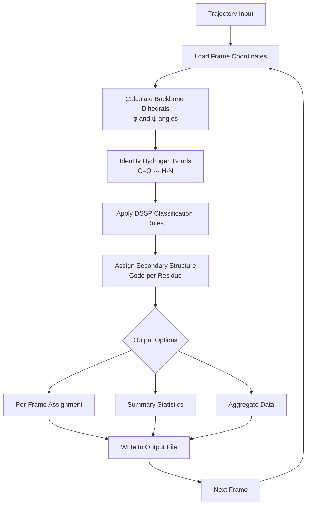
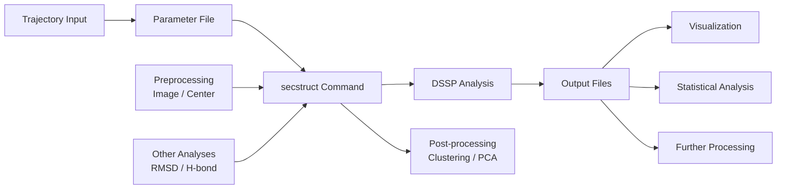

## Overview

Secondary Structure Assignment in CPPTRAJ implements the DSSP (Dictionary of Secondary Structure of Proteins) algorithm, a widely adopted method for identifying regular secondary structure elements in protein conformations. This analysis calculates hydrogen bond patterns and backbone dihedral angles to classify each residue into standard structural categories including alpha-helices, beta-sheets, and turns. CPPTRAJ's implementation provides multiple output formats, per-frame assignment tracking, and statistical summarization capabilities suitable for analyzing structural evolution during molecular dynamics simulations.

Sources: [test/Test_DSSP/RunTest.sh](test/Test_DSSP/RunTest.sh#L1-L86)

## DSSP Architecture

The DSSP action integrates into CPPTRAJ's action framework, processing trajectory frames sequentially to assign secondary structure based on geometric criteria. The core algorithm examines hydrogen bond patterns between backbone C=O and N-H groups, calculates backbone dihedral angles (φ and ψ), and applies classification rules according to the original Kabsch and Sander method. The implementation supports both per-residue assignments and aggregate statistics across the entire trajectory.



The DSSP processor operates on the backbone atoms (N, CA, C, O) of each residue, with hydrogen atoms calculated or reconstructed when not present in the structure. The algorithm applies energy-based hydrogen bond criteria and geometric constraints to determine the optimal assignment for each residue position.

Sources: [test/Test_DSSP/RunTest.sh](test/Test_DSSP/RunTest.sh#L14-L24)

## Secondary Structure Codes

CPPTRAJ's DSSP implementation uses single-character codes consistent with the original DSSP convention, representing distinct structural motifs:

| Code | Structure Name | Description |
|------|---------------|-------------|
| H | α-helix | Right-handed α-helix (i→i+4 hydrogen bonding) |
| B | β-bridge | Isolated β-bridge (single residue pair) |
| E | Extended strand | Extended β-sheet conformation |
| G | 3₁₀-helix | 3₁₀-helix (i→i+3 hydrogen bonding) |
| I | π-helix | π-helix (i→i+5 hydrogen bonding) |
| T | Turn | Turn conformation |
| S | Bend | Bend conformation |
| 0 | Coil | Loop/irregular conformation |

Additional non-standard codes may appear for special cases or terminal residues. The zero ('0') designation indicates regions that do not meet criteria for regular secondary structure elements.

Sources: [test/Test_DSSP/dssp.dat.save](test/Test_DSSP/dssp.dat.save#L1-L30)

## Command Syntax

The DSSP functionality is invoked using the `secstruct` or `dssp` commands, both being interchangeable aliases. The basic syntax allows specification of atom selections through mask expressions and multiple output file options for different analysis needs.

```
secstruct [<mask>] [keywords]
dssp [<mask>] [keywords]
```

The mask parameter enables selective analysis of specific residues or regions within the protein structure. When no mask is specified, all protein residues in the system are analyzed by default.

Sources: [test/Test_DSSP/RunTest.sh](test/Test_DSSP/RunTest.sh#L14-L24), [test/Test_DSSP/RunTest.sh](test/Test_DSSP/RunTest.sh#L27-L31)

## Output Format Options

CPPTRAJ provides flexible output formatting for DSSP analysis, supporting multiple file types and data organization schemes to accommodate different downstream analysis workflows.

### GNU Format (Default)

The default GNU-style output format produces a multi-column table with frame numbers in the first column and subsequent columns representing each residue's secondary structure assignment. This format facilitates direct visualization of structural transitions over time.

| Parameter | Description |
|-----------|-------------|
| `out <filename>` | Output file in GNU format (default) |
| `sumout <filename>` | Summary statistics file in Grace format |
| `totalout <filename>` | Aggregate totals per structure type |

Sources: [test/Test_DSSP/RunTest.sh](test/Test_DSSP/RunTest.sh#L14-L18)

### Ptraj Format

The ptraj-compatible format provides backward compatibility with earlier analysis scripts, using a similar tabular structure but with legacy formatting conventions.

| Parameter | Description |
|-----------|-------------|
| `ptrajformat` | Generate output in ptraj-compatible format |
| `out <filename>` | Output file in ptraj format |

Sources: [test/Test_DSSP/RunTest.sh](test/Test_DSSP/RunTest.sh#L27-L31)

## Advanced Options

Several control parameters modify the DSSP calculation behavior and output content, enabling customized analysis for specific research questions.

| Option | Purpose |
|--------|---------|
| `betadetail` | Include detailed β-sheet analysis including bridge types and partner residues |
| `nostring` | Suppress string formatting in output (numeric codes only) |
| `assignout <filename>` | Write detailed assignment information including per-residue classification data |
| `sumout <filename>` | Generate summary statistics showing percentage occupancy of each secondary structure type |
| `totalout <filename>` | Aggregate count of each secondary structure type across all frames |

The `betadetail` option is particularly valuable for studying β-sheet formation and stability, providing information about β-bridge classification (parallel vs. antiparallel) and the specific residues involved in each sheet pairing.

Sources: [test/Test_DSSP/RunTest.sh](test/Test_DSSP/RunTest.sh#L14-L18), [test/Test_DSSP/RunTest.sh](test/Test_DSSP/RunTest.sh#L38-L44)

## Workflow Integration

The DSSP analysis integrates seamlessly into CPPTRAJ's trajectory processing pipeline, allowing combination with other structural analysis commands for comprehensive characterization of protein dynamics.



> [!TIP]
> The DSSP calculation is performed on each frame independently, making it well-suited for parallel processing. When using MPI parallelization, the trajectory analysis distributes frames across processes and combines results, maintaining consistent secondary structure assignment criteria across all processes.

Sources: [test/Test_DSSP/RunTest.sh](test/Test_DSSP/RunTest.sh#L35-L44), [README.md](README.md#L1-L100)

## Practical Examples

### Basic Analysis

This example performs DSSP analysis on a protein trajectory, generating standard output files for structural assignment and summary statistics.

```
parm protein.parm7
trajin trajectory.nc
secstruct out dssp.gnu sumout dssp.sum.agr totalout total.agr betadetail
run
```

This produces three output files: `dssp.gnu` containing per-frame assignments, `dssp.sum.agr` with statistical summary in Grace format, and `total.agr` showing aggregate counts of each secondary structure type.

Sources: [test/Test_DSSP/RunTest.sh](test/Test_DSSP/RunTest.sh#L14-L18)

### Region-Specific Analysis

Analyzing specific regions of interest using mask selection enables focused examination of structural dynamics in particular domains or loops.

```
parm protein.parm7
trajin trajectory.nc
secstruct :10-22 out dssp.dat ptrajformat betadetail
run
```

This configuration restricts analysis to residues 10-22 (using Amber mask syntax), generating output in ptraj format with detailed β-sheet information.

Sources: [test/Test_DSSP/RunTest.sh](test/Test_DSSP/RunTest.sh#L27-L31)

### Multi-Trajectory Analysis

The DSSP command handles trajectories with varying numbers of residues, enabling analysis of concatenated simulations or systems with structural modifications.

```
parm structure1.parm7
trajin traj1.nc parmindex 1
trajin traj2.nc
secstruct out dssp2.gnu sumout dssp2.sum.agr nostring betadetail
run
```

> [!TIP]
> When analyzing multiple trajectories with different residue counts, ensure that residue numbering is consistent or use appropriate masking to maintain correct correspondence across frames.

Sources: [test/Test_DSSP/RunTest.sh](test/Test_DSSP/RunTest.sh#L35-L44)

### Assignment Output

The `assignout` option generates detailed per-residue assignment information, useful for scripting and further processing.

```
parm protein.pdb
trajin protein.pdb
dssp :1-100 assignout assign.dat betadetail
run
```

This produces a comprehensive assignment file containing detailed secondary structure classification for residues 1-100, including β-sheet bridge details and hydrogen bond information.

Sources: [test/Test_DSSP/RunTest.sh](test/Test_DSSP/RunTest.sh#L52-L57)

## Output Interpretation

### Per-Frame Assignment Format

The standard output format displays frames as rows and residues as columns, using single-character codes to represent secondary structure assignments. The first column contains the frame number, and column headers identify each residue by name and number.

```
#Frame   THR:10 TYR:11 THR:12 GLU:13 VAL:14 PRO:15 GLY:16 LYS:17 LYS:18 ILE:19 LEU:20 GLN:21 NHE:22
       1      0      B      B      B      B      T      T      B      B      B      B      0      0
       2      B      B      B      B      B      T      T      B      B      B      B      B      0
       3      0      B      B      B      B      T      T      B      B      B      B      0      0
```

In this example, residue 15 (PRO) shows turn conformation (T) across multiple frames, while residues 11-14 exhibit β-bridge (B) characteristics. Terminal residues often show coil (0) assignments due to missing hydrogen bond partners.

Sources: [test/Test_DSSP/dssp.dat.save](test/Test_DSSP/dssp.dat.save#L1-L4)

### Summary Statistics

The summary output provides percentage occupancy of each secondary structure type across the entire trajectory, enabling quantitative comparison of structural propensities between systems or conditions.

| Structure | Percentage | Interpretation |
|-----------|------------|----------------|
| H | 45.2% | High α-helical content |
| E | 12.8% | Moderate β-sheet content |
| T | 8.3% | Turn regions |
| 0 | 33.7% | Unstructured regions |

These statistics facilitate comparison between mutant variants, different force fields, or varying environmental conditions.

Sources: [test/Test_DSSP/dssp.dat.sum.save](test/Test_DSSP/dssp.dat.sum.save)

## Performance Considerations

The DSSP algorithm scales linearly with the number of residues in the system, making it suitable for analysis of large protein complexes. Computational efficiency is achieved through optimized hydrogen bond calculation and the use of pre-computed dihedral angles. For very large systems or extensive trajectory analysis, the calculation benefits significantly from OpenMP multi-threading when available.

Sources: [README.md](README.md#L100-L150)

## Integration with Complementary Analyses

DSSP analysis provides valuable context for other structural analyses in CPPTRAJ. Secondary structure assignments can be used to:

- Correlate structural transitions with [RMSD and RMSF calculations](10-rmsd-and-rmsf-calculations) to identify regions of increased flexibility
- Investigate relationships between secondary structure and [hydrogen bond patterns](15-hydrogen-bond-analysis)
- Analyze structural transitions in [cluster analysis](17-clustering-algorithms-k-means-dbscan-hierarchical) to characterize conformational states
- Study structural stability in [free energy calculations](21-free-energy-calculations-ti-mm-pbsa)

The modular nature of CPPTRAJ's command syntax allows straightforward combination of DSSP with these complementary analyses, enabling comprehensive investigation of protein structure-dynamics relationships.

Sources: [test/Test_DSSP/RunTest.sh](test/Test_DSSP/RunTest.sh#L1-L86)

## Limitations and Considerations

The DSSP algorithm has inherent limitations that users should consider when interpreting results:

- **Terminal Residues**: Chain termini often show ambiguous assignments due to missing hydrogen bond partners
- **Hydrogen Requirement**: Proper hydrogen positions are critical; consider adding hydrogens if not present
- **Time Resolution**: Secondary structure classification on a per-frame basis may miss transient intermediate states
- **Proline Effects**: Proline residues cannot donate backbone amide hydrogens, affecting helix propensity
- **Non-canonical Structures**: Novel or unusual secondary structure motifs may not fit standard classification criteria

For trajectories with high temporal resolution, consider applying temporal smoothing or using time-averaged assignments to distinguish structural transitions from thermal fluctuations.

## Next Steps

For deeper understanding of structural analysis in CPPTRAJ, explore these related documentation pages:

- [Atom Selection and Mask Expressions](6-atom-selection-and-mask-expressions) - Learn advanced mask syntax for region-specific DSSP analysis
- [Hydrogen Bond Analysis](15-hydrogen-bond-analysis) - Investigate relationship between hydrogen bonds and secondary structure
- [RMSD and RMSF Calculations](10-rmsd-and-rmsf-calculations) - Quantify structural stability and identify flexible regions
- [Clustering Algorithms](17-clustering-algorithms-k-means-dbscan-hierarchical) - Identify and characterize distinct conformational states
- [Basic Command Line Usage](4-basic-command-line-usage) - Review fundamental CPPTRAJ command syntax and workflow

For comprehensive trajectory processing techniques, refer to [Trajectory Processing Pipeline](7-trajectory-processing-pipeline) documentation.
