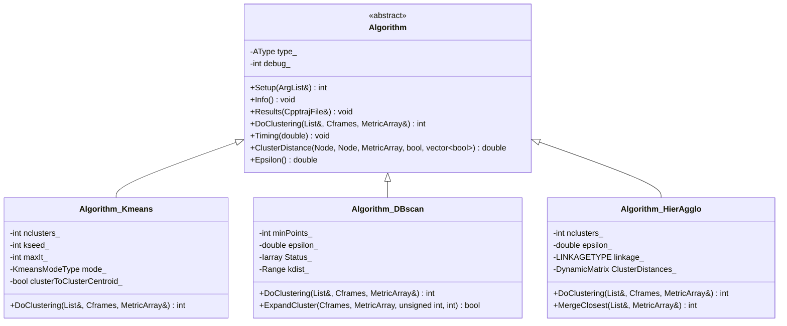
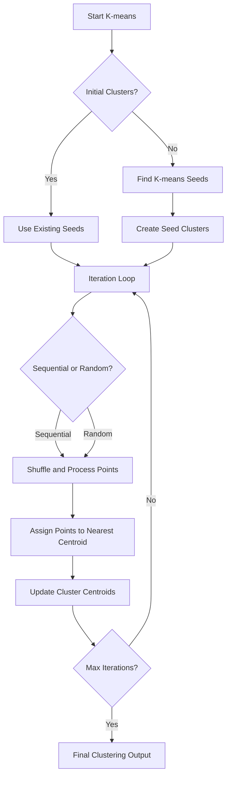
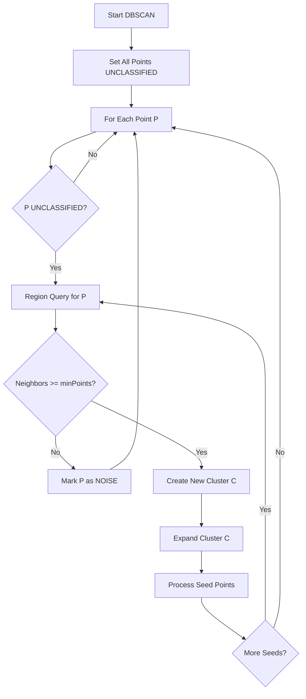
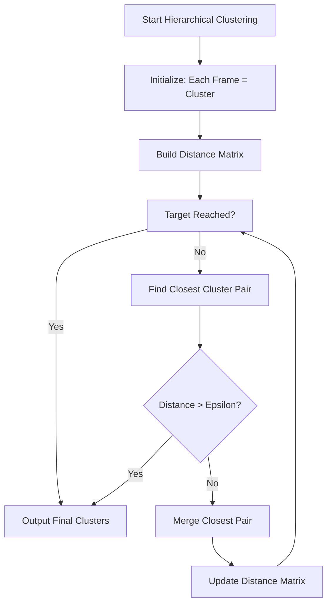

This documentation provides an in-depth exploration of the three primary clustering algorithms implemented in Amber-MD/cpptraj: K-means, DBSCAN, and Hierarchical Agglomerative clustering. These algorithms enable systematic analysis of molecular dynamics trajectories by grouping similar conformations based on specified distance metrics, revealing dominant structural states and transition pathways in biomolecular systems.

## Architecture Overview

The clustering framework is built upon an object-oriented design where all algorithms inherit from the abstract base class `Algorithm`, which defines a consistent interface for clustering operations. This architecture ensures algorithm interoperability with the broader trajectory analysis pipeline and supports seamless integration with various distance metrics and output formats.

The base algorithm interface defines five core methods that all clustering implementations must provide: `Setup()` for parameter configuration, `Info()` for algorithm status reporting, `Results()` for output file generation, `DoClustering()` for the core clustering logic, and `Timing()` for performance profiling [Algorithm.h](src/Cluster/Algorithm.h#L19-L28).

## Distance Metrics Framework

Before examining specific clustering algorithms, it is essential to understand the distance metric system that quantifies similarity between molecular conformations. The framework supports multiple distance calculation methods through the abstract `Metric` class, enabling algorithm-agnostic similarity measurements.

Available distance metrics include RMS (Root Mean Square Deviation), DME (Distance Matrix Error), SRMSD (Symmetry-corrected RMSD), SCALAR (for scalar properties), TORSION (for dihedral angles), MATRIX2D (pre-computed distance matrices), and QRMSD (Quaternion-based RMSD) [Metric.h](src/Cluster/Metric.h#L17).

Each metric implements methods for calculating distances between frames, between centroids, and between frames and centroids, along with centroid calculation and update operations. This modular design allows any clustering algorithm to work with any supported distance metric without algorithm modification.

## K-means Clustering

K-means clustering partitions trajectory frames into a predefined number of clusters by iteratively minimizing the within-cluster variance. The algorithm follows a centroid-based partitioning approach where each frame is assigned to the nearest cluster centroid, and centroids are updated to reflect the mean position of their assigned frames.

### Algorithm Implementation

The K-means implementation in cpptraj offers two operational modes: SEQUENTIAL and RANDOM point processing. In SEQUENTIAL mode, the algorithm processes frames in order, while RANDOM mode processes frames in a randomized sequence determined by a seed value [Algorithm_Kmeans.h](src/Cluster/Algorithm_Kmeans.h#L20).

The clustering process begins with seed selection, which can be derived from existing clusters or randomly chosen from the frame set. Seed frames become initial centroids for the target number of clusters [Algorithm_Kmeans.cpp](src/Cluster/Algorithm_Kmeans.cpp#L88-L97).

### Configuration Parameters

The K-means algorithm accepts several configuration parameters through the command-line interface:

- **clusters**: Specifies the target number of clusters (required, must be > 1) [Algorithm_Kmeans.cpp](src/Cluster/Algorithm_Kmeans.cpp#L30-L34)
- **randompoint**: Enables random point processing mode instead of sequential processing
- **kseed**: Sets the random seed for reproducible random initialization
- **maxit**: Controls the maximum number of iterations (default: 100) [Algorithm_Kmeans.cpp](src/Cluster/Algorithm_Kmeans.cpp#L40)

### Core Algorithm Logic

The main clustering loop iteratively processes each point, assigning it to the nearest cluster centroid based on the chosen distance metric. After all points are assigned, cluster centroids are recalculated to reflect the mean position of their constituent frames [Algorithm_Kmeans.cpp](src/Cluster/Algorithm_Kmeans.cpp#L100-L200).

The algorithm implements a convergence criterion based on centroid stability and the maximum iteration limit. The iterative assignment-update cycle continues until convergence or the maximum iteration count is reached, ensuring computational efficiency while maintaining cluster quality.

> [!TIP]
> K-means is particularly effective when the number of clusters is known a priori and clusters are expected to be roughly spherical in the chosen distance space. For molecular dynamics data, this often works well when analyzing well-defined conformational states with clear boundaries.

## DBSCAN Clustering

DBSCAN (Density-Based Spatial Clustering of Applications with Noise) is a density-based algorithm that identifies clusters as regions of high point density separated by regions of low density. Unlike K-means, DBSCAN does not require specifying the number of clusters in advance and can automatically identify noise points that do not belong to any meaningful cluster.

### Algorithm Principles

DBSCAN operates on two fundamental parameters: epsilon (ε), which defines the neighborhood radius, and minPoints, which specifies the minimum number of points required to form a dense region [Algorithm_DBscan.h](src/Cluster/Algorithm_DBscan.h#L33-L34).

The algorithm classifies points into three categories: core points (with at least minPoints within ε), border points (within ε of a core point but with fewer than minPoints neighbors), and noise points (neither core nor border) [Metric.h](src/Cluster/Metric.h#L9-L12).

### Implementation Architecture

The cpptraj implementation follows the canonical DBSCAN algorithm with optimizations for trajectory data. The core clustering process iterates through unclassified points and attempts to expand clusters from each point using the `ExpandCluster` method [Algorithm_DBscan.cpp](src/Cluster/Algorithm_DBscan.cpp#L132).

### K-Distance Analysis

A distinctive feature of the cpptraj DBSCAN implementation is the K-distance calculation utility, which helps users determine appropriate epsilon values. The K-distance for a point is defined as the distance to its K-th nearest neighbor, and plotting K-distance values sorted in descending order often reveals a "knee" point that suggests a suitable epsilon value [Algorithm_DBscan.cpp](src/Cluster/Algorithm_DBscan.cpp#L27-L28).

The implementation supports calculating K-distance functions for multiple K values, enabling systematic parameter exploration [Algorithm_DBscan.cpp](src/Cluster/Algorithm_DBscan.cpp#L86-L91).

### Configuration Parameters

DBSCAN configuration parameters include:

- **minpoints**: Minimum number of points required to form a cluster (required, must be ≥ 1) [Algorithm_DBscan.cpp](src/Cluster/Algorithm_DBscan.cpp#L35-L40)
- **epsilon**: Distance criterion for cluster formation (required, must be > 0.0) [Algorithm_DBscan.cpp](src/Cluster/Algorithm_DBscan.cpp#L41-L46)
- **kdist**: Computes K-distance graphs for specified K values instead of performing clustering
- **kfile**: Specifies output file prefix for K-distance data [Algorithm_DBscan.cpp](src/Cluster/Algorithm_DBscan.cpp#L51-L55)

### Region Query Optimization

The `RegionQuery` method efficiently retrieves all points within epsilon distance of a query point, forming the foundation for both core point identification and cluster expansion [Algorithm_DBscan.h](src/Cluster/Algorithm_DBscan.h#L26).

The algorithm supports existing cluster integration, allowing incremental clustering on new trajectory segments while preserving previous cluster assignments [Algorithm_DBscan.cpp](src/Cluster/Algorithm_DBscan.cpp#L98-L122).

> [!TIP]
> DBSCAN excels at identifying clusters of arbitrary shapes and automatically detecting noise, making it ideal for analyzing molecular dynamics data where conformational states may have irregular boundaries or where transient states should be treated as noise rather than forced into clusters.

## Hierarchical Agglomerative Clustering

Hierarchical agglomerative clustering builds a cluster hierarchy by iteratively merging the closest pairs of clusters, starting with each frame in its own cluster. This approach produces a dendrogram that reveals the hierarchical relationship between conformations at multiple resolution levels.

### Algorithm Structure

The hierarchical implementation supports three linkage criteria for measuring inter-cluster distance: single-linkage (minimum distance between any pair of points), complete-linkage (maximum distance between any pair of points), and average-linkage (average distance between all point pairs) [Algorithm_HierAgglo.h](src/Cluster/Algorithm_HierAgglo.h#L36).

The algorithm maintains a dynamic distance matrix `ClusterDistances_` that stores pairwise distances between all clusters, enabling efficient identification of the closest cluster pair at each iteration [Algorithm_HierAgglo.h](src/Cluster/Algorithm_HierAgglo.h#L44).

### Clustering Process

The algorithm begins by placing each frame in its own cluster, creating initial clusters equal to the number of frames [Algorithm_HierAgglo.cpp](src/Cluster/Algorithm_HierAgglo.cpp#L79-L89).

After initial cluster creation, the algorithm enters the main merging loop, which identifies the closest cluster pair and merges them iteratively [Algorithm_HierAgglo.cpp](src/Cluster/Algorithm_HierAgglo.cpp#L146-L148).

### Linkage Methods

The three linkage methods produce different clustering characteristics:

- **Single-linkage**: Tends to produce elongated clusters and can suffer from chaining effects [Algorithm_HierAgglo.cpp](src/Cluster/Algorithm_HierAgglo.cpp#L128)
- **Complete-linkage**: Produces compact clusters but can be sensitive to outliers [Algorithm_HierAgglo.cpp](src/Cluster/Algorithm_HierAgglo.cpp#L129)
- **Average-linkage**: Balances single and complete linkage, often providing robust results [Algorithm_HierAgglo.cpp](src/Cluster/Algorithm_HierAgglo.cpp#L130)

The linkage type is selected through command-line arguments, with average-linkage as the default [Algorithm_HierAgglo.cpp](src/Cluster/Algorithm_HierAgglo.cpp#L31).

### Configuration Parameters

Hierarchical clustering accepts the following parameters:

- **clusters**: Target number of clusters (default: 10 if not specified) [Algorithm_HierAgglo.cpp](src/Cluster/Algorithm_HierAgglo.cpp#L26-L27)
- **epsilon**: Stopping criterion when minimum cluster distance exceeds this value [Algorithm_HierAgglo.cpp](src/Cluster/Algorithm_HierAgglo.cpp#L27)
- **linkage/averagelinkage/complete**: Selects the linkage method (default: averagelinkage) [Algorithm_HierAgglo.cpp](src/Cluster/Algorithm_HierAgglo.cpp#L28-L31)
- **epsilonplot**: Generates a file plotting epsilon versus number of clusters [Algorithm_HierAgglo.cpp](src/Cluster/Algorithm_HierAgglo.cpp#L32-L36)

### Epsilon Plot Generation

When the epsilon plot option is enabled, the algorithm records the minimum inter-cluster distance at each merge step, producing a plot that helps identify natural cluster numbers based on significant increases in merge distance [Algorithm_HierAgglo.cpp](src/Cluster/Algorithm_HierAgglo.cpp#L32-L36).

> [!TIP]
> Hierarchical clustering with epsilon plotting provides a powerful exploratory tool for trajectory analysis, allowing researchers to identify natural clustering levels by examining the merge distance profile and selecting cutpoints that correspond to significant conformational transitions.

## Algorithm Comparison

| Feature | K-means | DBSCAN | Hierarchical |
|---------|---------|--------|--------------|
| **Cluster Count** | User-specified | Automatically determined | User-specified or epsilon-based |
| **Cluster Shape** | Spherical | Arbitrary | Depends on linkage method |
| **Noise Handling** | None (all points assigned) | Explicit noise identification | None (all points assigned) |
| **Parameter Sensitivity** | Sensitive to seed selection | Sensitive to epsilon and minPoints | Sensitive to linkage method |
| **Computational Complexity** | O(n × k × i) | O(n²) with spatial index | O(n³) naive, O(n²) with optimization |
| **Best Use Case** | Known number of states, spherical clusters | Unknown number, irregular shapes, noise detection | Multi-resolution analysis, dendrogram generation |

## Cluster Quality Metrics

Cpptraj provides multiple metrics for evaluating clustering quality, enabling quantitative comparison between different clustering parameters or algorithms.

### Silhouette Score

The silhouette score measures how similar each frame is to its own cluster compared to other clusters, providing a value between -1 (incorrect clustering) and 1 (well-clustered) [Silhouette.h](src/Cluster/Silhouette.h).

### Davies-Bouldin Index

The Davies-Bouldin Index evaluates cluster separation and compactness, with lower values indicating better clustering [DBI.h](src/Cluster/DBI.h).

### Pseudo-F Statistic

The pseudo-F statistic measures the ratio of between-cluster variance to within-cluster variance, with higher values indicating better separation [PseudoF.h](src/Cluster/PseudoF.h).

## Performance Considerations

### Sieving

All clustering algorithms support sieving, which reduces computational cost by analyzing only a subset of frames (e.g., every 10th frame) during clustering, then assigning the remaining frames to the nearest cluster [Sieve.h](src/Cluster/Sieve.h).

### Memory Management

For large trajectories, the framework supports binary matrix storage and NetCDF-based distance matrix caching to reduce memory requirements [Cmatrix_Binary.h](src/Cluster/Cmatrix_Binary.h), [Cmatrix_NC.h](src/Cluster/Cmatrix_NC.h).

### Parallel Processing

OpenMP parallelization is available in selected clustering operations, particularly in distance calculations and nearest-neighbor searches [Algorithm_DBscan.cpp](src/Cluster/Algorithm_DBscan.cpp#L12-L14).

## Integration with Trajectory Analysis Pipeline

Clustering in cpptraj is tightly integrated with the broader trajectory analysis ecosystem. Clustered frames can be extracted for further analysis, cluster representatives can be used as starting points for additional simulations, and clustering results can be visualized using trajectory output functions [Results_Coords.h](src/Cluster/Results_Coords.h).

The clustering framework supports combination with other analysis techniques such as [Principal Component Analysis (PCA)](13-principal-component-analysis-pca) for dimensionality reduction before clustering, and [RMSD/RMSF calculations](10-rmsd-and-rmsf-calculations) for understanding structural variation within and between clusters.

## Next Steps

After obtaining clustering results, consider exploring:

- **Cluster characterization**: Use [Contact Analysis and Native Contacts](18-contact-analysis-and-native-contacts) to identify key structural features differentiating clusters
- **Trajectory visualization**: Extract cluster representatives for structural visualization and analysis
- **Transition analysis**: Examine frame sequences to identify transition pathways between clusters
- **Ensemble analysis**: Apply [Ensemble Analysis (REMD, MREMD, HREMD)](27-ensemble-analysis-remd-mremd-hremd) techniques to understand cluster populations across simulation replicas