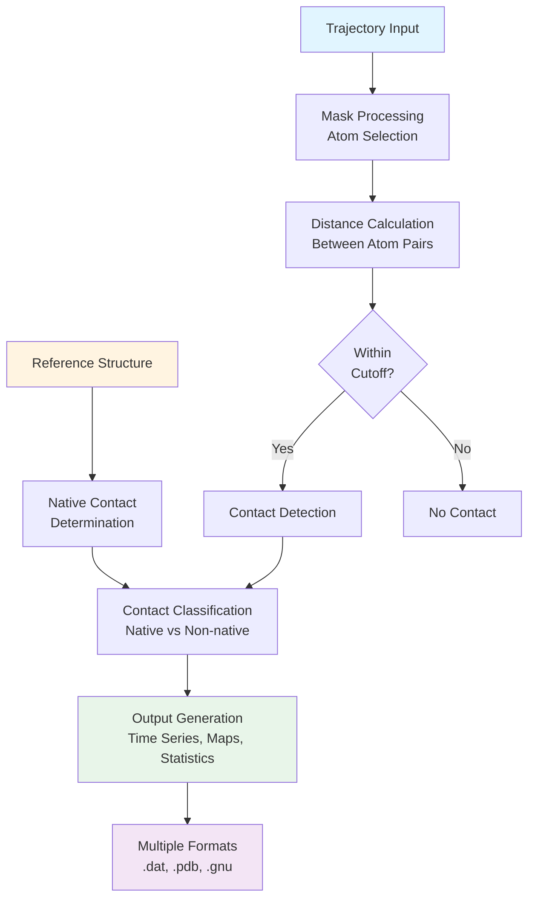

Contact analysis in CPPTRAJ provides powerful tools for quantifying atomic and residue-level interactions in molecular dynamics trajectories. This functionality enables researchers to track structural changes, identify native vs non-native contacts, and analyze interaction patterns over time. The analysis is particularly valuable for protein folding studies, ligand binding analysis, and understanding conformational transitions.

## Fundamentals of Contact Analysis

Contact analysis determines when atoms or residues are within a specified distance cutoff. The basic **contacts** command counts total contacts and native contacts relative to a reference structure, while the more advanced **nativecontacts** command provides detailed classification of native and non-native interactions with extensive output options.

The core workflow involves:
1. Selecting atom groups using mask expressions
2. Calculating distances between all atom pairs
3. Applying distance cutoff criteria to define contacts
4. Comparing against a reference structure to classify contacts as native or non-native
5. Outputting time series data, contact maps, and statistical summaries

Sources: [Test_Contacts/RunTest.sh](test/Test_Contacts/RunTest.sh#L11-L18), [Test_NativeContacts/RunTest.sh](test/Test_NativeContacts/RunTest.sh#L16-L29)

## Architecture and Data Flow



The architecture demonstrates parallel processing capabilities where contact calculations for each frame are independent, enabling efficient OpenMP multi-threading and MPI parallelization for large-scale analyses.

## Contacts Command: Basic Contact Analysis

The `contacts` command provides fundamental contact counting with native contact classification. It calculates the number of atomic contacts within a cutoff distance and determines which of these are present in a reference structure.

### Basic Syntax

```
contacts [name <name>] [out <filename>] [first] [reference] 
         [byresidue] [<mask1>] [<mask2>]
```

### Key Parameters

| Parameter | Description | Default | Notes |
|-----------|-------------|---------|-------|
| `name <name>` | Dataset name for output | Contacts | Multiple datasets can be created |
| `out <filename>` | Output file for time series | stdout | Contains frame-by-frame contact counts |
| `first` | Use first frame as reference | false | Equivalent to explicitly specifying reference |
| `reference` | Use reference structure for native contacts | false | Classifies contacts as native or not |
| `byresidue` | Aggregate by residue instead of atom | false | Reduces output complexity |
| `<mask1>`, `<mask2>` | Atom selection masks | all atoms | Single mask = intra-group, two masks = inter-group |

### Example Usage

```
# Basic contacts counting
trajin trajectory.nc
reference trajectory.nc 1
contacts first out contacts.dat :2-12@CA

# By-residue analysis with native contact classification
contacts reference out byres.dat byresidue
```

The output includes time series data showing the number of total contacts and native contacts for each frame:

```
#time    Contacts    native Contacts 
     1.00    60    60
     2.00    56    56
     3.00    58    56
     4.00    58    56
```

Sources: [Test_Contacts/RunTest.sh](test/Test_Contacts/RunTest.sh#L11-L22), [Test_Contacts/contacts.dat.save](test/Test_Contacts/contacts.dat.save#L1-L11)

## Native Contacts Command: Advanced Analysis

The `nativecontacts` command extends basic contact analysis with comprehensive native/non-native classification, multiple output formats, and detailed statistical analysis.

### Complete Syntax

```
nativecontacts [name <name>] [<mask1>] [<mask2>] 
               [out <filename>] [mindist] [maxdist] 
               [distance <cut>] [reference] 
               [byresidue] [map] [mapout <file>] 
               [contactpdb <file>] [nncontactpdb <file>]
               [writecontacts <file>] [resout <file>]
               [series] [seriesout <file>] 
               [savenonnative] [seriesnnout <file>]
               [resseries] [present\|sum] [resseriesout <file>]
```

### Advanced Parameters

| Parameter | Description | Notes |
|-----------|-------------|-------|
| `mindist` | Output minimum contact distance | Provides distance statistics |
| `maxdist` | Output maximum contact distance | Useful for understanding interaction range |
| `distance <cut>` | Distance cutoff for contacts | Default 7.0 Å |
| `map` | Generate contact map data | Creates matrix of contact frequencies |
| `mapout <file>` | Contact map output file | GNU plot format |
| `contactpdb <file>` | Write native contacts as PDB | Visual representation |
| `nncontactpdb <file>` | Write non-native contacts as PDB | Visualize non-native interactions |
| `writecontacts <file>` | Detailed contact listing with statistics | Includes Nframes, Fraction, Avg, Stdev |
| `resout <file>` | Per-residue contact summary | Aggregated data |
| `series` | Enable time series output | Frame-by-frame contact status |
| `seriesout <file>` | Time series output file | Binary (1) or absent (0) per contact per frame |
| `savenonnative` | Track non-native contacts separately | Requires additional processing |
| `seriesnnout <file>` | Non-native contact time series | Similar to seriesout for non-native |
| `resseries` | Per-residue time series | Either 'present' or 'sum' modes |
| `present\|sum` | Residue series mode | Present = binary, Sum = count |
| `resseriesout <file>` | Residue series output file | Time-resolved residue contacts |

> [!TIP]
> The `savenonnative` option requires additional computational overhead as it must track and classify contacts throughout the trajectory. Use it only when non-native contact analysis is essential to your study.

### Advanced Examples

#### Example 1: Multi-faceted Native Contact Analysis

```
nativecontacts name NC1 :1-12@CA out nc.hp1.ca.dat mindist maxdist \
               map mapout cmap.gnu contactpdb nc1.pdb
```

Output format:
```
#Frame    NC1[native] NC1[nonnative] NC1[mindist] NC1[maxdist]
     1           31              0       3.6912      16.2018
     2           31              1       3.7418      16.3238
     3           28              1       3.7696      15.5250
```

Sources: [Test_NativeContacts/RunTest.sh](test/Test_NativeContacts/RunTest.sh#L22-L23), [Test_NativeContacts/nc.hp1.ca.dat.save](test/Test_NativeContacts/nc.hp1.ca.dat.save#L1-L11)

#### Example 2: Detailed Contact Statistics

```
nativecontacts name NC2 :10-14@CA :17-21@CA out nc.hp2.ca.dat mindist maxdist \
               writecontacts nc2.contacts.dat resout nc2.res.dat \
               series seriesout NC2.series.dat
```

Contact statistics output:
```
# Contacts: NC2
# Native contacts determined from mask ':10-14@CA' and mask ':17-21@CA'
#                     Contact  Nframes    Frac.      Avg    Stdev
    1        :13@CA_:18@CA      100        1     4.56     0.29
    2        :11@CA_:20@CA      100        1      4.6    0.232
    3        :12@CA_:19@CA      100        1     5.08    0.159
```

Time series output (binary contact states):
```
#Frame   :10@CA_:20@CA :10@CA_:21@CA :11@CA_:18@CA :11@CA_:19@CA
     1             1             1             1             1
     2             1             1             1             1
     3             0             1             1             1
```

Sources: [Test_NativeContacts/RunTest.sh](test/Test_NativeContacts/RunTest.sh#L24-L26), [Test_NativeContacts/nc2.contacts.dat.save](test/Test_NativeContacts/nc2.contacts.dat.save#L1-L13), [Test_NativeContacts/NC2.series.dat.save](test/Test_NativeContacts/NC2.series.dat.save#L1-L11)

#### Example 3: Non-Native Contact Tracking

```
nativecontacts name NC4 :1-21@CA out nc4.dat savenonnative series \
               reference seriesnnout nc4.nn.dat resout nc4.res.dat \
               writecontacts nc4.contacts.dat \
               nncontactpdb nc4.nn.pdb
```

This enables tracking of non-native contacts, which are contacts present in the trajectory but not in the reference structure. The output includes separate time series for non-native contacts.

Sources: [Test_NativeContacts/RunTest.sh](test/Test_NativeContacts/RunTest.sh#L48-L51), [Test_NativeContacts/nc4.nn.dat.save](test/Test_NativeContacts/nc4.nn.dat.save#L1-L11)

#### Example 4: Per-Residue Time Series

```
nativecontacts name NC5 :10-11@CA,N :18-20@CA,N series savenonnative \
               resseries present resseriesout NC5.respresent.dat
```

Output format for residue series:
```
#Frame   THR:10_LEU:20 TYR:11_LYS:18 TYR:11_ILE:19 TYR:11_LEU:20 nn_TYR:11_LYS:18
     1             1             1             1             1                0
     2             1             1             1             1                0
     3             0             1             1             1                0
```

Sources: [Test_NativeContacts/RunTest.sh](test/Test_NativeContacts/RunTest.sh#L52-L53), [Test_NativeContacts/NC5.respresent.dat.save](test/Test_NativeContacts/NC5.respresent.dat.save#L1-L11)

## Practical Applications

### Protein Folding Studies

Native contact analysis is essential for quantifying folding progress. By comparing native contacts over time, researchers can:
- Track folding pathways and intermediate states
- Identify rate-limiting steps in folding
- Calculate Q-values (fraction of native contacts formed)
- Correlate native contact formation with other structural metrics

### Ligand Binding Analysis

For ligand-receptor systems:
- Use residue-level masks to identify key binding residues
- Track formation and breaking of specific interactions
- Compare binding modes across different conditions
- Identify non-native contacts that may represent alternative binding poses

### Conformational Transitions

Contact maps and time series data reveal:
- Networks of contacts that change coordinately
- Contact switching patterns during transitions
- Intermediate states characterized by unique contact patterns
- Energy landscape exploration through contact space

> [!TIP]
> When analyzing large systems, use the `byresidue` option to reduce computational complexity and focus on residue-level interactions rather than atomic-level details, which may be more biologically meaningful for conformational analysis.

## Data Output and Interpretation

### Time Series Data

Time series outputs provide frame-by-frame tracking of contact states:
- Binary (0/1) indicates contact presence/absence
- Useful for calculating contact lifetimes and formation rates
- Can be used as input for further statistical analysis

### Contact Statistics

The `writecontacts` output provides comprehensive statistics:
- **Nframes**: Number of frames where contact exists
- **Frac.**: Fraction of trajectory with contact present
- **Avg**: Average distance during contact
- **Stdev**: Standard deviation of contact distance

### Contact Maps

Contact maps (`map` and `mapout` options) create visual representations:
- Matrix format showing contact frequencies
- Useful for identifying persistent interaction networks
- Can be plotted with external visualization tools

### PDB Outputs

Contact PDB files enable 3D visualization:
- `contactpdb`: Native contacts as connections
- `nncontactpdb`: Non-native contacts highlighted
- Load with molecular visualization software (VMD, PyMOL) for interactive exploration

## Performance Considerations

### Computational Complexity

Contact analysis scales approximately as O(n²) where n is the number of atoms in the mask. For large systems:
- Use residue-level selection (`@CA`, `byresidue`)
- Restrict mask regions to areas of interest
- Consider distance filters in mask expressions

### Parallelization

Both OpenMP and MPI parallelization are supported:
- OpenMP provides speedup for single-system analysis
- MPI enables analysis of large ensembles or trajectories
- Parallelization is most effective for long trajectories with many frames

### Memory Requirements

For series and contact map outputs:
- Memory scales with number of contacts × number of frames
- Large contact maps may require significant memory
- Consider outputting to disk incrementally for very large analyses

## Integration with Other Analyses

Contact analysis synergizes with multiple CPPTRAJ analyses:

- **[RMSD and RMSF Calculations](10-rmsd-and-rmsf-calculations)**: Correlate contact changes with structural deviation
- **[Hydrogen Bond Analysis](15-hydrogen-bond-analysis)**: Compare contact patterns with specific hydrogen bonding interactions
- **[Clustering Algorithms](17-clustering-algorithms-k-means-dbscan-hierarchical)**: Use contact patterns as clustering metrics
- **[Distance and Angle Measurements](11-distance-and-angle-measurements)**: Validate contact distances with specific measurements
- **[Principal Component Analysis (PCA)](13-principal-component-analysis-pca)**: Project contact-based dynamics onto collective coordinates

## Troubleshooting and Common Issues

### Low Contact Counts

If contact numbers seem unexpectedly low:
- Verify distance cutoff is appropriate for your system
- Check that atom masks include relevant atoms
- Ensure reference structure is properly loaded for native contacts
- Consider periodic boundary conditions and imaging

### Memory Errors

For large contact maps or time series:
- Reduce atom selection scope
- Disable unnecessary output options
- Process trajectory in chunks
- Use `byresidue` to reduce contact count

### Performance Issues

To improve analysis speed:
- Use residue-level selections when atomic detail isn't needed
- Enable parallel processing with OpenMP
- Filter trajectories to relevant frames before analysis
- Consider separate analyses for different regions of large systems

## Next Steps

For deeper understanding of molecular dynamics analysis:

- Learn about **[Atom Selection and Mask Expressions](6-atom-selection-and-mask-expressions)** to create precise atom selections for contact analysis
- Explore **[Distance and Angle Measurements](11-distance-and-angle-measurements)** for complementary geometric analysis
- Study **[Hydrogen Bond Analysis](15-hydrogen-bond-analysis)** to examine specific directional interactions
- Investigate **[Clustering Algorithms](17-clustering-algorithms-k-means-dbscan-hierarchical)** to identify conformational states based on contact patterns
- Review **[Trajectory Processing Pipeline](7-trajectory-processing-pipeline)** for integrating contact analysis into comprehensive analysis workflows

Contact analysis and native contacts provide a powerful framework for understanding molecular interactions, conformational dynamics, and structural transitions in molecular dynamics simulations.