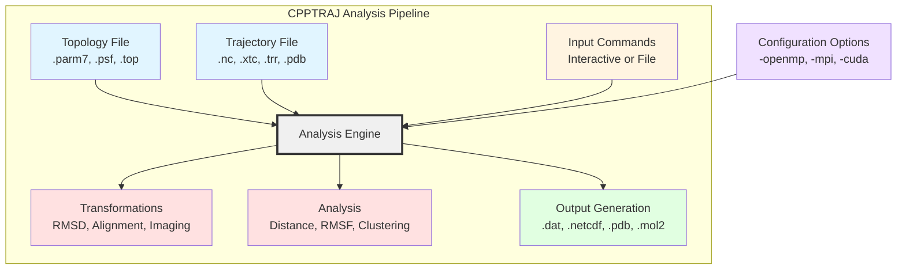

This guide provides a fast-track introduction to CPPTRAJ, helping you quickly set up, understand the basic architecture, and run your first molecular dynamics trajectory analysis. CPPTRAJ is a fast, parallelized program for processing and analyzing molecular dynamics trajectory data, supporting popular MD packages including Amber, CHARMM, Gromacs, and NAMD.

## Understanding CPPTRAJ Architecture

CPPTRAJ operates on a pipeline concept where you define analysis operations through commands or input files, process trajectory data, and output results in various formats. The program can read multiple trajectory and topology formats, apply transformations, perform calculations, and generate diverse outputs including coordinate files, data files, and visualizations.




The core architecture demonstrates flexibility in input handling and comprehensive analysis capabilities. You can interact with CPPTRAJ through interactive command mode or batch processing using input files, making it suitable for both exploratory analysis and automated workflows.

Sources: [README.md](/README.md#L9-L20), [README.md](/README.md#L65-L70)

## Project Structure Overview

The repository is organized to separate core functionality from tests, documentation, and examples. Understanding this structure helps you navigate the codebase and find resources quickly.

```
cpptraj/
├── src/                    # Core source code
├── test/                   # Comprehensive test suite
├── examples/               # Example usage scripts
├── doc/                    # Documentation (PDF/LyX)
├── dat/                    # Essential data files
├── cmake/ & cmake-cpptraj/ # Build configuration
├── CMakeLists.txt          # CMake build script
├── configure               # Configuration script
└── Makefile               # Make targets for building and testing
```

The `dat/` directory contains crucial reference data including atom type conversion tables, bond type mappings, and Karplus parameters for J-coupling calculations [dat/README](/dat/README#L1-L7). The `examples/` directory provides real-world usage scenarios, such as the NIST monoclonal antibody glycoform parameterization example [examples/prepareforleap/NIST-mAb/RunExample.sh](/examples/prepareforleap/NIST-mAb/RunExample.sh).

The `test/` directory contains over 200 test cases covering most functionality, organized in `Test_X` directories where X describes what's being tested. This serves as both a validation suite and a comprehensive examples collection [test/README](/test/README#L1-L15).

## Installation Methods

CPPTRAJ offers multiple installation approaches depending on your system configuration and requirements. The `configure` script provides the most straightforward installation method with extensive customization options.

### Basic Installation

For most systems, the minimal configuration suffices:

```bash
./configure gnu
make install
```

This builds CPPTRAJ with standard GNU compilers and basic functionality. The configure script automatically determines compiler and linker flags, generating `config.h` used by the build system [configure](/configure#L1-L15).

Sources: [README.md](/README.md#L75-L80), [configure](/configure#L16-L25)

### Parallel Configuration Options

For improved performance on multi-core systems or clusters, several parallelization options are available:

| Option | Description | Use Case |
|--------|-------------|----------|
| `-openmp` | Enable OpenMP threading | Multi-core workstations |
| `-mpi` | MPI parallelization | Distributed clusters |
| `-cuda` | CUDA GPU acceleration | NVIDIA GPU systems |
| `-hip` | HIP GPU acceleration | AMD GPU systems |

These can be combined (e.g., `./configure -openmp -mpi gnu`) for hybrid parallelization. Note that when using both MPI and OpenMP, you should properly set `OMP_NUM_THREADS` so that (processes × threads) doesn't exceed physical cores [README.md](/README.md#L92-L95).

Sources: [README.md](/README.md#L82-L100), [configure](/configure#L17-L24)

### Library Dependencies

CPPTRAJ supports optional libraries for enhanced functionality:

| Library | Purpose | Optional |
|---------|---------|----------|
| NetCDF | Trajectory I/O | No |
| BLAS/LAPACK | Linear algebra | No |
| FFTW | FFT calculations (PME) | No |
| Gzip/Bzip2 | Compression | No |
| ARPACK | Sparse matrix diagonalization | Yes (bundled) |
| helPME | PME calculations | Yes (bundled) |
| XDR | GROMACS XTC support | Yes (bundled) |
| TNG | GROMACS TNG support | Yes (bundled) |

CPPTRAJ can automatically download and build missing libraries using the `--buildlibs` option. For example, `./configure -fftw3 --buildlibs gnu` will install FFTW if unavailable [README.md](/README.md#L105-L108).

Sources: [README.md](/README.md#L55-L70)

### Advanced Configuration

For systems with specific library locations or custom requirements:

```bash
# Use NetCDF from custom location
./configure --with-netcdf=/opt/netcdf gnu

# Use AmberTools libraries
./configure -amberlib gnu

# Static linking
./configure -static gnu
```

For a complete list of options, run `./configure --full-help` which displays additional debugging, library, and platform-specific options [README.md](/README.md#L75-L80), [configure](/configure#L27-L40).

Sources: [README.md](/README.md#L110-L115), [configure](/configure#L27-L43)

## Verifying Installation

After successful installation, validate your build using the built-in test suite:

```bash
# Run basic tests
make check

# Run verbose tests with error output
make verbosecheck

# Run unit tests
make unittest
```

The `test/` directory contains comprehensive tests that verify most functionality. Tests can be run in parallel by setting `DO_PARALLEL`, e.g., `DO_PARALLEL="mpiexec -n 2" make test.all` [test/README](/test/README#L5-L10), [Makefile](/Makefile#L25-L33).

> [!TIP]
> Always run `make check` after installation to ensure your build is functional. The test suite not only validates functionality but also serves as a rich source of usage examples covering diverse analysis scenarios.

Sources: [test/README](/test/README#L1-L15), [Makefile](/Makefile#L25-L35)

## Your First Analysis

Let's create a simple analysis workflow demonstrating core CPPTRAJ concepts. We'll calculate RMSD and distance measurements from a trajectory.

### Basic Input File Example

Create a file named `analysis.in`:

```bash
# Load topology
parm ../tz2.parm7

# Calculate distance between atoms 1 and 2
distance d1 :1 :2 out distance.dat

# Calculate RMSD relative to first frame
rmsd r1 first out rmsd.dat

# Process trajectory
trajin ../tz2.nc

# Run analysis
run
```

Execute this with:

```bash
cpptraj -p ../tz2.parm7 -c analysis.in
```

This demonstrates the fundamental CPPTRAJ workflow: specify topology, define analyses, load trajectory, and execute. The `:1` and `:2` syntax represents atom selection masks, which you can explore in detail in [Atom Selection and Mask Expressions](6-atom-selection-and-mask-expressions).

Sources: [test/Test_General/RunTest.sh](/test/Test_General/RunTest.sh#L31-L40)

### Interactive Mode Example

For exploratory analysis, use interactive mode:

```bash
cpptraj

# In interactive mode
> parm ../tz2.parm7
> trajin ../tz2.nc
> distance d1 :1 :22 out distance.dat
> rmsd r1 first out rmsd.dat
> run
> xmgrace distance.dat  # Optional visualization
> quit
```

Interactive mode provides immediate feedback and is ideal for testing analysis commands before scripting them. Use `help [<command>]` to get information about specific commands.

Sources: [README.md](/README.md#L65-L70), [test/Test_General/RunTest.sh](/test/Test_General/RunTest.sh#L31-L47)

### Real-World Example: Antibody Glycoform Parameterization

The repository includes a practical example demonstrating the `prepareforleap` command for parameterizing glycoforms:

```bash
parm mAb8671_2021_0526.pdb
loadcrd mAb8671_2021_0526.pdb name MyCrd

# Mutate PCA to GLN
change crdset MyCrd atomname from :PCA@OE to OE1
change crdset MyCrd resname from :PCA to GLN

# Prepare for LEaP parameterization
prepareforleap \
  crdset MyCrd \
  name Prepared \
  pdbout Prepared.pdb \
  leapunitname Mol \
  out Prepared.leap.in runleap leap.ff.in \
  nowat noh

# Output in Mol2 format
crdout Prepared Prepared.mol2
```

This example shows coordinate manipulation, residue mutation, and output generation—all core CPPTRAJ capabilities [examples/prepareforleap/NIST-mAb/RunExample.sh](/examples/prepareforleap/NIST-mAb/RunExample.sh#L25-L40).

Sources: [examples/prepareforleap/NIST-mAb/RunExample.sh](/examples/prepareforleap/NIST-mAb/RunExample.sh#L1-L49)

## Common Analysis Patterns

Based on the test suite examples, here are frequently used analysis patterns:

| Analysis Type | Example Command | Use Case |
|--------------|----------------|----------|
| Distance | `distance d1 :1 :2 out dist.dat` | Interatomic distances |
| Angle | `angle a1 :2@CA :3@CA :4@CA out angle.dat` | Bond/structural angles |
| Dihedral | `dihedral dh1 :1@C :2@N :2@CA :2@C out phi.dat` | Torsion angles |
| RMSD | `rmsd r1 first out rmsd.dat` | Structural deviation |
| RMSF | `atomicfluct out rmsf.dat byres` | Atomic fluctuations |
| Alignment | `align :1-5@CA ref tz2.rst7` | Trajectory alignment |

These commands can be combined in a single input file to perform comprehensive analyses. The test suite in `test/Test_General/` provides working examples of these patterns [test/Test_General/RunTest.sh](/test/Test_General/RunTest.sh#L31-L55).

Sources: [test/Test_General/RunTest.sh](/test/Test_General/RunTest.sh#L31-L55)

## Getting Help and Resources

### Built-in Help

- **Interactive help**: Type `help` or `help <command>` in interactive mode
- **Command reference**: Run `cpptraj --help` for basic options
- **Full configuration options**: Run `./configure --full-help` during installation

### Documentation

- **PDF Manual**: [doc/CpptrajManual.pdf](/doc/CpptrajManual.pdf)
- **HTML Manual**: Available at https://amber-md.github.io/cpptraj/
- **Development Guide**: [doc/CpptrajDevelopmentGuide.pdf](/doc/CpptrajDevelopmentGuide.pdf)

### External Resources

- **Official tutorials**: http://ambermd.org/tutorials/TrajectoryAnalysis.php#cpptraj
- **AmberHub recipes**: https://amberhub.chpc.utah.edu/
- **Pytraj**: Python interface for programmatic analysis - https://github.com/Amber-MD/pytraj
- **Wiki**: What's new in CPPTRAJ at https://github.com/Amber-MD/cpptraj/wiki

Sources: [README.md](/README.md#L21-L30), [README.md](/README.md#L65-L70)

## Next Steps

Now that you have CPPTRAJ installed and understand the basic workflow, continue your journey through these resources:

1. **Installation and Configuration** - Detailed setup instructions for specific platforms and advanced build options
2. **Basic Command Line Usage** - In-depth coverage of command syntax, input file structure, and common workflows
3. **Trajectory Formats Support** - Comprehensive guide to supported file formats and format-specific options

For analysis-specific guidance, explore the Deep Dive sections starting with **[Atom Selection and Mask Expressions](6-atom-selection-and-mask-expressions)**, which provides the foundation for specifying atomic selections used throughout all analyses.

> [!TIP]
> The `test/` directory is an invaluable resource—each `Test_X` directory contains a working input file demonstrating specific functionality. Use these as templates for your own analyses.
