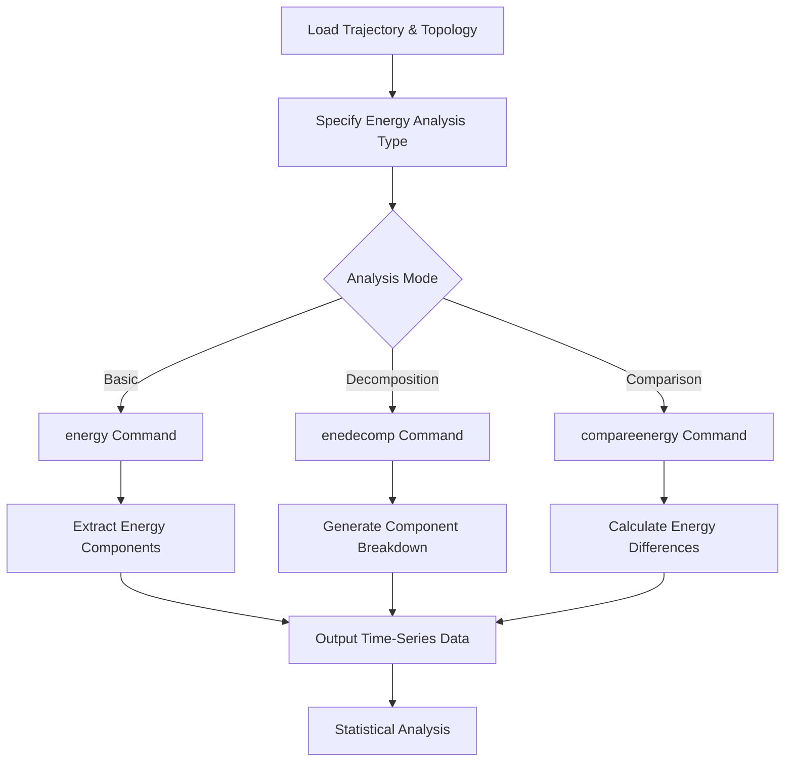

Energy extraction and analysis in cpptraj provides comprehensive capabilities for calculating, decomposing, and comparing energetic properties from molecular dynamics simulations. This functionality enables researchers to extract potential energy components from trajectory files, calculate kinetic energy from velocities, decompose total energy into contributions, and perform comparative energy analysis between different coordinate sets.

## Overview of Energy Analysis Architecture


The energy analysis system in cpptraj operates through multiple specialized commands that integrate seamlessly with the trajectory processing pipeline. The architecture supports both static energy extraction from stored trajectory data and dynamic energy calculations from atomic coordinates, velocities, and forces.

**Core Energy Commands**:

| Command | Purpose | Input Requirements | Output |
|---------|---------|-------------------|--------|
| `energy` | Extract potential energy components | Parameter file + trajectory | Time-series energy data |
| `energy kinetic` | Calculate kinetic energy | Coordinates + velocities | Kinetic energy values |
| `energy total` | Calculate total energy | Coordinates + velocities + forces | Total energy values |
| `compareenergy` | Compare energy between coordinate sets | Two coordinate sets | Energy differences |

Sources: [RunTest.sh](test/Test_Energy/RunTest.sh#L1-L62), [RunTest.sh](test/Test_CompareEnergy/RunTest.sh#L1-L29)

## Basic Energy Extraction

The fundamental `energy` command extracts potential energy components stored in trajectory files, providing access to the energy values calculated during the simulation by the MD engine. This is particularly useful for analyzing energy fluctuations, convergence, and thermodynamic properties.

```bash
# Basic energy extraction from trajectory
parm system.parm7
trajin system.nc
energy SystemName out energy_data.agr
```

The extracted energy data can include multiple components depending on what was saved in the trajectory file. Common components include total potential energy, bond, angle, dihedral, electrostatic, and van der Waals energies.

**Key Features**:
- Supports NetCDF trajectory format with energy data
- Outputs data in various formats (agr, dat, etc.)
- Integrates with mask expressions for selective analysis
- Compatible with time-series analysis workflows

Sources: [RunTest.sh](test/Test_Energy/RunTest.sh#L13-L20)

## Kinetic and Total Energy Calculation

For trajectories containing velocity and force information, cpptraj can calculate kinetic and total energy components dynamically. This capability extends energy analysis beyond what was originally computed and stored during simulation.

```bash
# Kinetic energy calculation with timestep specification
parm system.parm7
trajin system.crd mdvel system.vel mdfrc system.frc
energy kinetic Short out short.dat dt 0.002

# Total energy calculation
energy Tz2 out tz2.dat dt 0.002
```

The `dt` parameter specifies the timestep in picoseconds, which is essential for converting the kinetic energy calculation into proper units. This functionality requires trajectories that include velocity and force data, typically stored in separate files or NetCDF extensions.

**Implementation Details**:
- Kinetic energy: E_kin = 0.5 * Σ m_i * v_i²
- Total energy: E_total = E_kin + E_potential
- Requires atomic masses from parameter files
- Supports parallel processing for large systems

Sources: [RunTest.sh](test/Test_Energy/RunTest.sh#L23-L41)

## Energy Decomposition by Atom Selection

Energy decomposition allows researchers to analyze contributions from specific subsets of atoms, residues, or regions within a molecular system. This is invaluable for understanding energy hotspots, binding interactions, and regional stability.

```bash
# Partial energy calculations with atom selection
parm system.parm7
trajin system.nc
energy out strip.dat :NDP ENE1
energy out elec.dat  :NDP ENE2 elec
energy out vdw.dat   :NDP ENE3 vdw
```

The mask syntax `:NDP` selects specific residues (in this case, nucleotides), and the output can be further specified to extract particular energy components. Multiple `energy` commands can be chained to analyze different selections and energy types in a single analysis run.

**Supported Energy Components**:
- `elec` - Electrostatic energy
- `vdw` - Van der Waals energy
- `bond` - Bond stretching energy
- `angle` - Angle bending energy
- `dihedral` - Dihedral torsion energy

> [!TIP]
> When performing energy decomposition with atom selections, ensure that the trajectory contains the complete energy information for the requested components. Some formats may store only total energy, limiting decomposition capabilities.

Sources: [RunTest.sh](test/Test_Energy/RunTest.sh#L44-L59)

## Energy Comparison Between Coordinate Sets

The `compareenergy` command enables comparative analysis of energy components between different structural conformations. This is particularly useful for analyzing energy differences along reaction pathways, comparing mutant vs. wild-type structures, or evaluating conformational changes.

```bash
# Energy comparison workflow
parm system.parm7
loadcrd system.nc 1 1 name CRD1
loadcrd system.nc 2 2 name CRD2

# Compare bond energies
compareenergy crd0 CRD1 crd1 CRD2 bondout compare.bonds.dat mask1 :2 mask2 :2

# Compare angle energies
compareenergy crd0 CRD1 crd1 CRD2 angleout compare.angles.dat mask1 :2 mask2 :2 mask3 :2

# Compare dihedral energies
compareenergy crd0 CRD1 crd1 CRD2 dihedralout compare.dih.dat mask1 :2 mask2 :2 mask3 :2 mask4 :2
```

The comparison requires defining two coordinate sets (crd0 and crd1) and applying appropriate masks to specify which atoms participate in the energy terms. The output provides energy differences between the two conformations.

**Mask Requirements by Energy Type**:
| Energy Type | Required Masks | Description |
|-------------|----------------|-------------|
| Bond | mask1, mask2 | Two atoms defining the bond |
| Angle | mask1, mask2, mask3 | Three atoms defining the angle |
| Dihedral | mask1, mask2, mask3, mask4 | Four atoms defining the dihedral |

Sources: [RunTest.sh](test/Test_CompareEnergy/RunTest.sh#L1-L29)

## Integration with Energy Decomposition Analysis

For more detailed energy breakdown, cpptraj supports the `enedecomp` functionality (available in Test_EneDecomp), which provides comprehensive energy decomposition into residue-by-residue and component-wise contributions. This extends the basic energy extraction with detailed analysis capabilities.

The energy decomposition analysis workflow typically involves:
1. Loading trajectory and topology files
2. Specifying energy decomposition parameters
3. Generating detailed component breakdowns
4. Outputting per-residue and per-type energy data



## Output Formats and Data Handling

Energy analysis results can be output in multiple formats depending on downstream analysis needs:
- **.agr** - Grace/Xmgrace format for plotting
- **.dat** - Plain text format for spreadsheet analysis
- **.gnu** - Gnuplot format for data visualization
- **NetCDF** - Binary format for large datasets

The output files typically contain columns corresponding to frame number or time, followed by energy values for each requested component.

> [!TIP]
> For long trajectories or systems with many energy components, consider using NetCDF output format to reduce file size and improve I/O performance during subsequent analysis steps.

## Practical Applications

Energy extraction and analysis in cpptraj supports several key applications:

1. **Convergence Analysis**: Monitor energy fluctuations over time to assess simulation convergence and equilibration
2. **Binding Energy Analysis**: Decompose energies to understand contributions from specific residues or regions in protein-ligand complexes
3. **Pathway Analysis**: Compare energies along reaction coordinates or conformational pathways
4. **Validation**: Compare energy components between different simulation engines or parameter sets

## Advanced Integration

Energy analysis can be combined with other cpptraj capabilities for comprehensive analysis:

- Combine with [Time-Correlation Functions](14-time-correlation-functions-and-spectral-analysis) to analyze energy autocorrelation and fluctuation timescales
- Integrate with [Principal Component Analysis](13-principal-component-analysis-pca) to identify collective motions associated with energy changes
- Use with [Free Energy Calculations](21-free-energy-calculations-ti-mm-pbsa) for thermodynamic property calculation
- Apply [Statistical Analysis](12-correlation-functions-auto-correlation-cross-correlation) tools for energy distribution analysis
