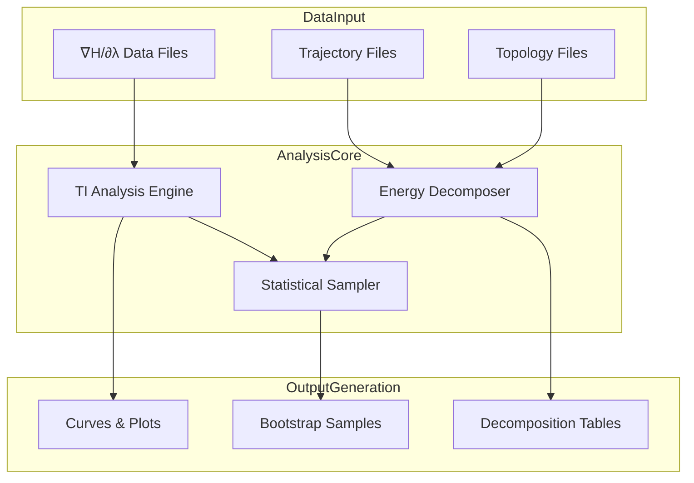

This documentation covers cpptraj's advanced capabilities for free energy calculations through Thermodynamic Integration (TI) and energy decomposition methods used in MM/PBSA (Molecular Mechanics/Poisson-Boltzmann Surface Area) analysis. These tools enable rigorous computation of free energy changes and component-wise energy breakdown for molecular systems.

Sources: [test/Test_TI/RunTest.sh](test/Test_TI/RunTest.sh#L1-L32), [test/Test_EneDecomp/RunTest.sh](test/Test_EneDecomp/RunTest.sh#L1-L76)

## Architecture Overview

The free energy calculation framework in cpptraj operates on a modular architecture that separates data input, analysis algorithms, and statistical post-processing. The system is designed to handle multiple λ-windows simultaneously for TI calculations and provides flexible decomposition schemes for per-residue or per-atom energy analysis.



The architecture supports two primary workflows: TI-based free energy integration from ∂H/∂λ data, and direct energy component decomposition from trajectory analysis using various electrostatic models including PME.

Sources: [test/Test_TI/dvdl.dat](test/Test_TI/dvdl.dat#L1-L5), [test/Test_EneDecomp/RunTest.sh](test/Test_EneDecomp/RunTest.sh#L12-L19)

## Thermodynamic Integration (TI) Implementation

### Data Format and Structure

TI analysis requires pre-computed ∂H/∂λ values across multiple λ windows. The input data format is structured as time-series data where each column represents a specific λ window. The dvdl.dat format contains ∂H/∂λ values for nine λ windows (TI_0 through TI_8) sampled across multiple time frames, enabling robust statistical analysis through ensemble averaging.

The integration framework supports flexible λ-sampling strategies through the `nq` parameter, which specifies the number of quadrature points for numerical integration. Skip-based analysis allows systematic evaluation of equilibration effects by excluding initial frames from the calculation.

Sources: [test/Test_TI/dvdl.dat](test/Test_TI/dvdl.dat#L1-L102)

### TI Analysis Command Syntax

The core TI analysis command implements numerical integration with multiple analysis modes:

```bash
ti <dataset_name> nq <num_points> name <analysis_name> \
  [out <output_file>] \
  [curveout <curve_file>] \
  [bsout <bootstrap_output>] \
  [nskip <skip_frames>] \
  [avgincrement <increment_size>] \
  [bs_samples <num_samples>] \
  [bs_seed <seed_value>] \
  [bs_pts <num_points>]
```

The `ti` command performs thermodynamic integration analysis on datasets containing ∂H/∂λ values. The integration is performed using numerical quadrature over λ-space, with the number of quadrature points specified by `nq`. This parameter determines the resolution of the integration grid, with typical values ranging from 5 to 20 points depending on the complexity of the λ-dependence.

Sources: [test/Test_TI/RunTest.sh](test/Test_TI/RunTest.sh#L13-L20)

### Statistical Methods and Bootstrapping

cpptraj implements sophisticated statistical analysis for TI calculations including bootstrap resampling for error estimation. The bootstrap analysis is controlled through three key parameters: `bs_samples` specifies the number of bootstrap replicates to generate, `bs_seed` sets the random number generator seed for reproducibility, and `bs_pts` determines the number of data points to include in each bootstrap sample.

The random number generation uses high-quality generators supported by the framework, with Marsaglia and Xoshiro128++ being available options. These generators have been validated against the Dieharder test suite, with Xoshiro128++ showing superior statistical properties compared to the C standard library generator.

Sources: [test/Test_TI/RunTest.sh](test/Test_TI/RunTest.sh#L21), [devtools/rngtest/README.md](devtools/rngtest/README.md#L36-L42)

> [!TIP]
> Set `bs_seed` explicitly when performing bootstrap analysis to ensure reproducible results. The seed controls the entire random sequence, which affects both the bootstrap resampling and any subsequent random-dependent calculations. For publication-quality results, use a fixed seed and document it in your methods section.

### Incremental and Skip-Based Analysis

The TI framework supports two complementary analysis strategies for evaluating equilibration and convergence. Incremental analysis divides the trajectory into segments specified by `avgincrement`, computing free energy estimates for each segment to assess time-series convergence. Skip-based analysis uses `nskip` to systematically exclude initial frames from calculation, allowing evaluation of equilibration effects.

For robust convergence assessment, combine both strategies: use skip-based analysis to identify the equilibration point, then apply incremental analysis on the equilibrated portion to verify stability.

Sources: [test/Test_TI/RunTest.sh](test/Test_TI/RunTest.sh#L13-L22)

## Energy Decomposition

### Command Interface and Options

The energy decomposition functionality is accessed through the `enedecomp` command, which performs per-atom or per-residue energy calculations using various electrostatic models. The command supports PME (Particle Mesh Ewald) calculations for long-range electrostatics, with fine-grained control over cutoff distances, tolerance parameters, and FFT grid dimensions.

```bash
enedecomp <dataset_name> <mask> [out <output_file>] \
  [savecomponents] \
  [pme] [cut <distance>] \
  [dsumtol <tolerance>] \
  [skinnb <skin_distance>] \
  [nfft <x>,<y>,<z>]
```

The `savecomponents` option enables output of individual energy components (electrostatic, van der Waals, etc.) rather than just the total energy per atom/residue. This is particularly useful for MM/PBSA workflows where separate treatment of different energy terms is required.

Sources: [test/Test_EneDecomp/RunTest.sh](test/Test_EneDecomp/RunTest.sh#L17-L25)

### PME Configuration Parameters

The PME implementation in cpptraj provides several configuration options for optimizing accuracy vs. computational cost:

| Parameter | Description | Typical Values | Impact |
|-----------|-------------|----------------|--------|
| `cut` | Real-space cutoff distance | 5.6-10.0 Å | Shorter cutoffs are faster but may require larger FFT grids |
| `dsumtol` | Direct sum tolerance | 0.0000001 | Lower values improve accuracy but increase computation |
| `skinnb` | Neighbor list skin distance | 0.01-0.02 Å | Larger values reduce neighbor list rebuilding frequency |
| `nfft` | FFT grid dimensions (x,y,z) | 32-128 per axis | Larger grids improve reciprocal space accuracy |

For production MM/PBSA calculations, validate that `dsumtol` and the FFT grid size provide sufficient convergence by running sensitivity analyses on a subset of frames.

Sources: [test/Test_EneDecomp/RunTest.sh](test/Test_EneDecomp/RunTest.sh#L15-L26)

### Energy Command Integration

The `energy` command serves as a companion to `enedecomp`, providing total energy calculations that can be used for validation or decomposition verification. The `etype` parameter specifies the electrostatic treatment method, with options including PME, Ewald, and simple cutoff-based methods.

The decomposition results can be summed using cpptraj's dataset operations (e.g., `Total = sum(ATM)`) to verify that component-wise sums reproduce the total energy from the `energy` command. This cross-validation step is essential for ensuring the correctness of the decomposition before proceeding to MM/PBSA analysis.

Sources: [test/Test_EneDecomp/RunTest.sh](test/Test_EneDecomp/RunTest.sh#L14-L16), [test/Test_EneDecomp/RunTest.sh](test/Test_EneDecomp/RunTest.sh#L27-L29)

## Advanced Analysis Workflows

### Free Energy Protocol Integration

The TI and energy decomposition capabilities can be combined into comprehensive free energy protocols. A typical workflow involves:

1. Generating ∂H/∂λ data across λ windows during MD simulations
2. Performing TI analysis with bootstrapping for error estimates
3. Computing energy decomposition on representative snapshots from each window
4. Combining results for complete thermodynamic characterization

The framework supports reading pre-computed energy data via the `readdata` command, enabling post-processing of externally generated data from various MD engines including Amber, CHARMM, and GROMACS.

Sources: [test/Test_TI/RunTest.sh](test/Test_TI/RunTest.sh#L8-L11)

### Parallel Execution Considerations

For large-scale TI calculations with many λ windows or long trajectories, consider the parallel execution capabilities of cpptraj. Both OpenMP and MPI parallelization are supported, with different advantages depending on the analysis type:

- OpenMP: Effective for parallelizing individual TI calculations across frames or bootstrap samples
- MPI: Superior for handling multiple independent calculations or very large trajectory datasets

When using parallel execution, ensure that random number seeds are properly managed to maintain reproducibility across different thread/process configurations.

Sources: [README.md](README.md#L103-L118)

## Best Practices and Recommendations

### Convergence Assessment

Establish convergence through multiple complementary metrics:

1. Compare results from different `nskip` values to identify equilibration
2. Use `avgincrement` analysis to verify temporal stability
3. Assess bootstrap error estimates; decreasing error with increased frames suggests convergence
4. Cross-validate energy decomposition totals against standalone energy calculations

For publication-quality free energy calculations, convergence should be demonstrated across at least three independent metrics.

Sources: [test/Test_TI/RunTest.sh](test/Test_TI/RunTest.sh#L13-L22)

> [!TIP]
> When performing TI analysis with limited data, use smaller `bs_pts` values (e.g., 50-70) to reduce bootstrap variance while maintaining sufficient statistical power. For well-converged systems with extensive sampling, increase `bs_pts` to 100-200 to maximize error estimate reliability.

### Data Management

Free energy calculations generate substantial output data including individual frame energies, bootstrap samples, and intermediate analysis files. Implement a structured naming convention and organize output by calculation type:

- `*_ti.agr`: TI curves and integrated free energy values
- `*_bs.dat`: Bootstrap sample results
- `*_incr.agr`: Incremental analysis results
- `*_decomp.dat`: Energy decomposition tables

This organization facilitates automated analysis pipelines and simplifies post-processing for publication figures.

Sources: [test/Test_TI/RunTest.sh](test/Test_TI/RunTest.sh#L6-L7), [test/Test_EneDecomp/RunTest.sh](test/Test_EneDecomp/RunTest.sh#L7)

## Next Steps

To explore related functionality in the cpptraj ecosystem:

- **Energy Extraction and Analysis**: For fundamental energy calculation techniques, see [Energy Extraction and Analysis](20-energy-extraction-and-analysis)
- **Atom Selection**: For precise mask specification in energy decomposition, see [Atom Selection and Mask Expressions](6-atom-selection-and-mask-expressions)
- **Parallel Processing**: For optimizing large-scale free energy calculations, see [OpenMP Multi-threading](29-openmp-multi-threading) or [MPI Parallelization](30-mpi-parallelization-for-large-scale-analysis)
- **PME Calculations**: For detailed PME implementation details, see [PME Calculations](28-pme-particle-mesh-ewald-calculations)
