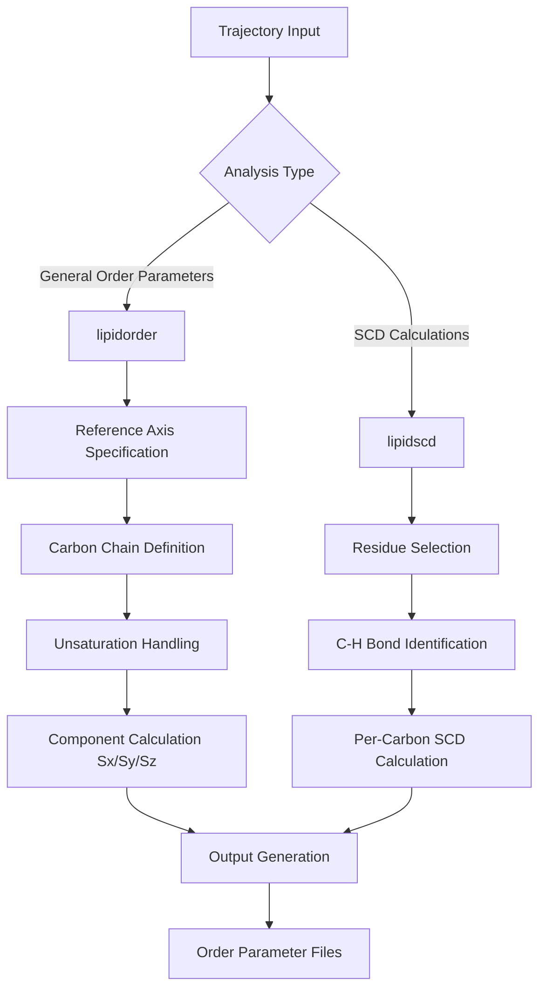
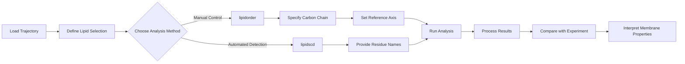

Lipid order parameter analysis in CPPTRAJ provides quantitative metrics for characterizing membrane structure and dynamics by measuring the orientational ordering of lipid acyl chains. This analysis is fundamental for understanding membrane fluidity, phase behavior, and lipid-lipid interactions in biological membranes and model lipid bilayers.

## Mathematical Foundations

Lipid order parameters quantify the orientation of molecular bonds relative to a defined reference frame, typically the membrane normal (z-axis). The primary order parameter calculated is the deuterium order parameter (SCD), derived from NMR quadrupolar splitting measurements and directly computable from molecular dynamics trajectories.

The order parameter Sα for a molecular vector relative to a reference axis α is defined as:

Sα = (3⟨cos²θ⟩ - 1)/2

where θ is the angle between the molecular vector and the reference axis α, and ⟨⟩ denotes ensemble averaging. For C-H bonds in lipid tails, the SCD parameter relates to the probability distribution of bond orientations, providing insight into chain conformational disorder.

## Implementation Architecture

CPPTRAJ provides two complementary commands for lipid order parameter analysis, each optimized for specific use cases:

| Command | Primary Purpose | Input Requirements | Output Format |
|---------|----------------|-------------------|---------------|
| `lipidorder` | General lipid order parameter calculations with customizable reference axis | Carbon atom masks, optional unsaturated bond specification | Sx, Sy, Sz components with standard deviations |
| `lipidscd` | Specialized SCD order parameter calculations per carbon position | Lipid residue selection, automatic C-H bond identification | Per-carbon SCD values with hydrogen-specific data |



Sources: [RunTest.sh](test/Test_LipidOrder/RunTest.sh#L14-L24), [RunTest.sh](test/Test_LipidSCD/RunTest.sh#L16-L25)

## LipidOrder Command

The `lipidorder` command provides flexible order parameter analysis with control over the reference axis direction and handling of unsaturated bonds within lipid tails.

### Core Parameters

- **Reference Axis**: Specifies the molecular axis along which order parameters are calculated (x, y, z)
- **Carbon Masks**: Atom mask expressions defining sequential carbon atoms along lipid acyl chains
- **Unsaturation**: Optional specification of double bond positions to modify calculation behavior
- **Tail Distance Analysis**: Calculates end-to-end distances for lipid tails with customizable resolution

> [!TIP]
> The `z` axis is typically used as the reference direction for planar lipid bilayers, aligning with the membrane normal. For vesicular systems or curved membranes, consider adjusting the reference frame based on local surface normals.

### Command Syntax

Basic lipid order parameter calculation for a single tail:
```
lipidorder out results.dat z \
  ":Lipid@C2" ":Lipid@C3" ":Lipid@C4" ... ":Lipid@C18"
```

Advanced calculation with unsaturation handling and tail distance:
```
lipidorder out sn1_est.dat z unsat ":Lipid@C9 | :Lipid@C10" \
  taildist e2e_sn1.dat delta 0.1 \
  tailstart ":Lipid@C2" tailend ":Lipid@C18" \
  ":Lipid@C2" ":Lipid@C3" ... ":Lipid@C18"
```

Sources: [RunTest.sh](test/Test_LipidOrder/RunTest.sh#L14-L24)

### Output Structure

The `lipidorder` command generates comprehensive output with multiple order parameter components:

```
#Cn         Sx     sd(Sx)         Sy     sd(Sy)         Sz     sd(Sz)      SCD_z     SCD_xy
  2 -0.1286853  0.0000000 -0.1839300  0.0000000  0.3126154  0.0000000  0.1563077  0.1471002
  3 -0.1788536  0.0000000 -0.1215643  0.0000000  0.3004179  0.0000000  0.1502090  0.1597572
  ...
```

- **Cn**: Carbon position number along the tail (relative numbering)
- **Sα**: Order parameter component along axis α
- **sd(Sα)**: Standard deviation of order parameter component
- **SCD_z**: Deuterium order parameter along z-axis (Sz/2)
- **SCD_xy**: Combined xy-plane order parameter

Sources: [sn1_est.dat.save](test/Test_LipidOrder/sn1_est.dat.save#L1-L4)

## LipidSCD Command

The `lipidscd` command provides specialized order parameter analysis specifically designed for comparing with experimental NMR measurements, automatically handling C-H bond identification and per-atom order parameter extraction.

### Simplified Interface

The `lipidscd` command streamlines the analysis workflow through:
- **Automatic residue detection**: Selects lipid molecules by residue name or type
- **C-H bond pairing**: Automatically identifies hydrogen atoms bonded to each carbon
- **Per-residue statistics**: Calculates order parameters separately for different lipid species

> [!TIP]
> Use the `lipidscd` command when you need direct comparability with NMR experiments or require analysis of multiple lipid types within the same system. It handles the atom naming conventions automatically.

### Command Syntax

Basic analysis of specific lipid types:
```
lipidscd :LipidName1,LipidName2 out results.dat
```

Advanced analysis with error formatting:
```
lipidscd :OL,PC out ol1.dat
lipidscd :OL2,PC out ol2.dat
lipidscd out ol3.agr xydy prec 10.7 xprec 3.0
```

Sources: [RunTest.sh](test/Test_LipidSCD/RunTest.sh#L16-L25)

### Output Structure

The `lipidscd` output provides per-carbon, per-hydrogen order parameters:

```
#Cn  OL_C11_H1 sd(OL_C11_H1)  OL_C11_H2 sd(OL_C11_H2)  OL_C11_H3 sd(OL_C11_H3)
  2  0.1911444     0.0000000  0.2222481     0.0000000  0.2222481     0.0000000
  3  0.1834894     0.0000000  0.1191841     0.0000000  0.1191841     0.0000000
  ...
```

- **Cn**: Carbon position along the tail
- **Residue_Cn_HX**: SCD value for specific carbon-hydrogen pair
- **sd()**: Standard deviation across trajectory frames

Sources: [ol1.dat.save](test/Test_LipidSCD/ol1.dat.save#L1-L4)

## Practical Workflow



### Example: Complete DOPC Bilayer Analysis

```
# Load DOPC bilayer trajectory
parm dopc.parm7
trajin dopc.nc

# Calculate order parameters for both tails
lipidorder out sn1_est.dat z unsat ":OL@C9 | :OL@C10" \
  ":OL@C2" ":OL@C3" ":OL@C4" ":OL@C5" ":OL@C6" ":OL@C7" \
  ":OL@C8" ":OL@C9" ":OL@C10" ":OL@C11" ":OL@C12" \
  ":OL@C13" ":OL@C14" ":OL@C15" ":OL@C16" ":OL@C17" ":OL@C18"

lipidorder out sn2_est.dat z unsat ":OL2@C9 | :OL2@C10" \
  ":OL2@C2" ":OL2@C3" ":OL2@C4" ":OL2@C5" ":OL2@C6" ":OL2@C7" \
  ":OL2@C8" ":OL2@C9" ":OL2@C10" ":OL2@C11" ":OL2@C12" \
  ":OL2@C13" ":OL2@C14" ":OL2@C15" ":OL2@C16" ":OL2@C17" ":OL2@C18"

# Alternative: Automated SCD calculation
lipidscd :OL,OL2 out dopc_scd.dat xydy
```

Sources: [RunTest.sh](test/Test_LipidOrder/RunTest.sh#L14-L44)

## Interpretation Guidelines

Lipid order parameters provide insight into membrane physical properties:

| SCD Value Range | Interpretation | Typical Membrane State |
|----------------|----------------|------------------------|
| > 0.25 | Highly ordered, extended chains | Gel phase, low temperature |
| 0.15 - 0.25 | Moderately ordered | Liquid-ordered phase (raft domains) |
| 0.05 - 0.15 | Disordered, gauche conformers | Liquid-disordered phase |
| < 0.05 | Highly fluid | Near phase transition, high temperature |

The characteristic "order profile" shows higher ordering near the headgroup (carbons 2-6), decreasing toward the bilayer center, with potential plateaus indicating gel-phase regions or kinks at unsaturated bonds.

## Advanced Features

### Multi-Lipid Systems

For membranes containing multiple lipid species:
```
lipidscd :POPC,POPE,CHOL out mixed_membrane.dat
```

This generates separate order parameter columns for each lipid type, enabling comparison of ordering effects in mixed systems.

### Tail-Specific Analysis

Analyzing sn1 and sn2 tails separately:
```
lipidorder out sn1.dat z ":PC@sn1tail"
lipidorder out sn2.dat z ":PC@sn2tail"
```

This reveals asymmetry in lipid packing and conformational preferences.

Sources: [RunTest.sh](test/Test_LipidOrder/RunTest.sh#L26-L44)

### Error Analysis

For quantitative comparison with experiment, enable error tracking:
```
lipidscd :DOPC out results.agr xydy prec 10.7
```

The `xydy` format includes standard deviations suitable for plotting with error bars in visualization tools like Grace or Python matplotlib.

## Next Steps

For comprehensive membrane analysis, consider combining lipid order parameters with:

- **Area per lipid**: [Grid and Density Calculations](19-grid-and-density-calculations) to correlate order with lateral pressure profiles
- **Membrane thickness**: Calculate bilayer thickness and correlate with order parameters
- **Diffusion coefficients**: [Diffusion Coefficients](26-diffusion-coefficients) to relate ordering with lipid mobility
- **Atom selection refinement**: [Atom Selection and Mask Expressions](6-atom-selection-and-mask-expressions) for complex lipid systems

For parallel processing of large membrane systems, refer to [OpenMP Multi-threading](29-openmp-multi-threading) or [MPI Parallelization](30-mpi-parallelization-for-large-scale-analysis) to accelerate order parameter calculations across multiple trajectories or large membrane patches.