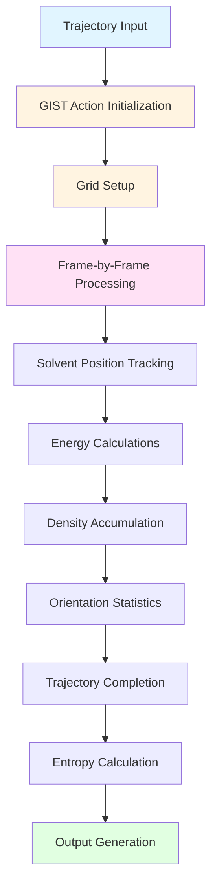

GIST (Grid Inhomogeneous Solvation Theory) is a sophisticated analysis technique implemented in CPPTRAJ for characterizing solvent thermodynamics and structure around biomolecules. GIST partitions the solvation shell into a three-dimensional grid, computing enthalpic and entropic contributions at each voxel to provide spatially-resolved thermodynamic profiles of solvent behavior.

## Theoretical Foundation

GIST is based on Inhomogeneous Solvation Theory (IST), which provides a rigorous framework for analyzing solvation thermodynamics through spatial integration of pair correlation functions. The method discretizes the volume around a solute into a regular grid, computing key thermodynamic quantities at each grid point:

- **Water density distribution (g(r))**: Probability density of finding water molecules at specific locations
- **Water-solute interaction energy (E_sw)**: Enthalpic contribution from solute-solvent interactions
- **Water-water interaction energy (E_ww)**: Enthalpic contribution from solvent-solvent interactions  
- **Translational entropy (S_trans)**: Entropy related to water molecule mobility
- **Orientational entropy (S_orient)**: Entropy related to water molecule orientation

## Computational Architecture

The GIST implementation follows a modular design integrating trajectory processing, spatial discretization, and thermodynamic calculation:



## Grid Configuration

The analysis region is defined through several key parameters that control spatial resolution and extent:

| Parameter | Description | Typical Values |
|-----------|-------------|-----------------|
| `gridcenter` | Center coordinates for GIST box | solute centroid or user-specified |
| `griddim` | Number of grid points in each dimension | 40-100 per axis |
| `gridspacn` | Distance between adjacent grid points | 0.5-1.0 Å |
| `solvent` | Atom mask defining solvent molecules | `:WAT` or equivalent |

The grid must be large enough to capture the first and second solvation shells while maintaining sufficient resolution to resolve thermodynamic features. Common practice uses 0.5 Å spacing with dimensions extending 5-10 Å from the solute surface.

## Energy Calculations

GIST decomposes solvation thermodynamics into enthalpic components computed through pairwise interactions:

**Solute-Water Energy (E_sw)**
- Electrostatic interactions between solute and water
- Van der Waals interactions using appropriate force field parameters
- Critical for identifying favorable binding hotspots and hydrophobic interactions

**Water-Water Energy (E_ww)**
- Interactions between water molecules within each grid voxel
- Reflects solvent structure and reorganization
- High values indicate regions of disrupted water networks (commonly seen at protein surfaces)

The implementation supports multiple energy calculation methods, including direct pairwise summation and particle mesh Ewald (PME) approaches for long-range electrostatics.

## Entropy Decomposition

GIST separates total solvation entropy into translational and orientational components, providing mechanistic insights into solvent behavior:

**Translational Entropy (S_trans)**
Derived from water density fluctuations and spatial distribution:
```
S_trans = -k_B ∫ g(r) ln g(r) dr
```
Quantifies the freedom of water molecules to move within the solvation shell. Reduced translational entropy indicates constrained water, commonly observed in deep pockets and binding sites.

**Orientational Entropy (S_orient)**
Computed from orientational distribution of water dipoles and molecular axes:
```
S_orient = -k_B ∫ P(Ω) ln P(Ω) dΩ
```
Measures the angular freedom of water molecules. Low orientational entropy suggests highly ordered water structures, characteristic of hydrophobic interfaces and specific hydration sites.

## Analysis Output

GIST generates multiple output files providing comprehensive thermodynamic profiles:

### Density Maps (OpenDX format)
- `gH.dx` / `gO.dx`: Spatial distribution of water oxygen/hydrogen densities
- Visualizes water localization and probability distributions
- Identifies hydration sites and dehydration-prone regions

### Energy Maps
- `Esw-dens.dx`: Solute-water interaction energy density
- `Eww-dens.dx`: Water-water interaction energy density
- Reveals enthalpic hotspots and unfavorable regions

### Entropy Maps
- `dTStrans-dens.dx`: Translational entropy contribution (kcal/mol/ų)
- `dTSorient-dens.dx`: Orientational entropy contribution (kcal/mol/ų)
- Highlights regions of solvent ordering and constraint

### Order Parameter Maps
- `order-norm.dx`: Normalized water orientation order parameters
- Quantifies tetrahedral ordering deviations from bulk water

### Statistical Summary
- `Info.dat`: Overall thermodynamic statistics including:
  - Total solvation free energy
  - Average energy and entropy contributions
  - Grid specifications and computation details
- `output.dat`: Per-voxel thermodynamic quantities in tabular format

## Molecular Resolution

GIST can resolve thermodynamics at the molecular level through the `mol` keyword, enabling separate analysis for different solvent species:

```cpp
// Example: Separate analysis for water, Na+, and Cl-
Esw-mol-WAT.dx   // Water-solute interactions
Esw-mol-NA.dx    // Sodium-solute interactions  
Esw-mol-CL.dx    // Chloride-solute interactions
```

This capability is essential for studying ionic solutions, electrolytes, and mixed solvent systems where different species contribute distinctly to solvation thermodynamics.

## Performance Considerations

The computational cost of GIST analysis scales with:
- Grid size (O(N_grid) for spatial discretization)
- Trajectory length (O(N_frames) for sampling)
- System size (O(N_atoms) per frame for energy calculations)

Optimization strategies include:
- Using appropriate grid resolution (0.5-1.0 Å typically sufficient)
- Restricting analysis to relevant solvation shells
- Leveraging OpenMP parallelization for frame-level processing
- Cutoff schemes for non-bonded energy calculations

## Practical Applications

GIST analysis provides critical insights for:

**Drug Discovery**
- Identify favorable water displacement sites
- Optimize ligand design by targeting thermodynamically favorable regions
- Quantify desolvation penalties for binding free energy predictions

**Protein Engineering**
- Characterize hydration patterns in binding pockets
- Guide mutagenesis to optimize solvation thermodynamics
- Understand role of water in protein stability and folding

**Biophysical Studies**
- Map solvation thermodynamics around biomolecular interfaces
- Investigate hydrophobic effect mechanisms
- Study solvent contributions to conformational changes

## Integration with Other Analyses

GIST complements other CPPTRAJ analyses:

- **Hydrogen Bond Analysis** ([Hydrogen Bond Analysis](15-hydrogen-bond-analysis)): Correlate thermodynamic patterns with specific H-bond networks
- **Water Density** ([Grid and Density Calculations](19-grid-and-density-calculations)): Compare pure density maps with thermodynamic profiles
- **Solvent Accessibility** ([Distance and Angle Measurements](11-distance-and-angle-measurements)): Relate thermodynamics to geometric accessibility
- **Free Energy Calculations** ([Free Energy Calculations](21-free-energy-calculations-ti-mm-pbsa)): Combine GIST with end-point methods for comprehensive solvation analysis

## Implementation Notes

The GIST implementation originated from work by Crystal N. Nguyen and Romelia F. Salomon, with subsequent enhancements to entropy calculations by Steven Ramsey. The code supports both Coulombic and PME electrostatic treatments, enabling accurate long-range interaction assessment.

Sources: [README.md](/README.md#L119-L126)

## Next Steps

For understanding the computational infrastructure supporting GIST and other grid-based analyses, explore [Grid and Density Calculations](19-grid-and-density-calculations). For thermodynamic calculations using complementary methods, see [Free Energy Calculations](21-free-energy-calculations-ti-mm-pbsa). To understand how GIST integrates into the broader trajectory processing workflow, review [Trajectory Processing Pipeline](7-trajectory-processing-pipeline).