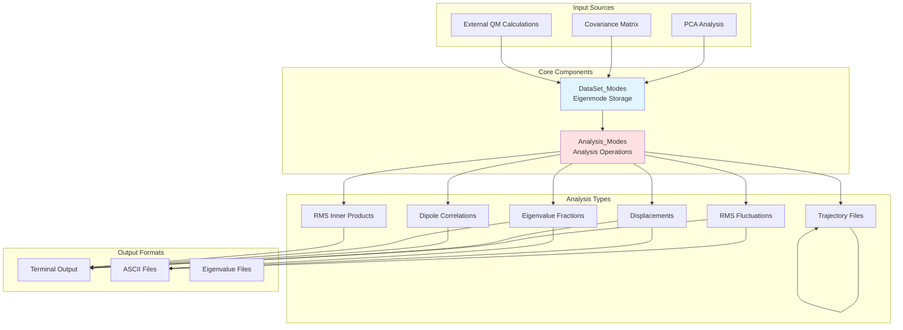
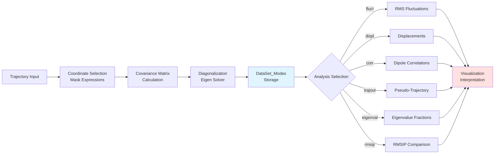

Normal Mode Analysis (NMA) and Eigenmode Calculations in CPPTRAJ provide powerful capabilities for understanding the collective motions and vibrational properties of molecular systems. These tools enable researchers to analyze normal modes derived from principal component analysis (PCA), diagonalization of covariance matrices, or external quantum mechanical calculations, offering insights into protein dynamics, conformational changes, and thermodynamic properties.

## Architecture Overview

The normal mode analysis framework in CPPTRAJ is built around a modular architecture that separates eigenmode storage from analysis operations. The `DataSet_Modes` class serves as the core data structure for storing eigenvectors and eigenvalues, while the `Analysis_Modes` component provides a comprehensive suite of analytical operations.



The architecture follows a clean separation of concerns where eigenmode data storage is decoupled from analysis algorithms, enabling flexible composition of different analysis types on the same dataset. Physical constants for quantum mechanical calculations are embedded within the analysis module for accurate temperature-dependent statistics.

Sources: [src/Analysis_Modes.cpp](src/Analysis_Modes.cpp#L1-L769), [src/cpptrajfiles](src/cpptrajfiles#L100-L200)

## Core Components

### DataSet_Modes

The `DataSet_Modes` class encapsulates eigenmode data including eigenvectors, eigenvalues, and associated mass information. This data structure supports both full and reduced coordinate representations, with optimized storage for large systems containing thousands of atoms.

Key features include:
- Storage of eigenvector matrices for each normal mode
- Eigenvalue arrays for frequency analysis
- Atomic mass weighting capabilities
- Coordinate projection functionality

Sources: [src/Analysis_Modes.cpp](src/Analysis_Modes.cpp#L365-L376)

### Analysis_Modes

The `Analysis_Modes` class implements six distinct analysis modes that can be applied to stored eigenmodes:

| Analysis Type | Command Key | Description |
|---------------|-------------|-------------|
| RMS Fluctuations | `fluct` | Calculate atomic RMS fluctuations from normal mode contributions |
| Displacements | `displ` | Compute Cartesian coordinate displacements along mode directions |
| Correlations | `corr` | Calculate dipole-dipole correlation functions between atom groups |
| Trajectory Output | `trajout` | Generate pseudo-trajectories along specific normal modes |
| Eigenvalue Fractions | `eigenval` | Compute fractional contribution of each eigenvalue to total variance |
| RMS Inner Product | `rmsip` | Compare two mode sets via root mean square inner product |

Sources: [src/Analysis_Modes.cpp](src/Analysis_Modes.cpp#L24-L64), [src/Analysis_Modes.cpp](src/Analysis_Modes.cpp#L84-L119)

## Physical Constants and Quantum Corrections

CPPTRAJ implements quantum mechanical corrections for normal mode analysis through predefined physical constants:

| Constant | Symbol | Value | Purpose |
|----------|--------|-------|---------|
| CONSQ | hc/2kT | 2.39805×10⁻³ cm | Bose statistics at 300K |
| TKBC2 | kT/c² | 0.46105×10⁻³⁴ g | Temperature-dependent scaling |
| AVO | Nₐ | 6.023×10²³ mol⁻¹ | Avogadro's number |
| CNST | - | 2.777×10⁻¹¹ | Combined constant for fluctuation calculations |
| CMTOA | - | 1.000×10⁸ Å/cm | Wavenumber to distance conversion |

These constants enable quantum correction of classical MD simulations via the Bose-Einstein distribution when the `bose` option is enabled, providing more accurate predictions of low-frequency mode behavior at physiological temperatures.

Sources: [src/Analysis_Modes.cpp](src/Analysis_Modes.cpp#L45-L56)

## Analysis Types in Detail

### RMS Fluctuations

The RMS fluctuation analysis calculates per-atom root-mean-square fluctuations derived from normal mode contributions. This analysis can be performed using classical statistical mechanics or quantum-mechanical Bose-Einstein statistics:

```
u_i² = (kT/ω_i²) × Σ_q (e_q(i)·e_q(i))      (Classical)
u_i² = (ħcω_i/2kT) × coth(ħcω_i/2kT) × Σ_q (e_q(i)·e_q(i))    (Quantum)
```

where ω_i is the mode frequency and e_q(i) represents the q-th eigenvector component for atom i.

**Usage Example:**
```bash
analyze modes name MYMODES type fluct out fluct.dat bose factor 1.0
```

Sources: [src/Analysis_Modes.cpp](src/Analysis_Modes.cpp#L412-L469)

### Coordinate Displacements

Displacement analysis quantifies how atomic coordinates shift along specific normal mode directions. This is particularly useful for visualizing collective motions and identifying key residues involved in conformational transitions.

The displacement magnitude for each atom along mode m is calculated as:
```
Δr_i(m) = √[Σ_j (e_m(i,j))²]
```

where e_m(i,j) represents the j-th Cartesian component of atom i in mode m.

**Usage Example:**
```bash
analyze modes name MYMODES type displ beg 1 end 10 out displ.dat calcall
```

Sources: [src/Analysis_Modes.cpp](src/Analysis_Modes.cpp#L471-L510)

### Dipole Correlation Functions

The correlation analysis computes time-dependent dipole-dipole correlation functions between specified atom groups, providing insights into collective electrostatic fluctuations and solvation dynamics. This requires defining atom selections for dipole moment calculation.

> [!TIP]
> Dipole correlations require partial charge information in the topology file. Ensure your topology includes accurate partial charges for meaningful results, particularly when studying solvent dynamics or protein-ligand interactions.

**Usage Example:**
```bash
analyze modes name MYMODES type corr mask1 :1-50 mask2 :51-100 out corr.dat
```

Sources: [src/Analysis_Modes.cpp](src/Analysis_Modes.cpp#L512-L607)

### Pseudo-Trajectory Generation

The `trajout` mode generates pseudo-trajectories by projecting atomic coordinates onto specific normal mode directions, enabling visualization of collective motions along selected eigenvectors. This is particularly valuable for:
- Animating dominant conformational changes
- Exploring transition pathways
- Generating initial structures for enhanced sampling

The coordinate projection follows:
```
r(t) = r₀ + A × sin(ωt + φ) × e_m
```

where A is the amplitude controlled by `pcmin`/`pcmax` parameters, ω is the mode frequency, and e_m is the eigenvector.

**Usage Example:**
```bash
analyze modes name MYMODES trajout mode1.dcd trajoutfmt dcd \
    tmode 1 pcmin -2.0 pcmax 2.0 trajoutmask :1-100
```

Sources: [src/Analysis_Modes.cpp](src/Analysis_Modes.cpp#L619-L666)

### Eigenvalue Fraction Analysis

Eigenvalue fraction analysis quantifies the relative contribution of each normal mode to the total variance, enabling identification of the most collective motions. The fractional contribution is computed as:

```
f_i = λ_i / Σ_j λ_j
```

where λ_i represents the i-th eigenvalue. Cumulative fractions are also computed to determine how many modes are required to capture a given percentage of total motion.

**Usage Example:**
```bash
analyze modes name MYMODES type eigenval out eigenfrac.dat beg 1 end 50
```

Sources: [src/Analysis_Modes.cpp](src/Analysis_Modes.cpp#L668-L683)

### Root Mean Square Inner Product (RMSIP)

RMSIP provides a quantitative measure of similarity between two different normal mode sets, enabling comparison of:
- Different simulation conditions
- Mutant vs. wild-type systems
- Different force field parameters
- PCA vs. normal mode analysis results

The RMSIP is calculated as:
```
RMSIP = √[Σ_i Σ_j (e₁(i)·e₂(j))² / N₁N₂]
```

where N₁ and N₂ are the numbers of modes compared in each set.

**Usage Example:**
```bash
analyze modes name MODES1 name2 MODES2 type rmsip beg 1 end 20
```

Sources: [src/Analysis_Modes.cpp](src/Analysis_Modes.cpp#L703-L769)

## Data Flow Pipeline

The normal mode analysis pipeline follows a systematic workflow from data generation to interpretation:



Sources: [src/Analysis_Modes.cpp](src/Analysis_Modes.cpp#L377-L410)

## Integration with PCA and Covariance Analysis

Normal mode analysis in CPPTRAJ is tightly integrated with Principal Component Analysis (PCA) and covariance matrix calculations. The typical workflow involves:

1. **Trajectory Alignment**: Remove overall translation and rotation using [RMSD and Alignment](8-coordinate-transformations-rmsd-alignment-rotation)
2. **Covariance Matrix**: Construct mass-weighted or unweighted covariance matrices via the `matrix` action
3. **Diagonalization**: Solve eigenvalue problem using ARPACK or LAPACK solvers
4. **Eigenmode Analysis**: Apply `Analysis_Modes` to extract physical insights

> [!TIP]
> For large systems, use ARPACK for efficient sparse matrix diagonalization. Configure CPPTRAJ with ARPACK support during installation: `./configure -arpack` to enable faster computation of the first few eigenvectors without full matrix diagonalization.

Sources: [README.md](README.md#L60-L80), [src/cpptrajfiles](src/cpptrajfiles#L100-L200)

## Parallelization and Performance

Normal mode analysis benefits from CPPTRAJ's parallelization capabilities:

- **OpenMP**: Parallelizes matrix operations and coordinate projections
- **MPI**: Enables distributed eigenvalue calculations for very large systems
- **Memory Efficiency**: Half-matrix storage reduces memory footprint for covariance matrices

For systems with >10,000 atoms, consider using MPI parallelization to distribute the computational load across multiple nodes.

Sources: [README.md](README.md#L40-L50), [configure](configure#L10-L30)

## Next Steps

To deepen your understanding of related analysis capabilities, explore:

- [Principal Component Analysis (PCA)](13-principal-component-analysis-pca) - Understand how covariance matrices and eigenvectors are generated
- [RMSD and RMSF Calculations](10-rmsd-and-rmsf-calculations) - Learn about trajectory preprocessing for normal mode analysis
- [Energy Extraction and Analysis](20-energy-extraction-and-analysis) - Explore thermodynamic integration with normal modes
- [OpenMP Multi-threading](29-openmp-multi-threading) - Optimize performance for large-scale calculations
- [MPI Parallelization](30-mpi-parallelization-for-large-scale-analysis) - Scale computations to distributed memory systems
