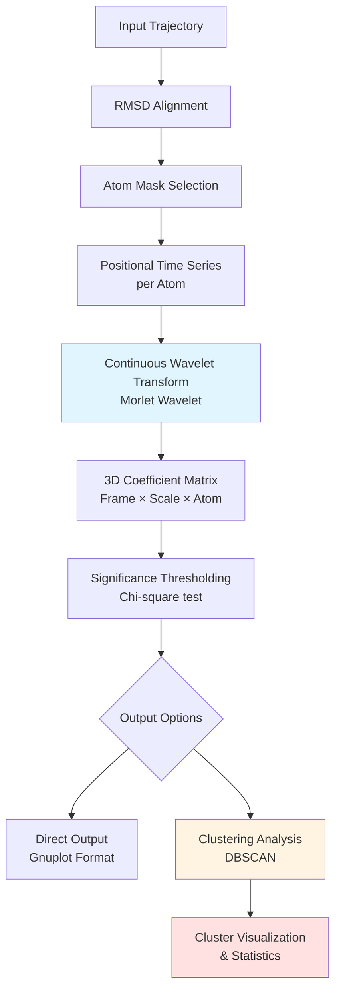
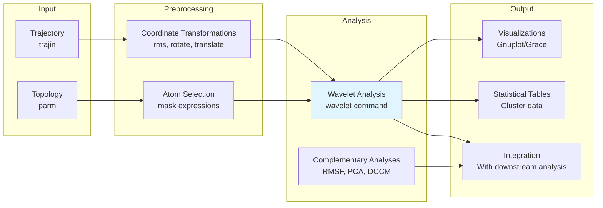

Wavelet analysis in CPPTRAJ provides a powerful method for detecting time-localized correlations in molecular dynamics trajectory data, enabling identification of transient structural patterns and conformational changes that traditional frequency-domain analysis may miss. This advanced feature implements continuous wavelet transforms (CWT) on atomic positional data, generating 3D mappings that reveal how correlations evolve across both time and spatial dimensions.

## Mathematical Foundation

Continuous wavelet transforms decompose time-series data using a family of wavelet functions localized in both time and frequency. Unlike Fourier analysis, which provides only frequency information, wavelet analysis preserves temporal information, making it ideal for detecting transient phenomena in MD trajectories where conformational states may appear and disappear over time scales.

The implementation currently supports the **Morlet wavelet**, defined as:

```
ψ(t) = π^(-1/4) * e^(iω₀t) * e^(-t²/2)
```

Where ω₀ is the central frequency parameter (controlled via the `correction` parameter), typically set to values around 1.0-6.0 for optimal balance between time and frequency resolution.

Sources: [test/Test_Wavelet/RunTest.sh](test/Test_Wavelet/RunTest.sh#L16-L18)

## Command Syntax and Parameters

The `wavelet` command operates as an action in CPPTRAJ's trajectory processing pipeline. The complete command syntax is:

```
wavelet <mask> [nb <N>] [s0 <S0>] [ds <DS>] [type <wavelet_type>] 
        [correction <corr>] [chival <chi>] [name <dataset_name>]
        [out <output_file>] [usemap]
        [cluster <clustermapout>] [clusterout <cluster_file>] 
        [minpoints <min>] [epsilon <eps>]
```

### Parameter Reference

| Parameter | Description | Default | Range |
|-----------|-------------|---------|-------|
| `<mask>` | Atom selection specifying which atoms to analyze | Required | Any valid mask expression |
| `nb <N>` | Number of octaves to analyze (frequency scales) | Required | Positive integer (e.g., 10) |
| `s0 <S0>` | Smallest scale parameter | Required | Positive float (e.g., 2.0) |
| `ds <DS>` | Spacing between successive scales | Required | Positive float (e.g., 0.25) |
| `type <wavelet_type>` | Wavelet function type | morlet | morlet |
| `correction <corr>` | Frequency correction factor for Morlet wavelet | 1.01 | Float (typically 1.0-6.0) |
| `chival <chi>` | Chi-square threshold value for significance | 0.25 | Float (0.0-1.0) |
| `name <dataset_name>` | Dataset name for output | Auto-generated | String |
| `out <output_file>` | Output file for wavelet coefficients | wavelet.gnu | Filename |
| `usemap` | Generate gnuplot-compatible 3D surface plot | No | Flag |
| `cluster <clustermapout>` | Enable clustering and specify map output | - | Filename |
| `clusterout <cluster_file>` | Clustering results output file | - | Filename |
| `minpoints <min>` | Minimum points for cluster formation | - | Positive integer |
| `epsilon <eps>` | DBSCAN clustering neighborhood radius | - | Positive float |

Sources: [test/Test_Wavelet/RunTest.sh](test/Test_Wavelet/RunTest.sh#L15-L22)

## Architecture Overview



The wavelet analysis pipeline transforms atomic coordinate fluctuations into a 3D correlation landscape where each point represents wavelet coefficient magnitude at a specific frame, scale (frequency), and atom. The optional clustering step identifies regions of significant correlation using DBSCAN (Density-Based Spatial Clustering of Applications with Noise) algorithm, automatically detecting spatially contiguous groups of correlated atoms.

Sources: [test/Test_Wavelet/RunTest.sh](test/Test_Wavelet/RunTest.sh#L15-L22), [test/Test_Wavelet/RunTest.sh](test/Test_Wavelet/RunTest.sh#L24-L30)

## Usage Examples

### Basic Wavelet Analysis

This example performs wavelet analysis on backbone atoms, generating a 3D surface plot:

```
parm protein.parm7
trajin trajectory.nc
rms @C,CA,N first

wavelet nb 10 s0 2 ds 0.25 type morlet correction 1.01 chival 0.25 \
        :1-22 out wavelet.gnu usemap
```

**Key points:**
- RMSD alignment to reference frame (`first`) removes overall translation/rotation
- Analyzes atoms 1-22 using backbone selection
- 10 octaves with initial scale 2.0 and spacing 0.25
- Significance threshold `chival 0.25` filters noise
- `usemap` flag creates gnuplot `pm3d map` format for visualization

Sources: [test/Test_Wavelet/RunTest.sh](test/Test_Wavelet/RunTest.sh#L11-L18)

### Wavelet Analysis with WAFEX Clustering

The Wavelet Atom Frequency EXtraction (WAFEX) extension identifies significant correlation clusters:

```
parm protein.parm7
trajin trajectory.nc
rms @C,CA,N first

wavelet nb 10 s0 2 ds 0.25 type morlet correction 1.01 chival 0.25 \
        :1-22 name DPDP \
        cluster clustermapout cluster.gnu clusterout cluster.dat \
          minpoints 66 epsilon 10.0
datafile cluster.gnu usemap palette kbvyw
```

**Clustering parameters:**
- `minpoints 66`: Minimum cluster size (determines significance)
- `epsilon 10.0`: Distance threshold for neighborhood determination
- Generates both visual map (`cluster.gnu`) and tabular statistics (`cluster.dat`)

Sources: [test/Test_Wavelet/RunTest.sh](test/Test_Wavelet/RunTest.sh#L24-L30)

## Output Format

### Gnuplot Surface Plot Format

The `usemap` option generates gnuplot-compatible output with 3D coordinate columns:

```gnuplot
set pm3d map
set xlabel "Frame"
set ylabel "Atom"
set yrange [   0.000: 334.000]
set xrange [   0.000: 102.000]
splot "-" with pm3d title "wavelet.gnu"
   1.000    1.000       0.0000
   1.000    2.000       0.0000
   1.000  102.000       4.8044
   1.000  125.000       9.6088
```

**Columns:**
- Column 1: Frame number (time dimension)
- Column 2: Atom index (spatial dimension)  
- Column 3: Wavelet coefficient magnitude (correlation strength)

Non-zero values indicate significant wavelet power at that frame-scale-atom intersection.

Sources: [test/Test_Wavelet/wavelet.gnu.save](test/Test_Wavelet/wavelet.gnu.save#L1-L15)

### Cluster Statistics Format

The clustering analysis produces a tabular summary:

```
#Cluster DPDP[points] DPDP[minatm] DPDP[maxatm] DPDP[minfrm] DPDP[maxfrm] DPDP[avgval]
       0         3255            1          234           62          100        8.964
       1          278          293          320           68          100        8.144
       2          241          254          281           64           93        8.887
```

**Column definitions:**
- `Cluster`: Cluster identifier (0, 1, 2, ...)
- `points`: Total data points in cluster (significance)
- `minatm`, `maxatm`: Atom index range
- `minfrm`, `maxfrm`: Frame range 
- `avgval`: Average wavelet coefficient (correlation strength)

This data identifies spatially coherent groups of atoms exhibiting similar temporal correlation patterns across specific frame ranges.

Sources: [test/Test_Wavelet/cluster.dat.save](test/Test_Wavelet/cluster.dat.save#L1-L5)

## Integration with Analysis Pipeline

Wavelet analysis integrates seamlessly with CPPTRAJ's trajectory processing workflow:



> [!TIP]
> **Practical Implementation Tip**: Wavelet analysis requires substantial computation (O(N²logN) complexity). For large systems, apply atom masks judiciously and consider reducing trajectory frame count or decreasing the number of octaves (`nb`) for initial exploratory analysis.

The analysis is typically positioned **after** trajectory preprocessing steps like RMSD alignment and atomic selection, but can be combined with other correlation analyses for comprehensive conformational dynamics characterization.

## Parameter Selection Guidelines

### Scale Parameters (`s0`, `ds`, `nb`)

The choice of wavelet scales determines the frequency resolution and computational cost:

| Application | s0 | ds | nb | Rationale |
|-------------|----|----|----|-----------|
| Fast fluctuations | 1.0-2.0 | 0.1-0.2 | 8-10 | Capture high-frequency motions |
| Slow domain motions | 4.0-8.0 | 0.3-0.5 | 6-8 | Focus on low-frequency modes |
| Full spectrum | 2.0-4.0 | 0.25-0.5 | 10-12 | Comprehensive analysis |

**Key considerations:**
- Smaller `s0` captures higher-frequency (faster) motions
- Larger `ds` reduces computation but coarsens frequency sampling
- Higher `nb` extends to lower frequencies but increases compute time

Sources: [test/Test_Wavelet/RunTest.sh](test/Test_Wavelet/RunTest.sh#L16)

### Significance Threshold (`chival`)

The chi-square threshold determines the statistical significance cutoff:

- `0.15-0.25`: Lenient threshold, includes more potential correlations (higher false positive rate)
- `0.30-0.45`: Moderate threshold, balanced sensitivity and specificity
- `0.50-0.70`: Strict threshold, only most significant correlations

> [!TIP]
> **Strategy**: Start with lenient thresholds (0.20-0.25) for exploratory analysis, then progressively increase to 0.35-0.45 for final reporting to ensure biological relevance of identified correlations.

### Clustering Parameters (`epsilon`, `minpoints`)

DBSCAN clustering requires careful tuning based on system size:

| System Size (atoms) | epsilon | minpoints | Recommended Strategy |
|---------------------|---------|-----------|----------------------|
| Small (<100) | 5.0-10.0 | 20-50 | Tight clustering, detailed resolution |
| Medium (100-500) | 10.0-20.0 | 50-150 | Balance resolution and aggregation |
| Large (>500) | 20.0-40.0 | 150-400 | Broad clusters, identify domains |

Sources: [test/Test_Wavelet/RunTest.sh](test/Test_Wavelet/RunTest.sh#L28-L29)

## Applications in Molecular Dynamics Analysis

### Domain Motion Detection

Wavelet analysis excels at identifying transient domain movements that may be averaged out in traditional correlation analysis:

1. **Protein-ligand binding**: Detect allosteric communication pathways with characteristic temporal patterns
2. **Conformational switches**: Identify intermediate states in large-scale domain rearrangements
3. **Loop dynamics**: Capture transient loop-closing events with specific time scales

### Comparison with Other Methods

| Method | Time Resolution | Frequency Resolution | Transient Detection | Computational Cost |
|--------|----------------|---------------------|-------------------|-------------------|
| Wavelet Analysis | High | Variable (scale-dependent) | Excellent | High |
| DCCM | None | Static correlation | Poor | Moderate |
| Principal Component Analysis | None | Global modes | Poor | Low-Moderate |
| Time-Correlation Functions | High | Single frequency | Limited | Low |

Sources: [README.md](README.md#L14-L15)

### Complementary Analyses

Wavelet analysis provides unique insights that complement other CPPTRAJ features:

- **[Principal Component Analysis (PCA)](13-principal-component-analysis-pca)**: Wavelet identifies when PCA modes are active
- **[RMSD and RMSF Calculations](10-rmsd-and-rmsf-calculations)**: Combine RMSF with wavelet to understand temporal context of fluctuations
- **[Contact Analysis](18-contact-analysis-and-native-contacts)**: Correlate wavelet clusters with contact formation/breakage

## Performance Considerations

### Computational Complexity

The continuous wavelet transform has O(N × S × A) complexity where:
- N = Number of frames
- S = Number of scales (nb × 1/ds)
- A = Number of atoms in selection

**Memory requirements**: For large systems, wavelet coefficient matrices can consume significant RAM. Consider:
- Reducing trajectory length with `trajin ... start stop offset`
- Limiting atom selection to residues of interest
- Decreasing scale resolution with larger `ds` values

### Optimization Strategies

1. **Trajectory preprocessing**: Perform RMSD alignment before wavelet analysis to remove overall translation/rotation artifacts
2. **Atom selection**: Use focused masks rather than entire system
3. **Scale optimization**: Start with fewer octaves (nb=6-8) for initial exploration
4. **Parallelization**: Compile with `-openmp` for multi-threaded performance (requires FFTW)

Sources: [configure](configure#L31-L32), [README.md](README.md#L59-L61)

## Next Steps

For comprehensive conformational dynamics analysis, consider these related features:

- **[Time-Correlation Functions and Spectral Analysis](14-time-correlation-functions-and-spectral-analysis)**: Extend wavelet findings with frequency-domain analysis
- **[Clustering Algorithms](17-clustering-algorithms-k-means-dbscan-hierarchical)**: Apply frame-based clustering to correlate with wavelet clusters
- **[Ensemble Analysis](27-ensemble-analysis-remd-mremd-hremd)**: Apply wavelet analysis across replica exchange trajectories
- **[Normal Mode Analysis](24-normal-mode-analysis-and-eigenmode-calculations)**: Compare wavelet-identified motions with normal mode predictions

Wavelet analysis provides a unique window into the temporal dynamics of molecular systems, revealing correlations that evolve over time scales crucial for understanding conformational changes, allosteric mechanisms, and transient binding events in molecular dynamics simulations.
