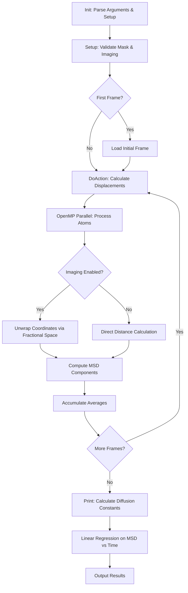
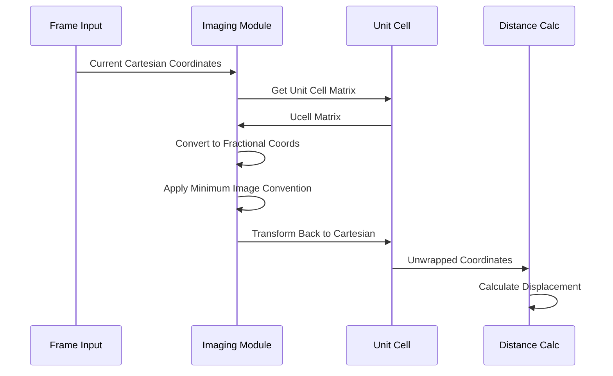

Diffusion coefficient analysis in cpptraj provides a comprehensive framework for calculating mean square displacement (MSD) and deriving diffusion constants from molecular dynamics trajectories. This implementation supports advanced features including periodic boundary condition correction, parallel processing, and individual atom tracking—making it suitable for complex diffusion studies in biological and materials systems.

## Theoretical Foundation and Architecture

The diffusion analysis action (`Action_Diffusion`) implements the Einstein-Smoluchowski relationship for calculating diffusion coefficients from molecular trajectories. The fundamental equation relates the mean square displacement to time:

**D = MSD / (2Nt)**

where N is the dimensionality (1 for directional, 3 for isotropic), t is time, and MSD is the mean square displacement. The architecture separates concerns between displacement calculation during trajectory processing and post-processing analysis for diffusion constant determination.

The system uses a modular design with three primary components: the main action class for trajectory iteration and displacement calculation, the results calculator for statistical analysis, and supporting infrastructure for imaging and parallelization. This separation enables efficient processing of large trajectories while maintaining flexibility in analysis options.

**Calculation Flow Architecture:**



Sources: [Action_Diffusion.h](src/Action_Diffusion.h#L6-L62), [Action_Diffusion.cpp](src/Action_Diffusion.cpp#L354-L480)

## Core Calculation Methodology

### Mean Square Displacement Computation

The core displacement calculation occurs in the `DoAction` method, which processes each frame to compute distances from reference positions. For systems without imaging, the calculation is straightforward: the displacement vector components (delx, dely, delz) are computed as the difference between current and initial Cartesian coordinates [Action_Diffusion.cpp#L432-L437](src/Action_Diffusion.cpp#L432-L437). The squared components are then accumulated across selected atoms to compute the MSD.

For systems with periodic boundary conditions, cpptraj employs a sophisticated imaging correction algorithm. The process converts Cartesian coordinates to fractional space, applies minimum image convention corrections, and then transforms back to Cartesian space for displacement calculation [Action_Diffusion.cpp#L414-L431](src/Action_Diffusion.cpp#L414-L431). This ensures that atoms crossing periodic boundaries contribute correctly to the diffusion calculation.

**Implementation Detail:**

```cpp
// Fractional coordinate transformation with minimum image correction
Vec3 xyz_frac = frm.Frm().BoxCrd().FracCell() * Vec3(XYZ);
Vec3 ixyz = xyz_frac - previousFrac_[imask];
ixyz[0] = ixyz[0] - round(ixyz[0]);  // Minimum image convention
ixyz[1] = ixyz[1] - round(ixyz[1]);
ixyz[2] = ixyz[2] - round(ixyz[2]);
xyz_frac = previousFrac_[imask] + ixyz;
Vec3 xyz_cart1 = ucell->TransposeMult( xyz_frac );
previousFrac_[imask] = xyz_frac;  // Update reference
```

Sources: [Action_Diffusion.cpp](src/Action_Diffusion.cpp#L414-L427)

### Statistical Aggregation

The system calculates five primary statistics for each frame: directional MSDs (X, Y, Z), total MSD (R), and total distance traveled (A). These are maintained as separate data sets with configurable output. The accumulation uses OpenMP parallelization with reduction clauses to safely sum contributions across threads [Action_Diffusion.cpp#L400-L462](src/Action_Diffusion.cpp#L400-L462).

> [!TIP]
> The parallel reduction implementation ensures thread safety while maintaining performance. The `reduction(+ : average2, avgx, avgy, avgz)` clause automatically handles the accumulation of squared displacements across OpenMP threads without requiring explicit synchronization.

Sources: [Action_Diffusion.cpp](src/Action_Diffusion.cpp#L400-L462)

## Configuration and Command Syntax

### New vs. Legacy Syntax

The diffusion action supports both modern and legacy command syntaxes. The modern syntax provides greater flexibility in output control and diffusion constant calculation, while the legacy syntax maintains backward compatibility with older scripts.

**Modern Syntax Options:**

| Keyword | Description | Default |
|---------|-------------|---------|
| `out <filename>` | Single output file for all components | None (console only) |
| `separateout <suffix>` | Separate files for X, Y, Z, R, A components with suffix | None |
| `time <dt>` | Time step between frames (ps) | 1.0 ps |
| `<mask>` | Atom selection mask | All atoms |
| `<set name>` | Base name for data sets | "Diff" |
| `individual` | Track per-atom diffusion | False |
| `diffout <filename>` | Output file for diffusion constants | None |
| `nocalc` | Skip diffusion constant calculation | False |
| `noimage` | Disable periodic boundary correction | Auto-detect |
| `avgucell <set>` | Use average unit cell for imaging | None |
| `allowmultipleorigins` | Enable MPI multiple time origins (MPI only) | False |

Sources: [Action_Diffusion.cpp](src/Action_Diffusion.cpp#L91-L121), [Action_Diffusion.cpp](src/Action_Diffusion.cpp#L33-L40)

### Data Set Management

The action creates five primary data sets for average calculations, each storing time-series data for a specific component. When `individual` tracking is enabled, additional data sets are created for each atom in the selection mask. The X dimension of all data sets is automatically configured with the time parameter to enable proper dimensional analysis [Action_Diffusion.cpp#L152-L175](src/Action_Diffusion.cpp#L152-L175).

Data set naming follows the convention `<base>_<component>` where components are X, Y, Z, R (radial/total MSD), and A (total distance). Individual atom data sets append the atom index to this base name. This naming scheme enables programmatic access to specific components in post-processing scripts.

Sources: [Action_Diffusion.cpp](src/Action_Diffusion.cpp#L152-L175)

## Advanced Features

### Periodic Boundary Condition Handling

Imaging support is critical for accurate diffusion calculations in periodic systems. The implementation detects unit cell presence automatically but can be manually controlled with the `noimage` keyword. When imaging is enabled, the system tracks fractional coordinates across frames to apply minimum image corrections [Action_Diffusion.cpp#L254-L279](src/Action_Diffusion.cpp#L254-L279).

For systems with significant box fluctuations, the `avgucell` keyword allows specification of an average unit cell matrix to remove box size variations from the diffusion calculation. This is particularly important for NPT simulations where box dimensions change over time [Action_Diffusion.cpp#L122-L150](src/Action_Diffusion.cpp#L122-L150).

**Imaging Workflow:**



Sources: [Action_Diffusion.cpp](src/Action_Diffusion.cpp#L254-L279)

### Parallel Processing Strategies

The implementation supports two parallelization strategies with different trade-offs. OpenMP parallelization is automatically enabled when available, distributing atom processing across threads within a single node [Action_Diffusion.cpp#L400-L465](src/Action_Diffusion.cpp#L400-L465). This provides near-linear speedup for systems with many atoms.

MPI parallelization offers trajectory-level parallelism but has constraints. Without imaging, MPI can process trajectory segments independently. However, with imaging enabled, standard MPI execution is prohibited because imaging corrections depend on continuous trajectories. The solution is the `allowmultipleorigins` mode, which treats each MPI rank as an independent time origin and averages results across ranks [Action_Diffusion.cpp#L258-L274](src/Action_Diffusion.cpp#L258-L274).

**Parallel Execution Comparison:**

| Strategy | Granularity | Imaging Support | Use Case |
|----------|-------------|-----------------|----------|
| OpenMP | Per-atom | Full | Large systems, single node |
| MPI (Standard) | Per-trajectory segment | None | Pre-unwrapped trajectories |
| MPI (Multiple Origins) | Per-time-origin | Full (special mode) | Long trajectories, imaging required |

Sources: [Action_Diffusion.cpp](src/Action_Diffusion.cpp#L258-L291), [Action_Diffusion.cpp](src/Action_Diffusion.cpp#L483-L562)

### Multiple Time Origins Algorithm

When `allowmultipleorigins` is enabled with imaging, each MPI rank calculates diffusion from its own reference frame. The `SyncAction` method collects these independent results and performs an ensemble average across all time origins [Action_Diffusion.cpp#L531-L562](src/Action_Diffusion.cpp#L531-L562). This approach maintains imaging accuracy while distributing computational load.

The algorithm handles rank-to-master data transfer, ensuring proper synchronization of data set sizes and performing weighted averages based on the number of samples from each time origin. This statistical approach improves the signal-to-noise ratio for diffusion constant estimation.

Sources: [Action_Diffusion.cpp](src/Action_Diffusion.cpp#L483-L562)

## Diffusion Constant Calculation

### Linear Regression Method

Diffusion constants are calculated during the `Print` phase using linear regression on the MSD vs. time data. The `DiffusionResults::CalcDiffusionConst` method performs the regression and applies the dimensional scaling factor [Action_Diffusion.cpp#L566-L590](src/Action_Diffusion.cpp#L566-L590). The slope of the linear fit is related to the diffusion coefficient by:

**D = slope × (10⁻⁵)/(2N)**

where the 10⁻⁵ factor converts from Ų/ps to cm²/s, and N is the dimensionality (1 for directional, 3 for isotropic diffusion).

The regression automatically handles the appropriate scaling based on the data set being analyzed. Radial MSD sets (R) use N=3 for isotropic diffusion, while directional sets (X, Y, Z) use N=1 for anisotropic diffusion components [Action_Diffusion.cpp#L571-L574](src/Action_Diffusion.cpp#L571-L574).

> [!TIP]
> The diffusion constant calculation assumes linear MSD behavior in the long-time limit. For systems exhibiting anomalous diffusion (sub-diffusive or super-diffusive), the linear regression will not capture the true transport properties. Consider analyzing the MSD time-dependence to identify linear regimes before calculating diffusion constants.

Sources: [DiffusionResults.cpp](src/DiffusionResults.cpp#L83-L102), [Action_Diffusion.cpp](src/Action_Diffusion.cpp#L566-L581)

## Implementation Considerations and Best Practices

### Memory Management

The implementation carefully manages memory for large-scale analyses. Fractional coordinate arrays (`previousFrac_`) are reserved with the exact size needed for the selected atom mask [Action_Diffusion.cpp#L282-L283](src/Action_Diffusion.cpp#L282-L283). Individual atom tracking data sets are dynamically allocated only for atoms in the mask, with bounds checking to prevent memory access errors [Action_Diffusion.cpp#L310-L343](src/Action_Diffusion.cpp#L310-L343).

### Error Handling and Validation

The action includes comprehensive validation at each stage. Time parameters must be positive, unit cell data sets must be non-empty MAT3X3 matrices, and atom masks must select at least one atom [Action_Diffusion.cpp#L50-L56](src/Action_Diffusion.cpp#L50-L56). Imaging compatibility with MPI modes is validated to prevent incorrect results [Action_Diffusion.cpp#L258-L274](src/Action_Diffusion.cpp#L258-L274).

### Performance Optimization

Key optimizations include pre-allocated data structures, OpenMP parallelization with reduction operations, and minimized data copying. The fractional coordinate transformation uses efficient matrix operations, and the imaging correction avoids costly square root operations until the final distance calculation [Action_Diffusion.cpp#L438-L447](src/Action_Diffusion.cpp#L438-L447).

**Performance Considerations Table:**

| Factor | Impact | Optimization Strategy |
|--------|--------|----------------------|
| Atoms per mask | Linear | OpenMP parallelization |
| Trajectory length | Linear | Streaming processing |
| Individual tracking | O(n_atoms) | Conditional allocation |
| Imaging overhead | Moderate | Pre-computed fractional transforms |

## Integration with Trajectory Processing Pipeline

The diffusion action integrates with cpptraj's action framework, following the standard Init-Setup-DoAction-Print lifecycle. The action works seamlessly with other analysis commands, enabling multi-stage processing pipelines. For comprehensive analysis, combine diffusion calculations with [Principal Component Analysis](13-principal-component-analysis-pca) to identify dominant motion modes or [Clustering Algorithms](17-clustering-algorithms-k-means-dbscan-hierarchical) to analyze diffusive sub-states.

Proper mask specification is critical for meaningful results. Consider using [Atom Selection and Mask Expressions](6-atom-selection-and-mask-expressions) to select relevant atoms (e.g., water molecules for solvent diffusion, protein residues for internal mobility). The time parameter should match your trajectory's frame interval to ensure correct temporal units.

For trajectories requiring coordinate transformations, ensure that imaging corrections are applied in the correct order relative to [Coordinate Transformations](8-coordinate-transformations-rmsd-alignment-rotation) and [Periodic Boundary Conditions](9-periodic-boundary-conditions-and-imaging) processing.
