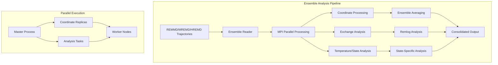

Ensemble analysis in CPPTRAJ provides sophisticated capabilities for processing and analyzing molecular dynamics trajectory data from replica exchange simulations, including standard REMD (Replica Exchange Molecular Dynamics), MREMD (Multi-dimensional REMD), and HREMD (Hamiltonian REMD). These advanced parallel sampling methods require specialized tools for analyzing the ensemble of trajectories generated across multiple temperature or Hamiltonian states.

## Ensemble Analysis Architecture Overview

CPPTRAJ's ensemble analysis framework leverages MPI parallelization to enable large-scale processing of multiple replica trajectories simultaneously. This architecture allows for efficient computation of ensemble-averaged properties, temperature-dependent observables, and exchange statistics across replicas.



Sources: [README.md](/README.md#L38-L43), [test/Test_Ensemble_HREMD](/test/Test_Ensemble_HREMD), [test/Test_Ensemble_MREMD](/test/Test_Ensemble_MREMD)

## REMD Analysis Capabilities

Replica Exchange Molecular Dynamics (REMD) generates multiple trajectories at different temperatures, allowing for efficient sampling across a temperature range. CPPTRAJ provides comprehensive tools for analyzing these ensemble datasets.

### REMD Trajectory Reading

CPPTRAJ can read ensemble trajectory data where multiple replica coordinates are stored across multiple files or within ensemble-formatted trajectories. The ensemble reader automatically handles the mapping between replica IDs and temperature states based on remlog files or temperature specification.

Key capabilities include:
- **Multi-trajectory ensemble reading**: Load multiple trajectory files representing different replicas
- **Temperature-based filtering**: Analyze subsets of replicas based on temperature ranges
- **Exchange coordinate reconstruction**: Access coordinates before and after exchange attempts
- **Ensemble-averaged property calculation**: Compute observables across all replicas

Sources: [README.md](/README.md#L111-L115), [test/Test_RemdTraj](/test/Test_RemdTraj)

### REMLog Analysis

The remlog file contains critical information about exchange attempts, success rates, and replica state transitions. CPPTRAJ's remlog analysis capabilities enable:

- **Exchange success rate calculation**: Track how frequently exchanges succeed across temperature pairs
- **Replica round-trip time analysis**: Measure how long replicas take to traverse the temperature ladder
- **State residence time analysis**: Determine how long replicas remain at specific temperatures
- **Transition matrix construction**: Build detailed exchange probability matrices

Sources: [test/Test_Remlog](/test/Test_Remlog)

## MREMD (Multi-dimensional REMD) Analysis

MREMD extends standard REMD by exchanging along multiple dimensions simultaneously, typically combining temperature with another parameter such as Hamiltonian scaling, ligand coupling, or alchemical coordinates. CPPTRAJ supports multi-dimensional ensemble analysis through enhanced coordinate and state mapping.

### Multi-Dimensional State Management

MREMD trajectories require careful handling of replica coordinates across multiple exchange dimensions:

- **Multi-dimensional replica indexing**: Track replica positions in a multi-dimensional exchange space
- **Dimension-specific filtering**: Analyze replicas based on state combinations across dimensions
- **Cross-dimensional correlation**: Study how exchange success correlates across different dimensions
- **Dimension reduction**: Project multi-dimensional ensembles onto specific dimensions for analysis

Sources: [test/Test_Ensemble_MREMD](/test/Test_Ensemble_MREMD)

## HREMD (Hamiltonian REMD) Analysis

Hamiltonian Replica Exchange Molecular Dynamics varies the Hamiltonian function rather than temperature, enabling sampling across different potential energy surfaces. This approach is particularly valuable for alchemical free energy calculations and studying the effects of different force field parameters.

### Hamiltonian State Analysis

HREMD analysis focuses on energy and structural differences across Hamiltonian states:

- **Energy difference tracking**: Monitor energy gaps between Hamiltonian states
- **Structural convergence analysis**: Compare structural ensembles across different Hamiltonians
- **Exchange barrier analysis**: Understand free energy barriers between Hamiltonian states
- **State-specific property calculation**: Compute observables specific to each Hamiltonian

Sources: [test/Test_Ensemble_HREMD](/test/Test_Ensemble_HREMD)

## Ensemble Analysis Commands

CPPTRAJ provides specific commands for ensemble-based analysis that can process multiple replicas simultaneously.

### Distance Analysis Across Ensembles

Calculate distances, angles, and other geometric measurements across all replicas to understand temperature or Hamiltonian-dependent behavior:

```
ensemble distance :1-10 out distances.dat ensemble
```

This command computes the specified distance for all ensemble members and outputs individual replica results along with ensemble statistics.

Sources: [test/Test_Ensemble_HREMD/distances.dat.0.save](/test/Test_Ensemble_HREMD/distances.dat.0.save)

### Ensemble Averaging

Compute averaged observables across the ensemble to obtain representative values:

```
ensemble average avg.distances.dat avg.distances.dat.save
```

Ensemble averaging provides both mean values and variance information across replicas, enabling statistical analysis of ensemble properties.

Sources: [test/Test_Ensemble_HREMD/avg.distances.dat.save](/test/Test_Ensemble_HREMD/avg.distances.dat.save)

## Parallel Processing Architecture

CPPTRAJ's ensemble analysis is optimized for MPI parallelization, enabling distributed processing of large ensemble datasets across multiple compute nodes.

### MPI Ensemble Parallelization

The parallel architecture supports two primary modes of ensemble processing:

1. **Trajectory parallelization**: Each MPI process handles a subset of the trajectory frames for each replica
2. **Ensemble parallelization**: Each MPI process handles one or more complete replicas

This flexibility allows users to optimize performance based on their specific ensemble size and computational resources. When using both MPI and OpenMP, careful thread management is required to avoid oversubscription—the product of MPI processes and OpenMP threads should not exceed the number of physical cores.

Sources: [README.md](/README.md#L111-L115), [README.md](/README.md#L112-L116)

## Ensemble Data Output

CPPTRAJ provides multiple output formats for ensemble analysis results:

### Per-Replica Output

Individual replica data can be output with replica-indexed filenames, facilitating downstream analysis workflows that require separate processing of each replica state.

### Sorted Coordinate Output

Ensemble coordinates can be sorted and output based on specific criteria (e.g., temperature, Hamiltonian state) to generate trajectory files that represent continuous evolution along a particular dimension of the exchange space.

Sources: [test/Test_Ensemble_HREMD/sorted.remlog.crd.0.save](/test/Test_Ensemble_HREMD/sorted.remlog.crd.0.save)

## Best Practices for Ensemble Analysis

### Memory Management

Large ensemble datasets can consume significant memory. Consider:

- Using trajectory filtering to load only necessary frames
- Processing ensembles in chunks for extremely large datasets
- Leveraging parallel I/O capabilities for distributed storage access

### Exchange Statistics Validation

Always validate exchange statistics before proceeding with detailed analysis:

- Confirm exchange rates fall within expected ranges (typically 20-40% for well-tuned REMD)
- Check for replica trapping or slow exchange phenomena
- Verify temperature distributions match target values

### Ensemble Convergence Assessment

Assess ensemble convergence through multiple metrics:

- Replica round-trip times
- Convergence of ensemble-averaged observables
- Stability of exchange probability matrices
- Per-replica property distributions

Sources: [README.md](/README.md#L136-L141)

## Integration with Other Analysis Methods

Ensemble analysis can be combined with CPPTRAJ's extensive analysis toolkit:

- **Clustering**: Apply clustering algorithms to individual replicas or the combined ensemble
- **PCA**: Perform principal component analysis across ensemble states
- **Free energy calculations**: Use ensemble data for WHAM or MBAR analysis
- **Correlation functions**: Compute time correlations within and between replicas

For detailed information on these methods, refer to [Principal Component Analysis (PCA)](13-principal-component-analysis-pca), [Clustering Algorithms](17-clustering-algorithms-k-means-dbscan-hierarchical), and [Free Energy Calculations](21-free-energy-calculations-ti-mm-pbsa).

## Performance Optimization

### Build Configuration

For optimal ensemble analysis performance, build CPPTRAJ with MPI support:

```bash
./configure -mpi gnu
make install
```

For hybrid MPI/OpenMP parallelization:

```bash
./configure -mpi -openmp gnu
make install
```

Sources: [README.md](/README.md#L111-L112)

### Resource Allocation

Allocate resources based on your ensemble size and analysis requirements:

- **Small ensembles (<10 replicas)**: Consider single-node processing with OpenMP threading
- **Medium ensembles (10-50 replicas)**: MPI parallelization across multiple nodes
- **Large ensembles (>50 replicas)**: Hybrid MPI/OpenMP with careful core allocation

## Next Steps

To continue exploring CPPTRAJ's advanced features:

- **Parallelization details**: See [MPI Parallelization](30-mpi-parallelization-for-large-scale-analysis) for in-depth MPI usage
- **Statistical methods**: Explore [Correlation Functions](12-correlation-functions-auto-correlation-cross-correlation) for ensemble time-series analysis
- **Temperature analysis**: Review [Diffusion Coefficients](26-diffusion-coefficients) for temperature-dependent property calculations

For ensemble-specific examples and tutorials, consult the test directories in [Test_Ensemble_HREMD](/test/Test_Ensemble_HREMD) and [Test_Ensemble_MREMD](/test/Test_Ensemble_MREMD), which provide working examples of ensemble analysis workflows.