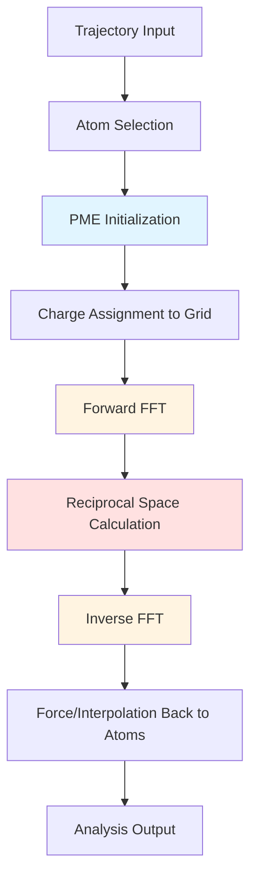
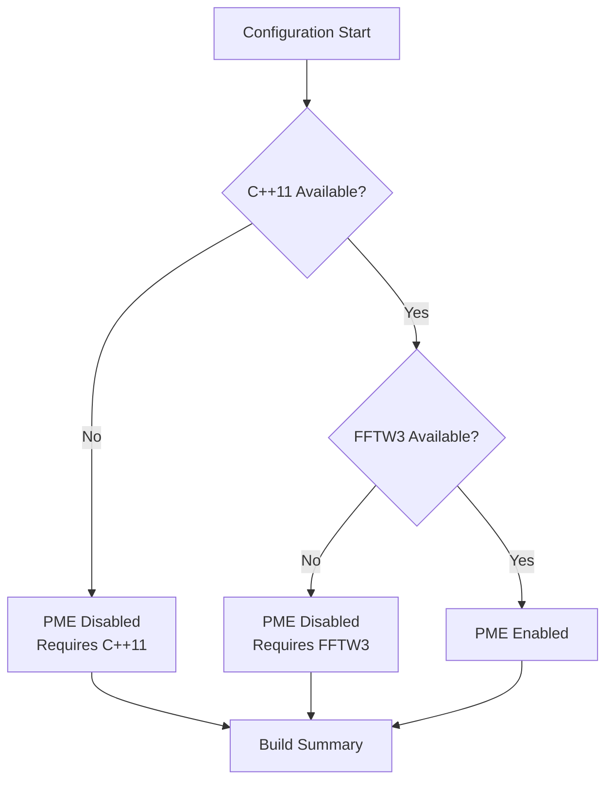

This section provides comprehensive documentation for Particle Mesh Ewald (PME) electrostatic calculations in CPPTRAJ. PME is a critical method for efficient computation of long-range electrostatic interactions in molecular dynamics simulations, utilizing Fast Fourier Transform (FFT) algorithms to achieve O(N log N) computational complexity instead of the O(N²) complexity of direct summation methods.

## Architecture Overview

CPPTRAJ's PME implementation integrates with the trajectory analysis pipeline to enable electrostatic calculations that account for periodic boundary conditions and long-range interactions. The architecture centers around FFT-based spatial decomposition and charge spreading operations.



The PME implementation depends fundamentally on the FFTW3 library, which provides high-performance FFT capabilities. When FFTW3 is available, CPPTRAJ enables full PME functionality; otherwise, it falls back to the bundled pub_fft implementation which does not support PME calculations.
Sources: [configure](configure#L70), [configure](configure#L2995-L2997)

## System Requirements and Configuration

### Build Dependencies

PME calculations require specific build-time dependencies to function correctly. The configuration process automatically detects and enables PME support when requirements are met.

| Requirement | Description | Default Status |
|------------|-------------|----------------|
| **FFTW3 Library** | Fast Fourier Transform library for efficient reciprocal space calculations | Enabled if detected |
| **C++11 Support** | Required compiler standard for PME implementation | Enabled by default |
| **Math Libraries** | BLAS/LAPACK for linear algebra operations | Optional but recommended |

### Configuration Options

The build system provides several options to control PME compilation:

**Enabling PME (Default):**
```bash
./configure --with-fftw3=<path_to_fftw3>
```

**Disabling PME Support:**
```bash
./configure -pubfft
```
This option forces use of the bundled pub_fft implementation instead of FFTW3, which disables PME functionality while retaining basic FFT capabilities.
Sources: [configure](configure#L70)

**Using MKL FFTW:**
When Intel MKL is available, CPPTRAJ can use MKL's optimized FFTW implementation:
```bash
./configure -mkl
```
Use `-nomklfftw` to prevent automatic detection and usage of MKL FFTW.
Sources: [configure](configure#L67-L2996)

### Configuration Detection

The configure script performs automatic detection of PME requirements:



During the configuration process, the build system explicitly reports PME support status. When both C++11 and FFTW3 are available, the configuration summary confirms PME support is enabled.
Sources: [configure](configure#L2992-L2997)

## Implementation Details

### FFT Backend Selection

CPPTRAJ uses a conditional compilation approach to select the FFT backend:

**FFTW3 Backend (PME Enabled):** When FFTW3 is detected and C++11 support is available, the build system uses FFTW3 for all FFT operations. This enables:
- Full PME reciprocal space calculations
- Optimized multi-threaded FFT execution
- Support for various FFT algorithms and planning strategies

**pub_fft Backend (PME Disabled):** When FFTW3 is explicitly disabled or not available, CPPTRAJ falls back to the bundled pub_fft implementation. This provides basic FFT capabilities for other analyses but does not support PME calculations.
Sources: [configure](configure#L3117-L3119)

### Build Target Integration

The PME/FFT backend selection is integrated into the build system through conditional target generation. The Makefile targets are determined based on library availability:

```makefile
# FFT target selection
ifeq ($(LIB_STAT[$LFFTW3]), off)
    FFT_TARGET = pub_fft.o
else
    FFT_TARGET = 
endif
```

This conditional logic ensures that appropriate FFT implementation files are compiled based on the configuration choices.
Sources: [configure](configure#L3117-L3119)

## Verification and Troubleshooting

### Checking PME Support Status

After configuration, verify PME support status by examining the configuration summary output. The following indicators confirm PME availability:

**Successful PME Configuration:**
```
Configuration summary:
  Options: fftw3 ...
  C++11 support enabled.
  PME support enabled.
```

**Disabled PME Configuration:**
```
Configuration summary:
  Options: ...
  C++11 support enabled.
  PME support disabled (requires FFTW3).
```
or
```
Configuration summary:
  Options: ...
  C++11 support disabled.
  PME support disabled (requires C++11 and FFTW3).
```
Sources: [configure](configure#L2992-L2999)

### Common Issues and Solutions

| Issue | Cause | Solution |
|-------|-------|----------|
| **PME support disabled** | FFTW3 not found | Install FFTW3: `./configure --with-fftw3=/path/to/fftw3` or use `-makeblas` to build automatically |
| **PME support disabled** | C++11 not available | Update compiler to support C++11 (GCC ≥4.8.1, Clang ≥3.3) |
| **Performance issues** | Using pub_fft backend | Enable FFTW3 with `-fftw3` option for optimized performance |
| **MKL FFTW not detected** | MKL not in standard path | Set `MKL_HOME` or `MKLROOT` environment variable |

## Integration with CPPTRAJ Analysis Pipeline

PME calculations in CPPTRAJ are designed to work seamlessly with the trajectory processing pipeline. The electrostatic calculations can be integrated with other analyses including:

- **Energy Analysis:** Combining PME electrostatic energies with other energy terms for comprehensive thermodynamic analysis
- **Structural Analysis:** Correlating electrostatic properties with structural features
- **Trajectory Processing:** Applying PME calculations across trajectory frames with proper periodic boundary condition handling

For detailed information on related energy and thermodynamics analyses, see [Energy Extraction and Analysis](20-energy-extraction-and-analysis) and [Free Energy Calculations](21-free-energy-calculations-ti-mm-pbsa).

## Performance Optimization

### Multi-threading Support

When FFTW3 is compiled with thread support, CPPTRAJ can leverage multi-threading for PME calculations. The FFTW3 build options used by CPPTRAJ include `--enable-threads --with-combined-threads` for optimal parallel performance.
Sources: [configure](configure#L165)

### Compiler Optimizations

PME performance benefits significantly from compiler optimizations. The build system supports:
- **Basic Optimization:** Enabled by default (`-O2` level)
- **Host-specific Tuning:** Use `-tune` for architecture-specific optimizations
- **Debug Builds:** Use `-debug` or `-d` for debugging with reduced optimization

For advanced performance optimization strategies, see [OpenMP Multi-threading](29-openmp-multi-threading) and [MPI Parallelization for Large-scale Analysis](30-mpi-parallelization-for-large-scale-analysis).

## Next Steps

After configuring PME support, explore the following related topics:

- **Energy Analysis:** [Energy Extraction and Analysis](20-energy-extraction-and-analysis) for integrating PME energies with other energy terms
- **Periodic Boundary Conditions:** [Periodic Boundary Conditions and Imaging](9-periodic-boundary-conditions-and-imaging) for understanding PBC handling
- **Parallelization:** [OpenMP Multi-threading](29-openmp-multi-threading) for optimizing PME performance on multi-core systems
- **Configuration:** [Installation and Configuration](3-installation-and-configuration) for comprehensive build system documentation