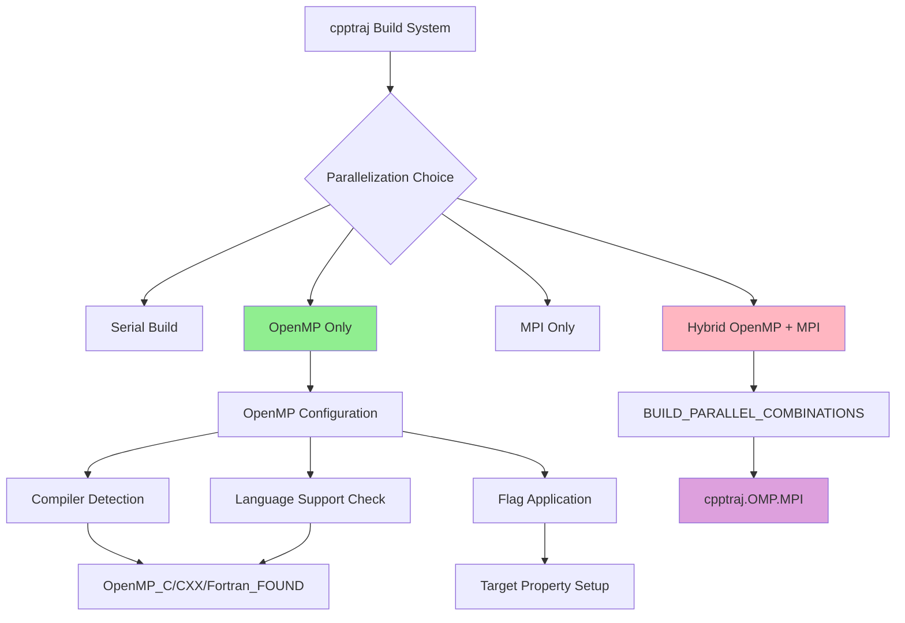

OpenMP provides shared-memory parallelization capabilities in cpptraj, enabling efficient multi-threaded execution of computationally intensive trajectory analysis operations on multi-core systems. This parallelization strategy complements MPI's distributed-memory approach, allowing users to scale analysis both across nodes (via MPI) and within individual nodes (via OpenMP).

## Architecture Overview

OpenMP integration in cpptraj follows a hierarchical parallelization model where thread-level parallelism accelerates frame-level and coordinate-level operations within individual analysis routines. The build system provides flexible configuration options for enabling OpenMP support across different compiler ecosystems and deployment scenarios.



Sources: [CMakeLists.txt](/CMakeLists.txt#L32-L37), [OpenMPConfig.cmake](/cmake-cpptraj/OpenMPConfig.cmake#L1-L25)

## Build Configuration

### Enabling OpenMP Support

OpenMP must be explicitly enabled during the build configuration phase. The build system provides multiple pathways for activation:

**CMake Configuration:**

The CMake build system includes dedicated OpenMP configuration through the `OpenMPConfig.cmake` module. To enable OpenMP, set the `OPENMP` option to TRUE before or during CMake configuration. The configuration automatically:

1. Detects OpenMP support for each enabled language (C, C++, Fortran)
2. Validates compiler compatibility (e.g., excludes incompatible configurations like Dragonegg)
3. Applies appropriate compiler flags to targets requiring parallelization
4. Sets up library linking for OpenMP runtime components

Sources: [OpenMPConfig.cmake](/cmake-cpptraj/OpenMPConfig.cmake#L2-L40)

**Configure Script:**

The traditional `./configure` build system provides the `-openmp` flag for enabling OpenMP parallelization:

```bash
./configure -openmp gnu
```

This option integrates with the broader build option system and can be combined with other parallelization flags for hybrid configurations.

Sources: [configure](/configure#L18-L20), [configure](/configure#L28-L35)

### Compiler Detection and Validation

The OpenMP configuration performs rigorous validation of compiler capabilities. For each language enabled in the build (C, C++, Fortran), the system checks for OpenMP support via the `FindOpenMPFixed` module. If OpenMP is requested but not supported for any enabled language, the build system emits a fatal error requiring either OpenMP deactivation or compiler substitution.

Sources: [OpenMPConfig.cmake](/cmake-cpptraj/OpenMPConfig.cmake#L10-L20)

### Hybrid Parallelization Configuration

cpptraj supports building combined OpenMP and MPI variants through the `BUILD_PARALLEL_COMBINATIONS` CMake option. When enabled, this creates specialized executable targets such as `cpptraj.OMP.MPI` that leverage both shared-memory and distributed-memory parallelism simultaneously. The option defaults to FALSE to avoid unnecessary build overhead for single-parallelization deployments.

Sources: [CMakeLists.txt](/CMakeLists.txt#L40-L41)

## Build System Implementation Details

### OpenMP Object Library Macro

The `openmp_object_library` macro encapsulates the application of OpenMP compilation flags to object library targets. This macro handles both standard flag application and generator expression-based flag application for complex build configurations:

- **Generator Expression Mode**: Used when `MCPAR_WORKAROUND_ENABLED` is true, applying flags conditionally based on compile language via generator expressions
- **Standard Mode**: Directly applies OpenMP flags to target compile options
- **Include Path Integration**: Adds OpenMP-specific include directories to the target

Sources: [OpenMPConfig.cmake](/cmake-cpptraj/OpenMPConfig.cmake#L41-L56)

### Target Version Creation

The `make_openmp_version` function provides automated creation of OpenMP-enabled variants of existing targets. This function supports:

- **Target Copying**: Creates new targets from existing ones with OpenMP support
- **Source Swapping**: Allows replacement of specific source files with OpenMP-optimized versions via `SWAP_SOURCES` argument
- **Language Specification**: Applies OpenMP flags selectively to specified languages (C, CXX, Fortran)
- **Installation Control**: Installs OpenMP targets to the `OpenMP` component when `INSTALL` flag is specified
- **Dependency Management**: Ensures OpenMP targets build after their serial counterparts through `add_dependencies`

Sources: [OpenMPConfig.cmake](/cmake-cpptraj/OpenMPConfig.cmake#L58-L112)

### Library Registration and Tracking

When OpenMP is enabled, the configuration system registers OpenMP libraries with the external library tracker using `using_external_libraries`. This integration ensures proper linking and dependency resolution throughout the build process.

Sources: [OpenMPConfig.cmake](/cmake-cpptraj/OpenMPConfig.cmake#L26-L31)

## Parallelization Scope and Application

> [!TIP]
> OpenMP parallelization in cpptraj typically targets loop-level parallelism in trajectory processing operations. The most effective applications include frame-independent analyses such as distance calculations, angle measurements, and coordinate transformations that can be distributed across frames without inter-thread dependencies.

### Typical Parallelization Patterns

While specific implementation details vary across analysis routines, OpenMP in cpptraj commonly accelerates:

- **Frame-wise Processing**: Independent calculations across trajectory frames
- **Coordinate Operations**: Vector/matrix operations on atomic coordinates
- **Statistical Accumulation**: Thread-safe accumulation of statistics via reduction operations
- **Grid-based Calculations**: Spatial decomposition for density and grid analyses

### Thread Management Considerations

Effective OpenMP usage requires attention to:

- **Thread Count**: Controlled via the `OMP_NUM_THREADS` environment variable
- **Affinity**: Proper CPU core binding for NUMA architectures
- **Thread Safety**: Ensuring shared data structures are properly protected
- **Load Balancing**: Even distribution of work across available threads

## Configuration Options Summary

| Configuration Method | OpenMP Option | Hybrid Support | Validation Level |
|---------------------|---------------|----------------|------------------|
| CMake | `-DOPENMP=TRUE` | Yes (via `BUILD_PARALLEL_COMBINATIONS`) | Per-language compiler detection |
| Configure Script | `-openmp` | Yes (with `-mpi`) | Basic compiler flag testing |

Sources: [CMakeLists.txt](/CMakeLists.txt#L32-L41), [OpenMPConfig.cmake](/cmake-cpptraj/OpenMPConfig.cmake#L1-L112), [configure](/configure#L18-L20)

> [!TIP]
> For production deployments involving large-scale trajectory analysis, consider hybrid OpenMP+MPI configurations where MPI distributes trajectory frames across compute nodes and OpenMP parallelizes within each node. This approach maximizes hardware utilization while minimizing inter-process communication overhead.

## Runtime Environment Configuration

Once built with OpenMP support, cpptraj runtime behavior is controlled through standard OpenMP environment variables:

- `OMP_NUM_THREADS`: Sets the number of threads for OpenMP parallel regions
- `OMP_PROC_BIND`: Controls thread-to-processor binding
- `OMP_PLACES`: Specifies placement of threads
- `OMP_SCHEDULE`: Controls loop scheduling for `for` directives

These variables allow fine-tuning of performance characteristics for specific hardware architectures and analysis workloads.

## Next Steps

For comprehensive parallelization strategies, explore the complementary MPI documentation at [MPI Parallelization for Large-scale Analysis](30-mpi-parallelization-for-large-scale-analysis). Understanding the interplay between OpenMP's shared-memory parallelism and MPI's distributed-memory approach enables optimal deployment decisions for your specific analysis requirements and computational infrastructure.

To understand how parallelization fits into the broader trajectory processing workflow, review the [Trajectory Processing Pipeline](7-trajectory-processing-pipeline) documentation. For specific analysis routines that benefit from parallelization, consult the relevant analysis documentation in the [Core Analysis Concepts](#deep-dive-core-analysis-concepts) section.