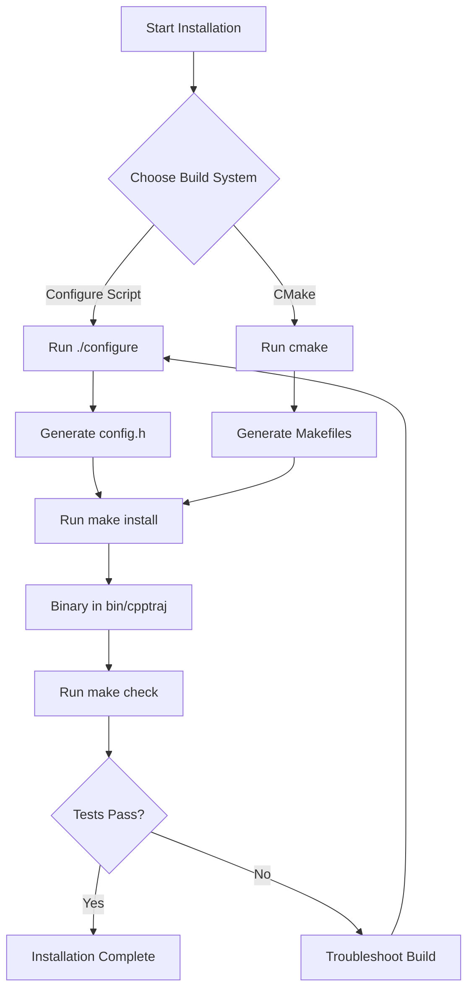

This guide provides comprehensive instructions for installing and configuring CPPTRAJ, the fast and parallelized molecular dynamics trajectory analysis program. You'll learn about system requirements, build system options, configuration parameters, and verification steps to get CPPTRAJ running efficiently on your system.

## Overview of Installation Methods

CPPTRAJ offers multiple build approaches designed to accommodate different environments and user preferences. The primary installation method uses a **configure script** that automatically detects system capabilities and generates appropriate build configurations. For users preferring modern build systems, **CMake support** is also available, providing cross-platform compatibility and integration with IDE workflows.


The build system architecture follows a modular approach where the configure script determines compiler flags, library availability, and optimization settings before generating the necessary makefiles. This process ensures that CPPTRAJ is built with optimal settings for your specific hardware and software environment.

**Sources:** [README.md](/README.md#L1-L50), [configure](/configure#L1-L50)

## System Requirements and Dependencies

### Required Libraries

CPPTRAJ relies on several external libraries for core functionality. The following table outlines these dependencies and their purposes:

| Library | Purpose | Installation Notes |
|---------|---------|-------------------|
| NetCDF | Trajectory I/O for Amber formats | Can be auto-built if missing |
| BLAS | Basic linear algebra operations | Can be auto-built or use OpenBLAS/MKL |
| LAPACK | Advanced linear algebra routines | Required for matrix operations |
| Gzip | Compressed file support | Standard on most systems |
| Bzip2 | Alternative compression format | Standard on most systems |
| C++11 Compiler | Language standard requirement | Required for PME functionality |

### Optional Libraries

Enhanced functionality requires additional libraries that CPPTRAJ can either use from your system or download and build automatically:

| Library | Purpose | Build Flag |
|---------|---------|------------|
| Parallel NetCDF | Parallel NetCDF trajectory output | Enabled with `-mpi` |
| CUDA | GPU acceleration for specific commands | `-cuda` flag |
| HIP | AMD GPU acceleration | `-hip` flag |
| FFTW | Fast Fourier transforms (PME support) | `-fftw3` flag |
| ARPACK | Sparse matrix diagonalization | Bundled with CPPTRAJ |
| helPME | Particle mesh Ewald calculations | Bundled, C++11 required |
| XDR | GROMACS XTC trajectory reading | Bundled |
| TNG | GROMACS TNG trajectory reading | Bundled |
| OpenMM | Energy minimization interface | `--with-openmm=PATH` |

**Sources:** [README.md](/README.md#L70-L100), [configure](/configure#L50-L150)

## Using the Configure Script

### Basic Configuration

The configure script provides a straightforward interface for configuring CPPTRAJ. For most Linux/Unix systems with GNU compilers, the basic command is sufficient:

```bash
./configure gnu
make install
```

This command detects available libraries and compiler settings, generating a `config.h` file that controls compilation options.

### Configuration Options

The configure script accepts numerous options to customize the build. View available options with:

```bash
./configure --help          # Basic options
./configure --full-help     # All available options
```

### Compiler Selection

Specify your compiler suite as the final argument:

| Compiler Suite | Command |
|----------------|---------|
| GNU | `./configure gnu` |
| Intel | `./configure intel` |
| PGI | `./configure pgi` |
| Clang | `./configure clang` |
| Cray | `./configure cray` |
| Intel OneAPI | `./configure oneapi` |

### Parallelization Options

Enable parallel execution based on your hardware:

| Option | Purpose | Example |
|--------|---------|---------|
| `-openmp` | Multi-threading via OpenMP | `./configure -openmp gnu` |
| `-mpi` | MPI parallelization for clusters | `./configure -mpi gnu` |
| `-intelmpi` | Use Intel MPI compilers | `./configure -intelmpi` |

**Note:** You can combine `-openmp` and `-mpi` for hybrid parallelization. Ensure `OMP_NUM_THREADS` is set appropriately (processes × threads ≤ physical cores).

**Sources:** [README.md](/README.md#L100-L120), [configure](/configure#L1-L50)

### GPU Acceleration Options

CPPTRAJ supports GPU acceleration through CUDA and HIP frameworks:

| GPU Type | Option | Environment Variable |
|----------|--------|---------------------|
| NVIDIA | `-cuda` | `CUDA_HOME` (default: `/usr/local/cuda`) |
| AMD | `-hip` | `HIP_HOME` (default: `/opt/rocm`) |

For CUDA builds, specify the compute capability using `SHADER_MODEL`:

```bash
SHADER_MODEL=sm_75 ./configure -cuda gnu  # For RTX 2070/2080
SHADER_MODEL=sm_80 ./configure -cuda gnu  # For RTX 3090/A100
SHADER_MODEL=sm_86 ./configure -cuda gnu  # For RTX 3080/4090
```

**Sources:** [configure](/configure#L50-L100)

### Library Management Options

The configure script provides flexible library management:

#### Automatic Library Building

For systems missing required libraries, CPPTRAJ can download and build them automatically:

```bash
./configure -fftw3 --buildlibs gnu    # Build missing libraries including FFTW
./configure --buildlibs gnu           # Build all missing enabled libraries
./configure --nobuildlibs gnu         # Disable library build prompts
```

#### Library Location Specification

Point to pre-installed libraries using `--with-<LIB>=<DIR>`:

```bash
./configure --with-netcdf=/opt/netcdf gnu
./configure --with-blas=/usr/local/lib gnu
```

#### Library Disabling

Disable specific libraries with `-no<LIB>`:

```bash
./configure -noarpack gnu    # Disable ARPACK
./configure -nofftw3 gnu     # Disable FFTW
```

#### Linear Algebra Frameworks

Optimized linear algebra libraries can improve performance significantly:

| Framework | Option | Notes |
|-----------|--------|-------|
| Intel MKL | `-mkl` | Requires `MKL_HOME` or `MKLROOT` |
| OpenBLAS | `-openblas` | May need `--with-blas` |
| macOS Accelerate | `-macAccelerate` | Native macOS framework |
| Cray LibSci | `-libsci` | For Cray systems |

**Sources:** [README.md](/README.md#L100-L150), [configure](/configure#L50-L150)

### Installation Directory

By default, CPPTRAJ installs to the current directory. Specify a custom location:

```bash
./configure --prefix=/path/to/install gnu
```

## CMake Build System

For users preferring CMake or requiring integration with CMake-based projects, CPPTRAJ provides comprehensive CMake support.

### Basic CMake Build

```bash
mkdir build
cd build
cmake ..
make install
```

### CMake Options

CMake provides options similar to the configure script:

```bash
# Enable/disable features
cmake -DUSE_ARPACK=ON ..
cmake -DUSE_TNG=ON ..

# Configure parallelization
cmake -DOpenMP_CXX_FOUND=ON ..
cmake -DMPI_FOUND=ON ..

# Build parallel combinations
cmake -DBUILD_PARALLEL_COMBINATIONS=ON ..
```

### Advanced CMake Configuration

CMake automatically detects available compilers and libraries. Override defaults with:

```bash
cmake -DCMAKE_CXX_COMPILER=g++ \
      -DCMAKE_C_COMPILER=gcc \
      -DNetCDF_DIR=/path/to/netcdf \
      ..
```

**Sources:** [CMakeLists.txt](/CMakeLists.txt#L1-L100)

## Installation Process

The installation workflow involves configuration, compilation, installation, and verification. The following diagram illustrates this process:



### Step-by-Step Installation

#### 1. Download and Extract

```bash
git clone https://github.com/Amber-MD/cpptraj.git
cd cpptraj
```

#### 2. Configure

Choose appropriate options based on your system:

```bash
# Basic installation
./configure gnu

# With OpenMP and FFTW
./configure -openmp -fftw3 gnu

# With MPI for clusters
./configure -mpi gnu

# Using Amber libraries
./configure -amberlib gnu

# With CUDA support
SHADER_MODEL=sm_75 ./configure -cuda gnu
```

#### 3. Build and Install

```bash
# Single-threaded build
make install

# Parallel build (recommended for multicore systems)
make -j 8 install
```

The binary will be placed in `$CPPTRAJHOME/bin/cpptraj`.

#### 4. Verify Installation

Run the test suite to verify functionality:

```bash
make check
```

For verbose output showing test errors:

```bash
make verbosecheck
```

**Sources:** [README.md](/README.md#L130-L150), [Makefile](/Makefile#L1-L46)

## Advanced Configuration Options

### Debug and Optimization

Control compilation optimization and debugging:

| Option | Purpose |
|--------|---------|
| `-debug` | Enable compiler debugging info |
| `-noopt` | Disable compiler optimization |
| `-tune` | Enable host-specific optimizations |
| `-d` | Debug info with no optimization (same as `-debug -noopt`) |
| `-timer` | Enable additional timing information |
| `-debugon` | Add `-DDEBUG` for internal debugging |

### Linking Options

Control how libraries are linked:

| Option | Purpose |
|--------|---------|
| `-static` | Use static linking for all libraries |
| `-libstatic` | Static link only specified libraries |
| `-shared` | Configure for generating libcpptraj.so |

### Special Features

Enable experimental or specialized features:

| Option | Purpose |
|--------|---------|
| `-single-ensemble` | Support single ensemble trajectory I/O |
| `-pubfft` | Use pubfft instead of FFTW (disables PME) |
| `-windows` | Configure for MinGW on Windows |
| `-profile` | GNU compiler profiling |
| `-vtune` | Intel VTune profiling support |

**Sources:** [configure](/configure#L100-L150)

## Using Amber Libraries

If you have AmberTools installed, CPPTRAJ can leverage pre-compiled libraries:

```bash
export AMBERHOME=/path/to/amber
./configure -amberlib gnu
```

This uses the BLAS, ARPACK, LAPACK, and NetCDF libraries from your Amber installation, potentially saving compilation time.

**Sources:** [README.md](/README.md#L100-L120)

## Troubleshooting Common Issues

### Library Not Found Errors

If configure cannot find a library:

```bash
# Specify library location explicitly
./configure --with-netcdf=/custom/path/to/netcdf gnu

# Or disable the library
./configure -nonetcdf gnu
```

### Linking Errors

For static linking issues, try:

```bash
./configure -static gnu
# Or static link only specific libraries
./configure -libstatic gnu
```

### Compiler Not Found

Specify compiler explicitly:

```bash
CXX=g++ CC=gcc ./configure gnu
```

### Fortran Compiler Required

Some features (ARPACK, PubFFT) require Fortran. Ensure a Fortran compiler is available:

```bash
FC=gfortran ./configure gnu
```

### Permission Issues

If you cannot install to system directories:

```bash
./configure --prefix=$HOME/cpptraj gnu
```

## Installation Verification

After installation, verify CPPTRAJ is working correctly:

```bash
# Check version
$CPPTRAJHOME/bin/cpptraj --version

# Run help
$CPPTRAJHOME/bin/cpptraj --help

# Execute basic analysis
$CPPTRAJHOME/bin/cpptraj -p test.prm -c test.rst -i basic.in
```

## Next Steps

After successful installation, proceed to these documentation sections:

- [Basic Command Line Usage](4-basic-command-line-usage) - Learn fundamental CPPTRAJ commands and syntax
- [Trajectory Formats Support](5-trajectory-formats-support-netcdf-xtc-trr-tng-dtr) - Understand different trajectory file formats
- [Overview](1-overview) - Revisit the system overview if needed
- [Quick Start](2-quick-start) - Try your first analysis

For advanced configuration and optimization:
- [OpenMP Multi-threading](29-openmp-multi-threading) - Configure multi-threaded performance
- [MPI Parallelization](30-mpi-parallelization-for-large-scale-analysis) - Set up cluster-scale analysis

**Sources:** [README.md](/README.md#L1-L150), [configure](/configure#L1-L150), [Makefile](/Makefile#L1-L46), [CMakeLists.txt](/CMakeLists.txt#L1-L100)