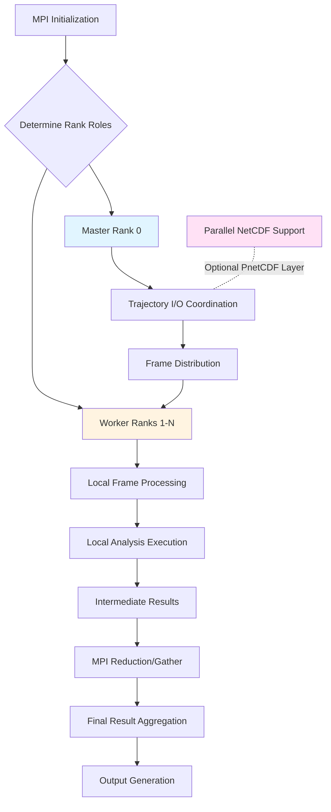
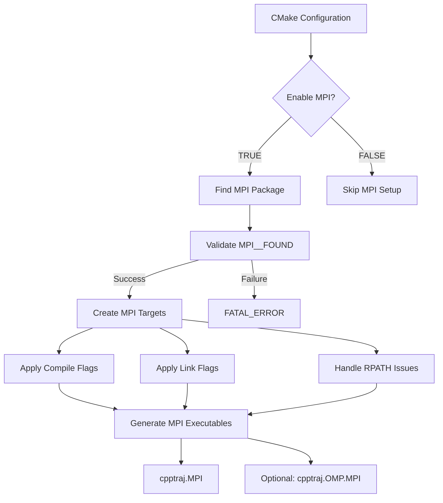
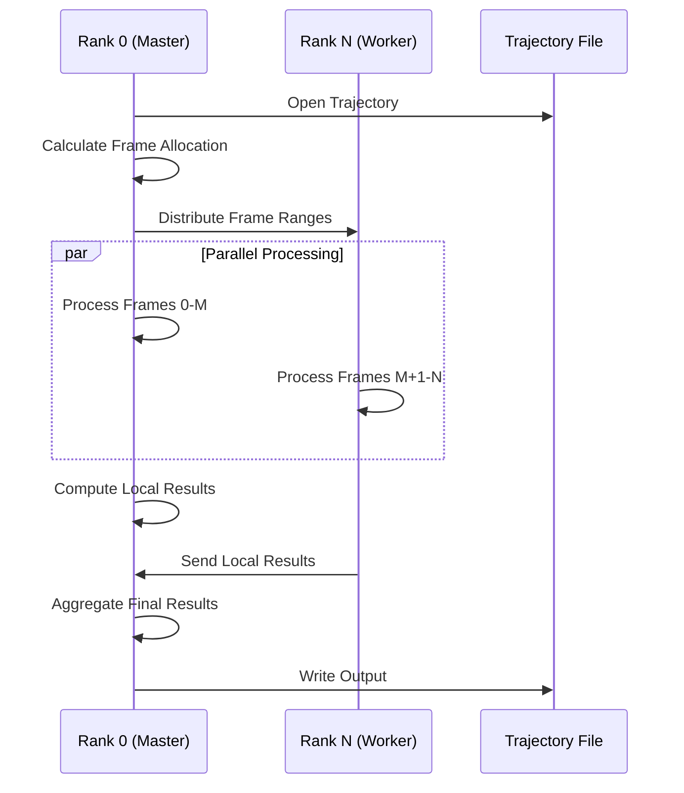
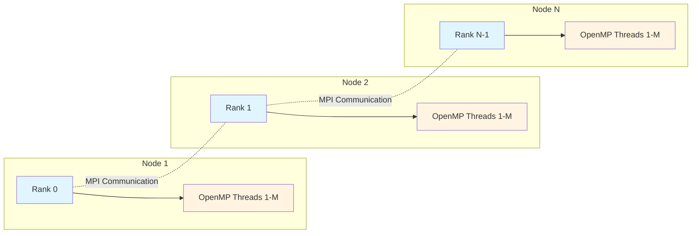

MPI (Message Passing Interface) parallelization in cpptraj enables distributed memory parallelization for analyzing large-scale molecular dynamics trajectories across multiple compute nodes. This capability is essential for processing terabyte-scale trajectory data where single-node memory or compute capacity becomes limiting. MPI parallelization distributes trajectory frames across ranks, performs independent analysis on each subset, and aggregates results efficiently, making it ideal for high-performance computing environments.

## Architecture Overview

MPI parallelization in cpptraj follows a master-worker distributed processing model with optional data aggregation patterns. The architecture supports multiple parallelization strategies that can be combined with OpenMP for hybrid parallelism.



The MPI architecture integrates with cpptraj's trajectory processing pipeline through multiple integration points. The build system generates separate MPI-enabled executables (`cpptraj.MPI`) that can be combined with other parallelization technologies. The `BUILD_PARALLEL_COMBINATIONS` CMake option controls whether hybrid variants like `cpptraj.OMP.MPI` are created [CMakeLists.txt#L84].

> [!TIP]
> When building with MPI support, ensure your MPI implementation (mpich, openmpi, or intelmpi) provides compatible compiler wrappers. The configure script automatically detects and uses `mpicc`/`mpicxx` or `mpiicc`/`mpiicpc` depending on the `-mpi` or `-intelmpi` flags [configure#L19-L20].

## Configuration and Build Setup

MPI parallelization requires specific build configuration through either the configure script or CMake build system. Both methods support standard MPI implementations and handle compiler wrapper detection automatically.

### Configure Script Options

The traditional build method uses the configure script with MPI-specific flags:

| Option | Purpose | Notes |
|--------|---------|-------|
| `-mpi` | Use mpicc/mpicxx compilers | Standard MPI wrapper detection |
| `-intelmpi` | Use mpiicc/mpiicpc compilers | Intel MPI-specific configuration |
| `-pnetcdf` | Enable Parallel NetCDF support | Required for MPI NetCDF I/O [configure#L57] |

Sources: [configure](configure#L18-L20), [configure](configure#L56-L57)

### CMake Configuration

CMake provides more granular control through dedicated MPI configuration modules:



The MPI configuration process automatically handles compiler-specific nuances:

Sources: [CMakeLists.txt](CMakeLists.txt#L47), [MPIConfig.cmake](cmake-cpptraj/MPIConfig.cmake#L3-L8)

#### MPI Target Creation

CMake's `make_mpi_version()` function automates creation of MPI-enabled variants by copying base targets and applying MPI-specific flags [MPIConfig.cmake#L160-L231]. This function:

- Copies the base target to a new MPI-specific target
- Applies MPI compile and link flags for specified languages (C, CXX, Fortran)
- Handles special cases for object libraries vs executables
- Manages installation into MPI-specific components
- Ensures proper dependency ordering

> [!TIP]
> The build system automatically removes RPATH flags from MPI link options to prevent conflicts with CMake's RPATH management [MPIConfig.cmake#L44-L115]. This is crucial for preventing library loading issues on HPC systems with non-standard installation paths.

### Library Dependencies

MPI builds require specific libraries for parallel I/O operations:

| Library | Purpose | Configuration Key | Default Status |
|---------|---------|------------------|----------------|
| Parallel NetCDF (pnetcdf) | Parallel NetCDF trajectory I/O | `pnetcdf` | off |
| NetCDF | Base NetCDF support | `netcdf` | enabled |
| MPI Runtime | Message passing infrastructure | System MPI | Required |

The Parallel NetCDF library is particularly important for large-scale analysis as it enables efficient parallel reading and writing of NetCDF trajectory files. The configure script includes dedicated testing and build support for pnetcdf [configure#L835-L881].

Sources: [configure](configure#L261-L268), [configure](configure#L835-L881)

## Parallel Processing Patterns

MPI parallelization in cpptraj implements several key patterns for distributing computational workloads across ranks. These patterns are designed to minimize communication overhead and maximize computational efficiency.

### Trajectory Distribution Pattern

The most common pattern distributes trajectory frames across available ranks:



This pattern works well for embarrassingly parallel analyses where each frame can be processed independently. The master rank coordinates I/O and result aggregation, while worker ranks focus on computational tasks.

### Data Aggregation Strategies

Different analysis types require different aggregation strategies:

| Analysis Type | Aggregation Method | MPI Collective | Communication Pattern |
|---------------|-------------------|----------------|----------------------|
| Time Series (RMSD, distances) | Vector concatenation | `MPI_Gatherv` | Many-to-One |
| Histograms | Bin-wise reduction | `MPI_Reduce` (SUM) | Many-to-One |
| Statistics (mean, std) | Accumulator reduction | `MPI_Reduce` (SUM/COUNT) | Many-to-One |
| Clustering | Local clustering + merge | `MPI_Allgather` + custom | All-to-All |

Sources: [configure](configure#L483-L499), [MPIConfig.cmake](cmake-cpptraj/MPIConfig.cmake#L160-L231)

## Advanced MPI Integration

### Parallel NetCDF I/O

Parallel NetCDF (pnetcdf) enables true parallel I/O operations where multiple ranks can read and write to the same file simultaneously. This capability significantly improves I/O performance for large trajectory files on parallel file systems.

The build system automatically detects and configures pnetcdf support:

- Tests for pnetcdf availability during configuration [configure#L835-L881]
- Links against `-lpnetcdf` when available [configure#L264]
- Defines `HAS_PNETCDF` preprocessor flag for conditional compilation [configure#L266]

Pnetcdf integration requires MPI-aware trajectory format handlers that utilize the pnetcdf API for collective I/O operations. This enables:
- Collective file opening with `ncmpi_open(MPI_COMM_WORLD, ...)` [configure#L839]
- Parallel reading of disjoint frame ranges
- Reduced I/O contention on shared file systems

### Hybrid Parallelization with OpenMP

Cpptraj supports combining MPI with OpenMP for hybrid parallelization, particularly effective on modern multi-core, multi-node HPC systems:



When `BUILD_PARALLEL_COMBINATIONS` is enabled, CMake builds hybrid executables combining both parallelization models [CMakeLists.txt#L84]. This creates executables like:
- `cpptraj.OMP` (OpenMP only)
- `cpptraj.MPI` (MPI only)
- `cpptraj.OMP.MPI` (Hybrid)

Sources: [CMakeLists.txt](CMakeLists.txt#L84), [CMakeLists.txt](CMakeLists.txt#L46-L47)

### Environment Variable Configuration

MPI execution requires proper environment variable setup for optimal performance:

| Variable | Purpose | Typical Values |
|----------|---------|----------------|
| `MPICH_MAX_THREAD_SAFETY` | Thread safety level | `multiple` |
| `MPI_THREAD_MULTIPLE` | Enable multi-threaded MPI | Required for hybrid |
| `OMP_NUM_THREADS` | OpenMP threads per rank | `#cores/#ranks` |
| `MV2_ENABLE_AFFINITY` | Process affinity (MVAPICH2) | `1` |

## Usage Examples

### Basic MPI Execution

Run a standard cpptraj analysis across 16 ranks:
```bash
mpirun -np 16 cpptraj.MPI -p system.prmtop -i analysis.in > analysis.out
```

### Hybrid MPI+OpenMP Execution

Execute with 4 ranks and 8 threads per rank (32 total cores):
```bash
export OMP_NUM_THREADS=8
mpirun -np 4 --bind-to none cpptraj.OMP.MPI -p system.prmtop -i analysis.in > analysis.out
```

### Parallel NetCDF Analysis

Process large NetCDF trajectories with parallel I/O:
```bash
mpirun -np 32 cpptraj.MPI -p system.prmtop -x trajectory.nc -i parallel_analysis.in
```

Sources: [configure](configure#L19-L20), [MPIConfig.cmake](cmake-cpptraj/MPIConfig.cmake#L8-L19)

## Performance Considerations

### Scalability Factors

MPI parallelization efficiency depends on several key factors:

| Factor | Impact | Optimization Strategy |
|--------|--------|----------------------|
| Computation-to-Communication Ratio | High ratios scale better | Choose analysis-intensive operations |
| Frame Distribution | Must balance load | Consider frame size variability |
| I/O Pattern | Critical for large trajectories | Use Parallel NetCDF when available |
| Network Bandwidth | Affects aggregation overhead | Minimize reduction operations |
| Memory per Rank | Determines feasible parallelism | Balance memory vs rank count |

### Memory Distribution

MPI parallelization provides natural memory distribution across ranks:

- Each rank loads only its assigned trajectory frames
- Local analysis uses rank-local memory
- Result aggregation typically requires minimal memory per rank
- Enables analysis of trajectories larger than single-node memory

> [!TIP]
> For optimal performance with MPI, ensure your input trajectories are organized to minimize inter-rank dependencies. Frame-based analyses scale best, while analyses requiring cross-frame correlations may need custom MPI communication patterns.

## Troubleshooting

### Common Build Issues

**Issue**: MPI compiler wrappers not found
```bash
Error: You requested MPI, but the MPI CXX library was not found
```
**Solution**: Ensure MPI is installed and compiler wrappers are in PATH, or set `MPICXX` environment variable [configure#L71-L73].

**Issue**: Parallel NetCDF linkage failures
```bash
Error: Parallel NetCDF test failed
```
**Solution**: Install pnetcdf library and specify with `-pnetcdf` or `--with-pnetcdf=<DIR>` [configure#L835-L881].

### Runtime Issues

**Issue**: Process hanging during MPI communication
**Solution**: Check for mismatched collective operations or deadlock conditions. Ensure all ranks follow identical execution paths.

**Issue**: Poor scalability with many ranks
**Solution**: Profile computation vs communication. Consider hybrid MPI+OpenMP approach to reduce MPI communication overhead.

Sources: [configure](configure#L505-L508), [MPIConfig.cmake](cmake-cpptraj/MPIConfig.cmake#L12-L14)

## Next Steps

For comprehensive parallel analysis capabilities, consider exploring:

- **[OpenMP Multi-threading](29-openmp-multi-threading)** - Learn about shared-memory parallelization for single-node optimization
- **[Trajectory Processing Pipeline](7-trajectory-processing-pipeline)** - Understand how MPI integrates with trajectory reading and analysis chains
- **[Cluster Analysis Algorithms](17-clustering-algorithms-k-means-dbscan-hierarchical)** - Explore MPI-accelerated clustering for large datasets
- **[Ensemble Analysis](27-ensemble-analysis-remd-mremd-hremd)** - See how MPI handles multiple trajectory ensembles in replica exchange analysis

These complementary parallelization strategies can be combined with MPI to achieve maximum performance on complex HPC workflows.