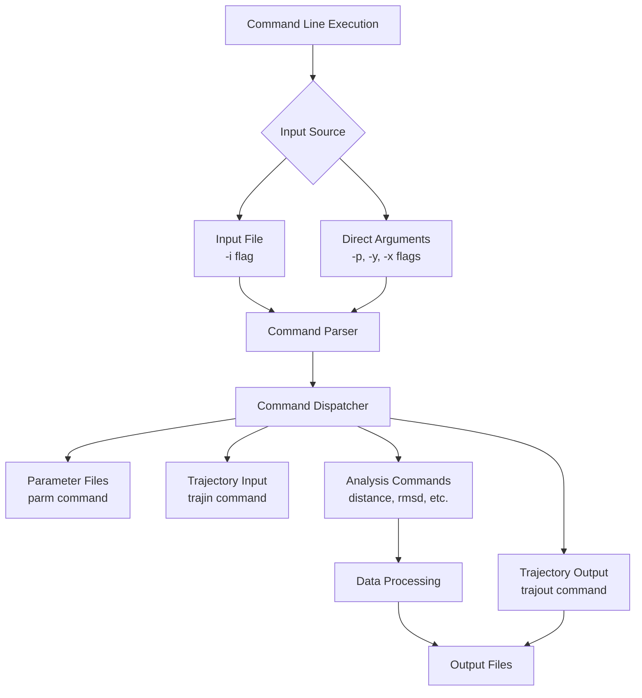
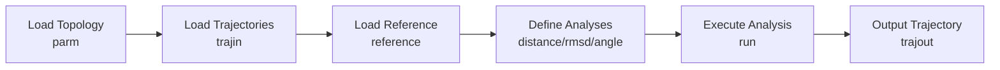

This guide introduces the fundamental command line interface patterns for CPPTRAJ, a fast, parallelized molecular dynamics trajectory data analysis program. CPPTRAJ provides flexible execution modes supporting both interactive command-line usage and scripted input files, making it suitable for both quick analyses and complex workflow automation.


## Architecture Overview

CPPTRAJ follows a command-driven architecture where operations are processed sequentially through a central dispatch system. Understanding this execution flow helps you structure your analysis workflows effectively.



## Basic Invocation Patterns

### Running CPPTRAJ with Input Files

The most common way to use CPPTRAJ is through input files containing sequences of commands. This approach provides reproducibility and enables complex analysis pipelines.

Sources: [RunTest.sh](test/Test_General/RunTest.sh#L1-L89)

**Basic syntax:**
```bash
cpptraj -i <input_file>
```

The input file contains one command per line, with each command following the pattern: `command [arguments] output <file>`. A typical input file structure includes:

```bash
noprogress                    # Suppress progress display
parm <topology_file>         # Load topology
trajin <trajectory_file>      # Load input trajectory
reference <ref_file>         # Load reference structure (optional)
<analysis_commands>          # Perform analyses
trajout <output_file>        # Write output trajectory (optional)
```

### Direct Command Line Arguments

For quick analyses, CPPTRAJ accepts essential parameters directly from the command line without creating an input file. This mode is particularly useful for single operations or batch processing.

Sources: [RunTest.sh](test/Test_CmdLine/RunTest.sh#L1-L48)

**Available command-line flags:**

| Flag | Purpose | Example |
|------|---------|---------|
| `-p` | Specify topology file | `-p tz2.parm7` |
| `-y` | Specify input trajectory | `-y tz2.nc` |
| `-ya` | Specify trajectory frame range | `-ya "2 13 3"` |
| `-x` | Specify output trajectory | `-x output.crd` |
| `-xa` | Specify output trajectory options | `-xa "title MyTitle"` |
| `-i` | Input file containing commands | `-i analysis.in` |

**Example using direct arguments:**
```bash
cpptraj -p tz2.parm7 -y tz2.nc -ya "2 13 3" -y tz2.nc -ya "98 last" -x output.crd -xa "title MyTitle"
```

This equivalent command demonstrates how file wildcards work with CPPTRAJ:

```bash
cpptraj tz2.p* cmd.in
```

Sources: [RunTest.sh](test/Test_CmdLine/RunTest.sh#L30-L42)

## Input File Structure and Commands

### Essential File Loading Commands

**Parameter/Topology Files**
The `parm` command loads molecular topology information required for atom selection and coordinate processing:

```bash
parm tz2.parm7              # Load Amber topology
parm tz2.pdb                # Load PDB as topology
parm tz2.ortho.parm7 [WAT]  # Load with label
```

Sources: [RunTest.sh](test/Test_General/RunTest.sh#L32-L36), [RunTest.sh](test/Test_RMSD/RunTest.sh#L49-L52)

**Trajectory Input**
The `trajin` command specifies trajectory files to process, with optional parameters for topology binding and frame ranges:

```bash
trajin tz2.nc                          # Load entire trajectory
trajin tz2.crd 2 13 3                  # Frames 2-13, stride 3
trajin tz2.nc 98 last                  # Frames 98 to end
trajin tz2.ortho.nc parm tz2.ortho.parm7  # With specific topology
```

Sources: [RunTest.sh](test/Test_General/RunTest.sh#L28-L29), [RunTest.sh](test/Test_General/RunTest.sh#L43-L52), [RunTest.sh](test/Test_CmdLine/RunTest.sh#L19-L24)

**Reference Structures**
Reference structures provide reference coordinates for analyses like RMSD calculations:

```bash
reference tz2.rst7                      # Load reference
reference ../tz2.nc parm tz2.parm7 1 [first]  # From trajectory, first frame
reference DPDP.nc parm DPDP.parm7      # With specific topology
```

Sources: [RunTest.sh](test/Test_General/RunTest.sh#L31), [RunTest.sh](test/Test_RMSD/RunTest.sh#L51-L54)

### Basic Analysis Commands

**Distance Measurements**
Calculate distances between atom selections or to fixed coordinates:

```bash
distance d1 :1 :2 out distance.dat              # Between atoms
distance d2 :1@CA :2@CA out distance.dat         # Specific atoms
distance ToRef @1 @1 out distance.dat reference # To reference
distance Point :1 point 0.0 0.0 0.0 out dist.dat # To coordinate
```

Sources: [RunTest.sh](test/Test_General/RunTest.sh#L27-L30), [RunTest.sh](test/Test_Distance/RunTest.sh#L14-L19)

**Angle Measurements**
Measure angles between three atoms:

```bash
angle a1 :2@CA :3@CA :4@CA out a1.dat              # Basic angle
angle a2 :2@CA :3@CA :4@CA out a2.dat.gz           # Compressed output
angle a3 :2@CA :3@CA :4@CA out a3.dat.bz2         # Bzip2 compressed
```

Sources: [RunTest.sh](test/Test_General/RunTest.sh#L33-L36)

**Dihedral Measurements**
Calculate torsion angles:

```bash
dihedral dh1 :1@C :2@N :2@CA :2@C out phi2.dat       # Single dihedral
dihedral phi3 :2@C :3@N :3@CA :3@C out PhiPsi.dat    # Multiple to same file
dihedral psi3 :3@N :3@CA :3@C :4@N out PhiPsi.dat    # Append to file
datafile PhiPsi.dat noxcol                          # Format option
```

Sources: [RunTest.sh](test/Test_General/RunTest.sh#L41-L46), [RunTest.sh](test/Test_General/RunTest.sh#L47-L48)

**RMSD Calculations**
Calculate root-mean-square deviations with various fitting options:

```bash
rmsd r1 ref tz2.rst7 out rmsd.dat                 # Basic RMSD
rmsd r1a refindex 0 out rmsda.dat                 # By reference index
rmsd r2 :1-4@C,CA,N ref tz2.rst7 :1-4@C,CA,N out r2.dat  # Atom selection
rmsd r3 :2-5@CA ref tz2.rst7 :2-5@CA out r3-nofit.dat nofit  # No fitting
rmsd r5 first out r5.dat :2-5@N,CA,C nomod        # No coordinate modification
rms Res2-11 first :2-11 out rmsd.dat              # With dataset name
```

Sources: [RunTest.sh](test/Test_General/RunTest.sh#L37-L41), [RunTest.sh](test/Test_General/RunTest.sh#L52-L58), [RunTest.sh](test/Test_RMSD/RunTest.sh#L24-L28), [RunTest.sh](test/Test_RMSD/RunTest.sh#L103-L108)

### Trajectory Output Commands

**Basic Output**
Write processed coordinates to various trajectory formats:

```bash
trajout test.crd                                  # Amber trajectory
trajout test.nc netcdf                            # NetCDF format
trajout Restart/test.rst7 restart                 # Restart format
trajout test1.crd title MyTitle                   # With title
outtraj tz2.norotate.crd parm [WAT]               # After RMSD nofit
```

Sources: [RunTest.sh](test/Test_General/RunTest.sh#L30-L32), [RunTest.sh](test/Test_CmdLine/RunTest.sh#L25), [RunTest.sh](test/Test_RMSD/RunTest.sh#L54-L55), [RunTest.sh](test/Test_RMSD/RunTest.sh#L58)

> [!TIP]
> Output trajectory formats are specified either by file extension (`.nc` for NetCDF, `.crd` for Amber text) or explicitly with keywords like `netcdf` or `restart`. Choose formats based on your downstream analysis tools and file size requirements.

## Advanced Command Patterns

### Multi-Topology Analysis

CPPTRAJ can process trajectories from multiple topologies within a single session, useful for ensemble systems or comparative analyses:

```bash
parm tz2.parm7          # Primary topology
parm tz2.pdb            # Secondary topology
trajin tz2.nc           # Associated trajectory
trajin tz2.ortho.nc parm tz2.ortho.parm7  # Different topology
```

Sources: [RunTest.sh](test/Test_General/RunTest.sh#L32-L43)

### Advanced RMSD Options

For sophisticated structural analyses, CPPTRAJ provides additional RMSD calculation modes:

```bash
# Mass-weighted RMSD with vector saving
rms Res2-11_mass first :2-11 out rmsd.mass.dat mass \
  savevectors combined vecsout vecs.dat

# RMSD to reference trajectory
rms Res2_11_traj reftraj ../tz2.truncoct.nc :2-11 out rmsd.reftraj.dat

# RMSD with rotation matrix output
rms ROT ref [first] out rms.dat @CA savematrices matricesout rmatrices.dat

# RMSD to previous frame
rms ToPrevious :2-12@CA previous out Previous.dat
```

Sources: [RunTest.sh](test/Test_RMSD/RunTest.sh#L25-L30), [RunTest.sh](test/Test_RMSD/RunTest.sh#L31-L33), [RunTest.sh](test/Test_RMSD/RunTest.sh#L57), [RunTest.sh](test/Test_RMSD/RunTest.sh#L95-L98)

### Imaging and Distance Calculations

For periodic systems, use imaging-aware distance calculations:

```bash
# With minimum image convention (default)
distance EndToEnd :1 :13 out ortho.dat

# Without imaging
distance To553_noImage ^1 :553 out ortho.553.dat noimage

# Non-orthogonal box support
parm tz2.truncoct.parm7
trajin tz2.truncoct.nc
distance To385 ^1 :385 out truncoct.385.dat
```

Sources: [RunTest.sh](test/Test_Distance/RunTest.sh#L29-L35), [RunTest.sh](test/Test_Distance/RunTest.sh#L40-L47)

## Workflow Execution Patterns

### Complete Analysis Pipeline Example

A typical CPPTRAJ session follows this logical sequence:



Sources: [RunTest.sh](test/Test_General/RunTest.sh#L27-L58)

### Practical Example Script

```bash
noprogress                      # Suppress progress output
parm tz2.parm7                 # Load topology
trajin tz2.nc                  # Load trajectory
reference tz2.rst7             # Load reference

# Perform analyses
distance d1 :1 :22 out distance.dat
rmsd r1 :2-12@CA ref tz2.rst7 out rmsd.dat
angle a1 :2@CA :3@CA :4@CA out angles.dat

# Output results
trajout aligned.crd            # Write aligned trajectory
run                            # Execute all commands
```

Sources: [RunTest.sh](test/Test_General/RunTest.sh#L26-L44), [RunTest.sh](test/Test_RMSD/RunTest.sh#L20-L32)

### Error Handling and Testing

Always validate your analyses by comparing results with known reference data. CPPTRAJ's test suite demonstrates this practice:

```bash
# Run analysis
cpptraj -i analysis.in

# Compare with reference
DoTest reference.dat output.dat
```

Sources: [RunTest.sh](test/Test_CmdLine/RunTest.sh#L26-L29), [RunTest.sh](test/Test_General/RunTest.sh#L64-L84)

> [!TIP]
> Use the `noprogress` command in scripts to produce cleaner output and improve performance for long-running analyses. For interactive sessions, omit it to monitor progress.

## Command Summary Table

| Category | Command | Purpose | Common Options |
|----------|---------|---------|----------------|
| **File I/O** | `parm` | Load topology file | `[label]` |
| | `trajin` | Load input trajectory | `[start stop stride] [parm]` |
| | `trajout` | Write output trajectory | `[format] [title]` |
| | `reference` | Load reference structure | `[parm] [frame]` |
| **Analysis** | `distance` | Calculate distances | `out <file> [noimage] [point x y z]` |
| | `angle` | Calculate angles | `out <file>` |
| | `dihedral` | Calculate torsion angles | `out <file>` |
| | `rmsd` | Calculate RMSD | `out <file> [mass] [nofit] [nomod] [savematrices]` |
| **Execution** | `run` | Execute queued commands | |
| | `noprogress` | Suppress progress display | |

Sources: [RunTest.sh](test/Test_General/RunTest.sh#L26-L58), [RunTest.sh](test/Test_RMSD/RunTest.sh#L20-L33), [RunTest.sh](test/Test_Distance/RunTest.sh#L14-L21)

## Next Steps

Now that you understand the basic command line usage, explore these related topics:

- **[Trajectory Formats Support (NetCDF, XTC, TRR, TNG, DTR)](5-trajectory-formats-support-netcdf-xtc-trr-tng-dtr)** - Learn about supported trajectory file formats and their specific handling in CPPTRAJ
- **[Atom Selection and Mask Expressions](6-atom-selection-and-mask-expressions)** - Master the powerful mask syntax for precise atom selection
- **[RMSD and RMSF Calculations](10-rmsd-and-rmsf-calculations)** - Dive deeper into structural similarity analysis techniques

For complete command reference and advanced features, consult the [official CPPTRAJ manual](https://amber-md.github.io/cpptraj/) or access interactive help with `cpptraj --help`.