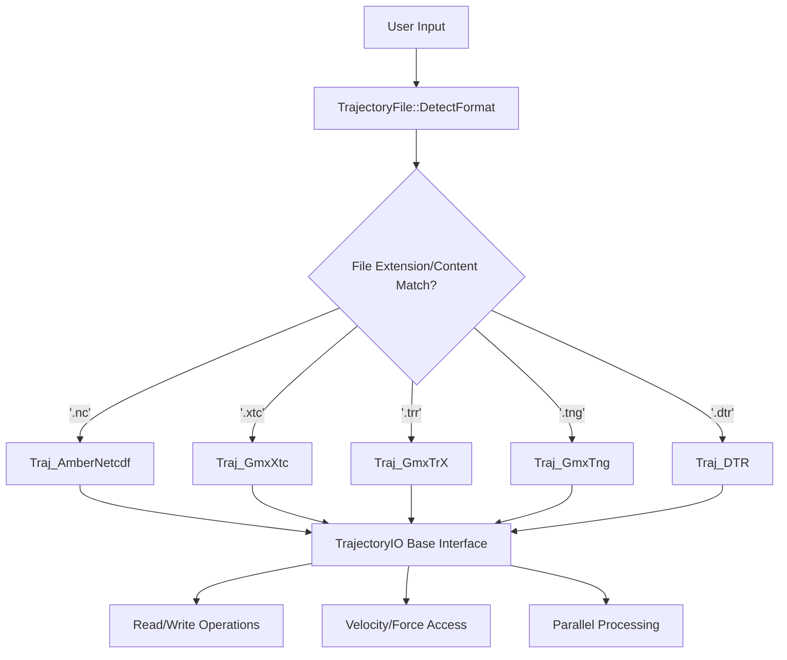
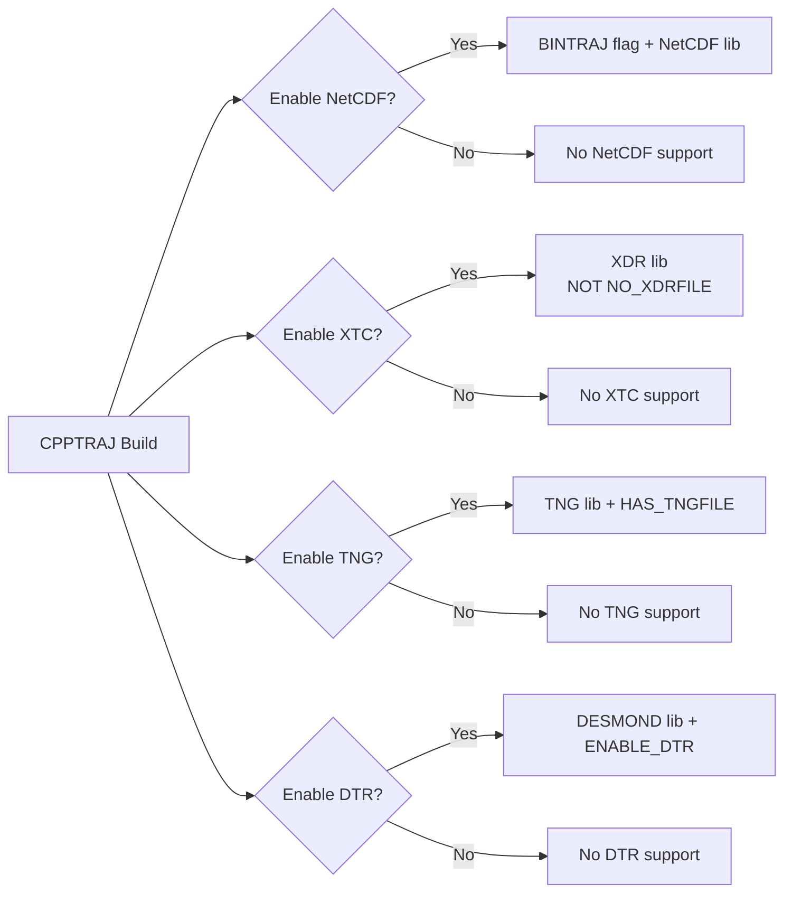

CPPTRAJ provides comprehensive support for multiple molecular dynamics trajectory formats, enabling you to work with data from different simulation packages seamlessly. This guide covers five key formats: **NetCDF** (Amber's high-performance format), **XTC/TRR** (GROMACS compressed and full-precision formats), **TNG** (GROMACS next-generation format), and **DTR** (Desmond trajectory format). Each format serves different use cases ranging from storage efficiency to full precision preservation.

## Architecture Overview

The trajectory format system in CPPTRAJ follows a modular architecture where each format inherits from a common `TrajectoryIO` base class. This design enables consistent read/write operations across different file formats while allowing format-specific optimizations. The system automatically detects file types based on extensions and file content, making it easy to work with mixed-format datasets.



## NetCDF Format

NetCDF (Network Common Data Form) is Amber's preferred trajectory format, offering excellent performance through chunked storage and optional compression. It supports coordinates, velocities, forces, and temperature data in a single self-describing file. CPPTRAJ implements NetCDF support through the `Traj_AmberNetcdf` class, which leverages the underlying NetCDF library for efficient I/O operations.

Sources: [Traj_AmberNetcdf.h](/src/Traj_AmberNetcdf.h#L8-L55)

### Key Features

| Feature | Description | Configuration |
|---------|-------------|--------------|
| **Coordinate Storage** | Double or single precision | `compress_` parameter controls compression level |
| **Velocity Support** | Optional velocity storage | `write_mdvel_` flag enables output |
| **Force Support** | Optional force storage | `write_mdfrc_` flag enables output |
| **Temperature Data** | Per-frame temperature recording | `outputTemp_` flag controls inclusion |
| **HDF5 Backend** | Modern storage with compression | `fchunkSize_` and `ishuffle_` parameters |
| **Parallel I/O** | MPI-based parallel writing | Requires `-mpi` build and Parallel NetCDF |

> [!TIP]
> NetCDF files require the `BINTRAJ` compilation flag. When using parallel NetCDF, you must also have the Parallel NetCDF library installed and build with `./configure -mpi`.

### Usage Examples

Reading NetCDF trajectories:
```
trajin production.nc
```

Writing NetCDF output with compression:
```
trajout output.nc netcdf
```

Writing with velocities and forces:
```
trajout full_data.nc netcdf velocity force
```

## XTC Format (GROMACS)

XTC is GROMACS's compressed trajectory format designed for efficient storage of coordinate data. CPPTRAJ implements XTC support through the `Traj_GmxXtc` class, which uses the XDR library for compression/decompression. XTC uses lossy compression that typically reduces file size by 3-10x while maintaining acceptable precision for most analyses.

Sources: [Traj_GmxXtc.h](/src/Traj_GmxXtc.h#L9-L54)

### Technical Characteristics

| Attribute | Value | Notes |
|-----------|-------|-------|
| **Precision** | ~0.001 nm | Lossy compression with adaptive precision |
| **File Size** | Small | 3-10x reduction compared to uncompressed |
| **Dependencies** | XDR library | Disabled if `NO_XDRFILE` is defined |
| **Supported Data** | Coordinates only | Velocities and forces not stored |
| **Random Access** | Frame offsets | Enables efficient frame seeking |

### Implementation Details

The XTC reader maintains frame offsets in `frameOffsets_` to enable random access without decompressing the entire file. The `prec_` parameter controls compression precision, with lower values producing smaller files at the cost of accuracy. The underlying XDR library handles the actual compression through the `xd_` XDRFILE handle and `vec_` coordinate buffer.

Sources: [Traj_GmxXtc.h](/src/Traj_GmxXtc.h#L43-L50)

> [!TIP]
> XTC files contain coordinate data only. If you need velocities or forces from GROMACS simulations, use TRR format instead or process velocities separately.

### Usage Examples

Reading XTC trajectories:
```
trajin md.xtc
```

Writing XTC output:
```
trajout compressed.xtc xtc
```

## TRR Format (GROMACS)

TRR (GROMACS Trajectory) is the full-precision counterpart to XTC, storing coordinates, velocities, forces, and other simulation data without compression. CPPTRAJ implements TRR support through the `Traj_GmxTrX` class, which handles both TRR and legacy TRJ formats with automatic endianness detection.

Sources: [Traj_GmxTrX.h](/src/Traj_GmxTrX.h#L6-L84)

### Comprehensive Data Support

| Data Type | Storage | Access Method |
|-----------|---------|---------------|
| **Coordinates** | Full precision | `readFrame()` / `writeFrame()` |
| **Velocities** | Full precision | `readVelocity()` |
| **Forces** | Full precision | `readForce()` |
| **Box Information** | Triclinic support | `ReadBox()` |
| **Time Step** | Float precision | `dt_` parameter |
| **Lambda** | Alchemical parameter | `lambda_` field |

### Format Detection

The `Traj_GmxTrX` class automatically identifies TRR files using a magic number and version string. The `DetermineEndian()` method handles cross-platform compatibility by detecting and correcting byte order differences. This ensures TRR files written on little-endian systems can be read on big-endian systems and vice versa.

Sources: [Traj_GmxTrX.h](/src/Traj_GmxTrX.h#L14-L15), [Traj_GmxTrX.h](/src/Traj_GmxTrX.h#L53-L54)

### Memory Management

TRR files use temporary arrays `farray_` (float) and `darray_` (double) for coordinate conversion, with `arraySize_` tracking the total number of coordinate elements (natoms × 3). The frame size calculation in `frameSize_` enables efficient seeking within the file.

Sources: [Traj_GmxTrX.h](/src/Traj_GmxTrX.h#L76-L81)

### Usage Examples

Reading TRR with velocities:
```
trajin md.trr
```

Reading only coordinates from TRR:
```
trajin md.trr nobox
```

Writing TRR output:
```
trajout output.trr trr
```

## TNG Format (GROMACS)

TNG (Trajectory Next Generation) is GROMACS's modern trajectory format designed for high-performance I/O and extensive data storage. CPPTRAJ implements TNG support through the `Traj_GmxTng` class, which interfaces directly with the TNG compression library. TNG supports lossless and lossy compression with user-configurable precision levels.

Sources: [Traj_GmxTng.h](/src/Traj_GmxTng.h#L8-L64)

### Advanced Features

| Feature | Capability | Implementation |
|---------|------------|----------------|
| **Multi-block Storage** | Flexible data organization | `blockIds_` vector manages active blocks |
| **Frame Seeking** | Efficient random access | `current_frame_` and `current_set_` tracking |
| **Coordinate Scaling** | Unit conversion support | `tngfac_` scaling factor |
| **Frame Sets** | MD step vs trajectory frame distinction | `tngframes_` vs `tngsets_` separation |
| **Block Pre-fetching** | Optimized I/O performance | `next_nblocks_` and `next_blockIDs_` caching |

### TNG-specific Architecture

Unlike other formats, TNG organizes data into logical blocks rather than simple frame sequences. The `getNextBlocks()` method retrieves block information for upcoming frames, while `readValues()` extracts specific data types from identified blocks. The `values_` buffer provides temporary storage for coordinate data during conversion.

Sources: [Traj_GmxTng.h](/src/Traj_GmxTng.h#L42-L45)

### Precision Control

The `convertArray()` method handles coordinate conversion between double (CPPTRAJ internal) and float (TNG storage) precision with configurable scaling factors. This enables users to balance file size against numerical precision based on analysis requirements.

Sources: [Traj_GmxTng.h](/src/Traj_GmxTng.h#L42)

> [!TIP]
> TNG format support requires the `HAS_TNGFILE` preprocessor definition. Ensure the TNG library is installed before building CPPTRAJ with TNG support.

### Usage Examples

Reading TNG trajectories:
```
trajin md.tng
```

Writing TNG with custom compression:
```
trajout output.tng tng precision 1000
```

## DTR Format (Desmond)

DTR is DESMOND's trajectory format, designed for high-performance molecular dynamics simulations. CPPTRAJ implements DTR support through the `Traj_DTR` class, which uses DESMOND's molfile plugin library for I/O operations. DTR files store coordinates and velocities in a compressed binary format optimized for large-scale simulations.

Sources: [Traj_DTR.h](/src/Traj_DTR.h#L7-L47)

### Implementation Details

| Component | Description | Purpose |
|-----------|-------------|---------|
| **FrameSetReader** | DESMOND library interface | Handles low-level DTR parsing |
| **fbuffer_** | Float coordinate buffer | Temporary storage for coordinate/velocity data |
| **bufsize_** | Buffer size management | Tracks allocated memory |

### Build Requirements

DTR format support requires the `ENABLE_DTR` compilation flag and DESMOND's molfile library. The implementation delegates all file operations to the `FrameSetReader` object, which manages the complex DTR file structure internally.

Sources: [Traj_DTR.h](/src/Traj_DTR.h#L41-L44)

### Usage Examples

Reading DTR trajectories:
```
trajin desmond_output.dtr
```

## Format Comparison and Selection

Choosing the right trajectory format depends on your specific needs regarding storage efficiency, data completeness, and interoperability.

### Format Decision Matrix

| Scenario | Recommended Format | Rationale |
|----------|-------------------|-----------|
| **Long-term Amber simulations** | NetCDF | Best compression with full data support |
| **GROMACS analysis workflows** | XTC | Efficient storage, GROMACS-native |
| **Full-precision GROMACS data** | TRR | Complete coordinate/velocity/force data |
| **Large-scale GROMACS I/O** | TNG | Modern format with advanced compression |
| **DESMOND compatibility** | DTR | Native format, maintains metadata |
| **Cross-package compatibility** | NetCDF or TRR | Widely supported across MD packages |

### Performance Characteristics

| Format | Read Speed | Write Speed | File Size | Random Access |
|--------|------------|-------------|-----------|---------------|
| NetCDF | Fast | Fast | Small | Excellent |
| XTC | Medium | Medium | Very Small | Good |
| TRR | Fast | Fast | Large | Excellent |
| TNG | Fast | Fast | Variable | Good |
| DTR | Medium | Medium | Small | Medium |

## Configuration and Build Requirements

### Compilation Flags

Different trajectory formats require specific compilation flags and external libraries:



### Build Configuration Examples

Enable all trajectory formats:
```bash
./configure --with-netcdf --with-xdr --with-tng --with-dtr gnu
make
```

Build with only NetCDF and XTC support:
```bash
./configure --with-netcdf --with-xdr gnu
make
```

Parallel build with NetCDF:
```bash
./configure -mpi --with-pnetcdf gnu
make
```

## Common Workflow Patterns

### Converting Between Formats

Converting GROMACS to Amber NetCDF:
```
parm topol.top
trajin md.xtc
trajout amber_traj.nc netcdf
run
```

Extracting specific data from TRR:
```
parm topol.top
trajin md.trr
trajout coordinates_only.nc netcdf nobox
velocity out velocity.dat
run
```

Merging multiple trajectory files:
```
parm topol.top
trajin part1.xtc
trajin part2.xtc
trajin part3.xtc
trajout combined.nc netcdf
run
```

### Format-Specific Operations

Reading only frames 100-200 from NetCDF:
```
trajin production.nc 100 200
```

Writing XTC with custom precision:
```
trajout output.xtc xtc precision 1000
```

Processing velocities from TRR:
```
trajin md.trr
velocity out vel.dat
run
```

## Next Steps

Now that you understand trajectory format support in CPPTRAJ, you can explore more advanced topics:

- **[Trajectory Processing Pipeline](7-trajectory-processing-pipeline)** - Learn how to chain multiple trajectory operations efficiently
- **[Basic Command Line Usage](4-basic-command-line-usage)** - Master CPPTRAJ command syntax and workflow organization
- **[Installation and Configuration](3-installation-and-configuration)** - Detailed build instructions for enabling specific format support
- **[Coordinate Transformations](8-coordinate-transformations-rmsd-alignment-rotation)** - Apply transformations to trajectory data regardless of format

Each format provides unique advantages depending on your simulation workflow. By understanding the strengths and limitations of NetCDF, XTC, TRR, TNG, and DTR formats, you can optimize your data management strategy for maximum efficiency and compatibility.