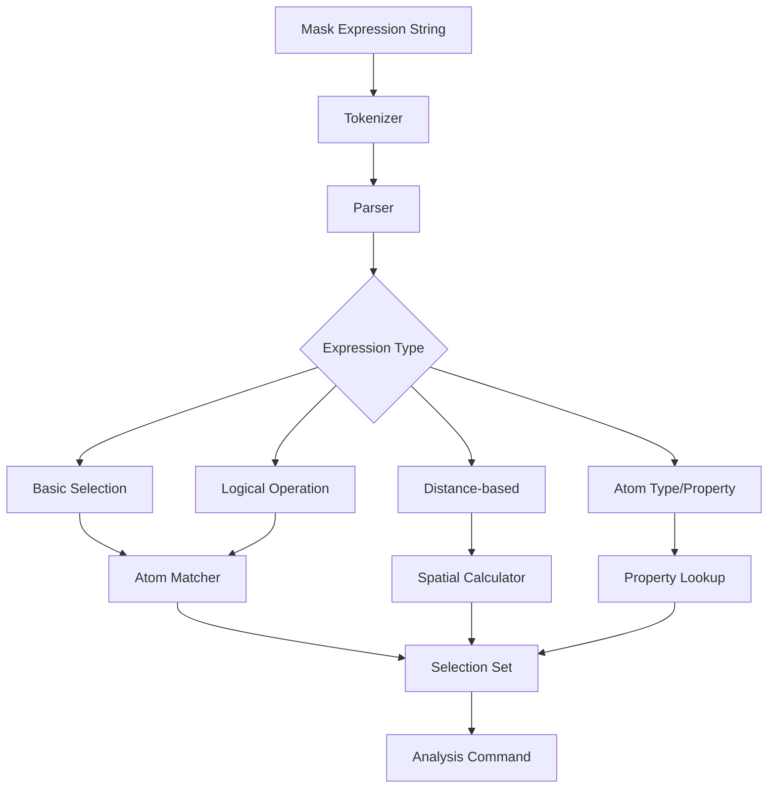

Mask expressions form the foundational query language for atom selection in cpptraj, enabling precise targeting of atoms, residues, and molecular features for trajectory analysis. These expressions provide a flexible syntax for defining subsets of atoms that serve as input to analysis commands, coordinate operations, and statistical calculations. Understanding mask expressions is essential for performing any meaningful molecular dynamics analysis in cpptraj.

## Architecture of the Mask Selection System

The mask expression system operates as a hierarchical parsing and evaluation engine that translates string-based queries into atom selection sets. This system integrates with topology information, coordinate data, and spatial calculations to resolve selections at runtime.



The mask processor handles three primary selection categories: **topology-based selections** (residues, atoms by name/number), **spatial selections** (distance-based queries), and **property selections** (atom types, charges). These can be combined using logical operators to create complex multi-criteria selections.

Sources: [RunTest.sh](test/Test_Mask/RunTest.sh#L1-L42), [RunTest.sh](test/Test_AtomTypeSelect/RunTest.sh#L1-L23)

## Basic Selection Syntax

### Atom Selection Patterns

Atom-level selections use the `@` prefix followed by atom identifiers:

- **Atom names**: `@CA`, `@NZ`, `@O` - selects atoms by their PDB-style names
- **Atom numbers**: `@1-100` - selects atoms by 1-based index range
- **Atom types**: `@%CT`, `@%N` - selects atoms by force field type using the `%` modifier

Residue-level selections use the `:` prefix:

- **Residue names**: `:WAT`, `:ALA` - selects all atoms in residues matching the 3-4 character name
- **Residue numbers**: `:5`, `:10-20` - selects atoms by 1-based residue index
- **Wildcards**: `:A*` - selects residues matching name patterns

These basic selectors form the building blocks for more complex expressions.

Sources: [RunTest.sh](test/Test_AtomTypeSelect/RunTest.sh#L1-L23)

## Logical Operators and Expression Composition

Mask expressions support boolean logic for combining multiple selection criteria:

### Operator Hierarchy

| Operator | Description | Example | Result |
|----------|-------------|---------|--------|
| `&` | AND (intersection) | `:WAT & @O` | Oxygen atoms in water molecules |
| `\|` | OR (union) | `:ALA \| :GLY` | Atoms in alanine or glycine |
| `!` | NOT (complement) | `!:WAT` | All non-water atoms |
| `()` | Grouping | `(:1-10) & (@CA \| @CB)` | Alpha or beta carbons in residues 1-10 |

Operator precedence follows standard boolean logic, with parentheses used to override default evaluation order and create nested expressions.

**Practical Example**: The expression `(:8@NZ <:3.0) & :WAT@O` selects water oxygen atoms within 3.0 Å of the NZ atom in residue 8. This combines three selection criteria connected by AND operators, with parentheses ensuring the distance criterion applies specifically to the NZ atom.

Sources: [RunTest.sh](test/Test_Mask/RunTest.sh#L18-L36)

## Distance-Based Selections

Spatial selections enable querying atoms based on geometric relationships, essential for analyzing local environments, binding sites, and solvent interactions.

### Distance Syntax

Distance-based selections use the `<`, `<=`, `>`, `>=`, or `==` operators followed by a distance value in Angstroms:

- **Example**: `(:5 <:3.0)` selects atoms within 3.0 Å of residue 5
- **Example**: `@1 >5.0 @2` selects atom 1 more than 5.0 Å from atom 2

The `<:3.0` syntax represents "less than 3.0 Å from the preceding selection target."

> [!TIP]
> Distance selections are evaluated for each frame using current coordinates, making them dynamic selections that update as the system evolves during trajectory analysis. This enables tracking of changing molecular environments over time.

Distance calculations respect periodic boundary conditions when defined in the topology, ensuring accurate minimum image conventions in solvated systems.

Sources: [RunTest.sh](test/Test_Mask/RunTest.sh#L14-L18)

## Mask Command and Output Options

The `mask` command applies mask expressions and provides various output formats for visualizing and analyzing selections.

### Command Syntax

```
mask "<expression>" [maskout <file>] [maskpdb <prefix>] [maskmol2 <file>] [name <dataset>] [out <file>] [nselectedout <file>]
```

### Output Options

| Option | Description | Output Format |
|--------|-------------|---------------|
| `maskout` | Write selection details | Text file with frame, atom number, atom name, residue info |
| `maskpdb` | Write selected atoms | PDB file with coordinate snapshot |
| `maskmol2` | Write selected atoms | MOL2 format file |
| `name` | Create dataset | Named selection for downstream analysis |
| `out` | Write time series | Mask selection values over frames |
| `nselectedout` | Write atom counts | Number of selected atoms per frame |

**Example Usage**:
```
mask "(:5 <:3.0) & :WAT" maskout mask.out maskpdb mask.pdb trajargs 'chainid " "'
```

This command identifies water molecules within 3.0 Å of residue 5, outputs the atom list to `mask.out`, and writes a PDB file of the selected atoms with chain ID formatting.

Sources: [RunTest.sh](test/Test_Mask/RunTest.sh#L14-L24), [mask.out.save](test/Test_Mask/mask.out.save#L1-L32)

## Selection Output Interpretation

The `maskout` file provides detailed information about selected atoms in tabular format:

```
#Frame    AtomNum Atom   ResNum  Res   MolNum
       1     1076 O         299 WAT       287
       1     1077 H1        299 WAT       287
       1     1078 H2        299 WAT       287
```

This output shows:
- **Frame**: Trajectory frame number
- **AtomNum**: Global atom index in topology
- **Atom**: Atom name
- **ResNum**: Residue number
- **Res**: Residue name
- **MolNum**: Molecule number

> [!TIP]
> For multi-frame selections, the output contains entries for each frame, enabling tracking of selection changes throughout the trajectory. The `nselectedout` option creates a simplified time series of selection counts.

Sources: [mask.out.save](test/Test_Mask/mask.out.save#L1-L32)

## Advanced Selection Patterns

### Combined Criteria Selections

Complex selections often require combining multiple criteria:

**Residue-atom combinations**: `:1-10@CA` - CA atoms in residues 1-10

**Property filters**: `@%CT & @H` - Hydrogen atoms with CT type

**Spatial exclusion**: `(:Protein <5.0) & !:Protein` - Non-protein atoms within 5 Å of protein

**Chain-specific selections**: When trajectory data includes chain identifiers, selections can be refined using chain information (evidenced by the `trajargs 'chainid " "'` option in mask commands).

### Dynamic Selection Datasets

Named masks can be used as datasets for time-resolved analysis:

```
mask "(:8@NZ <:3.0) & :WAT@O" name M out M.dat nselectedout Nselected.dat
```

This creates a time series tracking the number of water oxygens within 3.0 Å of the NZ atom, stored in `M.dat` and `Nselected.dat`. Such datasets can feed into subsequent analysis like correlation functions or lifetime calculations.

Sources: [RunTest.sh](test/Test_Mask/RunTest.sh#L27-L36)

## Performance Considerations

**Selection caching**: Repeated mask expressions across commands are cached when possible, improving performance for large trajectories.

**Spatial indexing**: Distance-based selections benefit from spatial data structures, making selections like `@1 <:5.0` efficient even for large systems.

**Expression optimization**: The parser optimizes expressions by combining adjacent selections and eliminating redundant operations.

> [!TIP]
> For extremely large selections or complex distance queries, consider pre-selecting a reduced subset before applying distance criteria. For example, select water molecules first (`:WAT`), then apply distance filters rather than computing distances for all atoms.

## Common Use Cases

### Solvent Shell Analysis

Select water molecules around a solute:
```
mask ":Ligand <:4.0 & :WAT" maskout first_shell.out
```

### Active Site Definition

Select residues within binding pocket:
```
mask "(:Residue1@CA <:6.0) | (:Residue2@CA <:6.0)" name pocket
```

### Backbone Atoms
```
mask ":1-100@N,CA,C,O" name backbone
```

### Hydrogen Bond Analysis
Select potential hydrogen bond donors and acceptors:
```
mask "@N,@O & @H" name donors
mask "@N,@O & !@H" name acceptors
```

## Summary of Mask Expression Syntax

| Category | Syntax Pattern | Example |
|----------|----------------|---------|
| Atom name | `@<name>` | `@CA` |
| Atom number | `@<num>` or `@<start>-<end>` | `@1-100` |
| Atom type | `@%<type>` | `@%CT` |
| Residue name | `:<name>` | `:WAT` |
| Residue number | `:<num>` or `:<start>-<end>` | `:1-10` |
| Distance | `<selection> <op> <distance>` | `@1 <:3.0` |
| AND | `&` | `:WAT & @O` |
| OR | `\|` | `:ALA \| :GLY` |
| NOT | `!` | `!:H` |

## Next Steps

Mastering mask expressions enables effective use of all cpptraj analysis commands. For trajectory-wide applications of selections, explore [Trajectory Processing Pipeline](7-trajectory-processing-pipeline). When selections inform coordinate comparisons, see [Coordinate Transformations](8-coordinate-transformations-rmsd-alignment-rotation). For statistical analysis using selections, proceed to [RMSD and RMSF Calculations](10-rmsd-and-rmsf-calculations).

Understanding mask expression syntax provides the foundation for nearly all cpptraj operations, from basic filtering to advanced ensemble analysis.