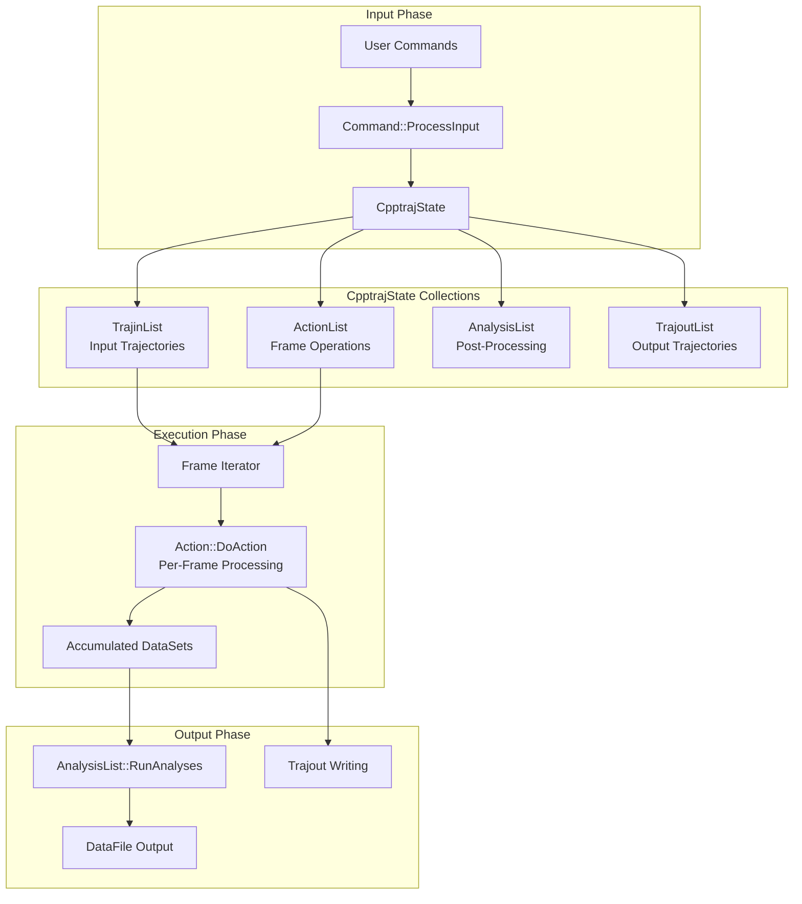
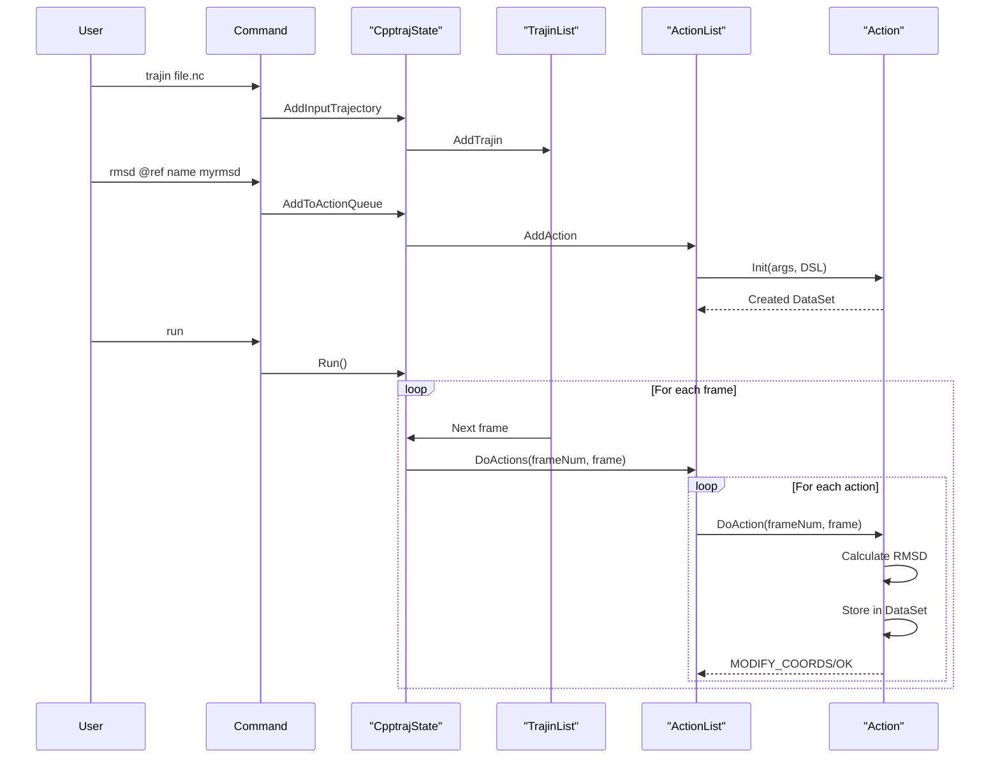

The trajectory processing pipeline in cpptraj represents the core architectural framework that orchestrates how molecular dynamics trajectory data flows through the system from input files through various analysis operations to final output. This pipeline embodies a modular, command-driven design that enables flexible composition of analysis operations while maintaining efficient execution through batch processing of frames.

Sources: [Command.h](src/Command.h#L1-L49), [CpptrajState.h](src/CpptrajState.h#L12-L131)

## Core Architecture Overview

At its foundation, the trajectory processing pipeline centers on three primary components working in concert: the **CpptrajState** (the global coordinator), the **Command** dispatcher (execution orchestrator), and the **ActionList** (frame processing engine). The CpptrajState maintains all collections—including input trajectories (TrajinList), output trajectories (TrajoutList), actions (ActionList), and analyses (AnalysisList)—while the Command dispatcher interprets user input and routes operations to appropriate handlers.

The pipeline follows a declarative programming model where users specify a sequence of operations through commands. These commands populate the CpptrajState's various lists without immediately executing on data. This separation of specification from execution enables cpptraj to optimize memory usage, validate configurations before processing begins, and support advanced features like ensemble processing and parallel execution.

Sources: [CpptrajState.h](src/CpptrajState.h#L102-L108), [Command.h](src/Command.h#L1-L49)

## Command Dispatch and State Population

The pipeline begins when the Command dispatcher receives user input through either command-line arguments or input files. The `Command::ProcessInput` method reads commands sequentially, parsing each line into an `ArgList` and dispatching through `Command::Dispatch` to locate the appropriate command handler. Each command is associated with a specific destination type (trajectory input, action, analysis, etc.) and triggers methods on CpptrajState that populate corresponding collections.

Critical to this phase is the fact that commands accumulate state without processing data. For example, `trajin` commands add trajectories to `TrajinList`, `rmsd` commands instantiate and add `Action_Rmsd` objects to `ActionList`, and `run` triggers the actual processing phase. This accumulation enables cross-command validation—actions can verify that required reference structures exist before frame processing begins.

The command system supports sophisticated control flow through **control blocks** (if/else, while loops), allowing conditional trajectory processing and dynamic action modification based on runtime conditions. Control blocks maintain their own state, enabling nested and iterative processing patterns while preserving the declarative nature of the overall pipeline.

Sources: [Command.h](src/Command.h#L16-L49), [CpptrajState.h](src/CpptrajState.h#L49-L61)

## Frame Processing Loop

When all commands have been processed and the pipeline is fully specified, the `CpptrajState::Run` method initiates the frame processing loop. This loop iterates through frames from all trajectories in TrajinList, applying each action in ActionList to every frame. The processing follows a three-phase pattern for each action: initialization, setup, and execution.

During the **initialization phase** (Action::Init), each action receives its user arguments, creates necessary DataSets, and establishes DataFile connections. This phase occurs once per action and validates that all parameters are correctly specified. The **setup phase** (Action::Setup) occurs after topology loading but before frame processing begins, allowing actions to prepare topology-specific information such as atom masks or mass arrays.

The **execution phase** (Action::DoAction) is called for every frame. Actions receive both the frame number and a mutable Frame object, enabling coordinate modifications, property calculations, and data accumulation. Actions communicate their processing outcomes through return codes—OK for successful processing, MODIFY_COORDS to indicate coordinate changes, or SKIP to signal that subsequent frames should also skip this action.

> [!TIP]
> The three-phase action lifecycle (Init → Setup → DoAction) separates configuration concerns from topology-specific preparation and per-frame computation. This design enables actions to cache topology-derived data structures during Setup, avoiding repeated calculations in the performance-critical DoAction method.

Sources: [Action.h](src/Action.h#L42-L53), [ActionList.h](src/ActionList.h#L14-L24)

## Action Chaining and Data Flow

Actions in the pipeline execute sequentially within each frame, with each action receiving the Frame object as modified by previous actions. This chaining enables sophisticated workflows where early actions prepare data for later operations. For example, an `autoimage` action might first re-center molecules in periodic boundary conditions, followed by an `rmsd` action that aligns to a reference structure, concluding with a `strip` action that removes solvent atoms before coordinate output.

The ActionList maintains each action's status through an enum tracking initialization state (NO_INIT, INIT, SETUP, INACTIVE). This status tracking enables efficient handling of topology changes—if an action returns MODIFY_TOPOLOGY, subsequent actions are automatically reset to SETUP status, forcing re-initialization with the new topology.

Actions communicate primarily through two mechanisms: coordinate modifications in the shared Frame object and DataSet accumulation for later analysis. This dual communication pattern supports both transient frame-level operations (like centering or rotation) and persistent data collection (like RMSD values or distance measurements). DataSets remain associated with the CpptrajState's DataSetList throughout execution, providing a repository for all analysis results.

Sources: [Action.h](src/Action.h#L32-L39), [ActionList.h](src/ActionList.h#L50-L59), [CpptrajState.h](src/CpptrajState.h#L102-L103)

## Parallel Processing Architecture

The trajectory processing pipeline supports multiple parallelization strategies through compile-time options (OpenMP, MPI, CUDA). The core pipeline design abstracts parallel execution details through the Action interface, with specific methods for synchronization and parallel-specific operations.

In **OpenMP** mode, the frame processing loop parallelizes across frames using shared memory. Each thread processes a subset of frames independently, with actions responsible for thread-safe DataSet accumulation. This approach provides near-linear scaling for computationally intensive actions that are not memory-bandwidth limited.

**MPI parallelization** operates at a higher level, distributing either trajectories across ranks (trajectory parallelism) or ensemble members across ranks (ensemble parallelism). Trajectory parallelism partitions the total frame count among processes, with each process handling a disjoint subset. The `Action::SyncAction` method collects data from all ranks at the end of processing, combining results through either summation or averaging depending on the analysis type. Ensemble parallelism processes multiple trajectories simultaneously, each rank handling one ensemble member, enabling efficient analysis of replica exchange simulations.

> [!TIP]
> MPI trajectory parallelism requires special handling for actions that need context from multiple frames. The `Action::ParallelPreviousFramesRequired` method allows actions to specify how many preceding frames they need, enabling the framework to preload boundary frames for correct processing on non-master ranks.

Sources: [CpptrajState.h](src/CpptrajState.h#L92-L98), [Action.h](src/Action.h#L54-L63)

## Execution Modes: Normal vs Ensemble

Cpptraj operates in two distinct trajectory processing modes: **NORMAL mode** processes trajectories sequentially, while **ENSEMBLE mode** processes multiple trajectories simultaneously as a collection. The mode determination occurs automatically based on input commands—if ensemble input is specified, the system configures for ensemble processing.

In NORMAL mode, the frame loop iterates through frames from each trajectory in sequence, with actions operating on single Frame objects. In ENSEMBLE mode, the frame loop advances all trajectories simultaneously, with actions receiving Frame arrays representing the current frame from each ensemble member. This design enables ensemble-specific analyses like calculating ensemble-averaged properties or performing clustering across multiple trajectories.

The mode affects execution timing and resource management. Ensemble processing typically requires more memory (holding multiple frames simultaneously) but enables calculations that would be impossible in sequential processing. The CpptrajState tracks the current mode and dispatches to specialized execution methods (`RunNormal` vs `RunEnsemble`) that implement the appropriate loop structure.

Sources: [CpptrajState.h](src/CpptrajState.h#L16-L17), [CpptrajState.h](src/L90-L91)

## Pipeline Performance Considerations

The trajectory processing pipeline optimizes performance through several architectural decisions. The separation of command specification from execution enables bulk allocation of DataSets and preprocessing of topology information, avoiding per-frame memory allocation overhead. Action setup occurs once per topology rather than per frame, allowing precomputation of expensive operations like mask expansion or mass array creation.

Frame processing minimizes data copying through reference passing where possible. The Frame object maintains coordinates in contiguous memory, facilitating cache-friendly access patterns during coordinate operations. Actions that modify coordinates communicate this through return codes, enabling the pipeline to optimize subsequent processing—if no coordinate modification occurs, downstream actions can avoid unnecessary coordinate transformations.

The pipeline also includes optional progress reporting through the `showProgress_` flag in CpptrajState, providing frame-by-frame feedback for long-running analyses without requiring debugger interruption. Progress reporting uses percentage completion estimates based on known frame counts from TrajinList, enabling accurate time estimates for predictable workloads.

Sources: [CpptrajState.h](src/CpptrajState.h#L110-L118), [TrajinList.h](src/TrajinList.h#L33-L34)

## Error Handling and Recovery

The pipeline implements a multi-level error handling strategy designed to balance robustness with early failure detection. Individual actions can signal non-fatal errors through the SKIP return code, causing the action to be marked inactive for the remainder of the current trajectory while allowing other actions to continue processing. This enables graceful handling of transient issues like missing frames or temporary calculation failures.

Fatal errors during action initialization or setup propagate through the CpptrajState's `exitOnError_` flag. When set, errors cause immediate pipeline termination; when unset, the system logs errors and continues execution. The `noEmptyRun_` flag prevents processing when no actions or output trajectories are specified, avoiding wasted computation in misconfigured runs.

The command processor includes special handling for control block errors, with unmatched control structures (unclosed loops or if statements) triggering errors before execution begins. This validation prevents runtime errors from malformed control structures that would be difficult to diagnose during frame processing.

Sources: [Action.h](src/Action.h#L32-L39), [CpptrajState.h](src/CpptrajState.h#L20-L23), [CpptrajState.h#L114-L115)

## Post-Processing and Output

After all frames are processed, the pipeline enters the post-processing phase where `Action::Print` methods are called and analyses are executed. The Print phase enables actions to perform calculations that require the complete dataset (like running averages or statistical summaries) and to write output not managed through the DataSet system.

The AnalysisList then processes all queued analyses through `CpptrajState::RunAnalyses`. Analyses operate on accumulated DataSets rather than individual frames, enabling operations like time series analysis, correlation functions, and statistical summaries. The separation between actions (per-frame operations) and analyses (post-frame calculations) provides a clean conceptual boundary for building complex workflows.

Finally, `CpptrajState::MasterDataFileWrite` iterates through all DataFiles in DataFileList, triggering DataSet writing to disk. This deferred writing enables DataSets to be modified by multiple analyses and supports output formatting optimizations that would be impossible with incremental writing during frame processing.

Sources: [CpptrajState.h](src/CpptrajState.h#L54-L71), [CpptrajState.h#L70-L71)

## Integration Points and Extensions

The trajectory processing pipeline provides multiple extension points for developers. New actions are created by inheriting from the Action base class and implementing the four required methods (Init, Setup, DoAction, Print). The `ReferenceAction` helper class simplifies reference structure handling for coordinate-based actions like RMSD or distance calculations.

The DispatchObject system enables dynamic command registration at program startup, allowing modular command addition without modifying core dispatch logic. Actions register themselves through the `AddCmd` method during program initialization, specifying their command name, help text, and allocator function.

For advanced users, the pipeline supports external integration through **Pytraj**, the Python interface that wraps the core C++ functionality. Pytraj exposes the trajectory processing pipeline as Python objects, enabling programmatic pipeline construction and integration with scientific Python ecosystems. This external interface maintains architectural consistency with the command-line version while providing additional flexibility for Python-based workflows.
